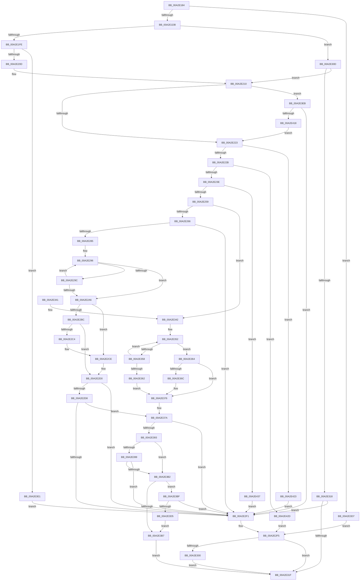

# SshpGenerateDeviceFriendlyName

- RVA: `0x00A2E184`–`0x00A2E441` (길이 `701` bytes)
- VA: `0x0000000140A2E184`
- 실행 섹션: `PAGE`
- PDB 이름 있음: `예`; PDB Function 태그: `아니요`
- unwind 정보 RVA: `0x000AC8CC`
- 디코드: `198`개 명령, `701/701` bytes 표시
- 미해석 바이트: `0` (있으면 어셈블리에 `.byte`로 보존)

> 이 문서는 커널 이미지의 기계어와 PDB 기호를 분석해 생성했습니다. 4번과 5번은 함수 원형과 자료형을 바이너리 사용 방식에서 추정한 C 해석이며 원본 소스 복구 결과는 아닙니다.

## 1. Dependencies

- 직접 호출 지점: **10**; 고유 호출 대상: **7**
- 직접 호출자로 확인된 함수: **3**
- RIP 상대 이미지 참조: **4**

### Outgoing calls
- `0x00A2E1EC` → [IoGetDeviceProperty](../8F/IoGetDeviceProperty_function_008FA720.md) (function, `0x008FA720`)
- `0x00A2E248` → [ExAllocatePool2](../../poolcode/B8/ExAllocatePool2_function_00B820F0.md) (function, `0x00B820F0`)
- `0x00A2E277` → [IoGetDeviceProperty](../8F/IoGetDeviceProperty_function_008FA720.md) (function, `0x008FA720`)
- `0x00A2E2E2` → [RtlUnicodeStringCatString](../../text/41/RtlUnicodeStringCatString_function_0041CD30.md) (function, `0x0041CD30`)
- `0x00A2E306` → [CmpFreePoolWithTag](../../text/44/CmpFreePoolWithTag_function_004489E0.md) (function, `0x004489E0`)
- `0x00A2E328` → [_security_check_cookie](../../text/6A/_security_check_cookie_function_006AC640.md) (function, `0x006AC640`)
- `0x00A2E384` → [RtlUnicodeStringCat](../../text/3E/RtlUnicodeStringCat_function_003E6030.md) (function, `0x003E6030`)
- `0x00A2E3A3` → [RtlUnicodeStringCatString](../../text/41/RtlUnicodeStringCatString_function_0041CD30.md) (function, `0x0041CD30`)
- `0x00A2E3C6` → [RtlUnicodeStringCat](../../text/3E/RtlUnicodeStringCat_function_003E6030.md) (function, `0x003E6030`)
- `0x00A2E409` → [RtlUnicodeStringPrintf](../../text/48/RtlUnicodeStringPrintf_function_0048B984.md) (function, `0x0048B984`)

### Direct callers
- [SleepstudyHelperCreateBlockerFromComponent](../77/SleepstudyHelperCreateBlockerFromComponent_function_007748B0.md) at `0x00774955`
- [SleepstudyHelper_GetPdoFriendlyName](SleepstudyHelper_GetPdoFriendlyName_function_00A2D570.md) at `0x00A2D59C`
- [SleepstudyHelperCreateBlockerFromDevice](SleepstudyHelperCreateBlockerFromDevice_function_00A2D5F0.md) at `0x00A2D678`

### Static image references
- `0x00A2E19D` → RVA `0x00E0A740` (`.data`; read)
- `0x00A2E2D8` → RVA `0x0001A1D0` (`.rdata`; read)
- `0x00A2E399` → RVA `0x0001A1D8` (`.rdata`; read)
- `0x00A2E3F3` → RVA `0x0002B308` (`.rdata`; read)

## 2. Other-region calls and transfers

- 다른 실행 섹션으로 향하는 call: **8**
  - `0x00A2E248` → [ExAllocatePool2](../../poolcode/B8/ExAllocatePool2_function_00B820F0.md) (`PAGE` → `POOLCODE`)
  - `0x00A2E2E2` → [RtlUnicodeStringCatString](../../text/41/RtlUnicodeStringCatString_function_0041CD30.md) (`PAGE` → `.text`)
  - `0x00A2E306` → [CmpFreePoolWithTag](../../text/44/CmpFreePoolWithTag_function_004489E0.md) (`PAGE` → `.text`)
  - `0x00A2E328` → [_security_check_cookie](../../text/6A/_security_check_cookie_function_006AC640.md) (`PAGE` → `.text`)
  - `0x00A2E384` → [RtlUnicodeStringCat](../../text/3E/RtlUnicodeStringCat_function_003E6030.md) (`PAGE` → `.text`)
  - `0x00A2E3A3` → [RtlUnicodeStringCatString](../../text/41/RtlUnicodeStringCatString_function_0041CD30.md) (`PAGE` → `.text`)
  - `0x00A2E3C6` → [RtlUnicodeStringCat](../../text/3E/RtlUnicodeStringCat_function_003E6030.md) (`PAGE` → `.text`)
  - `0x00A2E409` → [RtlUnicodeStringPrintf](../../text/48/RtlUnicodeStringPrintf_function_0048B984.md) (`PAGE` → `.text`)
- 별도 외부 분기/꼬리 이동을 확인하지 못했습니다.

## 3. Assembly (complete function range)

```asm
00A2E184  40 55                           push rbp
00A2E186  53                              push rbx
00A2E187  56                              push rsi
00A2E188  57                              push rdi
00A2E189  41 54                           push r12
00A2E18B  41 55                           push r13
00A2E18D  41 56                           push r14
00A2E18F  41 57                           push r15
00A2E191  48 8D 6C 24 E1                  lea rbp, [rsp - 0x1f]
00A2E196  48 81 EC A8 00 00 00            sub rsp, 0xa8
00A2E19D  48 8B 05 9C C5 3D 00            mov rax, qword ptr [rip + 0x3dc59c]
00A2E1A4  48 33 C4                        xor rax, rsp
00A2E1A7  48 89 45 07                     mov qword ptr [rbp + 7], rax
00A2E1AB  48 8B 81 38 01 00 00            mov rax, qword ptr [rcx + 0x138]
00A2E1B2  33 F6                           xor esi, esi
00A2E1B4  89 75 AB                        mov dword ptr [rbp - 0x55], esi
00A2E1B7  0F 57 C0                        xorps xmm0, xmm0
00A2E1BA  49 8B F9                        mov rdi, r9
00A2E1BD  44 89 45 A7                     mov dword ptr [rbp - 0x59], r8d
00A2E1C1  4C 8B E2                        mov r12, rdx
00A2E1C4  4C 8B E9                        mov r13, rcx
00A2E1C7  4C 8B 78 28                     mov r15, qword ptr [rax + 0x28]
00A2E1CB  44 8B F6                        mov r14d, esi
00A2E1CE  0F 11 45 AF                     movups xmmword ptr [rbp - 0x51], xmm0
00A2E1D2  4D 85 FF                        test r15, r15
00A2E1D5  0F 84 FC 01 00 00               je 0x140a2e3d7
00A2E1DB  48 8D 45 AB                     lea rax, [rbp - 0x55]
00A2E1DF  45 33 C9                        xor r9d, r9d
00A2E1E2  45 33 C0                        xor r8d, r8d
00A2E1E5  48 89 44 24 20                  mov qword ptr [rsp + 0x20], rax
00A2E1EA  33 D2                           xor edx, edx
00A2E1EC  E8 2F C5 EC FF                  call 0x1408fa720
00A2E1F1  8B D8                           mov ebx, eax
00A2E1F3  3D 23 00 00 C0                  cmp eax, 0xc0000023
00A2E1F8  0F 85 0F 01 00 00               jne 0x140a2e30d
00A2E1FE  8B 75 AB                        mov esi, dword ptr [rbp - 0x55]
00A2E201  81 FE FF FF 00 00               cmp esi, 0xffff
00A2E207  0F 87 D4 01 00 00               ja 0x140a2e3e1
00A2E20D  83 C6 04                        add esi, 4
00A2E210  41 0F B7 87 80 00 00 00         movzx eax, word ptr [r15 + 0x80]
00A2E218  03 F0                           add esi, eax
00A2E21A  4D 85 E4                        test r12, r12
00A2E21D  0F 85 C8 01 00 00               jne 0x140a2e3eb
00A2E223  85 F6                           test esi, esi
00A2E225  0F 84 F8 01 00 00               je 0x140a2e423
00A2E22B  44 8B 45 A7                     mov r8d, dword ptr [rbp - 0x59]
00A2E22F  83 C6 02                        add esi, 2
00A2E232  81 FE FF FF 00 00               cmp esi, 0xffff
00A2E238  0F 83 EF 01 00 00               jae 0x140a2e42d
00A2E23E  8B D6                           mov edx, esi
00A2E240  B9 00 01 00 00                  mov ecx, 0x100
00A2E245  48 03 D2                        add rdx, rdx
00A2E248  E8 A3 3E 15 00                  call 0x140b820f0
00A2E24D  4C 8B F0                        mov r14, rax
00A2E250  48 85 C0                        test rax, rax
00A2E253  0F 84 DE 01 00 00               je 0x140a2e437
00A2E259  44 8B 45 AB                     mov r8d, dword ptr [rbp - 0x55]
00A2E25D  45 85 C0                        test r8d, r8d
00A2E260  0F 84 DC 00 00 00               je 0x140a2e342
00A2E266  48 8D 45 AB                     lea rax, [rbp - 0x55]
00A2E26A  4D 8B CE                        mov r9, r14
00A2E26D  33 D2                           xor edx, edx
00A2E26F  48 89 44 24 20                  mov qword ptr [rsp + 0x20], rax
00A2E274  49 8B CD                        mov rcx, r13
00A2E277  E8 A4 C4 EC FF                  call 0x1408fa720
00A2E27C  45 33 ED                        xor r13d, r13d
00A2E27F  8B D8                           mov ebx, eax
00A2E281  85 C0                           test eax, eax
00A2E283  78 6C                           js 0x140a2e2f1
00A2E285  0F 57 C0                        xorps xmm0, xmm0
00A2E288  B9 FF 7F 00 00                  mov ecx, 0x7fff
00A2E28D  0F 11 07                        movups xmmword ptr [rdi], xmm0
00A2E290  44 8B C1                        mov r8d, ecx
00A2E293  49 8B C6                        mov rax, r14
00A2E296  66 44 39 28                     cmp word ptr [rax], r13w
00A2E29A  74 0A                           je 0x140a2e2a6
00A2E29C  48 83 C0 02                     add rax, 2
00A2E2A0  49 83 E8 01                     sub r8, 1
00A2E2A4  75 F0                           jne 0x140a2e296
00A2E2A6  49 8B C0                        mov rax, r8
00A2E2A9  BB 0D 00 00 C0                  mov ebx, 0xc000000d
00A2E2AE  48 F7 D8                        neg rax
00A2E2B1  1B D2                           sbb edx, edx
00A2E2B3  F7 D2                           not edx
00A2E2B5  23 D3                           and edx, ebx
00A2E2B7  4D 85 C0                        test r8, r8
00A2E2BA  74 12                           je 0x140a2e2ce
00A2E2BC  49 2B C8                        sub rcx, r8
00A2E2BF  48 85 FF                        test rdi, rdi
00A2E2C2  74 0C                           je 0x140a2e2d0
00A2E2C4  66 03 C9                        add cx, cx
00A2E2C7  4C 89 77 08                     mov qword ptr [rdi + 8], r14
00A2E2CB  66 89 0F                        mov word ptr [rdi], cx
00A2E2CE  8B DA                           mov ebx, edx
00A2E2D0  66 89 77 02                     mov word ptr [rdi + 2], si
00A2E2D4  85 DB                           test ebx, ebx
00A2E2D6  78 19                           js 0x140a2e2f1
00A2E2D8  48 8D 15 F1 BE 5E FF            lea rdx, [rip - 0xa1410f]
00A2E2DF  48 8B CF                        mov rcx, rdi
00A2E2E2  E8 49 EA 9E FF                  call 0x14041cd30
00A2E2E7  8B D8                           mov ebx, eax
00A2E2E9  85 C0                           test eax, eax
00A2E2EB  0F 89 89 00 00 00               jns 0x140a2e37a
00A2E2F1  44 8B 45 A7                     mov r8d, dword ptr [rbp - 0x59]
00A2E2F5  0F 57 C0                        xorps xmm0, xmm0
00A2E2F8  0F 11 07                        movups xmmword ptr [rdi], xmm0
00A2E2FB  4D 85 F6                        test r14, r14
00A2E2FE  74 1F                           je 0x140a2e31f
00A2E300  41 8B D0                        mov edx, r8d
00A2E303  49 8B CE                        mov rcx, r14
00A2E306  E8 D5 A6 A1 FF                  call 0x1404489e0
00A2E30B  EB 12                           jmp 0x140a2e31f
00A2E30D  3D 34 00 00 C0                  cmp eax, 0xc0000034
00A2E312  0F 84 F8 FE FF FF               je 0x140a2e210
00A2E318  45 33 ED                        xor r13d, r13d
00A2E31B  85 C0                           test eax, eax
00A2E31D  78 D2                           js 0x140a2e2f1
00A2E31F  8B C3                           mov eax, ebx
00A2E321  48 8B 4D 07                     mov rcx, qword ptr [rbp + 7]
00A2E325  48 33 CC                        xor rcx, rsp
00A2E328  E8 13 E3 C7 FF                  call 0x1406ac640
00A2E32D  48 81 C4 A8 00 00 00            add rsp, 0xa8
00A2E334  41 5F                           pop r15
00A2E336  41 5E                           pop r14
00A2E338  41 5D                           pop r13
00A2E33A  41 5C                           pop r12
00A2E33C  5F                              pop rdi
00A2E33D  5E                              pop rsi
00A2E33E  5B                              pop rbx
00A2E33F  5D                              pop rbp
00A2E340  C3                              ret
00A2E341  CC                              int3
00A2E342  0F 57 C0                        xorps xmm0, xmm0
00A2E345  B9 FF 7F 00 00                  mov ecx, 0x7fff
00A2E34A  0F 11 07                        movups xmmword ptr [rdi], xmm0
00A2E34D  8B D1                           mov edx, ecx
00A2E34F  45 33 ED                        xor r13d, r13d
00A2E352  66 44 39 28                     cmp word ptr [rax], r13w
00A2E356  74 0C                           je 0x140a2e364
00A2E358  48 83 C0 02                     add rax, 2
00A2E35C  48 83 EA 01                     sub rdx, 1
00A2E360  75 F0                           jne 0x140a2e352
00A2E362  EB 12                           jmp 0x140a2e376
00A2E364  48 2B CA                        sub rcx, rdx
00A2E367  48 85 FF                        test rdi, rdi
00A2E36A  74 0A                           je 0x140a2e376
00A2E36C  66 03 C9                        add cx, cx
00A2E36F  4C 89 77 08                     mov qword ptr [rdi + 8], r14
00A2E373  66 89 0F                        mov word ptr [rdi], cx
00A2E376  66 89 77 02                     mov word ptr [rdi + 2], si
00A2E37A  49 8D 97 80 00 00 00            lea rdx, [r15 + 0x80]
00A2E381  48 8B CF                        mov rcx, rdi
00A2E384  E8 A7 7C 9B FF                  call 0x1403e6030
00A2E389  8B D8                           mov ebx, eax
00A2E38B  85 C0                           test eax, eax
00A2E38D  0F 88 5E FF FF FF               js 0x140a2e2f1
00A2E393  44 39 6D AB                     cmp dword ptr [rbp - 0x55], r13d
00A2E397  74 19                           je 0x140a2e3b2
00A2E399  48 8D 15 38 BE 5E FF            lea rdx, [rip - 0xa141c8]
00A2E3A0  48 8B CF                        mov rcx, rdi
00A2E3A3  E8 88 E9 9E FF                  call 0x14041cd30
00A2E3A8  8B D8                           mov ebx, eax
00A2E3AA  85 C0                           test eax, eax
00A2E3AC  0F 88 3F FF FF FF               js 0x140a2e2f1
00A2E3B2  4D 85 E4                        test r12, r12
00A2E3B5  75 08                           jne 0x140a2e3bf
00A2E3B7  41 8B DD                        mov ebx, r13d
00A2E3BA  E9 60 FF FF FF                  jmp 0x140a2e31f
00A2E3BF  48 8D 55 AF                     lea rdx, [rbp - 0x51]
00A2E3C3  48 8B CF                        mov rcx, rdi
00A2E3C6  E8 65 7C 9B FF                  call 0x1403e6030
00A2E3CB  8B D8                           mov ebx, eax
00A2E3CD  85 C0                           test eax, eax
00A2E3CF  0F 88 1C FF FF FF               js 0x140a2e2f1
00A2E3D5  EB E0                           jmp 0x140a2e3b7
00A2E3D7  BB 0D 00 00 C0                  mov ebx, 0xc000000d
00A2E3DC  E9 14 FF FF FF                  jmp 0x140a2e2f5
00A2E3E1  BB 05 00 00 80                  mov ebx, 0x80000005
00A2E3E6  E9 06 FF FF FF                  jmp 0x140a2e2f1
00A2E3EB  45 8B 04 24                     mov r8d, dword ptr [r12]
00A2E3EF  48 8D 45 C7                     lea rax, [rbp - 0x39]
00A2E3F3  48 8D 15 0E CF 5F FF            lea rdx, [rip - 0xa030f2]
00A2E3FA  48 89 45 B7                     mov qword ptr [rbp - 0x49], rax
00A2E3FE  48 8D 4D AF                     lea rcx, [rbp - 0x51]
00A2E402  C7 45 AF 00 00 40 00            mov dword ptr [rbp - 0x51], 0x400000
00A2E409  E8 76 D5 A5 FF                  call 0x14048b984
00A2E40E  8B D8                           mov ebx, eax
00A2E410  85 C0                           test eax, eax
00A2E412  0F 88 D9 FE FF FF               js 0x140a2e2f1
00A2E418  0F B7 45 AF                     movzx eax, word ptr [rbp - 0x51]
00A2E41C  03 F0                           add esi, eax
00A2E41E  E9 00 FE FF FF                  jmp 0x140a2e223
00A2E423  BB 0D 00 00 C0                  mov ebx, 0xc000000d
00A2E428  E9 C4 FE FF FF                  jmp 0x140a2e2f1
00A2E42D  BB 05 00 00 80                  mov ebx, 0x80000005
00A2E432  E9 BE FE FF FF                  jmp 0x140a2e2f5
00A2E437  BB 9A 00 00 C0                  mov ebx, 0xc000009a
00A2E43C  E9 B0 FE FF FF                  jmp 0x140a2e2f1
```

## 4. C-style interpretation (structured pseudocode)

```c
__int64 __fastcall SshpGenerateDeviceFriendlyName(__int64 a1, __int64 a2, int a3, __int64 a4)
{
    __int64 result;
    __int64 v_r13;
    __int64 v_rsi;
    __int64 v_rsp;
    unsigned __int64 v_stack_m58;
    unsigned __int64 v_stack_m5F;
    unsigned __int64 v_stack_m98;
    unsigned __int64 v_stack_mA8;
    unsigned __int64 v_stack_mB0;
    unsigned int v_stack_mB4;
    unsigned int v_stack_mB8;
    unsigned __int64 v_stack_mC8;

    v_rsp = (v_rsp) - (168);
    result = (*(unsigned __int64 *)(v_rip + 4048284)) ^ (v_rsp);
    v_stack_m58 = result;
    v_rsi = 0;
    v_stack_mB4 = 0;
    v_stack_mB8 = a3;
    v_stack_mB0 = v_xmm0;
    if (*(unsigned __int64 *)(*(unsigned __int64 *)(a1 + 312) + 40) == 0) goto loc_00A2E3D7;
    a4 = 0;
    a3 = 0;
    v_stack_mC8 = v_stack_mB4;
    a2 = 0;
    result = IoGetDeviceProperty(a1, a2, a3, a4);
    if (((unsigned int)(result)) != 0xC0000023ULL) goto loc_00A2E30D;
    if (((unsigned int)((unsigned int)(v_stack_mB4))) > 0xFFFFULL) goto loc_00A2E3E1;
    v_rsi = (unsigned int)(((unsigned int)(v_stack_mB4)) + (4));
loc_00A2E210:
    v_rsi = (unsigned int)((v_rsi) + ((unsigned int)(*(unsigned __int16 *)(*(unsigned __int64 *)(*(unsigned __int64 *)(a1 + 312) + 40) + 128))));
    if (0 != 0) goto loc_00A2E3EB;
loc_00A2E223:
    if ((unsigned int)(v_rsi) == 0) goto loc_00A2E423;
    v_rsi = (unsigned int)((v_rsi) + (2));
    if (((unsigned int)(v_rsi)) >= 0xFFFFULL) goto loc_00A2E42D;
    a2 = ((unsigned int)((unsigned int)(v_rsi))) + ((unsigned int)((unsigned int)(v_rsi)));
    result = ExAllocatePool2(256, a2, (unsigned int)(v_stack_mB8), a4);
    if (result == 0) goto loc_00A2E437;
    if ((unsigned int)((unsigned int)(v_stack_mB4)) == 0) goto loc_00A2E342;
    a2 = 0;
    v_stack_mC8 = v_stack_mB4;
    result = IoGetDeviceProperty(a1, a2, (unsigned int)(v_stack_mB4), result);
    v_r13 = 0;
    if (sign_flag) goto loc_00A2E2F1;
    *(unsigned __int64 *)(a4) = v_xmm0;
loc_00A2E296:
    if ((*(unsigned __int16 *)(result)) == 0) goto loc_00A2E2A6;
    result = (result) + (2);
    a3 = ((unsigned int)((unsigned int)((unsigned int)(0x7FFFULL)))) - (1);
    if (condition_is_not_equal) goto loc_00A2E296;
loc_00A2E2A6:
    result = -(a3);
    a2 = (unsigned int)(~(a2));
    a2 = (unsigned int)((a2) & ((unsigned int)((unsigned int)(0xC000000DULL))));
    if (a3 == 0) goto loc_00A2E2CE;
    a1 = ((unsigned int)(0x7FFFULL)) - (a3);
    if (0 == 0) goto loc_00A2E2D0;
    a1 = (unsigned __int16)((a1) + ((unsigned __int16)(a1)));
    *(unsigned __int64 *)(a4 + 8) = result;
    *(unsigned __int16 *)(a4) = (unsigned __int16)(a1);
loc_00A2E2CE:
loc_00A2E2D0:
    *(unsigned __int16 *)(a4 + 2) = (unsigned __int16)(v_rsi);
    if (sign_flag) goto loc_00A2E2F1;
    result = RtlUnicodeStringCatString(0, v_rip - 10567951, a3, result);
    if (!sign_flag) goto loc_00A2E37A;
loc_00A2E2F1:
loc_00A2E2F5:
    *(unsigned __int64 *)(a4) = v_xmm0;
    if (result == 0) goto loc_00A2E31F;
    result = CmpFreePoolWithTag(result, (unsigned int)((unsigned int)((unsigned int)(v_stack_mB8))), (unsigned int)(v_stack_mB8), result);
    goto loc_00A2E31F;
loc_00A2E30D:
    if (((unsigned int)(result)) == 0xC0000034ULL) goto loc_00A2E210;
    v_r13 = 0;
    if (sign_flag) goto loc_00A2E2F1;
loc_00A2E31F:
    a1 = (v_stack_m58) ^ (v_rsp);
    result = _security_check_cookie(a1, (unsigned int)((unsigned int)((unsigned int)(v_stack_mB8))), (unsigned int)(v_stack_mB8), result);
    v_rsp = (v_rsp) + (168);
    return result;
loc_00A2E342:
    *(unsigned __int64 *)(a4) = v_xmm0;
    v_r13 = 0;
loc_00A2E352:
    if ((*(unsigned __int16 *)(result)) == 0) goto loc_00A2E364;
    result = (result) + (2);
    a2 = ((unsigned int)((unsigned int)((unsigned int)(0x7FFFULL)))) - (1);
    if (condition_is_not_equal) goto loc_00A2E352;
    goto loc_00A2E376;
loc_00A2E364:
    a1 = ((unsigned int)(0x7FFFULL)) - (a2);
    if (0 != 0) {
        a1 = (unsigned __int16)((a1) + ((unsigned __int16)(a1)));
        *(unsigned __int64 *)(a4 + 8) = result;
        *(unsigned __int16 *)(a4) = (unsigned __int16)(a1);
    }
    *(unsigned __int16 *)(a4 + 2) = (unsigned __int16)(v_rsi);
loc_00A2E37A:
    result = RtlUnicodeStringCat(0, *(unsigned __int64 *)(*(unsigned __int64 *)(a1 + 312) + 40) + 128, (unsigned int)(v_stack_mB8), result);
    if (sign_flag) goto loc_00A2E2F1;
    if (v_stack_mB4 == 0) goto loc_00A2E3B2;
    result = RtlUnicodeStringCatString(0, v_rip - 10568136, (unsigned int)(v_stack_mB8), result);
    if (sign_flag) goto loc_00A2E2F1;
loc_00A2E3B2:
    if (a2 != 0) goto loc_00A2E3BF;
loc_00A2E3B7:
    goto loc_00A2E31F;
loc_00A2E3BF:
    result = RtlUnicodeStringCat(0, v_stack_mB0, (unsigned int)(v_stack_mB8), result);
    if (sign_flag) goto loc_00A2E2F1;
    goto loc_00A2E3B7;
loc_00A2E3D7:
    goto loc_00A2E2F5;
loc_00A2E3E1:
    goto loc_00A2E2F1;
loc_00A2E3EB:
    v_stack_mA8 = v_stack_m98;
    v_stack_mB0 = 0x400000ULL;
    result = RtlUnicodeStringPrintf(v_stack_mB0, v_rip - 10498290, (unsigned int)(*(unsigned int *)(a2)), result);
    if (sign_flag) goto loc_00A2E2F1;
    v_rsi = (unsigned int)((v_rsi) + ((unsigned int)(v_stack_mB0)));
    goto loc_00A2E223;
loc_00A2E423:
    goto loc_00A2E2F1;
loc_00A2E42D:
    goto loc_00A2E2F5;
loc_00A2E437:
    goto loc_00A2E2F1;
}
```

## 5. (Beta) C Style

```c
int64_t SshpGenerateDeviceFriendlyName(void *Arg1, int64_t Arg2, int32_t Arg3, void *Arg4)
{
    uint8_t *arg1 = (uint8_t *)Arg1;
    uint8_t *arg4 = (uint8_t *)Arg4;

    int64_t result;
    int64_t local_r13;
    int64_t local_rsi;
    int64_t local_rsp;
    uint64_t v_stack_m58;
    uint64_t v_stack_m5F;
    uint64_t v_stack_m98;
    uint64_t v_stack_mA8;
    uint64_t v_stack_mB0;
    uint32_t v_stack_mB4;
    uint32_t v_stack_mB8;
    uint64_t v_stack_mC8;

    local_rsp = (local_rsp) - (168);
    result = (*(uint64_t *)(v_rip + 0x3DC59C)) ^ (local_rsp);
    v_stack_m58 = result;
    local_rsi = 0;
    v_stack_mB4 = 0;
    v_stack_mB8 = Arg3;
    v_stack_mB0 = v_xmm0;
    if (*(uint64_t *)(*(uint64_t *)(arg1 + 0x138) + 0x28) == 0) goto loc_00A2E3D7;
    Arg4 = 0;
    Arg3 = 0;
    v_stack_mC8 = v_stack_mB4;
    Arg2 = 0;
    result = IoGetDeviceProperty(Arg1, Arg2, Arg3, Arg4);
    if (((uint32_t)(result)) != 0xC0000023ULL) goto loc_00A2E30D;
    if (((uint32_t)((uint32_t)(v_stack_mB4))) > 0xFFFFULL) goto loc_00A2E3E1;
    local_rsi = (uint32_t)(((uint32_t)(v_stack_mB4)) + (4));
loc_00A2E210:
    local_rsi = (uint32_t)((local_rsi) + ((uint32_t)(*(uint16_t *)(*(uint64_t *)(*(uint64_t *)(arg1 + 0x138) + 0x28) + 0x80))));
    if (0 != 0) goto loc_00A2E3EB;
loc_00A2E223:
    if ((uint32_t)(local_rsi) == 0) goto loc_00A2E423;
    local_rsi = (uint32_t)((local_rsi) + (2));
    if (((uint32_t)(local_rsi)) >= 0xFFFFULL) goto loc_00A2E42D;
    Arg2 = ((uint32_t)((uint32_t)(local_rsi))) + ((uint32_t)((uint32_t)(local_rsi)));
    result = ExAllocatePool2(256, Arg2, (uint32_t)(v_stack_mB8), Arg4);
    if (result == 0) goto loc_00A2E437;
    if ((uint32_t)((uint32_t)(v_stack_mB4)) == 0) goto loc_00A2E342;
    Arg2 = 0;
    v_stack_mC8 = v_stack_mB4;
    result = IoGetDeviceProperty(Arg1, Arg2, (uint32_t)(v_stack_mB4), result);
    local_r13 = 0;
    if (sign_flag) goto loc_00A2E2F1;
    *(uint64_t *)(arg4) = v_xmm0;
loc_00A2E296:
    if ((*(uint16_t *)(result)) == 0) goto loc_00A2E2A6;
    result = (result) + (2);
    Arg3 = ((uint32_t)((uint32_t)((uint32_t)(0x7FFFULL)))) - (1);
    if (condition_is_not_equal) goto loc_00A2E296;
loc_00A2E2A6:
    result = -(Arg3);
    Arg2 = (uint32_t)(~(Arg2));
    Arg2 = (uint32_t)((Arg2) & ((uint32_t)((uint32_t)(0xC000000DULL))));
    if (Arg3 == 0) goto loc_00A2E2CE;
    Arg1 = ((uint32_t)(0x7FFFULL)) - (Arg3);
    if (0 == 0) goto loc_00A2E2D0;
    Arg1 = (uint16_t)((Arg1) + ((uint16_t)(Arg1)));
    *(uint64_t *)(arg4 + 0x8) = result;
    *(uint16_t *)(arg4) = (uint16_t)(Arg1);
loc_00A2E2CE:
loc_00A2E2D0:
    *(uint16_t *)(arg4 + 0x2) = (uint16_t)(local_rsi);
    if (sign_flag) goto loc_00A2E2F1;
    result = RtlUnicodeStringCatString(0, v_rip - 10567951, Arg3, result);
    if (!sign_flag) goto loc_00A2E37A;
loc_00A2E2F1:
loc_00A2E2F5:
    *(uint64_t *)(arg4) = v_xmm0;
    if (result == 0) goto loc_00A2E31F;
    result = CmpFreePoolWithTag(result, (uint32_t)((uint32_t)((uint32_t)(v_stack_mB8))), (uint32_t)(v_stack_mB8), result);
    goto loc_00A2E31F;
loc_00A2E30D:
    if (((uint32_t)(result)) == 0xC0000034ULL) goto loc_00A2E210;
    local_r13 = 0;
    if (sign_flag) goto loc_00A2E2F1;
loc_00A2E31F:
    Arg1 = (v_stack_m58) ^ (local_rsp);
    result = _security_check_cookie(Arg1, (uint32_t)((uint32_t)((uint32_t)(v_stack_mB8))), (uint32_t)(v_stack_mB8), result);
    local_rsp = (local_rsp) + (168);
    return result;
loc_00A2E342:
    *(uint64_t *)(arg4) = v_xmm0;
    local_r13 = 0;
loc_00A2E352:
    if ((*(uint16_t *)(result)) == 0) goto loc_00A2E364;
    result = (result) + (2);
    Arg2 = ((uint32_t)((uint32_t)((uint32_t)(0x7FFFULL)))) - (1);
    if (condition_is_not_equal) goto loc_00A2E352;
    goto loc_00A2E376;
loc_00A2E364:
    Arg1 = ((uint32_t)(0x7FFFULL)) - (Arg2);
    if (0 != 0) {
        Arg1 = (uint16_t)((Arg1) + ((uint16_t)(Arg1)));
        *(uint64_t *)(arg4 + 0x8) = result;
        *(uint16_t *)(arg4) = (uint16_t)(Arg1);
    }
    *(uint16_t *)(arg4 + 0x2) = (uint16_t)(local_rsi);
loc_00A2E37A:
    result = RtlUnicodeStringCat(0, *(uint64_t *)(*(uint64_t *)(arg1 + 0x138) + 0x28) + 128, (uint32_t)(v_stack_mB8), result);
    if (sign_flag) goto loc_00A2E2F1;
    if (v_stack_mB4 == 0) goto loc_00A2E3B2;
    result = RtlUnicodeStringCatString(0, v_rip - 10568136, (uint32_t)(v_stack_mB8), result);
    if (sign_flag) goto loc_00A2E2F1;
loc_00A2E3B2:
    if (Arg2 != 0) goto loc_00A2E3BF;
loc_00A2E3B7:
    goto loc_00A2E31F;
loc_00A2E3BF:
    result = RtlUnicodeStringCat(0, v_stack_mB0, (uint32_t)(v_stack_mB8), result);
    if (sign_flag) goto loc_00A2E2F1;
    goto loc_00A2E3B7;
loc_00A2E3D7:
    goto loc_00A2E2F5;
loc_00A2E3E1:
    goto loc_00A2E2F1;
loc_00A2E3EB:
    v_stack_mA8 = v_stack_m98;
    v_stack_mB0 = 0x400000ULL;
    result = RtlUnicodeStringPrintf(v_stack_mB0, v_rip - 10498290, (uint32_t)(*(uint32_t *)(Arg2)), result);
    if (sign_flag) goto loc_00A2E2F1;
    local_rsi = (uint32_t)((local_rsi) + ((uint32_t)(v_stack_mB0)));
    goto loc_00A2E223;
loc_00A2E423:
    goto loc_00A2E2F1;
loc_00A2E42D:
    goto loc_00A2E2F5;
loc_00A2E437:
    goto loc_00A2E2F1;
}
```

### 관측된 메모리 오프셋

구조체 형식이 확인되지 않은 접근은 인자 기준의 오프셋으로만 기록했습니다.

| 기준 인자 | 오프셋 표현 | 폭 (bit) | 접근 |
|---|---:|---:|---|
| `Arg1` | `+ 0x138` | `64` | `R` |
| `Arg4` | `+ 0x0` | `128` | `R` |

## 6. Execution-region graph

[열기: 2D/3D 그래프와 함수 탐색 컨트롤 패널](../../../control-panel.html?section=page&rva=0x00A2E184&view=graph)

- 2D 그래프는 위에서 아래로 흐르고, 3D 그래프는 빈 공간을 드래그해 회전합니다. Shift+드래그는 이동, 휠은 확대·축소, 함수 노드 선택은 대상 보고서 이동입니다.

### Static fallback


