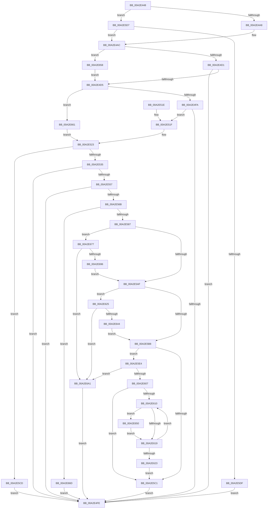

# SshpGenerateDeviceVerboseDescription

- RVA: `0x00A2E448`–`0x00A2E6B1` (길이 `617` bytes)
- VA: `0x0000000140A2E448`
- 실행 섹션: `PAGE`
- PDB 이름 있음: `예`; PDB Function 태그: `아니요`
- unwind 정보 RVA: `0x000AC8F0`
- 디코드: `181`개 명령, `617/617` bytes 표시
- 미해석 바이트: `0` (있으면 어셈블리에 `.byte`로 보존)

> 이 문서는 커널 이미지의 기계어와 PDB 기호를 분석해 생성했습니다. 4번과 5번은 함수 원형과 자료형을 바이너리 사용 방식에서 추정한 C 해석이며 원본 소스 복구 결과는 아닙니다.

## 1. Dependencies

- 직접 호출 지점: **8**; 고유 호출 대상: **3**
- 직접 호출자로 확인된 함수: **2**
- RIP 상대 이미지 참조: **0**

### Outgoing calls
- `0x00A2E491` → [IoGetDeviceProperty](../8F/IoGetDeviceProperty_function_008FA720.md) (function, `0x008FA720`)
- `0x00A2E4C2` → [IoGetDeviceProperty](../8F/IoGetDeviceProperty_function_008FA720.md) (function, `0x008FA720`)
- `0x00A2E4EB` → [IoGetDeviceProperty](../8F/IoGetDeviceProperty_function_008FA720.md) (function, `0x008FA720`)
- `0x00A2E576` → [ExAllocatePool2](../../poolcode/B8/ExAllocatePool2_function_00B820F0.md) (function, `0x00B820F0`)
- `0x00A2E5F8` → [IoGetDeviceProperty](../8F/IoGetDeviceProperty_function_008FA720.md) (function, `0x008FA720`)
- `0x00A2E639` → [IoGetDeviceProperty](../8F/IoGetDeviceProperty_function_008FA720.md) (function, `0x008FA720`)
- `0x00A2E68B` → [IoGetDeviceProperty](../8F/IoGetDeviceProperty_function_008FA720.md) (function, `0x008FA720`)
- `0x00A2E6A7` → [CmpFreePoolWithTag](../../text/44/CmpFreePoolWithTag_function_004489E0.md) (function, `0x004489E0`)

### Direct callers
- [SleepstudyHelperCreateBlockerFromComponent](../77/SleepstudyHelperCreateBlockerFromComponent_function_007748B0.md) at `0x0077496A`
- [SleepstudyHelperCreateBlockerFromDevice](SleepstudyHelperCreateBlockerFromDevice_function_00A2D5F0.md) at `0x00A2D6B3`

### Static image references
- 디코드된 RIP-relative 메모리 참조가 없습니다.

## 2. Other-region calls and transfers

- 다른 실행 섹션으로 향하는 call: **2**
  - `0x00A2E576` → [ExAllocatePool2](../../poolcode/B8/ExAllocatePool2_function_00B820F0.md) (`PAGE` → `POOLCODE`)
  - `0x00A2E6A7` → [CmpFreePoolWithTag](../../text/44/CmpFreePoolWithTag_function_004489E0.md) (`PAGE` → `.text`)
- 별도 외부 분기/꼬리 이동을 확인하지 못했습니다.

## 3. Assembly (complete function range)

```asm
00A2E448  4C 8B DC                        mov r11, rsp
00A2E44B  49 89 5B 08                     mov qword ptr [r11 + 8], rbx
00A2E44F  49 89 73 10                     mov qword ptr [r11 + 0x10], rsi
00A2E453  49 89 7B 18                     mov qword ptr [r11 + 0x18], rdi
00A2E457  55                              push rbp
00A2E458  41 54                           push r12
00A2E45A  41 55                           push r13
00A2E45C  41 56                           push r14
00A2E45E  41 57                           push r15
00A2E460  48 8B EC                        mov rbp, rsp
00A2E463  48 83 EC 40                     sub rsp, 0x40
00A2E467  45 33 ED                        xor r13d, r13d
00A2E46A  48 8D 45 F0                     lea rax, [rbp - 0x10]
00A2E46E  4D 8B E0                        mov r12, r8
00A2E471  44 89 6D 48                     mov dword ptr [rbp + 0x48], r13d
00A2E475  44 8B FA                        mov r15d, edx
00A2E478  44 89 6D F0                     mov dword ptr [rbp - 0x10], r13d
00A2E47C  45 33 C9                        xor r9d, r9d
00A2E47F  44 89 6D F4                     mov dword ptr [rbp - 0xc], r13d
00A2E483  41 8D 55 05                     lea edx, [r13 + 5]
00A2E487  49 89 43 B8                     mov qword ptr [r11 - 0x48], rax
00A2E48B  45 33 C0                        xor r8d, r8d
00A2E48E  4C 8B F1                        mov r14, rcx
00A2E491  E8 8A C2 EC FF                  call 0x1408fa720
00A2E496  BF 23 00 00 C0                  mov edi, 0xc0000023
00A2E49B  8B D8                           mov ebx, eax
00A2E49D  8D 77 11                        lea esi, [rdi + 0x11]
00A2E4A0  3B C6                           cmp eax, esi
00A2E4A2  0F 85 2F 01 00 00               jne 0x140a2e5d7
00A2E4A8  44 89 6D F0                     mov dword ptr [rbp - 0x10], r13d
00A2E4AC  45 33 C9                        xor r9d, r9d
00A2E4AF  48 8D 45 48                     lea rax, [rbp + 0x48]
00A2E4B3  45 33 C0                        xor r8d, r8d
00A2E4B6  48 89 44 24 20                  mov qword ptr [rsp + 0x20], rax
00A2E4BB  49 8B CE                        mov rcx, r14
00A2E4BE  41 8D 51 06                     lea edx, [r9 + 6]
00A2E4C2  E8 59 C2 EC FF                  call 0x1408fa720
00A2E4C7  8B D8                           mov ebx, eax
00A2E4C9  3B C6                           cmp eax, esi
00A2E4CB  0F 84 87 01 00 00               je 0x140a2e658
00A2E4D1  3B C7                           cmp eax, edi
00A2E4D3  75 29                           jne 0x140a2e4fe
00A2E4D5  45 33 C9                        xor r9d, r9d
00A2E4D8  48 8D 45 F4                     lea rax, [rbp - 0xc]
00A2E4DC  45 33 C0                        xor r8d, r8d
00A2E4DF  48 89 44 24 20                  mov qword ptr [rsp + 0x20], rax
00A2E4E4  49 8B CE                        mov rcx, r14
00A2E4E7  41 8D 51 01                     lea edx, [r9 + 1]
00A2E4EB  E8 30 C2 EC FF                  call 0x1408fa720
00A2E4F0  8B D8                           mov ebx, eax
00A2E4F2  3B C6                           cmp eax, esi
00A2E4F4  0F 84 67 01 00 00               je 0x140a2e661
00A2E4FA  3B C7                           cmp eax, edi
00A2E4FC  74 21                           je 0x140a2e51f
00A2E4FE  4C 8D 5C 24 40                  lea r11, [rsp + 0x40]
00A2E503  8B C3                           mov eax, ebx
00A2E505  49 8B 5B 30                     mov rbx, qword ptr [r11 + 0x30]
00A2E509  49 8B 73 38                     mov rsi, qword ptr [r11 + 0x38]
00A2E50D  49 8B 7B 40                     mov rdi, qword ptr [r11 + 0x40]
00A2E511  49 8B E3                        mov rsp, r11
00A2E514  41 5F                           pop r15
00A2E516  41 5E                           pop r14
00A2E518  41 5D                           pop r13
00A2E51A  41 5C                           pop r12
00A2E51C  5D                              pop rbp
00A2E51D  C3                              ret
00A2E51E  CC                              int3
00A2E51F  44 8B 45 F4                     mov r8d, dword ptr [rbp - 0xc]
00A2E523  44 8B 4D 48                     mov r9d, dword ptr [rbp + 0x48]
00A2E527  41 83 C1 0C                     add r9d, 0xc
00A2E52B  41 83 F9 0C                     cmp r9d, 0xc
00A2E52F  0F 82 98 00 00 00               jb 0x140a2e5cd
00A2E535  8B 4D F0                        mov ecx, dword ptr [rbp - 0x10]
00A2E538  41 83 CB FF                     or r11d, 0xffffffff
00A2E53C  41 03 C9                        add ecx, r9d
00A2E53F  45 8B D3                        mov r10d, r11d
00A2E542  41 3B C9                        cmp ecx, r9d
00A2E545  BA 95 00 00 C0                  mov edx, 0xc0000095
00A2E54A  44 0F 43 D1                     cmovae r10d, ecx
00A2E54E  1B DB                           sbb ebx, ebx
00A2E550  23 DA                           and ebx, edx
00A2E552  41 3B C9                        cmp ecx, r9d
00A2E555  72 A7                           jb 0x140a2e4fe
00A2E557  43 8D 04 02                     lea eax, [r10 + r8]
00A2E55B  41 3B C2                        cmp eax, r10d
00A2E55E  44 0F 43 D8                     cmovae r11d, eax
00A2E562  1B DB                           sbb ebx, ebx
00A2E564  23 DA                           and ebx, edx
00A2E566  41 3B C2                        cmp eax, r10d
00A2E569  72 93                           jb 0x140a2e4fe
00A2E56B  41 8B D3                        mov edx, r11d
00A2E56E  45 8B C7                        mov r8d, r15d
00A2E571  B9 00 01 00 00                  mov ecx, 0x100
00A2E576  E8 75 3B 15 00                  call 0x140b820f0
00A2E57B  48 8B F8                        mov rdi, rax
00A2E57E  48 85 C0                        test rax, rax
00A2E581  0F 84 E6 00 00 00               je 0x140a2e66d
00A2E587  8B 45 48                        mov eax, dword ptr [rbp + 0x48]
00A2E58A  48 8D 77 0C                     lea rsi, [rdi + 0xc]
00A2E58E  D1 E8                           shr eax, 1
00A2E590  89 07                           mov dword ptr [rdi], eax
00A2E592  8B 45 F0                        mov eax, dword ptr [rbp - 0x10]
00A2E595  D1 E8                           shr eax, 1
00A2E597  89 47 04                        mov dword ptr [rdi + 4], eax
00A2E59A  8B 45 F4                        mov eax, dword ptr [rbp - 0xc]
00A2E59D  D1 E8                           shr eax, 1
00A2E59F  89 47 08                        mov dword ptr [rdi + 8], eax
00A2E5A2  44 8B 45 48                     mov r8d, dword ptr [rbp + 0x48]
00A2E5A6  45 85 C0                        test r8d, r8d
00A2E5A9  0F 85 C8 00 00 00               jne 0x140a2e677
00A2E5AF  44 8B 45 F0                     mov r8d, dword ptr [rbp - 0x10]
00A2E5B3  45 85 C0                        test r8d, r8d
00A2E5B6  75 6D                           jne 0x140a2e625
00A2E5B8  44 8B 45 F4                     mov r8d, dword ptr [rbp - 0xc]
00A2E5BC  45 85 C0                        test r8d, r8d
00A2E5BF  75 23                           jne 0x140a2e5e4
00A2E5C1  49 89 3C 24                     mov qword ptr [r12], rdi
00A2E5C5  41 8B DD                        mov ebx, r13d
00A2E5C8  E9 31 FF FF FF                  jmp 0x140a2e4fe
00A2E5CD  BB 95 00 00 C0                  mov ebx, 0xc0000095
00A2E5D2  E9 27 FF FF FF                  jmp 0x140a2e4fe
00A2E5D7  3B C7                           cmp eax, edi
00A2E5D9  0F 84 CD FE FF FF               je 0x140a2e4ac
00A2E5DF  E9 1A FF FF FF                  jmp 0x140a2e4fe
00A2E5E4  48 8D 45 F4                     lea rax, [rbp - 0xc]
00A2E5E8  4C 8B CE                        mov r9, rsi
00A2E5EB  BA 01 00 00 00                  mov edx, 1
00A2E5F0  48 89 44 24 20                  mov qword ptr [rsp + 0x20], rax
00A2E5F5  49 8B CE                        mov rcx, r14
00A2E5F8  E8 23 C1 EC FF                  call 0x1408fa720
00A2E5FD  8B D8                           mov ebx, eax
00A2E5FF  85 C0                           test eax, eax
00A2E601  0F 88 9A 00 00 00               js 0x140a2e6a1
00A2E607  83 7F 08 02                     cmp dword ptr [rdi + 8], 2
00A2E60B  41 8B CD                        mov ecx, r13d
00A2E60E  76 B1                           jbe 0x140a2e5c1
00A2E610  8B C1                           mov eax, ecx
00A2E612  66 44 39 2C 46                  cmp word ptr [rsi + rax*2], r13w
00A2E617  74 37                           je 0x140a2e650
00A2E619  FF C1                           inc ecx
00A2E61B  8D 41 02                        lea eax, [rcx + 2]
00A2E61E  3B 47 08                        cmp eax, dword ptr [rdi + 8]
00A2E621  72 ED                           jb 0x140a2e610
00A2E623  EB 9C                           jmp 0x140a2e5c1
00A2E625  48 8D 45 F0                     lea rax, [rbp - 0x10]
00A2E629  4C 8B CE                        mov r9, rsi
00A2E62C  BA 05 00 00 00                  mov edx, 5
00A2E631  48 89 44 24 20                  mov qword ptr [rsp + 0x20], rax
00A2E636  49 8B CE                        mov rcx, r14
00A2E639  E8 E2 C0 EC FF                  call 0x1408fa720
00A2E63E  8B D8                           mov ebx, eax
00A2E640  85 C0                           test eax, eax
00A2E642  78 5D                           js 0x140a2e6a1
00A2E644  8B 47 04                        mov eax, dword ptr [rdi + 4]
00A2E647  48 8D 34 46                     lea rsi, [rsi + rax*2]
00A2E64B  E9 68 FF FF FF                  jmp 0x140a2e5b8
00A2E650  66 C7 04 46 2C 00               mov word ptr [rsi + rax*2], 0x2c
00A2E656  EB C1                           jmp 0x140a2e619
00A2E658  44 89 6D 48                     mov dword ptr [rbp + 0x48], r13d
00A2E65C  E9 74 FE FF FF                  jmp 0x140a2e4d5
00A2E661  45 8B C5                        mov r8d, r13d
00A2E664  44 89 6D F4                     mov dword ptr [rbp - 0xc], r13d
00A2E668  E9 B6 FE FF FF                  jmp 0x140a2e523
00A2E66D  BB 9A 00 00 C0                  mov ebx, 0xc000009a
00A2E672  E9 87 FE FF FF                  jmp 0x140a2e4fe
00A2E677  48 8D 45 48                     lea rax, [rbp + 0x48]
00A2E67B  4C 8B CE                        mov r9, rsi
00A2E67E  BA 06 00 00 00                  mov edx, 6
00A2E683  48 89 44 24 20                  mov qword ptr [rsp + 0x20], rax
00A2E688  49 8B CE                        mov rcx, r14
00A2E68B  E8 90 C0 EC FF                  call 0x1408fa720
00A2E690  8B D8                           mov ebx, eax
00A2E692  85 C0                           test eax, eax
00A2E694  78 0B                           js 0x140a2e6a1
00A2E696  8B 07                           mov eax, dword ptr [rdi]
00A2E698  48 8D 34 46                     lea rsi, [rsi + rax*2]
00A2E69C  E9 0E FF FF FF                  jmp 0x140a2e5af
00A2E6A1  41 8B D7                        mov edx, r15d
00A2E6A4  48 8B CF                        mov rcx, rdi
00A2E6A7  E8 34 A3 A1 FF                  call 0x1404489e0
00A2E6AC  E9 4D FE FF FF                  jmp 0x140a2e4fe
```

## 4. C-style interpretation (structured pseudocode)

```c
__int64 __fastcall SshpGenerateDeviceVerboseDescription(__int64 a1, int a2, __int64 a3, int a4)
{
    __int64 result;
    __int64 v_r10;
    __int64 v_r11;
    __int64 v_r13;
    __int64 v_rbx;
    __int64 v_rsp;
    unsigned __int64 v_stack_m20;
    unsigned __int64 v_stack_m28;
    unsigned int v_stack_m34;
    unsigned __int64 v_stack_m38;
    unsigned __int64 v_stack_m48;
    unsigned int v_stack_p20;

    *(unsigned __int64 *)(v_rsp + 8) = v_rbx;
    *(unsigned __int64 *)(v_rsp + 16) = v_rsi;
    *(unsigned __int64 *)(v_rsp + 24) = v_rdi;
    v_rsp = (v_rsp) - (64);
    v_r13 = 0;
    v_stack_p20 = 0;
    v_stack_m38 = 0;
    a4 = 0;
    v_stack_m34 = 0;
    *(unsigned __int64 *)(v_rsp - 72) = v_stack_m38;
    a3 = 0;
    result = IoGetDeviceProperty(a1, v_r13 + 5, a3, a4);
    if (((unsigned int)(result)) != ((unsigned int)((unsigned int)(0xC0000023ULL) + 17))) goto loc_00A2E5D7;
    v_stack_m38 = 0;
loc_00A2E4AC:
    a4 = 0;
    a3 = 0;
    v_stack_m48 = v_stack_p20;
    result = IoGetDeviceProperty(a1, a4 + 6, a3, a4);
    if (((unsigned int)(result)) == ((unsigned int)((unsigned int)(0xC0000023ULL) + 17))) goto loc_00A2E658;
    if (((unsigned int)(result)) != ((unsigned int)((unsigned int)(0xC0000023ULL)))) goto loc_00A2E4FE;
loc_00A2E4D5:
    a4 = 0;
    a3 = 0;
    v_stack_m48 = v_stack_m34;
    result = IoGetDeviceProperty(a1, a4 + 1, a3, a4);
    if (((unsigned int)(result)) == ((unsigned int)((unsigned int)(0xC0000023ULL) + 17))) goto loc_00A2E661;
    if (((unsigned int)(result)) == ((unsigned int)((unsigned int)(0xC0000023ULL)))) goto loc_00A2E51F;
loc_00A2E4FE:
    return (unsigned int)((unsigned int)((unsigned int)((unsigned int)(result))));
loc_00A2E51F:
loc_00A2E523:
    a4 = (unsigned int)(((unsigned int)(v_stack_p20)) + (12));
    if (a4 < 12) goto loc_00A2E5CD;
    v_r11 = (unsigned int)((v_stack_m28) | (0xFFFFFFFFULL));
    a1 = (unsigned int)(((unsigned int)(v_stack_m38)) + (a4));
    v_r10 = (unsigned int)((unsigned int)(v_r11));
    if (((unsigned int)(a1)) >= a4) { v_r10 = (unsigned int)(a1); }
    v_rbx = (unsigned int)((*(unsigned __int64 *)(v_stack_m28 + 48)) & ((unsigned int)((unsigned int)(0xC0000095ULL))));
    if (((unsigned int)(a1)) < a4) goto loc_00A2E4FE;
    if (((unsigned int)(v_r10 + (unsigned int)(v_stack_m34) * 1)) >= ((unsigned int)(v_r10))) { v_r11 = (unsigned int)(v_r10 + (unsigned int)(v_stack_m34) * 1); }
    v_rbx = (unsigned int)((v_rbx) & ((unsigned int)((unsigned int)(0xC0000095ULL))));
    if (((unsigned int)(v_r10 + (unsigned int)(v_stack_m34) * 1)) < ((unsigned int)(v_r10))) goto loc_00A2E4FE;
    result = ExAllocatePool2(256, (unsigned int)((unsigned int)(v_r11)), (unsigned int)((unsigned int)((unsigned int)(a2))), a4);
    if (result == 0) goto loc_00A2E66D;
    result = (unsigned int)(((unsigned int)(v_stack_p20)) >> (1));
    *(unsigned int *)(result) = (unsigned int)(result);
    result = (unsigned int)(((unsigned int)(v_stack_m38)) >> (1));
    *(unsigned int *)(result + 4) = (unsigned int)(result);
    result = (unsigned int)(((unsigned int)(v_stack_m34)) >> (1));
    *(unsigned int *)(result + 8) = (unsigned int)(result);
    if ((unsigned int)((unsigned int)(v_stack_p20)) != 0) goto loc_00A2E677;
loc_00A2E5AF:
    if ((unsigned int)((unsigned int)(v_stack_m38)) != 0) goto loc_00A2E625;
loc_00A2E5B8:
    if ((unsigned int)((unsigned int)(v_stack_m34)) != 0) goto loc_00A2E5E4;
loc_00A2E5C1:
    *(unsigned __int64 *)(a3) = result;
    goto loc_00A2E4FE;
loc_00A2E5CD:
    goto loc_00A2E4FE;
loc_00A2E5D7:
    if (((unsigned int)(result)) == ((unsigned int)(result))) goto loc_00A2E4AC;
    goto loc_00A2E4FE;
loc_00A2E5E4:
    v_stack_m20 = v_stack_m34;
    result = IoGetDeviceProperty(a1, 1, (unsigned int)(v_stack_m34), result + 12);
    if (sign_flag) goto loc_00A2E6A1;
    if ((*(unsigned int *)(result + 8)) <= 2) goto loc_00A2E5C1;
loc_00A2E610:
    if ((*(unsigned __int16 *)(result + 12 + 0 * 2)) == 0) goto loc_00A2E650;
loc_00A2E619:
    a1 = (unsigned int)((0) + 1);
    if (((unsigned int)(a1 + 2)) < (*(unsigned int *)(result + 8))) goto loc_00A2E610;
    goto loc_00A2E5C1;
loc_00A2E625:
    v_stack_m20 = v_stack_m38;
    result = IoGetDeviceProperty(a1, 5, (unsigned int)(v_stack_m34), result + 12);
    if (sign_flag) goto loc_00A2E6A1;
    goto loc_00A2E5B8;
loc_00A2E650:
    *(unsigned __int16 *)(result + 12 + (unsigned int)(*(unsigned int *)(result + 4)) * 2 + (unsigned int)(*(unsigned int *)(result + 4)) * 2) = 44;
    goto loc_00A2E619;
loc_00A2E658:
    v_stack_p20 = 0;
    goto loc_00A2E4D5;
loc_00A2E661:
    v_stack_m34 = 0;
    goto loc_00A2E523;
loc_00A2E66D:
    goto loc_00A2E4FE;
loc_00A2E677:
    v_stack_m20 = v_stack_p20;
    result = IoGetDeviceProperty(a1, 6, 0, result + 12 + (unsigned int)(*(unsigned int *)(result + 4)) * 2);
    if (sign_flag) goto loc_00A2E6A1;
    goto loc_00A2E5AF;
loc_00A2E6A1:
    result = CmpFreePoolWithTag(result, (unsigned int)((unsigned int)((unsigned int)(a2))), 0, result + 12 + (unsigned int)(*(unsigned int *)(result + 4)) * 2);
    goto loc_00A2E4FE;
}
```

## 5. (Beta) C Style

```c
int64_t SshpGenerateDeviceVerboseDescription(int64_t Arg1, int32_t Arg2, void *Arg3, int32_t Arg4)
{
    uint8_t *arg3 = (uint8_t *)Arg3;

    int64_t result;
    int64_t local_r10;
    int64_t local_r11;
    int64_t local_r13;
    int64_t local_rbx;
    int64_t local_rsp;
    uint64_t v_stack_m20;
    uint64_t v_stack_m28;
    uint32_t v_stack_m34;
    uint64_t v_stack_m38;
    uint64_t v_stack_m48;
    uint32_t v_stack_p20;

    *(uint64_t *)(local_rsp + 0x8) = local_rbx;
    *(uint64_t *)(local_rsp + 0x10) = local_rsi;
    *(uint64_t *)(local_rsp + 0x18) = local_rdi;
    local_rsp = (local_rsp) - (64);
    local_r13 = 0;
    v_stack_p20 = 0;
    v_stack_m38 = 0;
    Arg4 = 0;
    v_stack_m34 = 0;
    *(uint64_t *)(local_rsp - 0x48) = v_stack_m38;
    Arg3 = 0;
    result = IoGetDeviceProperty(Arg1, local_r13 + 5, Arg3, Arg4);
    if (((uint32_t)(result)) != ((uint32_t)((uint32_t)(0xC0000023ULL) + 17))) goto loc_00A2E5D7;
    v_stack_m38 = 0;
loc_00A2E4AC:
    Arg4 = 0;
    Arg3 = 0;
    v_stack_m48 = v_stack_p20;
    result = IoGetDeviceProperty(Arg1, Arg4 + 6, Arg3, Arg4);
    if (((uint32_t)(result)) == ((uint32_t)((uint32_t)(0xC0000023ULL) + 17))) goto loc_00A2E658;
    if (((uint32_t)(result)) != ((uint32_t)((uint32_t)(0xC0000023ULL)))) goto loc_00A2E4FE;
loc_00A2E4D5:
    Arg4 = 0;
    Arg3 = 0;
    v_stack_m48 = v_stack_m34;
    result = IoGetDeviceProperty(Arg1, Arg4 + 1, Arg3, Arg4);
    if (((uint32_t)(result)) == ((uint32_t)((uint32_t)(0xC0000023ULL) + 17))) goto loc_00A2E661;
    if (((uint32_t)(result)) == ((uint32_t)((uint32_t)(0xC0000023ULL)))) goto loc_00A2E51F;
loc_00A2E4FE:
    return (uint32_t)((uint32_t)((uint32_t)((uint32_t)(result))));
loc_00A2E51F:
loc_00A2E523:
    Arg4 = (uint32_t)(((uint32_t)(v_stack_p20)) + (12));
    if (Arg4 < 12) goto loc_00A2E5CD;
    local_r11 = (uint32_t)((v_stack_m28) | (0xFFFFFFFFULL));
    Arg1 = (uint32_t)(((uint32_t)(v_stack_m38)) + (Arg4));
    local_r10 = (uint32_t)((uint32_t)(local_r11));
    if (((uint32_t)(Arg1)) >= Arg4) { local_r10 = (uint32_t)(Arg1); }
    local_rbx = (uint32_t)((*(uint64_t *)(v_stack_m28 + 0x30)) & ((uint32_t)((uint32_t)(0xC0000095ULL))));
    if (((uint32_t)(Arg1)) < Arg4) goto loc_00A2E4FE;
    if (((uint32_t)(local_r10 + (uint32_t)(v_stack_m34) * 1)) >= ((uint32_t)(local_r10))) { local_r11 = (uint32_t)(local_r10 + (uint32_t)(v_stack_m34) * 1); }
    local_rbx = (uint32_t)((local_rbx) & ((uint32_t)((uint32_t)(0xC0000095ULL))));
    if (((uint32_t)(local_r10 + (uint32_t)(v_stack_m34) * 1)) < ((uint32_t)(local_r10))) goto loc_00A2E4FE;
    result = ExAllocatePool2(256, (uint32_t)((uint32_t)(local_r11)), (uint32_t)((uint32_t)((uint32_t)(Arg2))), Arg4);
    if (result == 0) goto loc_00A2E66D;
    result = (uint32_t)(((uint32_t)(v_stack_p20)) >> (1));
    *(uint32_t *)(result) = (uint32_t)(result);
    result = (uint32_t)(((uint32_t)(v_stack_m38)) >> (1));
    *(uint32_t *)(result + 0x4) = (uint32_t)(result);
    result = (uint32_t)(((uint32_t)(v_stack_m34)) >> (1));
    *(uint32_t *)(result + 0x8) = (uint32_t)(result);
    if ((uint32_t)((uint32_t)(v_stack_p20)) != 0) goto loc_00A2E677;
loc_00A2E5AF:
    if ((uint32_t)((uint32_t)(v_stack_m38)) != 0) goto loc_00A2E625;
loc_00A2E5B8:
    if ((uint32_t)((uint32_t)(v_stack_m34)) != 0) goto loc_00A2E5E4;
loc_00A2E5C1:
    *(uint64_t *)(arg3) = result;
    goto loc_00A2E4FE;
loc_00A2E5CD:
    goto loc_00A2E4FE;
loc_00A2E5D7:
    if (((uint32_t)(result)) == ((uint32_t)(result))) goto loc_00A2E4AC;
    goto loc_00A2E4FE;
loc_00A2E5E4:
    v_stack_m20 = v_stack_m34;
    result = IoGetDeviceProperty(Arg1, 1, (uint32_t)(v_stack_m34), result + 12);
    if (sign_flag) goto loc_00A2E6A1;
    if ((*(uint32_t *)(result + 0x8)) <= 2) goto loc_00A2E5C1;
loc_00A2E610:
    if ((*(uint16_t *)(result + 0xC + 0x0 * 2)) == 0) goto loc_00A2E650;
loc_00A2E619:
    Arg1 = (uint32_t)((0) + 1);
    if (((uint32_t)(Arg1 + 2)) < (*(uint32_t *)(result + 0x8))) goto loc_00A2E610;
    goto loc_00A2E5C1;
loc_00A2E625:
    v_stack_m20 = v_stack_m38;
    result = IoGetDeviceProperty(Arg1, 5, (uint32_t)(v_stack_m34), result + 12);
    if (sign_flag) goto loc_00A2E6A1;
    goto loc_00A2E5B8;
loc_00A2E650:
    *(uint16_t *)(result + 0xC + (uint32_t)(*(uint32_t *)(result + 0x4)) * 2 + (uint32_t)(*(uint32_t *)(result + 0x4)) * 2) = 44;
    goto loc_00A2E619;
loc_00A2E658:
    v_stack_p20 = 0;
    goto loc_00A2E4D5;
loc_00A2E661:
    v_stack_m34 = 0;
    goto loc_00A2E523;
loc_00A2E66D:
    goto loc_00A2E4FE;
loc_00A2E677:
    v_stack_m20 = v_stack_p20;
    result = IoGetDeviceProperty(Arg1, 6, 0, result + 12 + (uint32_t)(*(uint32_t *)(result + 0x4)) * 2);
    if (sign_flag) goto loc_00A2E6A1;
    goto loc_00A2E5AF;
loc_00A2E6A1:
    result = CmpFreePoolWithTag(result, (uint32_t)((uint32_t)((uint32_t)(Arg2))), 0, result + 12 + (uint32_t)(*(uint32_t *)(result + 0x4)) * 2);
    goto loc_00A2E4FE;
}
```

### 관측된 메모리 오프셋

구조체 형식이 확인되지 않은 접근은 인자 기준의 오프셋으로만 기록했습니다.

| 기준 인자 | 오프셋 표현 | 폭 (bit) | 접근 |
|---|---:|---:|---|
| `Arg3` | `+ 0x0` | `64` | `W` |

## 6. Execution-region graph

[열기: 2D/3D 그래프와 함수 탐색 컨트롤 패널](../../../control-panel.html?section=page&rva=0x00A2E448&view=graph)

- 2D 그래프는 위에서 아래로 흐르고, 3D 그래프는 빈 공간을 드래그해 회전합니다. Shift+드래그는 이동, 휠은 확대·축소, 함수 노드 선택은 대상 보고서 이동입니다.

### Static fallback


