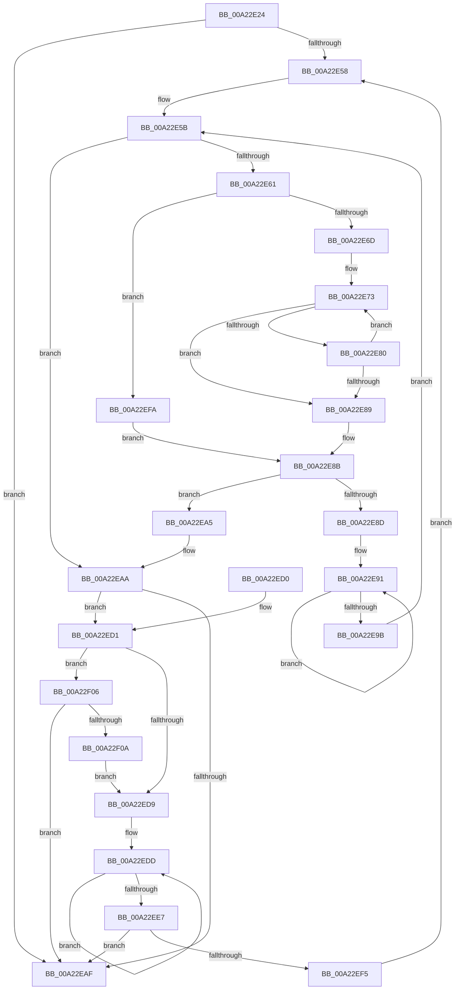

# StringListContains

- RVA: `0x00A22E24`–`0x00A22F0C` (길이 `232` bytes)
- VA: `0x0000000140A22E24`
- 실행 섹션: `PAGE`
- PDB 이름 있음: `예`; PDB Function 태그: `아니요`
- unwind 정보 RVA: `0x000AB63C`
- 디코드: `73`개 명령, `232/232` bytes 표시
- 미해석 바이트: `0` (있으면 어셈블리에 `.byte`로 보존)

> 이 문서는 커널 이미지의 기계어와 PDB 기호를 분석해 생성했습니다. 4번과 5번은 함수 원형과 자료형을 바이너리 사용 방식에서 추정한 C 해석이며 원본 소스 복구 결과는 아닙니다.

## 1. Dependencies

- 직접 호출 지점: **1**; 고유 호출 대상: **1**
- 직접 호출자로 확인된 함수: **1**
- RIP 상대 이미지 참조: **0**

### Outgoing calls
- `0x00A22EFD` → [wcsicmp](../../text/50/wcsicmp_function_00500080.md) (function, `0x00500080`)

### Direct callers
- [PropertyEval](../9C/PropertyEval_function_009CB300.md) at `0x009CB44C`

### Static image references
- 디코드된 RIP-relative 메모리 참조가 없습니다.

## 2. Other-region calls and transfers

- 다른 실행 섹션으로 향하는 call: **1**
  - `0x00A22EFD` → [wcsicmp](../../text/50/wcsicmp_function_00500080.md) (`PAGE` → `.text`)
- 별도 외부 분기/꼬리 이동을 확인하지 못했습니다.

## 3. Assembly (complete function range)

```asm
00A22E24  48 8B C4                        mov rax, rsp
00A22E27  48 89 58 08                     mov qword ptr [rax + 8], rbx
00A22E2B  48 89 68 10                     mov qword ptr [rax + 0x10], rbp
00A22E2F  48 89 70 18                     mov qword ptr [rax + 0x18], rsi
00A22E33  48 89 78 20                     mov qword ptr [rax + 0x20], rdi
00A22E37  41 54                           push r12
00A22E39  41 56                           push r14
00A22E3B  41 57                           push r15
00A22E3D  48 83 EC 20                     sub rsp, 0x20
00A22E41  45 33 E4                        xor r12d, r12d
00A22E44  45 8B F1                        mov r14d, r9d
00A22E47  49 8B F8                        mov rdi, r8
00A22E4A  8B EA                           mov ebp, edx
00A22E4C  4C 8B F9                        mov r15, rcx
00A22E4F  41 8B F4                        mov esi, r12d
00A22E52  66 45 39 20                     cmp word ptr [r8], r12w
00A22E56  74 57                           je 0x140a22eaf
00A22E58  49 8B DF                        mov rbx, r15
00A22E5B  66 44 39 23                     cmp word ptr [rbx], r12w
00A22E5F  74 49                           je 0x140a22eaa
00A22E61  48 8B D7                        mov rdx, rdi
00A22E64  45 85 F6                        test r14d, r14d
00A22E67  0F 85 8D 00 00 00               jne 0x140a22efa
00A22E6D  48 8B C3                        mov rax, rbx
00A22E70  48 2B D3                        sub rdx, rbx
00A22E73  0F B7 08                        movzx ecx, word ptr [rax]
00A22E76  44 0F B7 04 10                  movzx r8d, word ptr [rax + rdx]
00A22E7B  41 2B C8                        sub ecx, r8d
00A22E7E  75 09                           jne 0x140a22e89
00A22E80  48 83 C0 02                     add rax, 2
00A22E84  45 85 C0                        test r8d, r8d
00A22E87  75 EA                           jne 0x140a22e73
00A22E89  85 C9                           test ecx, ecx
00A22E8B  74 18                           je 0x140a22ea5
00A22E8D  48 83 C8 FF                     or rax, 0xffffffffffffffff
00A22E91  48 FF C0                        inc rax
00A22E94  66 44 39 24 43                  cmp word ptr [rbx + rax*2], r12w
00A22E99  75 F6                           jne 0x140a22e91
00A22E9B  48 8D 1C 43                     lea rbx, [rbx + rax*2]
00A22E9F  48 83 C3 02                     add rbx, 2
00A22EA3  EB B6                           jmp 0x140a22e5b
00A22EA5  BE 01 00 00 00                  mov esi, 1
00A22EAA  83 FD 12                        cmp ebp, 0x12
00A22EAD  75 22                           jne 0x140a22ed1
00A22EAF  48 8B 5C 24 40                  mov rbx, qword ptr [rsp + 0x40]
00A22EB4  8B C6                           mov eax, esi
00A22EB6  48 8B 74 24 50                  mov rsi, qword ptr [rsp + 0x50]
00A22EBB  48 8B 6C 24 48                  mov rbp, qword ptr [rsp + 0x48]
00A22EC0  48 8B 7C 24 58                  mov rdi, qword ptr [rsp + 0x58]
00A22EC5  48 83 C4 20                     add rsp, 0x20
00A22EC9  41 5F                           pop r15
00A22ECB  41 5E                           pop r14
00A22ECD  41 5C                           pop r12
00A22ECF  C3                              ret
00A22ED0  CC                              int3
00A22ED1  81 FD 12 20 00 00               cmp ebp, 0x2012
00A22ED7  74 2D                           je 0x140a22f06
00A22ED9  48 83 C9 FF                     or rcx, 0xffffffffffffffff
00A22EDD  48 FF C1                        inc rcx
00A22EE0  66 44 39 24 4F                  cmp word ptr [rdi + rcx*2], r12w
00A22EE5  75 F6                           jne 0x140a22edd
00A22EE7  48 8D 3C 4F                     lea rdi, [rdi + rcx*2]
00A22EEB  48 83 C7 02                     add rdi, 2
00A22EEF  66 44 39 27                     cmp word ptr [rdi], r12w
00A22EF3  74 BA                           je 0x140a22eaf
00A22EF5  E9 5E FF FF FF                  jmp 0x140a22e58
00A22EFA  48 8B CB                        mov rcx, rbx
00A22EFD  E8 7E D1 AD FF                  call 0x140500080
00A22F02  85 C0                           test eax, eax
00A22F04  EB 85                           jmp 0x140a22e8b
00A22F06  85 F6                           test esi, esi
00A22F08  75 A5                           jne 0x140a22eaf
00A22F0A  EB CD                           jmp 0x140a22ed9
```

## 4. C-style interpretation (structured pseudocode)

```c
__int64 __fastcall StringListContains(__int64 a1, int a2, __int64 a3, int a4)
{
    __int64 result;
    __int64 v_r12;
    __int64 v_rbx;
    __int64 v_rdi;
    __int64 v_rsp;
    unsigned __int64 v_stack_p10;
    unsigned __int64 v_stack_p18;
    unsigned __int64 v_stack_p20;
    unsigned __int64 v_stack_p8;

    *(unsigned __int64 *)(v_rsp + 8) = v_rbx;
    *(unsigned __int64 *)(v_rsp + 16) = v_rbp;
    *(unsigned __int64 *)(v_rsp + 24) = v_rsi;
    *(unsigned __int64 *)(v_rsp + 32) = v_rdi;
    v_rsp = (v_rsp) - (32);
    v_r12 = 0;
    if ((*(unsigned __int16 *)(a3)) == 0) goto loc_00A22EAF;
loc_00A22E58:
loc_00A22E5B:
    if ((*(unsigned __int16 *)(a1)) == 0) goto loc_00A22EAA;
    if ((unsigned int)((unsigned int)(a4)) != 0) goto loc_00A22EFA;
    a2 = (a3) - (a1);
loc_00A22E73:
    a1 = (unsigned int)((*(unsigned __int16 *)(a1)) - ((unsigned int)(*(unsigned __int16 *)(a1 + a2 * 1))));
    if (condition_is_not_equal) goto loc_00A22E89;
    result = (a1) + (2);
    if ((unsigned int)(*(unsigned __int16 *)(a1 + a2 * 1)) != 0) goto loc_00A22E73;
loc_00A22E89:
loc_00A22E8B:
    if ((unsigned int)(a1) == 0) goto loc_00A22EA5;
    result = (result) | (-1);
loc_00A22E91:
    result = (result) + 1;
    if ((*(unsigned __int16 *)(a1 + result * 2)) != 0) goto loc_00A22E91;
    v_rbx = (a1 + result * 2) + (2);
    goto loc_00A22E5B;
loc_00A22EA5:
loc_00A22EAA:
    if (((unsigned int)((unsigned int)(a2))) != 18) goto loc_00A22ED1;
loc_00A22EAF:
    v_rsp = (v_rsp) + (32);
    return 1;
loc_00A22ED1:
    if (((unsigned int)(v_stack_p10)) == 0x2012ULL) goto loc_00A22F06;
loc_00A22ED9:
    a1 = (a1) | (-1);
loc_00A22EDD:
    a1 = (a1) + 1;
    if ((*(unsigned __int16 *)(v_stack_p20 + a1 * 2)) != 0) goto loc_00A22EDD;
    v_rdi = (v_stack_p20 + a1 * 2) + (2);
    if ((*(unsigned __int16 *)(v_rdi)) == 0) goto loc_00A22EAF;
    goto loc_00A22E58;
loc_00A22EFA:
    result = wcsicmp(v_stack_p8, a2, *(unsigned __int16 *)(a1 + a2 * 1), a4);
    goto loc_00A22E8B;
loc_00A22F06:
    if ((unsigned int)(v_stack_p18) != 0) goto loc_00A22EAF;
    goto loc_00A22ED9;
}
```

## 5. (Beta) C Style

```c
int64_t StringListContains(void *Arg1, int32_t Arg2, void *Arg3, int32_t Arg4)
{
    uint8_t *arg1 = (uint8_t *)Arg1;
    uint8_t *arg3 = (uint8_t *)Arg3;

    int64_t result;
    int64_t local_r12;
    int64_t local_rbx;
    int64_t local_rdi;
    int64_t local_rsp;
    uint64_t v_stack_p10;
    uint64_t v_stack_p18;
    uint64_t v_stack_p20;
    uint64_t v_stack_p8;

    *(uint64_t *)(local_rsp + 0x8) = local_rbx;
    *(uint64_t *)(local_rsp + 0x10) = local_rbp;
    *(uint64_t *)(local_rsp + 0x18) = local_rsi;
    *(uint64_t *)(local_rsp + 0x20) = local_rdi;
    local_rsp = (local_rsp) - (32);
    local_r12 = 0;
    if ((*(uint16_t *)(arg3)) == 0) goto loc_00A22EAF;
loc_00A22E58:
loc_00A22E5B:
    if ((*(uint16_t *)(arg1)) == 0) goto loc_00A22EAA;
    if ((uint32_t)((uint32_t)(Arg4)) != 0) goto loc_00A22EFA;
    Arg2 = (Arg3) - (Arg1);
loc_00A22E73:
    Arg1 = (uint32_t)((*(uint16_t *)(arg1)) - ((uint32_t)(*(uint16_t *)(arg1 + Arg2 * 1))));
    if (condition_is_not_equal) goto loc_00A22E89;
    result = (Arg1) + (2);
    if ((uint32_t)(*(uint16_t *)(arg1 + Arg2 * 1)) != 0) goto loc_00A22E73;
loc_00A22E89:
loc_00A22E8B:
    if ((uint32_t)(Arg1) == 0) goto loc_00A22EA5;
    result = (result) | (-1);
loc_00A22E91:
    result = (result) + 1;
    if ((*(uint16_t *)(arg1 + result * 2)) != 0) goto loc_00A22E91;
    local_rbx = (Arg1 + result * 2) + (2);
    goto loc_00A22E5B;
loc_00A22EA5:
loc_00A22EAA:
    if (((uint32_t)((uint32_t)(Arg2))) != 18) goto loc_00A22ED1;
loc_00A22EAF:
    local_rsp = (local_rsp) + (32);
    return 1;
loc_00A22ED1:
    if (((uint32_t)(v_stack_p10)) == 0x2012ULL) goto loc_00A22F06;
loc_00A22ED9:
    Arg1 = (Arg1) | (-1);
loc_00A22EDD:
    Arg1 = (Arg1) + 1;
    if ((*(uint16_t *)(v_stack_p20 + arg1 * 2)) != 0) goto loc_00A22EDD;
    local_rdi = (v_stack_p20 + Arg1 * 2) + (2);
    if ((*(uint16_t *)(local_rdi)) == 0) goto loc_00A22EAF;
    goto loc_00A22E58;
loc_00A22EFA:
    result = wcsicmp(v_stack_p8, Arg2, *(uint16_t *)(arg1 + Arg2 * 1), Arg4);
    goto loc_00A22E8B;
loc_00A22F06:
    if ((uint32_t)(v_stack_p18) != 0) goto loc_00A22EAF;
    goto loc_00A22ED9;
}
```

### 관측된 메모리 오프셋

구조체 형식이 확인되지 않은 접근은 인자 기준의 오프셋으로만 기록했습니다.

| 기준 인자 | 오프셋 표현 | 폭 (bit) | 접근 |
|---|---:|---:|---|
| `Arg1` | `+ 0x0` | `16` | `R` |
| `Arg1` | `+ 0x0 + rax*2` | `16` | `R` |
| `Arg1` | `+ 0x0 + rax*2` | `64` | `R` |
| `Arg1` | `+ 0x0 + rdx*1` | `16` | `R` |
| `Arg3` | `+ 0x0` | `16` | `R` |
| `Arg3` | `+ 0x0 + rcx*2` | `16` | `R` |
| `Arg3` | `+ 0x0 + rcx*2` | `64` | `R` |

## 6. Execution-region graph

[열기: 2D/3D 그래프와 함수 탐색 컨트롤 패널](../../../control-panel.html?section=page&rva=0x00A22E24&view=graph)

- 2D 그래프는 위에서 아래로 흐르고, 3D 그래프는 빈 공간을 드래그해 회전합니다. Shift+드래그는 이동, 휠은 확대·축소, 함수 노드 선택은 대상 보고서 이동입니다.

### Static fallback


