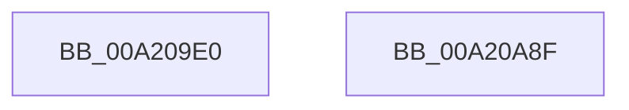

# sub_00A209E0

- RVA: `0x00A209E0`–`0x00A20A90` (길이 `176` bytes)
- VA: `0x0000000140A209E0`
- 실행 섹션: `PAGE`
- PDB 이름 있음: `아니요`; PDB Function 태그: `아니요`
- unwind 정보 RVA: `0x00069588`
- 디코드: `49`개 명령, `176/176` bytes 표시
- 미해석 바이트: `0` (있으면 어셈블리에 `.byte`로 보존)

> 이 문서는 커널 이미지의 기계어와 PDB 기호를 분석해 생성했습니다. 4번과 5번은 함수 원형과 자료형을 바이너리 사용 방식에서 추정한 C 해석이며 원본 소스 복구 결과는 아닙니다.

## 1. Dependencies

- 직접 호출 지점: **0**; 고유 호출 대상: **0**
- 직접 호출자로 확인된 함수: **0**
- RIP 상대 이미지 참조: **0**

### Outgoing calls
- 직접 디코드된 call 명령이 없습니다.

### Direct callers
- 이 함수 시작 RVA로 연결되는 직접 call은 확인되지 않았습니다. 간접 호출은 완전히 역산할 수 없습니다.

### Static image references
- 디코드된 RIP-relative 메모리 참조가 없습니다.

## 2. Other-region calls and transfers

- 다른 실행 섹션으로 향하는 call: **0**
- 별도 외부 분기/꼬리 이동을 확인하지 못했습니다.

## 3. Assembly (complete function range)

```asm
00A209E0  48 89 5C 24 08                  mov qword ptr [rsp + 8], rbx
00A209E5  48 89 74 24 10                  mov qword ptr [rsp + 0x10], rsi
00A209EA  48 89 7C 24 18                  mov qword ptr [rsp + 0x18], rdi
00A209EF  8B 5C 24 38                     mov ebx, dword ptr [rsp + 0x38]
00A209F3  48 8B F9                        mov rdi, rcx
00A209F6  49 8B F1                        mov rsi, r9
00A209F9  4D 8B D8                        mov r11, r8
00A209FC  48 B8 93 24 49 92 24 49 92 24   movabs rax, 0x2492492492492493
00A20A06  83 E7 03                        and edi, 3
00A20A09  49 F7 E0                        mul r8
00A20A0C  49 8B C0                        mov rax, r8
00A20A0F  4C 8B 44 24 30                  mov r8, qword ptr [rsp + 0x30]
00A20A14  48 2B C2                        sub rax, rdx
00A20A17  48 D1 E8                        shr rax, 1
00A20A1A  48 03 C2                        add rax, rdx
00A20A1D  8B D3                           mov edx, ebx
00A20A1F  48 C1 E8 02                     shr rax, 2
00A20A23  4C 6B C8 07                     imul r9, rax, 7
00A20A27  48 8B C1                        mov rax, rcx
00A20A2A  41 8A CB                        mov cl, r11b
00A20A2D  48 D1 E8                        shr rax, 1
00A20A30  41 2A C9                        sub cl, r9b
00A20A33  48 FF C8                        dec rax
00A20A36  FE C1                           inc cl
00A20A38  83 E0 01                        and eax, 1
00A20A3B  45 2A CB                        sub r9b, r11b
00A20A3E  41 33 14 80                     xor edx, dword ptr [r8 + rax*4]
00A20A42  41 0F B7 04 78                  movzx eax, word ptr [r8 + rdi*2]
00A20A47  44 8B D2                        mov r10d, edx
00A20A4A  48 8B 7C 24 18                  mov rdi, qword ptr [rsp + 0x18]
00A20A4F  41 D3 E2                        shl r10d, cl
00A20A52  41 8D 49 1F                     lea ecx, [r9 + 0x1f]
00A20A56  D3 EA                           shr edx, cl
00A20A58  44 0B D2                        or r10d, edx
00A20A5B  44 0F AF D0                     imul r10d, eax
00A20A5F  48 B8 89 88 88 88 88 88 88 88   movabs rax, 0x8888888888888889
00A20A69  48 F7 E6                        mul rsi
00A20A6C  48 C1 EA 03                     shr rdx, 3
00A20A70  0F B6 CA                        movzx ecx, dl
00A20A73  6B D1 0F                        imul edx, ecx, 0xf
00A20A76  40 2A F2                        sub sil, dl
00A20A79  8D 4E 01                        lea ecx, [rsi + 1]
00A20A7C  48 8B 74 24 10                  mov rsi, qword ptr [rsp + 0x10]
00A20A81  D3 EB                           shr ebx, cl
00A20A83  44 2B D3                        sub r10d, ebx
00A20A86  48 8B 5C 24 08                  mov rbx, qword ptr [rsp + 8]
00A20A8B  41 8B C2                        mov eax, r10d
00A20A8E  C3                              ret
00A20A8F  CC                              int3
```

## 4. C-style interpretation (structured pseudocode)

```c
__int64 __fastcall sub_00A209E0(__int64 a1, __int64 a2, __int64 a3, __int64 a4, __int64 a5, __int64 a6, unsigned int a7)
{
    __int64 result;
    __int64 v_r10;
    __int64 v_rbx;
    __int64 v_rdi;
    __int64 v_rsi;
    unsigned __int64 v_stack_p10;
    unsigned __int64 v_stack_p18;
    unsigned __int64 v_stack_p8;

    v_stack_p8 = v_rbx;
    v_stack_p10 = v_rsi;
    v_stack_p18 = v_rdi;
    v_rdi = (unsigned int)((a1) & (3));
    result = (a3) - (a2);
    result = (result) >> (1);
    result = (result) + (a2);
    result = (result) >> (2);
    a4 = (a4) * (result);
    result = (a1) >> (1);
    a1 = (unsigned __int8)(((unsigned __int8)(a3)) - ((unsigned __int8)(a4)));
    result = (result) - 1;
    a1 = (unsigned __int8)((a1) + 1);
    result = (unsigned int)((result) & (1));
    a4 = (unsigned __int8)((a4) - ((unsigned __int8)(a3)));
    a2 = (unsigned int)(((unsigned int)((unsigned int)((unsigned int)(a7)))) ^ (*(unsigned int *)(a6 + result * 4)));
    v_r10 = (unsigned int)(((unsigned int)((unsigned int)(a2))) << ((unsigned __int8)(a1)));
    a2 = (unsigned int)((a2) >> ((unsigned __int8)(a4 + 31)));
    v_r10 = (unsigned int)((v_r10) | ((unsigned int)(a2)));
    v_r10 = (unsigned int)((v_r10) * ((unsigned int)(*(unsigned __int16 *)(a6 + v_rdi * 2))));
    a2 = (a2) >> (3);
    a2 = (unsigned int)((a2) * ((unsigned int)((unsigned __int8)(a2))));
    v_rsi = (unsigned __int8)((a4) - ((unsigned __int8)(a2)));
    v_rbx = (unsigned int)(((unsigned int)(a7)) >> ((unsigned __int8)(v_rsi + 1)));
    v_r10 = (unsigned int)((v_r10) - ((unsigned int)(v_rbx)));
    return (unsigned int)((unsigned int)(v_r10));
}
```

## 5. (Beta) C Style

```c
int64_t sub_00A209E0(int64_t Arg1, int64_t Arg2, int64_t Arg3, void *Arg4, uint64_t Arg5, void *Arg6, uint32_t Arg7)
{
    uint8_t *arg4 = (uint8_t *)Arg4;
    uint8_t *arg6 = (uint8_t *)Arg6;

    int64_t result;
    int64_t local_r10;
    int64_t local_rbx;
    int64_t local_rdi;
    int64_t local_rsi;
    uint64_t v_stack_p10;
    uint64_t v_stack_p18;
    uint64_t v_stack_p8;

    v_stack_p8 = local_rbx;
    v_stack_p10 = local_rsi;
    v_stack_p18 = local_rdi;
    local_rdi = (uint32_t)((Arg1) & (3));
    result = (Arg3) - (Arg2);
    result = (result) >> (1);
    result = (result) + (Arg2);
    result = (result) >> (2);
    Arg4 = (Arg4) * (result);
    result = (Arg1) >> (1);
    Arg1 = (uint8_t)(((uint8_t)(Arg3)) - ((uint8_t)(Arg4)));
    result = (result) - 1;
    Arg1 = (uint8_t)((Arg1) + 1);
    result = (uint32_t)((result) & (1));
    Arg4 = (uint8_t)((Arg4) - ((uint8_t)(Arg3)));
    Arg2 = (uint32_t)(((uint32_t)((uint32_t)((uint32_t)(Arg7)))) ^ (*(uint32_t *)(arg6 + result * 4)));
    local_r10 = (uint32_t)(((uint32_t)((uint32_t)(Arg2))) << ((uint8_t)(Arg1)));
    Arg2 = (uint32_t)((Arg2) >> ((uint8_t)(Arg4 + 31)));
    local_r10 = (uint32_t)((local_r10) | ((uint32_t)(Arg2)));
    local_r10 = (uint32_t)((local_r10) * ((uint32_t)(*(uint16_t *)(arg6 + local_rdi * 2))));
    Arg2 = (Arg2) >> (3);
    Arg2 = (uint32_t)((Arg2) * ((uint32_t)((uint8_t)(Arg2))));
    local_rsi = (uint8_t)((Arg4) - ((uint8_t)(Arg2)));
    local_rbx = (uint32_t)(((uint32_t)(Arg7)) >> ((uint8_t)(local_rsi + 1)));
    local_r10 = (uint32_t)((local_r10) - ((uint32_t)(local_rbx)));
    return (uint32_t)((uint32_t)(local_r10));
}
```

### 관측된 메모리 오프셋

구조체 형식이 확인되지 않은 접근은 인자 기준의 오프셋으로만 기록했습니다.

| 기준 인자 | 오프셋 표현 | 폭 (bit) | 접근 |
|---|---:|---:|---|
| `Arg4` | `+ 0x1F` | `32` | `R` |
| `Arg6` | `+ 0x0 + rax*4` | `32` | `R` |
| `Arg6` | `+ 0x0 + rdi*2` | `16` | `R` |

## 6. Execution-region graph

[열기: 2D/3D 그래프와 함수 탐색 컨트롤 패널](../../../control-panel.html?section=page&rva=0x00A209E0&view=graph)

- 2D 그래프는 위에서 아래로 흐르고, 3D 그래프는 빈 공간을 드래그해 회전합니다. Shift+드래그는 이동, 휠은 확대·축소, 함수 노드 선택은 대상 보고서 이동입니다.

### Static fallback


