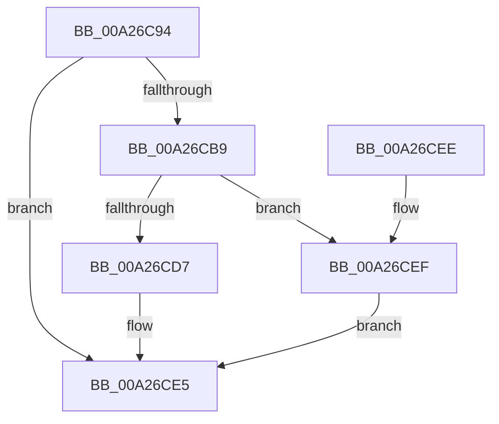

# WdtpAllocateTimer

- RVA: `0x00A26C94`–`0x00A26D00` (길이 `108` bytes)
- VA: `0x0000000140A26C94`
- 실행 섹션: `PAGE`
- PDB 이름 있음: `예`; PDB Function 태그: `아니요`
- unwind 정보 RVA: `0x0008B9A4`
- 디코드: `31`개 명령, `108/108` bytes 표시
- 미해석 바이트: `0` (있으면 어셈블리에 `.byte`로 보존)

> 이 문서는 커널 이미지의 기계어와 PDB 기호를 분석해 생성했습니다. 4번과 5번은 함수 원형과 자료형을 바이너리 사용 방식에서 추정한 C 해석이며 원본 소스 복구 결과는 아닙니다.

## 1. Dependencies

- 직접 호출 지점: **4**; 고유 호출 대상: **4**
- 직접 호출자로 확인된 함수: **1**
- RIP 상대 이미지 참조: **1**

### Outgoing calls
- `0x00A26CAC` → [ExAllocatePool2](../../poolcode/B8/ExAllocatePool2_function_00B820F0.md) (function, `0x00B820F0`)
- `0x00A26CC9` → [ExAllocateTimer](../../text/3A/ExAllocateTimer_function_003A30D0.md) (function, `0x003A30D0`)
- `0x00A26CE0` → [KeInitializeEvent](../../text/40/KeInitializeEvent_function_0040DD10.md) (function, `0x0040DD10`)
- `0x00A26CF7` → [ExFreePoolWithTag](../../poolcode/B8/ExFreePoolWithTag_function_00B82870.md) (function, `0x00B82870`)

### Direct callers
- [PnpWatchdogTimerAllocate](PnpWatchdogTimerAllocate_function_00A26BFC.md) at `0x00A26C3E`

### Static image references
- `0x00A26CC2` → RVA `0x006A31B0` (`WdtpTimerCallback`; read)

## 2. Other-region calls and transfers

- 다른 실행 섹션으로 향하는 call: **4**
  - `0x00A26CAC` → [ExAllocatePool2](../../poolcode/B8/ExAllocatePool2_function_00B820F0.md) (`PAGE` → `POOLCODE`)
  - `0x00A26CC9` → [ExAllocateTimer](../../text/3A/ExAllocateTimer_function_003A30D0.md) (`PAGE` → `.text`)
  - `0x00A26CE0` → [KeInitializeEvent](../../text/40/KeInitializeEvent_function_0040DD10.md) (`PAGE` → `.text`)
  - `0x00A26CF7` → [ExFreePoolWithTag](../../poolcode/B8/ExFreePoolWithTag_function_00B82870.md) (`PAGE` → `POOLCODE`)
- 별도 외부 분기/꼬리 이동을 확인하지 못했습니다.

## 3. Assembly (complete function range)

```asm
00A26C94  40 53                           push rbx
00A26C96  48 83 EC 20                     sub rsp, 0x20
00A26C9A  48 8D 91 8D 00 00 00            lea rdx, [rcx + 0x8d]
00A26CA1  41 B8 50 57 64 54               mov r8d, 0x54645750
00A26CA7  B9 40 00 00 00                  mov ecx, 0x40
00A26CAC  E8 3F B4 15 00                  call 0x140b820f0
00A26CB1  48 8B D8                        mov rbx, rax
00A26CB4  48 85 C0                        test rax, rax
00A26CB7  74 2C                           je 0x140a26ce5
00A26CB9  45 33 C0                        xor r8d, r8d
00A26CBC  C6 00 77                        mov byte ptr [rax], 0x77
00A26CBF  48 8B D0                        mov rdx, rax
00A26CC2  48 8D 0D E7 C4 C7 FF            lea rcx, [rip - 0x383b19]
00A26CC9  E8 02 C4 97 FF                  call 0x1403a30d0
00A26CCE  48 89 43 30                     mov qword ptr [rbx + 0x30], rax
00A26CD2  48 85 C0                        test rax, rax
00A26CD5  74 18                           je 0x140a26cef
00A26CD7  48 8D 4B 60                     lea rcx, [rbx + 0x60]
00A26CDB  45 33 C0                        xor r8d, r8d
00A26CDE  33 D2                           xor edx, edx
00A26CE0  E8 2B 70 9E FF                  call 0x14040dd10
00A26CE5  48 8B C3                        mov rax, rbx
00A26CE8  48 83 C4 20                     add rsp, 0x20
00A26CEC  5B                              pop rbx
00A26CED  C3                              ret
00A26CEE  CC                              int3
00A26CEF  BA 50 57 64 54                  mov edx, 0x54645750
00A26CF4  48 8B CB                        mov rcx, rbx
00A26CF7  E8 74 BB 15 00                  call 0x140b82870
00A26CFC  33 DB                           xor ebx, ebx
00A26CFE  EB E5                           jmp 0x140a26ce5
```

## 4. C-style interpretation (structured pseudocode)

```c
__int64 __fastcall WdtpAllocateTimer(__int64 a1)
{
    __int64 result;
    __int64 v_rbx;
    __int64 v_rsp;

    v_rsp = (v_rsp) - (32);
    result = ExAllocatePool2(64, a1 + 141, (unsigned int)(0x54645750ULL), a4);
    if (result == 0) goto loc_00A26CE5;
    a3 = 0;
    *(unsigned __int8 *)(result) = 119;
    result = ExAllocateTimer(v_rip - 3685145, result, a3, a4);
    *(unsigned __int64 *)(result + 48) = result;
    if (result == 0) goto loc_00A26CEF;
    a3 = 0;
    a2 = 0;
    result = KeInitializeEvent(result + 96, a2, a3, a4);
loc_00A26CE5:
    v_rsp = (v_rsp) + (32);
    return result;
loc_00A26CEF:
    result = ExFreePoolWithTag(result, (unsigned int)(0x54645750ULL), a3, a4);
    v_rbx = 0;
    goto loc_00A26CE5;
}
```

## 5. (Beta) C Style

```c
int64_t WdtpAllocateTimer(void *Arg1)
{
    uint8_t *arg1 = (uint8_t *)Arg1;

    int64_t result;
    int64_t local_rbx;
    int64_t local_rsp;

    local_rsp = (local_rsp) - (32);
    result = ExAllocatePool2(64, Arg1 + 141, (uint32_t)(0x54645750ULL), a4);
    if (result == 0) goto loc_00A26CE5;
    a3 = 0;
    *(uint8_t *)(result) = 119;
    result = ExAllocateTimer(v_rip - 3685145, result, a3, a4);
    *(uint64_t *)(result + 0x30) = result;
    if (result == 0) goto loc_00A26CEF;
    a3 = 0;
    a2 = 0;
    result = KeInitializeEvent(result + 96, a2, a3, a4);
loc_00A26CE5:
    local_rsp = (local_rsp) + (32);
    return result;
loc_00A26CEF:
    result = ExFreePoolWithTag(result, (uint32_t)(0x54645750ULL), a3, a4);
    local_rbx = 0;
    goto loc_00A26CE5;
}
```

### 관측된 메모리 오프셋

구조체 형식이 확인되지 않은 접근은 인자 기준의 오프셋으로만 기록했습니다.

| 기준 인자 | 오프셋 표현 | 폭 (bit) | 접근 |
|---|---:|---:|---|
| `Arg1` | `+ 0x8D` | `64` | `R` |

## 6. Execution-region graph

[열기: 2D/3D 그래프와 함수 탐색 컨트롤 패널](../../../control-panel.html?section=page&rva=0x00A26C94&view=graph)

- 2D 그래프는 위에서 아래로 흐르고, 3D 그래프는 빈 공간을 드래그해 회전합니다. Shift+드래그는 이동, 휠은 확대·축소, 함수 노드 선택은 대상 보고서 이동입니다.

### Static fallback


