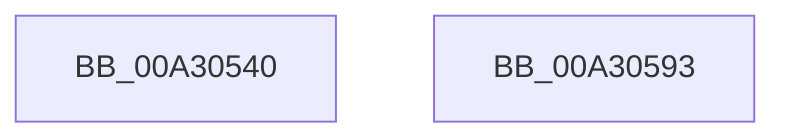

# AlpcRegionDestroyProcedure

- RVA: `0x00A30540`–`0x00A30594` (길이 `84` bytes)
- VA: `0x0000000140A30540`
- 실행 섹션: `PAGE`
- PDB 이름 있음: `예`; PDB Function 태그: `아니요`
- unwind 정보 RVA: `0x0005CAAC`
- 디코드: `25`개 명령, `84/84` bytes 표시
- 미해석 바이트: `0` (있으면 어셈블리에 `.byte`로 보존)

> 이 문서는 커널 이미지의 기계어와 PDB 기호를 분석해 생성했습니다. 4번과 5번은 함수 원형과 자료형을 바이너리 사용 방식에서 추정한 C 해석이며 원본 소스 복구 결과는 아닙니다.

## 1. Dependencies

- 직접 호출 지점: **3**; 고유 호출 대상: **3**
- 직접 호출자로 확인된 함수: **0**
- RIP 상대 이미지 참조: **0**

### Outgoing calls
- `0x00A30554` → [AlpcpLockForCachedReferenceBlob](../88/AlpcpLockForCachedReferenceBlob_function_0088A8B0.md) (function, `0x0088A8B0`)
- `0x00A30574` → [AlpcpUnlockBlob](../88/AlpcpUnlockBlob_function_0088B990.md) (function, `0x0088B990`)
- `0x00A30581` → [AlpcpDereferenceBlobEx](../88/AlpcpDereferenceBlobEx_function_0088AF00.md) (function, `0x0088AF00`)

### Direct callers
- 이 함수 시작 RVA로 연결되는 직접 call은 확인되지 않았습니다. 간접 호출은 완전히 역산할 수 없습니다.

### Static image references
- 디코드된 RIP-relative 메모리 참조가 없습니다.

## 2. Other-region calls and transfers

- 다른 실행 섹션으로 향하는 call: **0**
- 별도 외부 분기/꼬리 이동을 확인하지 못했습니다.

## 3. Assembly (complete function range)

```asm
00A30540  48 89 5C 24 08                  mov qword ptr [rsp + 8], rbx
00A30545  57                              push rdi
00A30546  48 83 EC 20                     sub rsp, 0x20
00A3054A  48 8B 79 10                     mov rdi, qword ptr [rcx + 0x10]
00A3054E  48 8B D9                        mov rbx, rcx
00A30551  48 8B CF                        mov rcx, rdi
00A30554  E8 57 A3 E5 FF                  call 0x14088a8b0
00A30559  48 8B 53 08                     mov rdx, qword ptr [rbx + 8]
00A3055D  48 8B CF                        mov rcx, rdi
00A30560  48 8B 03                        mov rax, qword ptr [rbx]
00A30563  48 89 02                        mov qword ptr [rdx], rax
00A30566  48 8B 13                        mov rdx, qword ptr [rbx]
00A30569  48 8B 43 08                     mov rax, qword ptr [rbx + 8]
00A3056D  48 89 42 08                     mov qword ptr [rdx + 8], rax
00A30571  FF 4F 34                        dec dword ptr [rdi + 0x34]
00A30574  E8 17 B4 E5 FF                  call 0x14088b990
00A30579  BA 01 00 00 00                  mov edx, 1
00A3057E  48 8B CF                        mov rcx, rdi
00A30581  E8 7A A9 E5 FF                  call 0x14088af00
00A30586  48 8B 5C 24 30                  mov rbx, qword ptr [rsp + 0x30]
00A3058B  33 C0                           xor eax, eax
00A3058D  48 83 C4 20                     add rsp, 0x20
00A30591  5F                              pop rdi
00A30592  C3                              ret
00A30593  CC                              int3
```

## 4. C-style interpretation (structured pseudocode)

```c
__int64 __fastcall AlpcRegionDestroyProcedure(__int64 a1)
{
    __int64 result;
    __int64 v_rsp;
    unsigned __int64 v_stack_p8;

    v_stack_p8 = v_rbx;
    v_rsp = (v_rsp) - (32);
    result = AlpcpLockForCachedReferenceBlob(*(unsigned __int64 *)(a1 + 16), a2, a3, a4);
    *(unsigned __int64 *)(*(unsigned __int64 *)(a1 + 8)) = *(unsigned __int64 *)(a1);
    *(unsigned __int64 *)(*(unsigned __int64 *)(a1) + 8) = *(unsigned __int64 *)(a1 + 8);
    result = AlpcpUnlockBlob(*(unsigned __int64 *)(a1 + 16), *(unsigned __int64 *)(a1), a3, a4);
    result = AlpcpDereferenceBlobEx(*(unsigned __int64 *)(a1 + 16), 1, a3, a4);
    result = 0;
    v_rsp = (v_rsp) + (32);
    return result;
}
```

## 5. (Beta) C Style

```c
int64_t AlpcRegionDestroyProcedure(void *Arg1)
{
    uint8_t *arg1 = (uint8_t *)Arg1;

    int64_t result;
    int64_t local_rsp;
    uint64_t v_stack_p8;

    v_stack_p8 = local_rbx;
    local_rsp = (local_rsp) - (32);
    result = AlpcpLockForCachedReferenceBlob(*(uint64_t *)(arg1 + 0x10), a2, a3, a4);
    *(uint64_t *)(*(uint64_t *)(arg1 + 0x8)) = *(uint64_t *)(arg1);
    *(uint64_t *)(*(uint64_t *)(arg1) + 0x8) = *(uint64_t *)(arg1 + 0x8);
    result = AlpcpUnlockBlob(*(uint64_t *)(arg1 + 0x10), *(uint64_t *)(arg1), a3, a4);
    result = AlpcpDereferenceBlobEx(*(uint64_t *)(arg1 + 0x10), 1, a3, a4);
    result = 0;
    local_rsp = (local_rsp) + (32);
    return result;
}
```

### 관측된 메모리 오프셋

구조체 형식이 확인되지 않은 접근은 인자 기준의 오프셋으로만 기록했습니다.

| 기준 인자 | 오프셋 표현 | 폭 (bit) | 접근 |
|---|---:|---:|---|
| `Arg1` | `+ 0x0` | `64` | `R` |
| `Arg1` | `+ 0x8` | `64` | `R` |
| `Arg1` | `+ 0x10` | `64` | `R` |

## 6. Execution-region graph

[열기: 2D/3D 그래프와 함수 탐색 컨트롤 패널](../../../control-panel.html?section=page&rva=0x00A30540&view=graph)

- 2D 그래프는 위에서 아래로 흐르고, 3D 그래프는 빈 공간을 드래그해 회전합니다. Shift+드래그는 이동, 휠은 확대·축소, 함수 노드 선택은 대상 보고서 이동입니다.

### Static fallback


