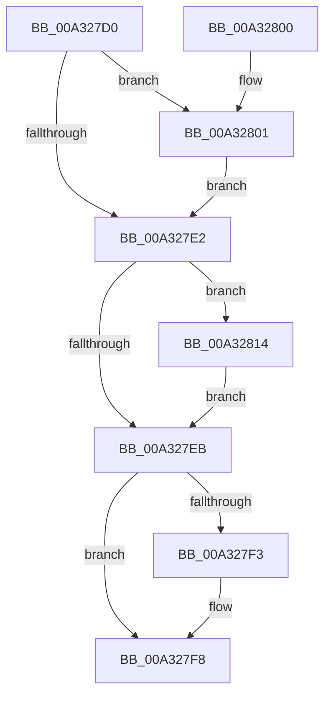

# AlpcSectionDestroyProcedure

- RVA: `0x00A327D0`–`0x00A3282C` (길이 `92` bytes)
- VA: `0x0000000140A327D0`
- 실행 섹션: `PAGE`
- PDB 이름 있음: `예`; PDB Function 태그: `아니요`
- unwind 정보 RVA: `0x000AD3D0`
- 디코드: `29`개 명령, `92/92` bytes 표시
- 미해석 바이트: `0` (있으면 어셈블리에 `.byte`로 보존)

> 이 문서는 커널 이미지의 기계어와 PDB 기호를 분석해 생성했습니다. 4번과 5번은 함수 원형과 자료형을 바이너리 사용 방식에서 추정한 C 해석이며 원본 소스 복구 결과는 아닙니다.

## 1. Dependencies

- 직접 호출 지점: **4**; 고유 호출 대상: **3**
- 직접 호출자로 확인된 함수: **0**
- RIP 상대 이미지 참조: **0**

### Outgoing calls
- `0x00A327F3` → [ObfDereferenceObject](../../text/2F/ObfDereferenceObject_function_002F9350.md) (function, `0x002F9350`)
- `0x00A32808` → [AlpcDeleteBlobByHandle](../88/AlpcDeleteBlobByHandle_function_008882A4.md) (function, `0x008882A4`)
- `0x00A32817` → [AlpcpRemoveResourcePort](../88/AlpcpRemoveResourcePort_function_0088836C.md) (function, `0x0088836C`)
- `0x00A32820` → [ObfDereferenceObject](../../text/2F/ObfDereferenceObject_function_002F9350.md) (function, `0x002F9350`)

### Direct callers
- 이 함수 시작 RVA로 연결되는 직접 call은 확인되지 않았습니다. 간접 호출은 완전히 역산할 수 없습니다.

### Static image references
- 디코드된 RIP-relative 메모리 참조가 없습니다.

## 2. Other-region calls and transfers

- 다른 실행 섹션으로 향하는 call: **2**
  - `0x00A327F3` → [ObfDereferenceObject](../../text/2F/ObfDereferenceObject_function_002F9350.md) (`PAGE` → `.text`)
  - `0x00A32820` → [ObfDereferenceObject](../../text/2F/ObfDereferenceObject_function_002F9350.md) (`PAGE` → `.text`)
- 별도 외부 분기/꼬리 이동을 확인하지 못했습니다.

## 3. Assembly (complete function range)

```asm
00A327D0  40 53                           push rbx
00A327D2  48 83 EC 20                     sub rsp, 0x20
00A327D6  48 8B D9                        mov rbx, rcx
00A327D9  48 8B 49 10                     mov rcx, qword ptr [rcx + 0x10]
00A327DD  48 85 C9                        test rcx, rcx
00A327E0  75 1F                           jne 0x140a32801
00A327E2  48 8B 4B 28                     mov rcx, qword ptr [rbx + 0x28]
00A327E6  48 85 C9                        test rcx, rcx
00A327E9  75 29                           jne 0x140a32814
00A327EB  48 8B 0B                        mov rcx, qword ptr [rbx]
00A327EE  48 85 C9                        test rcx, rcx
00A327F1  74 05                           je 0x140a327f8
00A327F3  E8 58 6B 8C FF                  call 0x1402f9350
00A327F8  33 C0                           xor eax, eax
00A327FA  48 83 C4 20                     add rsp, 0x20
00A327FE  5B                              pop rbx
00A327FF  C3                              ret
00A32800  CC                              int3
00A32801  48 8B 53 18                     mov rdx, qword ptr [rbx + 0x18]
00A32805  4C 8B C3                        mov r8, rbx
00A32808  E8 97 5A E5 FF                  call 0x1408882a4
00A3280D  48 83 63 10 00                  and qword ptr [rbx + 0x10], 0
00A32812  EB CE                           jmp 0x140a327e2
00A32814  48 8B D3                        mov rdx, rbx
00A32817  E8 50 5B E5 FF                  call 0x14088836c
00A3281C  48 8B 4B 28                     mov rcx, qword ptr [rbx + 0x28]
00A32820  E8 2B 6B 8C FF                  call 0x1402f9350
00A32825  48 83 63 28 00                  and qword ptr [rbx + 0x28], 0
00A3282A  EB BF                           jmp 0x140a327eb
```

## 4. C-style interpretation (structured pseudocode)

```c
__int64 __fastcall AlpcSectionDestroyProcedure(__int64 a1)
{
    __int64 result;
    __int64 v_rsp;

    v_rsp = (v_rsp) - (32);
    if (*(unsigned __int64 *)(a1 + 16) != 0) goto loc_00A32801;
loc_00A327E2:
    if (*(unsigned __int64 *)(a1 + 40) != 0) goto loc_00A32814;
loc_00A327EB:
    if (*(unsigned __int64 *)(a1) != 0) {
        result = ObfDereferenceObject(*(unsigned __int64 *)(a1), a2, a3, a4);
    }
    result = 0;
    v_rsp = (v_rsp) + (32);
    return result;
loc_00A32801:
    result = AlpcDeleteBlobByHandle(*(unsigned __int64 *)(a1), *(unsigned __int64 *)(a1 + 24), a1, a4);
    goto loc_00A327E2;
loc_00A32814:
    result = AlpcpRemoveResourcePort(*(unsigned __int64 *)(a1), a1, a1, a4);
    result = ObfDereferenceObject(*(unsigned __int64 *)(a1 + 40), a1, a1, a4);
    goto loc_00A327EB;
}
```

## 5. (Beta) C Style

```c
int64_t AlpcSectionDestroyProcedure(void *Arg1)
{
    uint8_t *arg1 = (uint8_t *)Arg1;

    int64_t result;
    int64_t local_rsp;

    local_rsp = (local_rsp) - (32);
    if (*(uint64_t *)(arg1 + 0x10) != 0) goto loc_00A32801;
loc_00A327E2:
    if (*(uint64_t *)(arg1 + 0x28) != 0) goto loc_00A32814;
loc_00A327EB:
    if (*(uint64_t *)(arg1) != 0) {
        result = ObfDereferenceObject(*(uint64_t *)(arg1), a2, a3, a4);
    }
    result = 0;
    local_rsp = (local_rsp) + (32);
    return result;
loc_00A32801:
    result = AlpcDeleteBlobByHandle(*(uint64_t *)(arg1), *(uint64_t *)(arg1 + 0x18), Arg1, a4);
    goto loc_00A327E2;
loc_00A32814:
    result = AlpcpRemoveResourcePort(*(uint64_t *)(arg1), Arg1, Arg1, a4);
    result = ObfDereferenceObject(*(uint64_t *)(arg1 + 0x28), Arg1, Arg1, a4);
    goto loc_00A327EB;
}
```

### 관측된 메모리 오프셋

구조체 형식이 확인되지 않은 접근은 인자 기준의 오프셋으로만 기록했습니다.

| 기준 인자 | 오프셋 표현 | 폭 (bit) | 접근 |
|---|---:|---:|---|
| `Arg1` | `+ 0x0` | `64` | `R` |
| `Arg1` | `+ 0x10` | `64` | `R` |
| `Arg1` | `+ 0x10` | `64` | `R/W` |
| `Arg1` | `+ 0x18` | `64` | `R` |
| `Arg1` | `+ 0x28` | `64` | `R` |
| `Arg1` | `+ 0x28` | `64` | `R/W` |

## 6. Execution-region graph

[열기: 2D/3D 그래프와 함수 탐색 컨트롤 패널](../../../control-panel.html?section=page&rva=0x00A327D0&view=graph)

- 2D 그래프는 위에서 아래로 흐르고, 3D 그래프는 빈 공간을 드래그해 회전합니다. Shift+드래그는 이동, 휠은 확대·축소, 함수 노드 선택은 대상 보고서 이동입니다.

### Static fallback


