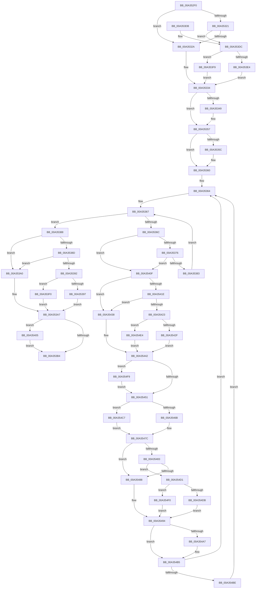

# AlpcpFlushMessagesByRequestor

- RVA: `0x00A352F0`–`0x00A35506` (길이 `534` bytes)
- VA: `0x0000000140A352F0`
- 실행 섹션: `PAGE`
- PDB 이름 있음: `예`; PDB Function 태그: `아니요`
- unwind 정보 RVA: `0x000AD710`
- 디코드: `146`개 명령, `534/534` bytes 표시
- 미해석 바이트: `0` (있으면 어셈블리에 `.byte`로 보존)

> 이 문서는 커널 이미지의 기계어와 PDB 기호를 분석해 생성했습니다. 4번과 5번은 함수 원형과 자료형을 바이너리 사용 방식에서 추정한 C 해석이며 원본 소스 복구 결과는 아닙니다.

## 1. Dependencies

- 직접 호출 지점: **12**; 고유 호출 대상: **8**
- 직접 호출자로 확인된 함수: **1**
- RIP 상대 이미지 참조: **0**

### Outgoing calls
- `0x00A35339` → [KeAbPreAcquire](../../text/21/KeAbPreAcquire_function_00210230.md) (function, `0x00210230`)
- `0x00A35352` → [ExfAcquirePushLockExclusiveEx](../../text/20/ExfAcquirePushLockExclusiveEx_function_0020FC90.md) (function, `0x0020FC90`)
- `0x00A353B7` → [KeAbPostRelease](../../text/2E/KeAbPostRelease_function_002E1600.md) (function, `0x002E1600`)
- `0x00A35408` → [ExfTryToWakePushLock](../../text/26/ExfTryToWakePushLock_function_00265DD0.md) (function, `0x00265DD0`)
- `0x00A35412` → [AlpcpReferenceBlob](../89/AlpcpReferenceBlob_function_00890110.md) (function, `0x00890110`)
- `0x00A35454` → [KeAbPostRelease](../../text/2E/KeAbPostRelease_function_002E1600.md) (function, `0x002E1600`)
- `0x00A3545C` → [AlpcpLockForCachedReferenceBlob](../88/AlpcpLockForCachedReferenceBlob_function_0088A8B0.md) (function, `0x0088A8B0`)
- `0x00A35477` → [AlpcpCancelMessage](../89/AlpcpCancelMessage_function_00894120.md) (function, `0x00894120`)
- `0x00A35497` → [KeAbPreAcquire](../../text/21/KeAbPreAcquire_function_00210230.md) (function, `0x00210230`)
- `0x00A354B0` → [ExfAcquirePushLockExclusiveEx](../../text/20/ExfAcquirePushLockExclusiveEx_function_0020FC90.md) (function, `0x0020FC90`)
- `0x00A354CA` → [AlpcpUnlockMessage](../89/AlpcpUnlockMessage_function_00897AE0.md) (function, `0x00897AE0`)
- `0x00A354FC` → [ExfTryToWakePushLock](../../text/26/ExfTryToWakePushLock_function_00265DD0.md) (function, `0x00265DD0`)

### Direct callers
- [AlpcpFlushMessagesPort](../92/AlpcpFlushMessagesPort_function_00925554.md) at `0x0092599B`

### Static image references
- 디코드된 RIP-relative 메모리 참조가 없습니다.

## 2. Other-region calls and transfers

- 다른 실행 섹션으로 향하는 call: **8**
  - `0x00A35339` → [KeAbPreAcquire](../../text/21/KeAbPreAcquire_function_00210230.md) (`PAGE` → `.text`)
  - `0x00A35352` → [ExfAcquirePushLockExclusiveEx](../../text/20/ExfAcquirePushLockExclusiveEx_function_0020FC90.md) (`PAGE` → `.text`)
  - `0x00A353B7` → [KeAbPostRelease](../../text/2E/KeAbPostRelease_function_002E1600.md) (`PAGE` → `.text`)
  - `0x00A35408` → [ExfTryToWakePushLock](../../text/26/ExfTryToWakePushLock_function_00265DD0.md) (`PAGE` → `.text`)
  - `0x00A35454` → [KeAbPostRelease](../../text/2E/KeAbPostRelease_function_002E1600.md) (`PAGE` → `.text`)
  - `0x00A35497` → [KeAbPreAcquire](../../text/21/KeAbPreAcquire_function_00210230.md) (`PAGE` → `.text`)
  - `0x00A354B0` → [ExfAcquirePushLockExclusiveEx](../../text/20/ExfAcquirePushLockExclusiveEx_function_0020FC90.md) (`PAGE` → `.text`)
  - `0x00A354FC` → [ExfTryToWakePushLock](../../text/26/ExfTryToWakePushLock_function_00265DD0.md) (`PAGE` → `.text`)
- 별도 외부 분기/꼬리 이동을 확인하지 못했습니다.

## 3. Assembly (complete function range)

```asm
00A352F0  48 8B C4                        mov rax, rsp
00A352F3  48 89 58 08                     mov qword ptr [rax + 8], rbx
00A352F7  48 89 68 10                     mov qword ptr [rax + 0x10], rbp
00A352FB  48 89 70 18                     mov qword ptr [rax + 0x18], rsi
00A352FF  48 89 78 20                     mov qword ptr [rax + 0x20], rdi
00A35303  41 54                           push r12
00A35305  41 56                           push r14
00A35307  41 57                           push r15
00A35309  48 83 EC 20                     sub rsp, 0x20
00A3530D  41 8B C1                        mov eax, r9d
00A35310  41 8B F1                        mov esi, r9d
00A35313  4D 8B F8                        mov r15, r8
00A35316  48 8B EA                        mov rbp, rdx
00A35319  4C 8B E1                        mov r12, rcx
00A3531C  83 E8 01                        sub eax, 1
00A3531F  74 09                           je 0x140a3532a
00A35321  83 E8 01                        sub eax, 1
00A35324  0F 85 B2 00 00 00               jne 0x140a353dc
00A3532A  48 8D 9A 88 00 00 00            lea rbx, [rdx + 0x88]
00A35331  45 33 C0                        xor r8d, r8d
00A35334  33 D2                           xor edx, edx
00A35336  48 8B CB                        mov rcx, rbx
00A35339  E8 F2 AE 7D FF                  call 0x140210230
00A3533E  F0 48 0F BA 2B 00               lock bts qword ptr [rbx], 0
00A35344  48 8B F8                        mov rdi, rax
00A35347  73 0E                           jae 0x140a35357
00A35349  4C 8B C3                        mov r8, rbx
00A3534C  48 8B D0                        mov rdx, rax
00A3534F  48 8B CB                        mov rcx, rbx
00A35352  E8 39 A9 7D FF                  call 0x14020fc90
00A35357  48 85 FF                        test rdi, rdi
00A3535A  74 04                           je 0x140a35360
00A3535C  C6 47 0A 01                     mov byte ptr [rdi + 0xa], 1
00A35360  48 83 CB FF                     or rbx, 0xffffffffffffffff
00A35364  49 8B 3F                        mov rdi, qword ptr [r15]
00A35367  49 3B FF                        cmp rdi, r15
00A3536A  74 1C                           je 0x140a35388
00A3536C  4C 39 67 18                     cmp qword ptr [rdi + 0x18], r12
00A35370  0F 84 99 00 00 00               je 0x140a3540f
00A35376  F7 47 28 00 00 01 00            test dword ptr [rdi + 0x28], 0x10000
00A3537D  0F 85 8C 00 00 00               jne 0x140a3540f
00A35383  48 8B 3F                        mov rdi, qword ptr [rdi]
00A35386  EB DF                           jmp 0x140a35367
00A35388  83 EE 01                        sub esi, 1
00A3538B  74 13                           je 0x140a353a0
00A3538D  83 EE 01                        sub esi, 1
00A35390  74 0E                           je 0x140a353a0
00A35392  83 FE 01                        cmp esi, 1
00A35395  74 59                           je 0x140a353f0
00A35397  48 8D BD C8 00 00 00            lea rdi, [rbp + 0xc8]
00A3539E  EB 07                           jmp 0x140a353a7
00A353A0  48 8D BD 88 00 00 00            lea rdi, [rbp + 0x88]
00A353A7  F0 48 0F C1 1F                  lock xadd qword ptr [rdi], rbx
00A353AC  80 E3 06                        and bl, 6
00A353AF  80 FB 02                        cmp bl, 2
00A353B2  74 51                           je 0x140a35405
00A353B4  48 8B CF                        mov rcx, rdi
00A353B7  E8 44 C2 8A FF                  call 0x1402e1600
00A353BC  48 8B 5C 24 40                  mov rbx, qword ptr [rsp + 0x40]
00A353C1  48 8B 6C 24 48                  mov rbp, qword ptr [rsp + 0x48]
00A353C6  48 8B 74 24 50                  mov rsi, qword ptr [rsp + 0x50]
00A353CB  48 8B 7C 24 58                  mov rdi, qword ptr [rsp + 0x58]
00A353D0  48 83 C4 20                     add rsp, 0x20
00A353D4  41 5F                           pop r15
00A353D6  41 5E                           pop r14
00A353D8  41 5C                           pop r12
00A353DA  C3                              ret
00A353DB  CC                              int3
00A353DC  45 33 C0                        xor r8d, r8d
00A353DF  83 F8 01                        cmp eax, 1
00A353E2  74 15                           je 0x140a353f9
00A353E4  48 8D 9A C8 00 00 00            lea rbx, [rdx + 0xc8]
00A353EB  E9 44 FF FF FF                  jmp 0x140a35334
00A353F0  48 8D BD B0 00 00 00            lea rdi, [rbp + 0xb0]
00A353F7  EB AE                           jmp 0x140a353a7
00A353F9  48 8D 9A B0 00 00 00            lea rbx, [rdx + 0xb0]
00A35400  E9 2F FF FF FF                  jmp 0x140a35334
00A35405  48 8B CF                        mov rcx, rdi
00A35408  E8 C3 09 83 FF                  call 0x140265dd0
00A3540D  EB A5                           jmp 0x140a353b4
00A3540F  48 8B CF                        mov rcx, rdi
00A35412  E8 F9 AC E5 FF                  call 0x140890110
00A35417  8B C6                           mov eax, esi
00A35419  83 E8 01                        sub eax, 1
00A3541C  74 1A                           je 0x140a35438
00A3541E  83 E8 01                        sub eax, 1
00A35421  74 15                           je 0x140a35438
00A35423  83 F8 01                        cmp eax, 1
00A35426  48 8B C3                        mov rax, rbx
00A35429  0F 84 B5 00 00 00               je 0x140a354e4
00A3542F  4C 8D B5 C8 00 00 00            lea r14, [rbp + 0xc8]
00A35436  EB 0A                           jmp 0x140a35442
00A35438  4C 8D B5 88 00 00 00            lea r14, [rbp + 0x88]
00A3543F  48 8B C3                        mov rax, rbx
00A35442  F0 49 0F C1 06                  lock xadd qword ptr [r14], rax
00A35447  24 06                           and al, 6
00A35449  3C 02                           cmp al, 2
00A3544B  0F 84 A8 00 00 00               je 0x140a354f9
00A35451  49 8B CE                        mov rcx, r14
00A35454  E8 A7 C1 8A FF                  call 0x1402e1600
00A35459  48 8B CF                        mov rcx, rdi
00A3545C  E8 4F 54 E5 FF                  call 0x14088a8b0
00A35461  66 01 5F E2                     add word ptr [rdi - 0x1e], bx
00A35465  4C 39 67 18                     cmp qword ptr [rdi + 0x18], r12
00A35469  75 5C                           jne 0x140a354c7
00A3546B  41 B8 00 00 01 00               mov r8d, 0x10000
00A35471  48 8B D7                        mov rdx, rdi
00A35474  48 8B CD                        mov rcx, rbp
00A35477  E8 A4 EC E5 FF                  call 0x140894120
00A3547C  8B C6                           mov eax, esi
00A3547E  83 E8 01                        sub eax, 1
00A35481  74 05                           je 0x140a35488
00A35483  83 E8 01                        sub eax, 1
00A35486  75 49                           jne 0x140a354d1
00A35488  45 33 C0                        xor r8d, r8d
00A3548B  4C 8D B5 88 00 00 00            lea r14, [rbp + 0x88]
00A35492  33 D2                           xor edx, edx
00A35494  49 8B CE                        mov rcx, r14
00A35497  E8 94 AD 7D FF                  call 0x140210230
00A3549C  F0 49 0F BA 2E 00               lock bts qword ptr [r14], 0
00A354A2  48 8B F8                        mov rdi, rax
00A354A5  73 0E                           jae 0x140a354b5
00A354A7  4D 8B C6                        mov r8, r14
00A354AA  48 8B D0                        mov rdx, rax
00A354AD  49 8B CE                        mov rcx, r14
00A354B0  E8 DB A7 7D FF                  call 0x14020fc90
00A354B5  48 85 FF                        test rdi, rdi
00A354B8  0F 84 A6 FE FF FF               je 0x140a35364
00A354BE  C6 47 0A 01                     mov byte ptr [rdi + 0xa], 1
00A354C2  E9 9D FE FF FF                  jmp 0x140a35364
00A354C7  48 8B CF                        mov rcx, rdi
00A354CA  E8 11 26 E6 FF                  call 0x140897ae0
00A354CF  EB AB                           jmp 0x140a3547c
00A354D1  45 33 C0                        xor r8d, r8d
00A354D4  33 D2                           xor edx, edx
00A354D6  83 F8 01                        cmp eax, 1
00A354D9  74 15                           je 0x140a354f0
00A354DB  4C 8D B5 C8 00 00 00            lea r14, [rbp + 0xc8]
00A354E2  EB B0                           jmp 0x140a35494
00A354E4  4C 8D B5 B0 00 00 00            lea r14, [rbp + 0xb0]
00A354EB  E9 52 FF FF FF                  jmp 0x140a35442
00A354F0  4C 8D B5 B0 00 00 00            lea r14, [rbp + 0xb0]
00A354F7  EB 9B                           jmp 0x140a35494
00A354F9  49 8B CE                        mov rcx, r14
00A354FC  E8 CF 08 83 FF                  call 0x140265dd0
00A35501  E9 4B FF FF FF                  jmp 0x140a35451
```

## 4. C-style interpretation (structured pseudocode)

```c
__int64 __fastcall AlpcpFlushMessagesByRequestor(__int64 a1, __int64 a2, __int64 a3, int a4)
{
    __int64 result;
    __int64 v_rbx;
    __int64 v_rsi;
    __int64 v_rsp;
    unsigned __int64 v_stack_p10;
    unsigned __int64 v_stack_p18;
    unsigned __int64 v_stack_p20;
    unsigned __int64 v_stack_p8;

    *(unsigned __int64 *)(v_rsp + 8) = v_rbx;
    *(unsigned __int64 *)(v_rsp + 16) = v_rbp;
    *(unsigned __int64 *)(v_rsp + 24) = v_rsi;
    *(unsigned __int64 *)(v_rsp + 32) = v_rdi;
    v_rsp = (v_rsp) - (32);
    result = (unsigned int)(((unsigned int)(a4)) - (1));
    if (condition_is_equal) goto loc_00A3532A;
    result = (unsigned int)((result) - (1));
    if (condition_is_not_equal) goto loc_00A353DC;
loc_00A3532A:
    a3 = 0;
loc_00A35334:
    a2 = 0;
    result = KeAbPreAcquire(a2 + 136, a2, a3, a4);
    if (!(condition_is_above_or_equal)) {
        a3 = a2 + 136;
        a2 = result;
        a1 = a2 + 136;
        result = ExfAcquirePushLockExclusiveEx(a1, a2, a3, a4);
    }
    if (result != 0) {
        *(unsigned __int8 *)(result + 10) = 1;
    }
    v_rbx = (a2 + 136) | (-1);
loc_00A35364:
loc_00A35367:
    if ((*(unsigned __int64 *)(a3)) == a3) goto loc_00A35388;
    if ((*(unsigned __int64 *)(*(unsigned __int64 *)(a3) + 24)) == a1) goto loc_00A3540F;
    if (((*(unsigned int *)(*(unsigned __int64 *)(a3) + 40)) & (0x10000ULL)) != 0) goto loc_00A3540F;
    goto loc_00A35367;
loc_00A35388:
    v_rsi = (unsigned int)(((unsigned int)(a4)) - (1));
    if (condition_is_equal) goto loc_00A353A0;
    v_rsi = (unsigned int)((v_rsi) - (1));
    if (condition_is_equal) goto loc_00A353A0;
    if (((unsigned int)(v_rsi)) == 1) goto loc_00A353F0;
    goto loc_00A353A7;
loc_00A353A0:
loc_00A353A7:
    v_rbx = (unsigned __int8)((v_rbx) & (6));
    if (((unsigned __int8)(v_rbx)) == 2) goto loc_00A35405;
loc_00A353B4:
    result = KeAbPostRelease(a2 + 136, a2, a3, a4);
    v_rsp = (v_rsp) + (32);
    return result;
loc_00A353DC:
    a3 = 0;
    if (((unsigned int)(result)) == 1) goto loc_00A353F9;
    goto loc_00A35334;
loc_00A353F0:
    goto loc_00A353A7;
loc_00A353F9:
    goto loc_00A35334;
loc_00A35405:
    result = ExfTryToWakePushLock(v_stack_p10 + 176, a2, a3, a4);
    goto loc_00A353B4;
loc_00A3540F:
    result = AlpcpReferenceBlob(v_stack_p10 + 176, a2, a3, a4);
    result = (unsigned int)(((unsigned int)((unsigned int)(v_stack_p18))) - (1));
    if (condition_is_equal) goto loc_00A35438;
    result = (unsigned int)((result) - (1));
    if (condition_is_equal) goto loc_00A35438;
    if (((unsigned int)(result)) == 1) goto loc_00A354E4;
    goto loc_00A35442;
loc_00A35438:
loc_00A35442:
    result = (unsigned __int8)((a2 + 176) & (6));
    if (((unsigned __int8)(result)) == 2) goto loc_00A354F9;
loc_00A35451:
    result = KeAbPostRelease(v_stack_p10 + 136, a2, a3, a4);
    result = AlpcpLockForCachedReferenceBlob(v_stack_p10 + 176, a2, a3, a4);
    if ((*(unsigned __int64 *)(v_stack_p10 + 176 + 24)) != a1) goto loc_00A354C7;
    result = AlpcpCancelMessage(v_stack_p10, v_stack_p10 + 176, (unsigned int)(0x10000ULL), a4);
loc_00A3547C:
    result = (unsigned int)(((unsigned int)((unsigned int)(v_stack_p18))) - (1));
    if (condition_is_equal) goto loc_00A35488;
    result = (unsigned int)((result) - (1));
    if (condition_is_not_equal) goto loc_00A354D1;
loc_00A35488:
    a3 = 0;
    a2 = 0;
loc_00A35494:
    result = KeAbPreAcquire(v_stack_p10 + 136, a2, a3, a4);
    if (!(condition_is_above_or_equal)) {
        a3 = v_stack_p10 + 136;
        a2 = result;
        a1 = v_stack_p10 + 136;
        result = ExfAcquirePushLockExclusiveEx(a1, a2, a3, a4);
    }
    if (result == 0) goto loc_00A35364;
    *(unsigned __int8 *)(result + 10) = 1;
    goto loc_00A35364;
loc_00A354C7:
    result = AlpcpUnlockMessage(result, a2, a3, a4);
    goto loc_00A3547C;
loc_00A354D1:
    a3 = 0;
    a2 = 0;
    if (((unsigned int)(result)) == 1) goto loc_00A354F0;
    goto loc_00A35494;
loc_00A354E4:
    goto loc_00A35442;
loc_00A354F0:
    goto loc_00A35494;
loc_00A354F9:
    result = ExfTryToWakePushLock(v_stack_p10 + 176, a2, a3, a4);
    goto loc_00A35451;
}
```

## 5. (Beta) C Style

```c
int64_t AlpcpFlushMessagesByRequestor(int64_t Arg1, void *Arg2, void *Arg3, int32_t Arg4)
{
    uint8_t *arg2 = (uint8_t *)Arg2;
    uint8_t *arg3 = (uint8_t *)Arg3;

    int64_t result;
    int64_t local_rbx;
    int64_t local_rsi;
    int64_t local_rsp;
    uint64_t v_stack_p10;
    uint64_t v_stack_p18;
    uint64_t v_stack_p20;
    uint64_t v_stack_p8;

    *(uint64_t *)(local_rsp + 0x8) = local_rbx;
    *(uint64_t *)(local_rsp + 0x10) = local_rbp;
    *(uint64_t *)(local_rsp + 0x18) = local_rsi;
    *(uint64_t *)(local_rsp + 0x20) = local_rdi;
    local_rsp = (local_rsp) - (32);
    result = (uint32_t)(((uint32_t)(Arg4)) - (1));
    if (condition_is_equal) goto loc_00A3532A;
    result = (uint32_t)((result) - (1));
    if (condition_is_not_equal) goto loc_00A353DC;
loc_00A3532A:
    Arg3 = 0;
loc_00A35334:
    Arg2 = 0;
    result = KeAbPreAcquire(Arg2 + 136, Arg2, Arg3, Arg4);
    if (!(condition_is_above_or_equal)) {
        Arg3 = Arg2 + 136;
        Arg2 = result;
        Arg1 = Arg2 + 136;
        result = ExfAcquirePushLockExclusiveEx(Arg1, Arg2, Arg3, Arg4);
    }
    if (result != 0) {
        *(uint8_t *)(result + 0xA) = 1;
    }
    local_rbx = (Arg2 + 136) | (-1);
loc_00A35364:
loc_00A35367:
    if ((*(uint64_t *)(arg3)) == Arg3) goto loc_00A35388;
    if ((*(uint64_t *)(*(uint64_t *)(arg3) + 0x18)) == Arg1) goto loc_00A3540F;
    if (((*(uint32_t *)(*(uint64_t *)(arg3) + 0x28)) & (0x10000ULL)) != 0) goto loc_00A3540F;
    goto loc_00A35367;
loc_00A35388:
    local_rsi = (uint32_t)(((uint32_t)(Arg4)) - (1));
    if (condition_is_equal) goto loc_00A353A0;
    local_rsi = (uint32_t)((local_rsi) - (1));
    if (condition_is_equal) goto loc_00A353A0;
    if (((uint32_t)(local_rsi)) == 1) goto loc_00A353F0;
    goto loc_00A353A7;
loc_00A353A0:
loc_00A353A7:
    local_rbx = (uint8_t)((local_rbx) & (6));
    if (((uint8_t)(local_rbx)) == 2) goto loc_00A35405;
loc_00A353B4:
    result = KeAbPostRelease(Arg2 + 136, Arg2, Arg3, Arg4);
    local_rsp = (local_rsp) + (32);
    return result;
loc_00A353DC:
    Arg3 = 0;
    if (((uint32_t)(result)) == 1) goto loc_00A353F9;
    goto loc_00A35334;
loc_00A353F0:
    goto loc_00A353A7;
loc_00A353F9:
    goto loc_00A35334;
loc_00A35405:
    result = ExfTryToWakePushLock(v_stack_p10 + 176, Arg2, Arg3, Arg4);
    goto loc_00A353B4;
loc_00A3540F:
    result = AlpcpReferenceBlob(v_stack_p10 + 176, Arg2, Arg3, Arg4);
    result = (uint32_t)(((uint32_t)((uint32_t)(v_stack_p18))) - (1));
    if (condition_is_equal) goto loc_00A35438;
    result = (uint32_t)((result) - (1));
    if (condition_is_equal) goto loc_00A35438;
    if (((uint32_t)(result)) == 1) goto loc_00A354E4;
    goto loc_00A35442;
loc_00A35438:
loc_00A35442:
    result = (uint8_t)((Arg2 + 176) & (6));
    if (((uint8_t)(result)) == 2) goto loc_00A354F9;
loc_00A35451:
    result = KeAbPostRelease(v_stack_p10 + 136, Arg2, Arg3, Arg4);
    result = AlpcpLockForCachedReferenceBlob(v_stack_p10 + 176, Arg2, Arg3, Arg4);
    if ((*(uint64_t *)(v_stack_p10 + 0xB0 + 0x18)) != Arg1) goto loc_00A354C7;
    result = AlpcpCancelMessage(v_stack_p10, v_stack_p10 + 176, (uint32_t)(0x10000ULL), Arg4);
loc_00A3547C:
    result = (uint32_t)(((uint32_t)((uint32_t)(v_stack_p18))) - (1));
    if (condition_is_equal) goto loc_00A35488;
    result = (uint32_t)((result) - (1));
    if (condition_is_not_equal) goto loc_00A354D1;
loc_00A35488:
    Arg3 = 0;
    Arg2 = 0;
loc_00A35494:
    result = KeAbPreAcquire(v_stack_p10 + 136, Arg2, Arg3, Arg4);
    if (!(condition_is_above_or_equal)) {
        Arg3 = v_stack_p10 + 136;
        Arg2 = result;
        Arg1 = v_stack_p10 + 136;
        result = ExfAcquirePushLockExclusiveEx(Arg1, Arg2, Arg3, Arg4);
    }
    if (result == 0) goto loc_00A35364;
    *(uint8_t *)(result + 0xA) = 1;
    goto loc_00A35364;
loc_00A354C7:
    result = AlpcpUnlockMessage(result, Arg2, Arg3, Arg4);
    goto loc_00A3547C;
loc_00A354D1:
    Arg3 = 0;
    Arg2 = 0;
    if (((uint32_t)(result)) == 1) goto loc_00A354F0;
    goto loc_00A35494;
loc_00A354E4:
    goto loc_00A35442;
loc_00A354F0:
    goto loc_00A35494;
loc_00A354F9:
    result = ExfTryToWakePushLock(v_stack_p10 + 176, Arg2, Arg3, Arg4);
    goto loc_00A35451;
}
```

### 관측된 메모리 오프셋

구조체 형식이 확인되지 않은 접근은 인자 기준의 오프셋으로만 기록했습니다.

| 기준 인자 | 오프셋 표현 | 폭 (bit) | 접근 |
|---|---:|---:|---|
| `Arg2` | `+ 0x0` | `64` | `R/W` |
| `Arg2` | `+ 0x88` | `64` | `R` |
| `Arg2` | `+ 0xB0` | `64` | `R` |
| `Arg2` | `+ 0xC8` | `64` | `R` |
| `Arg3` | `+ 0x0` | `64` | `R` |

## 6. Execution-region graph

[열기: 2D/3D 그래프와 함수 탐색 컨트롤 패널](../../../control-panel.html?section=page&rva=0x00A352F0&view=graph)

- 2D 그래프는 위에서 아래로 흐르고, 3D 그래프는 빈 공간을 드래그해 회전합니다. Shift+드래그는 이동, 휠은 확대·축소, 함수 노드 선택은 대상 보고서 이동입니다.

### Static fallback


