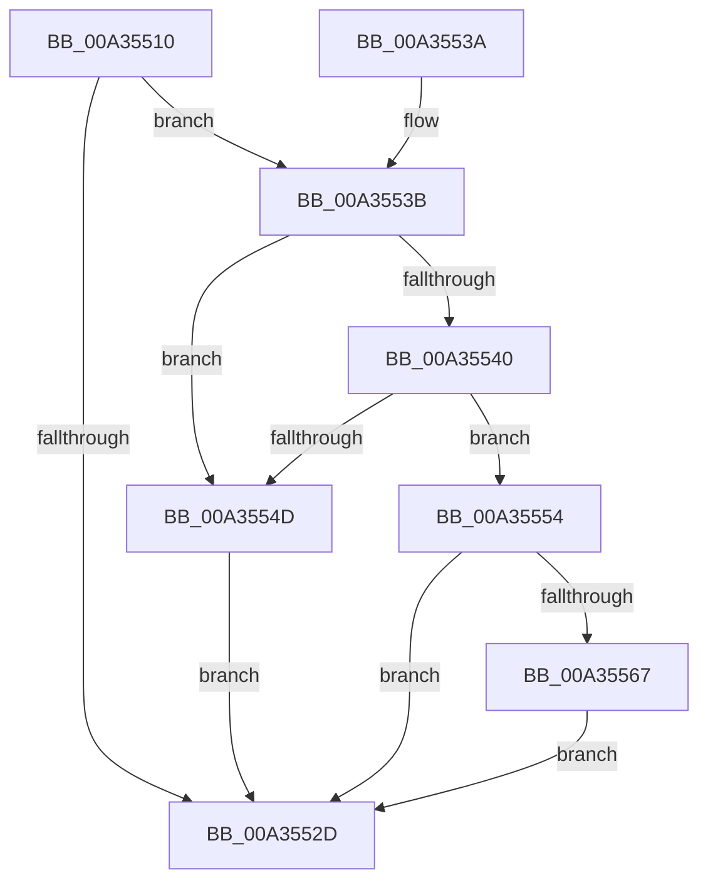

# AlpcpOpenPort

- RVA: `0x00A35510`–`0x00A35571` (길이 `97` bytes)
- VA: `0x0000000140A35510`
- 실행 섹션: `PAGE`
- PDB 이름 있음: `예`; PDB Function 태그: `아니요`
- unwind 정보 RVA: `0x0007DF88`
- 디코드: `29`개 명령, `97/97` bytes 표시
- 미해석 바이트: `0` (있으면 어셈블리에 `.byte`로 보존)

> 이 문서는 커널 이미지의 기계어와 PDB 기호를 분석해 생성했습니다. 4번과 5번은 함수 원형과 자료형을 바이너리 사용 방식에서 추정한 C 해석이며 원본 소스 복구 결과는 아닙니다.

## 1. Dependencies

- 직접 호출 지점: **1**; 고유 호출 대상: **1**
- 직접 호출자로 확인된 함수: **0**
- RIP 상대 이미지 참조: **0**

### Outgoing calls
- `0x00A3552D` → [KeLeaveCriticalRegion](../../text/25/KeLeaveCriticalRegion_function_0025D8B0.md) (function, `0x0025D8B0`)

### Direct callers
- 이 함수 시작 RVA로 연결되는 직접 call은 확인되지 않았습니다. 간접 호출은 완전히 역산할 수 없습니다.

### Static image references
- 디코드된 RIP-relative 메모리 참조가 없습니다.

## 2. Other-region calls and transfers

- 다른 실행 섹션으로 향하는 call: **1**
  - `0x00A3552D` → [KeLeaveCriticalRegion](../../text/25/KeLeaveCriticalRegion_function_0025D8B0.md) (`PAGE` → `.text`)
- 별도 외부 분기/꼬리 이동을 확인하지 못했습니다.

## 3. Assembly (complete function range)

```asm
00A35510  40 53                           push rbx
00A35512  48 83 EC 20                     sub rsp, 0x20
00A35516  65 48 8B 04 25 88 01 00 00      mov rax, qword ptr gs:[0x188]
00A3551F  33 DB                           xor ebx, ebx
00A35521  66 FF 88 E4 01 00 00            dec word ptr [rax + 0x1e4]
00A35528  90                              nop
00A35529  85 C9                           test ecx, ecx
00A3552B  75 0E                           jne 0x140a3553b
00A3552D  E8 7E 83 82 FF                  call 0x14025d8b0
00A35532  8B C3                           mov eax, ebx
00A35534  48 83 C4 20                     add rsp, 0x20
00A35538  5B                              pop rbx
00A35539  C3                              ret
00A3553A  CC                              int3
00A3553B  83 F9 02                        cmp ecx, 2
00A3553E  75 0D                           jne 0x140a3554d
00A35540  41 F7 81 00 01 00 00 00 00 10 00  test dword ptr [r9 + 0x100], 0x100000
00A3554B  74 07                           je 0x140a35554
00A3554D  BB BB 00 00 C0                  mov ebx, 0xc00000bb
00A35552  EB D9                           jmp 0x140a3552d
00A35554  49 8B 49 18                     mov rcx, qword ptr [r9 + 0x18]
00A35558  48 8B C3                        mov rax, rbx
00A3555B  F6 C1 01                        test cl, 1
00A3555E  48 0F 44 C1                     cmove rax, rcx
00A35562  49 3B C0                        cmp rax, r8
00A35565  74 C6                           je 0x140a3552d
00A35567  48 8B 44 24 50                  mov rax, qword ptr [rsp + 0x50]
00A3556C  83 20 FE                        and dword ptr [rax], 0xfffffffe
00A3556F  EB BC                           jmp 0x140a3552d
```

## 4. C-style interpretation (structured pseudocode)

```c
__int64 __fastcall AlpcpOpenPort(int a1, __int64 a2, __int64 a3, __int64 a4, __int64 a5)
{
    __int64 result;
    __int64 v_rbx;
    __int64 v_rsp;

    v_rsp = (v_rsp) - (32);
    v_rbx = 0;
    if (a1 != 0) goto loc_00A3553B;
loc_00A3552D:
    result = KeLeaveCriticalRegion(a1, a2, a3, a4);
    v_rsp = (v_rsp) + (32);
    return 0;
loc_00A3553B:
    if (a1 != 2) goto loc_00A3554D;
    if (((*(unsigned int *)(a4 + 256)) & (0x100000ULL)) == 0) goto loc_00A35554;
loc_00A3554D:
    goto loc_00A3552D;
loc_00A35554:
    result = (unsigned int)(0xC00000BBULL);
    if ((((unsigned __int8)(*(unsigned __int64 *)(a4 + 24))) & (1)) == 0) { result = *(unsigned __int64 *)(a4 + 24); }
    if (result == a3) goto loc_00A3552D;
    goto loc_00A3552D;
}
```

## 5. (Beta) C Style

```c
int64_t AlpcpOpenPort(int32_t Arg1, int64_t Arg2, int64_t Arg3, void *Arg4, void *Arg5)
{
    uint8_t *arg4 = (uint8_t *)Arg4;
    uint8_t *arg5 = (uint8_t *)Arg5;

    int64_t result;
    int64_t local_rbx;
    int64_t local_rsp;

    local_rsp = (local_rsp) - (32);
    local_rbx = 0;
    if (Arg1 != 0) goto loc_00A3553B;
loc_00A3552D:
    result = KeLeaveCriticalRegion(Arg1, Arg2, Arg3, Arg4);
    local_rsp = (local_rsp) + (32);
    return 0;
loc_00A3553B:
    if (Arg1 != 2) goto loc_00A3554D;
    if (((*(uint32_t *)(arg4 + 0x100)) & (0x100000ULL)) == 0) goto loc_00A35554;
loc_00A3554D:
    goto loc_00A3552D;
loc_00A35554:
    result = (uint32_t)(0xC00000BBULL);
    if ((((uint8_t)(*(uint64_t *)(arg4 + 0x18))) & (1)) == 0) { result = *(uint64_t *)(arg4 + 0x18); }
    if (result == Arg3) goto loc_00A3552D;
    goto loc_00A3552D;
}
```

### 관측된 메모리 오프셋

구조체 형식이 확인되지 않은 접근은 인자 기준의 오프셋으로만 기록했습니다.

| 기준 인자 | 오프셋 표현 | 폭 (bit) | 접근 |
|---|---:|---:|---|
| `Arg4` | `+ 0x18` | `64` | `R` |
| `Arg4` | `+ 0x100` | `32` | `R` |
| `Arg5` | `+ 0x0` | `32` | `R/W` |

## 6. Execution-region graph

[열기: 2D/3D 그래프와 함수 탐색 컨트롤 패널](../../../control-panel.html?section=page&rva=0x00A35510&view=graph)

- 2D 그래프는 위에서 아래로 흐르고, 3D 그래프는 빈 공간을 드래그해 회전합니다. Shift+드래그는 이동, 휠은 확대·축소, 함수 노드 선택은 대상 보고서 이동입니다.

### Static fallback


