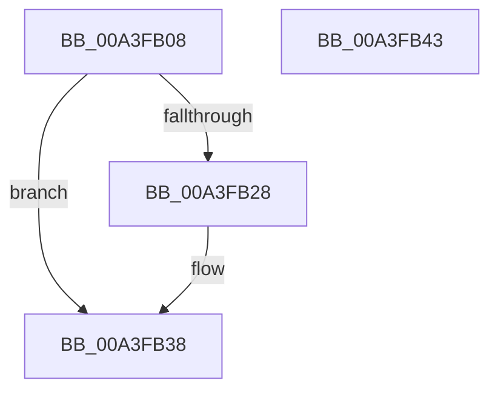

# BcdCloseObject

- RVA: `0x00A3FB08`–`0x00A3FB44` (길이 `60` bytes)
- VA: `0x0000000140A3FB08`
- 실행 섹션: `PAGE`
- PDB 이름 있음: `예`; PDB Function 태그: `아니요`
- unwind 정보 RVA: `0x0005CAAC`
- 디코드: `19`개 명령, `60/60` bytes 표시
- 미해석 바이트: `0` (있으면 어셈블리에 `.byte`로 보존)

> 이 문서는 커널 이미지의 기계어와 PDB 기호를 분석해 생성했습니다. 4번과 5번은 함수 원형과 자료형을 바이너리 사용 방식에서 추정한 C 해석이며 원본 소스 복구 결과는 아닙니다.

## 1. Dependencies

- 직접 호출 지점: **4**; 고유 호출 대상: **4**
- 직접 호출자로 확인된 함수: **20**
- RIP 상대 이미지 참조: **0**

### Outgoing calls
- `0x00A3FB15` → [BiIsOfflineHandle](../../text/4B/BiIsOfflineHandle_function_004B4FA0.md) (function, `0x004B4FA0`)
- `0x00A3FB1F` → [BiAcquireBcdSyncMutant](../91/BiAcquireBcdSyncMutant_function_00916898.md) (function, `0x00916898`)
- `0x00A3FB2B` → [BiCloseKey](../91/BiCloseKey_function_00916A00.md) (function, `0x00916A00`)
- `0x00A3FB33` → [BiReleaseBcdSyncMutant](../91/BiReleaseBcdSyncMutant_function_0091695C.md) (function, `0x0091695C`)

### Direct callers
- [PopAdaptivePersistSystemInitatedRebootState](../../text/5D/PopAdaptivePersistSystemInitatedRebootState_function_005DC30C.md) at `0x005DC3DF`
- [WheaPersistBadPageToBcd](../../text/65/WheaPersistBadPageToBcd_function_0065F3D0.md) at `0x0065F54C`
- [PopAdaptiveClearInitialSystemPowerState](../76/PopAdaptiveClearInitialSystemPowerState_function_0076B55C.md) at `0x0076B5C8`
- [PopAdaptiveGetSystemInitiatedRebootTargetBootEntry](../76/PopAdaptiveGetSystemInitiatedRebootTargetBootEntry_function_0076B69C.md) at `0x0076B763`
- [PopBcdEstablishResumeObject](../77/PopBcdEstablishResumeObject_function_007700E4.md) at `0x00770221`
- [PopBcdEstablishResumeObject](../77/PopBcdEstablishResumeObject_function_007700E4.md) at `0x00770241`
- [PopBcdEstablishResumeObject](../77/PopBcdEstablishResumeObject_function_007700E4.md) at `0x0077027D`
- [PopBcdGetApplicationPathFromResumeObject](../77/PopBcdGetApplicationPathFromResumeObject_function_007702AC.md) at `0x0077045C`
- [PopBcdGetApplicationPathFromResumeObject](../77/PopBcdGetApplicationPathFromResumeObject_function_007702AC.md) at `0x00770469`
- [PopBcdRegenerateResumeObject](../77/PopBcdRegenerateResumeObject_function_007704BC.md) at `0x007706BE`
- [PopBcdSetPendingResume](../77/PopBcdSetPendingResume_function_007706F8.md) at `0x00770829`
- [SepSecureBootCorrectBcd](../7A/SepSecureBootCorrectBcd_function_007A2174.md) at `0x007A2397`
- [SepSecureBootCorrectBcd](../7A/SepSecureBootCorrectBcd_function_007A2174.md) at `0x007A23C1`
- [BiGetDefaultBootEntryIdentifier](../82/BiGetDefaultBootEntryIdentifier_function_0082397C.md) at `0x008239F7`
- [BiAddBootEntryToEfiBootManagerDisplayOrder](../82/BiAddBootEntryToEfiBootManagerDisplayOrder_function_008262D8.md) at `0x00826408`
- [BiCreateEfiEntry](../82/BiCreateEfiEntry_function_008268C4.md) at `0x00826A75`
- [BiUpdateBcdObject](../82/BiUpdateBcdObject_function_008270D0.md) at `0x00827411`
- [BiUpdateEfiEntry](BiUpdateEfiEntry_function_00A3CCC0.md) at `0x00A3CE69`
- [PopBcdClearPendingResume](PopBcdClearPendingResume_function_00A3E07C.md) at `0x00A3E0BE`
- [BiBuildIdentifierList](BiBuildIdentifierList_function_00A3E584.md) at `0x00A3E6D1`
- [BiBuildIdentifierList](BiBuildIdentifierList_function_00A3E584.md) at `0x00A3E7C9`
- [BiBuildIdentifierList](BiBuildIdentifierList_function_00A3E584.md) at `0x00A3EB5C`
- [BiExportEfiBootManager](../AC/BiExportEfiBootManager_function_00ACB13C.md) at `0x00ACB432`
- [BiBindEfiEntryToBcdObject](../AD/BiBindEfiEntryToBcdObject_function_00AD502C.md) at `0x00AD5102`
- [PopAllocateHiberContext](../AD/PopAllocateHiberContext_function_00ADC05C.md) at `0x00ADC335`
- [sub_00B3A616](../B3/Unknown_function_00B3A616.md) at `0x00B3A616`

### Static image references
- 디코드된 RIP-relative 메모리 참조가 없습니다.

## 2. Other-region calls and transfers

- 다른 실행 섹션으로 향하는 call: **1**
  - `0x00A3FB15` → [BiIsOfflineHandle](../../text/4B/BiIsOfflineHandle_function_004B4FA0.md) (`PAGE` → `.text`)
- 별도 외부 분기/꼬리 이동을 확인하지 못했습니다.

## 3. Assembly (complete function range)

```asm
00A3FB08  48 89 5C 24 08                  mov qword ptr [rsp + 8], rbx
00A3FB0D  57                              push rdi
00A3FB0E  48 83 EC 20                     sub rsp, 0x20
00A3FB12  48 8B D9                        mov rbx, rcx
00A3FB15  E8 86 54 A7 FF                  call 0x1404b4fa0
00A3FB1A  8A C8                           mov cl, al
00A3FB1C  40 8A F8                        mov dil, al
00A3FB1F  E8 74 6D ED FF                  call 0x140916898
00A3FB24  85 C0                           test eax, eax
00A3FB26  78 10                           js 0x140a3fb38
00A3FB28  48 8B CB                        mov rcx, rbx
00A3FB2B  E8 D0 6E ED FF                  call 0x140916a00
00A3FB30  40 8A CF                        mov cl, dil
00A3FB33  E8 24 6E ED FF                  call 0x14091695c
00A3FB38  48 8B 5C 24 30                  mov rbx, qword ptr [rsp + 0x30]
00A3FB3D  48 83 C4 20                     add rsp, 0x20
00A3FB41  5F                              pop rdi
00A3FB42  C3                              ret
00A3FB43  CC                              int3
```

## 4. C-style interpretation (structured pseudocode)

```c
__int64 __fastcall BcdCloseObject(__int64 a1)
{
    __int64 result;
    __int64 v_rsp;
    unsigned __int64 v_stack_p8;

    v_stack_p8 = v_rbx;
    v_rsp = (v_rsp) - (32);
    result = BiIsOfflineHandle(a1, a2, a3, a4);
    result = BiAcquireBcdSyncMutant((unsigned __int8)(result), a2, a3, a4);
    if (!(sign_flag)) {
        a1 = a1;
        result = BiCloseKey(a1, a2, a3, a4);
        a1 = (unsigned __int8)((unsigned __int8)(result));
        result = BiReleaseBcdSyncMutant(a1, a2, a3, a4);
    }
    v_rsp = (v_rsp) + (32);
    return result;
}
```

## 5. (Beta) C Style

```c
int64_t BcdCloseObject(int64_t Arg1)
{
    int64_t result;
    int64_t local_rsp;
    uint64_t v_stack_p8;

    v_stack_p8 = local_rbx;
    local_rsp = (local_rsp) - (32);
    result = BiIsOfflineHandle(Arg1, a2, a3, a4);
    result = BiAcquireBcdSyncMutant((uint8_t)(result), a2, a3, a4);
    if (!(sign_flag)) {
        Arg1 = Arg1;
        result = BiCloseKey(Arg1, a2, a3, a4);
        Arg1 = (uint8_t)((uint8_t)(result));
        result = BiReleaseBcdSyncMutant(Arg1, a2, a3, a4);
    }
    local_rsp = (local_rsp) + (32);
    return result;
}
```

## 6. Execution-region graph

[열기: 2D/3D 그래프와 함수 탐색 컨트롤 패널](../../../control-panel.html?section=page&rva=0x00A3FB08&view=graph)

- 2D 그래프는 위에서 아래로 흐르고, 3D 그래프는 빈 공간을 드래그해 회전합니다. Shift+드래그는 이동, 휠은 확대·축소, 함수 노드 선택은 대상 보고서 이동입니다.

### Static fallback


