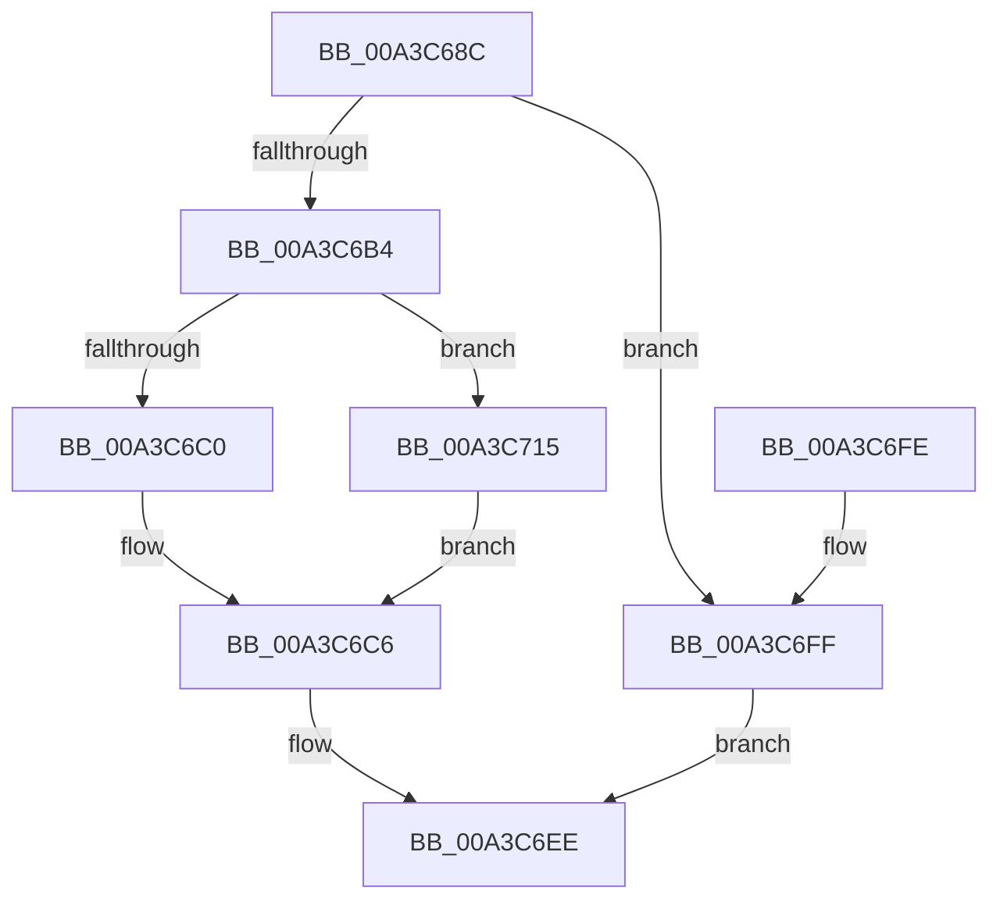

# BcdCloseStore

- RVA: `0x00A3C68C`–`0x00A3C738` (길이 `172` bytes)
- VA: `0x0000000140A3C68C`
- 실행 섹션: `PAGE`
- PDB 이름 있음: `예`; PDB Function 태그: `아니요`
- unwind 정보 RVA: `0x000AE4C4`
- 디코드: `49`개 명령, `172/172` bytes 표시
- 미해석 바이트: `0` (있으면 어셈블리에 `.byte`로 보존)

> 이 문서는 커널 이미지의 기계어와 PDB 기호를 분석해 생성했습니다. 4번과 5번은 함수 원형과 자료형을 바이너리 사용 방식에서 추정한 C 해석이며 원본 소스 복구 결과는 아닙니다.

## 1. Dependencies

- 직접 호출 지점: **9**; 고유 호출 대상: **8**
- 직접 호출자로 확인된 함수: **9**
- RIP 상대 이미지 참조: **2**

### Outgoing calls
- `0x00A3C69E` → [BiIsOfflineHandle](../../text/4B/BiIsOfflineHandle_function_004B4FA0.md) (function, `0x004B4FA0`)
- `0x00A3C6A8` → [BiAcquireBcdSyncMutant](../91/BiAcquireBcdSyncMutant_function_00916898.md) (function, `0x00916898`)
- `0x00A3C6B7` → [BiIsSystemStore](BiIsSystemStore_function_00A3DF84.md) (function, `0x00A3DF84`)
- `0x00A3C6D2` → [BiLogMessage](BiLogMessage_function_00A3D3A8.md) (function, `0x00A3D3A8`)
- `0x00A3C6DD` → [BiCloseStore](BiCloseStore_function_00A3C5D8.md) (function, `0x00A3C5D8`)
- `0x00A3C6E7` → [BiReleaseBcdSyncMutant](../91/BiReleaseBcdSyncMutant_function_0091695C.md) (function, `0x0091695C`)
- `0x00A3C70B` → [BiLogMessage](BiLogMessage_function_00A3D3A8.md) (function, `0x00A3D3A8`)
- `0x00A3C718` → [BiIsSynchFirmwareEntries](../../text/69/BiIsSynchFirmwareEntries_function_0069E090.md) (function, `0x0069E090`)
- `0x00A3C724` → [BiIsWinPEBoot](../A4/BiIsWinPEBoot_function_00A40F54.md) (function, `0x00A40F54`)

### Direct callers
- [WheaPersistBadPageToBcd](../../text/65/WheaPersistBadPageToBcd_function_0065F3D0.md) at `0x0065F55B`
- [PopFreeHiberContext](../70/PopFreeHiberContext_function_00704F1C.md) at `0x00704F61`
- [PoInitHiberServices](../75/PoInitHiberServices_function_007537C4.md) at `0x0075388F`
- [PopValidateWinresume](../75/PopValidateWinresume_function_0075DFF4.md) at `0x0075E347`
- [PopAdaptiveClearInitialSystemPowerState](../76/PopAdaptiveClearInitialSystemPowerState_function_0076B55C.md) at `0x0076B5DA`
- [SepSecureBootCorrectBcd](../7A/SepSecureBootCorrectBcd_function_007A2174.md) at `0x007A23DF`
- [BiLoadSystemStore](BiLoadSystemStore_function_00A3C198.md) at `0x00A3C2C0`
- [BiLoadSystemStore](BiLoadSystemStore_function_00A3C198.md) at `0x00A3C2ED`
- [PopBcdClose](PopBcdClose_function_00A3C674.md) at `0x00A3C678`
- [PopAllocateHiberContext](../AD/PopAllocateHiberContext_function_00ADC05C.md) at `0x00ADC317`
- [PopAllocateHiberContext](../AD/PopAllocateHiberContext_function_00ADC05C.md) at `0x00ADC347`

### Static image references
- `0x00A3C6C6` → RVA `0x00B0A8B0` (` ?? ::NNGAKEGL::`string'`; read)
- `0x00A3C6FF` → RVA `0x00B0A830` (` ?? ::NNGAKEGL::`string'`; read)

## 2. Other-region calls and transfers

- 다른 실행 섹션으로 향하는 call: **2**
  - `0x00A3C69E` → [BiIsOfflineHandle](../../text/4B/BiIsOfflineHandle_function_004B4FA0.md) (`PAGE` → `.text`)
  - `0x00A3C718` → [BiIsSynchFirmwareEntries](../../text/69/BiIsSynchFirmwareEntries_function_0069E090.md) (`PAGE` → `.text`)
- 별도 외부 분기/꼬리 이동을 확인하지 못했습니다.

## 3. Assembly (complete function range)

```asm
00A3C68C  48 89 5C 24 08                  mov qword ptr [rsp + 8], rbx
00A3C691  48 89 74 24 10                  mov qword ptr [rsp + 0x10], rsi
00A3C696  57                              push rdi
00A3C697  48 83 EC 20                     sub rsp, 0x20
00A3C69B  48 8B F9                        mov rdi, rcx
00A3C69E  E8 FD 88 A7 FF                  call 0x1404b4fa0
00A3C6A3  8A C8                           mov cl, al
00A3C6A5  40 8A F0                        mov sil, al
00A3C6A8  E8 EB A1 ED FF                  call 0x140916898
00A3C6AD  44 8B C0                        mov r8d, eax
00A3C6B0  85 C0                           test eax, eax
00A3C6B2  78 4B                           js 0x140a3c6ff
00A3C6B4  48 8B CF                        mov rcx, rdi
00A3C6B7  E8 C8 18 00 00                  call 0x140a3df84
00A3C6BC  84 C0                           test al, al
00A3C6BE  75 55                           jne 0x140a3c715
00A3C6C0  41 B8 02 00 00 00               mov r8d, 2
00A3C6C6  48 8D 15 E3 E1 0C 00            lea rdx, [rip + 0xce1e3]
00A3C6CD  B9 02 00 00 00                  mov ecx, 2
00A3C6D2  E8 D1 0C 00 00                  call 0x140a3d3a8
00A3C6D7  41 8B D0                        mov edx, r8d
00A3C6DA  48 8B CF                        mov rcx, rdi
00A3C6DD  E8 F6 FE FF FF                  call 0x140a3c5d8
00A3C6E2  40 8A CE                        mov cl, sil
00A3C6E5  8B D8                           mov ebx, eax
00A3C6E7  E8 70 A2 ED FF                  call 0x14091695c
00A3C6EC  8B C3                           mov eax, ebx
00A3C6EE  48 8B 5C 24 30                  mov rbx, qword ptr [rsp + 0x30]
00A3C6F3  48 8B 74 24 38                  mov rsi, qword ptr [rsp + 0x38]
00A3C6F8  48 83 C4 20                     add rsp, 0x20
00A3C6FC  5F                              pop rdi
00A3C6FD  C3                              ret
00A3C6FE  CC                              int3
00A3C6FF  48 8D 15 2A E1 0C 00            lea rdx, [rip + 0xce12a]
00A3C706  B9 04 00 00 00                  mov ecx, 4
00A3C70B  E8 98 0C 00 00                  call 0x140a3d3a8
00A3C710  41 8B C0                        mov eax, r8d
00A3C713  EB D9                           jmp 0x140a3c6ee
00A3C715  48 8B CF                        mov rcx, rdi
00A3C718  E8 73 19 C6 FF                  call 0x14069e090
00A3C71D  F6 D8                           neg al
00A3C71F  1B DB                           sbb ebx, ebx
00A3C721  83 E3 04                        and ebx, 4
00A3C724  E8 2B 48 00 00                  call 0x140a40f54
00A3C729  44 8B C3                        mov r8d, ebx
00A3C72C  41 83 C8 02                     or r8d, 2
00A3C730  84 C0                           test al, al
00A3C732  44 0F 44 C3                     cmove r8d, ebx
00A3C736  EB 8E                           jmp 0x140a3c6c6
```

## 4. C-style interpretation (structured pseudocode)

```c
__int64 __fastcall BcdCloseStore(__int64 a1)
{
    __int64 result;
    __int64 v_rbx;
    __int64 v_rsp;
    unsigned __int64 v_stack_p10;
    unsigned __int64 v_stack_p8;

    v_stack_p8 = v_rbx;
    v_stack_p10 = v_rsi;
    v_rsp = (v_rsp) - (32);
    result = BiIsOfflineHandle(a1, a2, a3, a4);
    result = BiAcquireBcdSyncMutant((unsigned __int8)(result), a2, a3, a4);
    if (sign_flag) goto loc_00A3C6FF;
    result = BiIsSystemStore(a1, a2, (unsigned int)((unsigned int)(result)), a4);
    if ((unsigned __int8)(result) != 0) goto loc_00A3C715;
loc_00A3C6C6:
    result = BiLogMessage(2, v_rip + 844259, 2, a4);
    result = BiCloseStore(a1, 2, 2, a4);
    result = BiReleaseBcdSyncMutant((unsigned __int8)((unsigned __int8)(result)), 2, 2, a4);
loc_00A3C6EE:
    v_rsp = (v_rsp) + (32);
    return (unsigned int)((unsigned int)((unsigned int)((unsigned int)(result))));
loc_00A3C6FF:
    result = BiLogMessage(4, v_rip + 844074, 2, a4);
    goto loc_00A3C6EE;
loc_00A3C715:
    result = BiIsSynchFirmwareEntries(a1, v_rip + 844074, 2, a4);
    result = (unsigned __int8)(-(result));
    v_rbx = (unsigned int)((v_stack_p8) & (4));
    result = BiIsWinPEBoot(a1, v_rip + 844074, 2, a4);
    a3 = (unsigned int)(((unsigned int)((unsigned int)(v_rbx))) | (2));
    if ((unsigned __int8)(result) == 0) { a3 = (unsigned int)(v_rbx); }
    goto loc_00A3C6C6;
}
```

## 5. (Beta) C Style

```c
int64_t BcdCloseStore(int64_t Arg1)
{
    int64_t result;
    int64_t local_rbx;
    int64_t local_rsp;
    uint64_t v_stack_p10;
    uint64_t v_stack_p8;

    v_stack_p8 = local_rbx;
    v_stack_p10 = local_rsi;
    local_rsp = (local_rsp) - (32);
    result = BiIsOfflineHandle(Arg1, a2, a3, a4);
    result = BiAcquireBcdSyncMutant((uint8_t)(result), a2, a3, a4);
    if (sign_flag) goto loc_00A3C6FF;
    result = BiIsSystemStore(Arg1, a2, (uint32_t)((uint32_t)(result)), a4);
    if ((uint8_t)(result) != 0) goto loc_00A3C715;
loc_00A3C6C6:
    result = BiLogMessage(2, v_rip + 844259, 2, a4);
    result = BiCloseStore(Arg1, 2, 2, a4);
    result = BiReleaseBcdSyncMutant((uint8_t)((uint8_t)(result)), 2, 2, a4);
loc_00A3C6EE:
    local_rsp = (local_rsp) + (32);
    return (uint32_t)((uint32_t)((uint32_t)((uint32_t)(result))));
loc_00A3C6FF:
    result = BiLogMessage(4, v_rip + 844074, 2, a4);
    goto loc_00A3C6EE;
loc_00A3C715:
    result = BiIsSynchFirmwareEntries(Arg1, v_rip + 844074, 2, a4);
    result = (uint8_t)(-(result));
    local_rbx = (uint32_t)((v_stack_p8) & (4));
    result = BiIsWinPEBoot(Arg1, v_rip + 844074, 2, a4);
    a3 = (uint32_t)(((uint32_t)((uint32_t)(local_rbx))) | (2));
    if ((uint8_t)(result) == 0) { a3 = (uint32_t)(local_rbx); }
    goto loc_00A3C6C6;
}
```

## 6. Execution-region graph

[열기: 2D/3D 그래프와 함수 탐색 컨트롤 패널](../../../control-panel.html?section=page&rva=0x00A3C68C&view=graph)

- 2D 그래프는 위에서 아래로 흐르고, 3D 그래프는 빈 공간을 드래그해 회전합니다. Shift+드래그는 이동, 휠은 확대·축소, 함수 노드 선택은 대상 보고서 이동입니다.

### Static fallback


