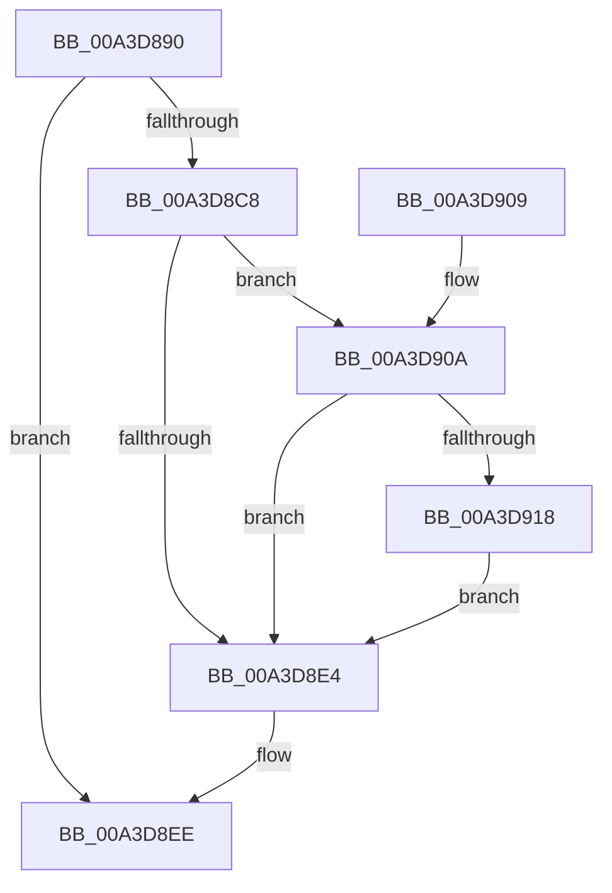

# BcdCreateObject

- RVA: `0x00A3D890`–`0x00A3D924` (길이 `148` bytes)
- VA: `0x0000000140A3D890`
- 실행 섹션: `PAGE`
- PDB 이름 있음: `예`; PDB Function 태그: `아니요`
- unwind 정보 RVA: `0x000AE614`
- 디코드: `46`개 명령, `148/148` bytes 표시
- 미해석 바이트: `0` (있으면 어셈블리에 `.byte`로 보존)

> 이 문서는 커널 이미지의 기계어와 PDB 기호를 분석해 생성했습니다. 4번과 5번은 함수 원형과 자료형을 바이너리 사용 방식에서 추정한 C 해석이며 원본 소스 복구 결과는 아닙니다.

## 1. Dependencies

- 직접 호출 지점: **6**; 고유 호출 대상: **6**
- 직접 호출자로 확인된 함수: **2**
- RIP 상대 이미지 참조: **0**

### Outgoing calls
- `0x00A3D8B5` → [BiIsOfflineHandle](../../text/4B/BiIsOfflineHandle_function_004B4FA0.md) (function, `0x004B4FA0`)
- `0x00A3D8BF` → [BiAcquireBcdSyncMutant](../91/BiAcquireBcdSyncMutant_function_00916898.md) (function, `0x00916898`)
- `0x00A3D8D9` → [BiCreateObject](BiCreateObject_function_00A3D92C.md) (function, `0x00A3D92C`)
- `0x00A3D8E7` → [BiReleaseBcdSyncMutant](../91/BiReleaseBcdSyncMutant_function_0091695C.md) (function, `0x0091695C`)
- `0x00A3D90F` → [BiIsLinkedToFirmwareVariable](BiIsLinkedToFirmwareVariable_function_00A3E4D0.md) (function, `0x00A3E4D0`)
- `0x00A3D91D` → [BiSetFirmwareModified](../../text/4B/BiSetFirmwareModified_function_004B1DF4.md) (function, `0x004B1DF4`)

### Direct callers
- [WheaPersistBadPageToBcd](../../text/65/WheaPersistBadPageToBcd_function_0065F3D0.md) at `0x0065F445`
- [PopBcdRegenerateResumeObject](../77/PopBcdRegenerateResumeObject_function_007704BC.md) at `0x0077052D`

### Static image references
- 디코드된 RIP-relative 메모리 참조가 없습니다.

## 2. Other-region calls and transfers

- 다른 실행 섹션으로 향하는 call: **2**
  - `0x00A3D8B5` → [BiIsOfflineHandle](../../text/4B/BiIsOfflineHandle_function_004B4FA0.md) (`PAGE` → `.text`)
  - `0x00A3D91D` → [BiSetFirmwareModified](../../text/4B/BiSetFirmwareModified_function_004B1DF4.md) (`PAGE` → `.text`)
- 별도 외부 분기/꼬리 이동을 확인하지 못했습니다.

## 3. Assembly (complete function range)

```asm
00A3D890  48 8B C4                        mov rax, rsp
00A3D893  48 89 58 08                     mov qword ptr [rax + 8], rbx
00A3D897  48 89 68 10                     mov qword ptr [rax + 0x10], rbp
00A3D89B  48 89 70 18                     mov qword ptr [rax + 0x18], rsi
00A3D89F  48 89 78 20                     mov qword ptr [rax + 0x20], rdi
00A3D8A3  41 56                           push r14
00A3D8A5  48 83 EC 30                     sub rsp, 0x30
00A3D8A9  49 8B F1                        mov rsi, r9
00A3D8AC  49 8B D8                        mov rbx, r8
00A3D8AF  4C 8B F2                        mov r14, rdx
00A3D8B2  48 8B F9                        mov rdi, rcx
00A3D8B5  E8 E6 76 A7 FF                  call 0x1404b4fa0
00A3D8BA  8A C8                           mov cl, al
00A3D8BC  40 8A E8                        mov bpl, al
00A3D8BF  E8 D4 8F ED FF                  call 0x140916898
00A3D8C4  85 C0                           test eax, eax
00A3D8C6  78 26                           js 0x140a3d8ee
00A3D8C8  45 33 C9                        xor r9d, r9d
00A3D8CB  48 89 74 24 20                  mov qword ptr [rsp + 0x20], rsi
00A3D8D0  4C 8B C3                        mov r8, rbx
00A3D8D3  49 8B D6                        mov rdx, r14
00A3D8D6  48 8B CF                        mov rcx, rdi
00A3D8D9  E8 4E 00 00 00                  call 0x140a3d92c
00A3D8DE  8B D8                           mov ebx, eax
00A3D8E0  85 C0                           test eax, eax
00A3D8E2  79 26                           jns 0x140a3d90a
00A3D8E4  40 8A CD                        mov cl, bpl
00A3D8E7  E8 70 90 ED FF                  call 0x14091695c
00A3D8EC  8B C3                           mov eax, ebx
00A3D8EE  48 8B 5C 24 40                  mov rbx, qword ptr [rsp + 0x40]
00A3D8F3  48 8B 6C 24 48                  mov rbp, qword ptr [rsp + 0x48]
00A3D8F8  48 8B 74 24 50                  mov rsi, qword ptr [rsp + 0x50]
00A3D8FD  48 8B 7C 24 58                  mov rdi, qword ptr [rsp + 0x58]
00A3D902  48 83 C4 30                     add rsp, 0x30
00A3D906  41 5E                           pop r14
00A3D908  C3                              ret
00A3D909  CC                              int3
00A3D90A  48 8B 0E                        mov rcx, qword ptr [rsi]
00A3D90D  33 D2                           xor edx, edx
00A3D90F  E8 BC 0B 00 00                  call 0x140a3e4d0
00A3D914  84 C0                           test al, al
00A3D916  74 CC                           je 0x140a3d8e4
00A3D918  B2 01                           mov dl, 1
00A3D91A  48 8B CF                        mov rcx, rdi
00A3D91D  E8 D2 44 A7 FF                  call 0x1404b1df4
00A3D922  EB C0                           jmp 0x140a3d8e4
```

## 4. C-style interpretation (structured pseudocode)

```c
__int64 __fastcall BcdCreateObject(__int64 a1, __int64 a2, __int64 a3, __int64 a4)
{
    __int64 result;
    __int64 v_rsp;
    unsigned __int64 v_stack_m18;
    unsigned __int64 v_stack_p10;
    unsigned __int64 v_stack_p18;
    unsigned __int64 v_stack_p20;
    unsigned __int64 v_stack_p8;

    *(unsigned __int64 *)(v_rsp + 8) = v_rbx;
    *(unsigned __int64 *)(v_rsp + 16) = v_rbp;
    *(unsigned __int64 *)(v_rsp + 24) = v_rsi;
    *(unsigned __int64 *)(v_rsp + 32) = v_rdi;
    v_rsp = (v_rsp) - (48);
    result = BiIsOfflineHandle(a1, a2, a3, a4);
    result = BiAcquireBcdSyncMutant((unsigned __int8)(result), a2, a3, a4);
    if (sign_flag) goto loc_00A3D8EE;
    a4 = 0;
    v_stack_m18 = 0;
    result = BiCreateObject(a1, a2, a3, a4);
    if (!sign_flag) goto loc_00A3D90A;
loc_00A3D8E4:
    result = BiReleaseBcdSyncMutant((unsigned __int8)((unsigned __int8)(result)), a2, a3, a4);
loc_00A3D8EE:
    v_rsp = (v_rsp) + (48);
    return (unsigned int)((unsigned int)((unsigned int)((unsigned int)(result))));
loc_00A3D90A:
    a2 = 0;
    result = BiIsLinkedToFirmwareVariable(*(unsigned __int64 *)(v_stack_p18), a2, a3, a4);
    if ((unsigned __int8)(result) == 0) goto loc_00A3D8E4;
    result = BiSetFirmwareModified(v_stack_p20, 1, a3, a4);
    goto loc_00A3D8E4;
}
```

## 5. (Beta) C Style

```c
int64_t BcdCreateObject(int64_t Arg1, int64_t Arg2, int64_t Arg3, void *Arg4)
{
    uint8_t *arg4 = (uint8_t *)Arg4;

    int64_t result;
    int64_t local_rsp;
    uint64_t v_stack_m18;
    uint64_t v_stack_p10;
    uint64_t v_stack_p18;
    uint64_t v_stack_p20;
    uint64_t v_stack_p8;

    *(uint64_t *)(local_rsp + 0x8) = local_rbx;
    *(uint64_t *)(local_rsp + 0x10) = local_rbp;
    *(uint64_t *)(local_rsp + 0x18) = local_rsi;
    *(uint64_t *)(local_rsp + 0x20) = local_rdi;
    local_rsp = (local_rsp) - (48);
    result = BiIsOfflineHandle(Arg1, Arg2, Arg3, Arg4);
    result = BiAcquireBcdSyncMutant((uint8_t)(result), Arg2, Arg3, Arg4);
    if (sign_flag) goto loc_00A3D8EE;
    Arg4 = 0;
    v_stack_m18 = 0;
    result = BiCreateObject(Arg1, Arg2, Arg3, Arg4);
    if (!sign_flag) goto loc_00A3D90A;
loc_00A3D8E4:
    result = BiReleaseBcdSyncMutant((uint8_t)((uint8_t)(result)), Arg2, Arg3, Arg4);
loc_00A3D8EE:
    local_rsp = (local_rsp) + (48);
    return (uint32_t)((uint32_t)((uint32_t)((uint32_t)(result))));
loc_00A3D90A:
    Arg2 = 0;
    result = BiIsLinkedToFirmwareVariable(*(uint64_t *)(v_stack_p18), Arg2, Arg3, Arg4);
    if ((uint8_t)(result) == 0) goto loc_00A3D8E4;
    result = BiSetFirmwareModified(v_stack_p20, 1, Arg3, Arg4);
    goto loc_00A3D8E4;
}
```

### 관측된 메모리 오프셋

구조체 형식이 확인되지 않은 접근은 인자 기준의 오프셋으로만 기록했습니다.

| 기준 인자 | 오프셋 표현 | 폭 (bit) | 접근 |
|---|---:|---:|---|
| `Arg4` | `+ 0x0` | `64` | `R` |

## 6. Execution-region graph

[열기: 2D/3D 그래프와 함수 탐색 컨트롤 패널](../../../control-panel.html?section=page&rva=0x00A3D890&view=graph)

- 2D 그래프는 위에서 아래로 흐르고, 3D 그래프는 빈 공간을 드래그해 회전합니다. Shift+드래그는 이동, 휠은 확대·축소, 함수 노드 선택은 대상 보고서 이동입니다.

### Static fallback


