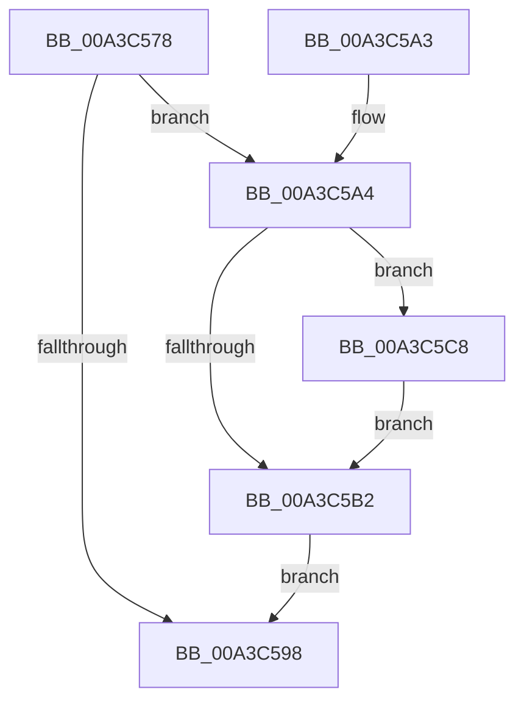

# BcdDeleteObject

- RVA: `0x00A3C578`–`0x00A3C5D2` (길이 `90` bytes)
- VA: `0x0000000140A3C578`
- 실행 섹션: `PAGE`
- PDB 이름 있음: `예`; PDB Function 태그: `아니요`
- unwind 정보 RVA: `0x00096B0C`
- 디코드: `30`개 명령, `90/90` bytes 표시
- 미해석 바이트: `0` (있으면 어셈블리에 `.byte`로 보존)

> 이 문서는 커널 이미지의 기계어와 PDB 기호를 분석해 생성했습니다. 4번과 5번은 함수 원형과 자료형을 바이너리 사용 방식에서 추정한 C 해석이며 원본 소스 복구 결과는 아닙니다.

## 1. Dependencies

- 직접 호출 지점: **6**; 고유 호출 대상: **6**
- 직접 호출자로 확인된 함수: **3**
- RIP 상대 이미지 참조: **0**

### Outgoing calls
- `0x00A3C585` → [BiIsOfflineHandle](../../text/4B/BiIsOfflineHandle_function_004B4FA0.md) (function, `0x004B4FA0`)
- `0x00A3C58F` → [BiAcquireBcdSyncMutant](../91/BiAcquireBcdSyncMutant_function_00916898.md) (function, `0x00916898`)
- `0x00A3C5A9` → [BiIsLinkedToFirmwareVariable](BiIsLinkedToFirmwareVariable_function_00A3E4D0.md) (function, `0x00A3E4D0`)
- `0x00A3C5B5` → [BiDeleteKey](BiDeleteKey_function_00A3FC58.md) (function, `0x00A3FC58`)
- `0x00A3C5BF` → [BiReleaseBcdSyncMutant](../91/BiReleaseBcdSyncMutant_function_0091695C.md) (function, `0x0091695C`)
- `0x00A3C5CB` → [BiSetFirmwareModifiedFromObject](../../text/4B/BiSetFirmwareModifiedFromObject_function_004B1CC8.md) (function, `0x004B1CC8`)

### Direct callers
- [PopBcdRegenerateResumeObject](../77/PopBcdRegenerateResumeObject_function_007704BC.md) at `0x007706C5`
- [BiBindEfiBootManager](BiBindEfiBootManager_function_00A3DCB0.md) at `0x00A3DEB7`
- [BiBindEfiBootManager](BiBindEfiBootManager_function_00A3DCB0.md) at `0x00A3DF5D`
- [BiBindEfiEntries](../AB/BiBindEfiEntries_function_00AB09C4.md) at `0x00AB0A6C`

### Static image references
- 디코드된 RIP-relative 메모리 참조가 없습니다.

## 2. Other-region calls and transfers

- 다른 실행 섹션으로 향하는 call: **2**
  - `0x00A3C585` → [BiIsOfflineHandle](../../text/4B/BiIsOfflineHandle_function_004B4FA0.md) (`PAGE` → `.text`)
  - `0x00A3C5CB` → [BiSetFirmwareModifiedFromObject](../../text/4B/BiSetFirmwareModifiedFromObject_function_004B1CC8.md) (`PAGE` → `.text`)
- 별도 외부 분기/꼬리 이동을 확인하지 못했습니다.

## 3. Assembly (complete function range)

```asm
00A3C578  48 89 5C 24 08                  mov qword ptr [rsp + 8], rbx
00A3C57D  57                              push rdi
00A3C57E  48 83 EC 20                     sub rsp, 0x20
00A3C582  48 8B D9                        mov rbx, rcx
00A3C585  E8 16 8A A7 FF                  call 0x1404b4fa0
00A3C58A  8A C8                           mov cl, al
00A3C58C  40 8A F8                        mov dil, al
00A3C58F  E8 04 A3 ED FF                  call 0x140916898
00A3C594  85 C0                           test eax, eax
00A3C596  79 0C                           jns 0x140a3c5a4
00A3C598  48 8B 5C 24 30                  mov rbx, qword ptr [rsp + 0x30]
00A3C59D  48 83 C4 20                     add rsp, 0x20
00A3C5A1  5F                              pop rdi
00A3C5A2  C3                              ret
00A3C5A3  CC                              int3
00A3C5A4  33 D2                           xor edx, edx
00A3C5A6  48 8B CB                        mov rcx, rbx
00A3C5A9  E8 22 1F 00 00                  call 0x140a3e4d0
00A3C5AE  84 C0                           test al, al
00A3C5B0  75 16                           jne 0x140a3c5c8
00A3C5B2  48 8B CB                        mov rcx, rbx
00A3C5B5  E8 9E 36 00 00                  call 0x140a3fc58
00A3C5BA  40 8A CF                        mov cl, dil
00A3C5BD  8B D8                           mov ebx, eax
00A3C5BF  E8 98 A3 ED FF                  call 0x14091695c
00A3C5C4  8B C3                           mov eax, ebx
00A3C5C6  EB D0                           jmp 0x140a3c598
00A3C5C8  48 8B CB                        mov rcx, rbx
00A3C5CB  E8 F8 56 A7 FF                  call 0x1404b1cc8
00A3C5D0  EB E0                           jmp 0x140a3c5b2
```

## 4. C-style interpretation (structured pseudocode)

```c
__int64 __fastcall BcdDeleteObject(__int64 a1, int a2)
{
    __int64 result;
    __int64 v_rsp;
    unsigned __int64 v_stack_p8;

    v_stack_p8 = v_rbx;
    v_rsp = (v_rsp) - (32);
    result = BiIsOfflineHandle(a1, a2, a3, a4);
    result = BiAcquireBcdSyncMutant((unsigned __int8)(result), a2, a3, a4);
    if (!sign_flag) goto loc_00A3C5A4;
loc_00A3C598:
    v_rsp = (v_rsp) + (32);
    return result;
loc_00A3C5A4:
    a2 = 0;
    result = BiIsLinkedToFirmwareVariable(v_stack_p8, a2, a3, a4);
    if ((unsigned __int8)(result) != 0) goto loc_00A3C5C8;
loc_00A3C5B2:
    result = BiDeleteKey(v_stack_p8, a2, a3, a4);
    result = BiReleaseBcdSyncMutant((unsigned __int8)((unsigned __int8)(result)), a2, a3, a4);
    goto loc_00A3C598;
loc_00A3C5C8:
    result = BiSetFirmwareModifiedFromObject((unsigned int)((unsigned int)(result)), a2, a3, a4);
    goto loc_00A3C5B2;
}
```

## 5. (Beta) C Style

```c
int64_t BcdDeleteObject(int64_t Arg1, int32_t Arg2)
{
    int64_t result;
    int64_t local_rsp;
    uint64_t v_stack_p8;

    v_stack_p8 = local_rbx;
    local_rsp = (local_rsp) - (32);
    result = BiIsOfflineHandle(Arg1, Arg2, a3, a4);
    result = BiAcquireBcdSyncMutant((uint8_t)(result), Arg2, a3, a4);
    if (!sign_flag) goto loc_00A3C5A4;
loc_00A3C598:
    local_rsp = (local_rsp) + (32);
    return result;
loc_00A3C5A4:
    Arg2 = 0;
    result = BiIsLinkedToFirmwareVariable(v_stack_p8, Arg2, a3, a4);
    if ((uint8_t)(result) != 0) goto loc_00A3C5C8;
loc_00A3C5B2:
    result = BiDeleteKey(v_stack_p8, Arg2, a3, a4);
    result = BiReleaseBcdSyncMutant((uint8_t)((uint8_t)(result)), Arg2, a3, a4);
    goto loc_00A3C598;
loc_00A3C5C8:
    result = BiSetFirmwareModifiedFromObject((uint32_t)((uint32_t)(result)), Arg2, a3, a4);
    goto loc_00A3C5B2;
}
```

## 6. Execution-region graph

[열기: 2D/3D 그래프와 함수 탐색 컨트롤 패널](../../../control-panel.html?section=page&rva=0x00A3C578&view=graph)

- 2D 그래프는 위에서 아래로 흐르고, 3D 그래프는 빈 공간을 드래그해 회전합니다. Shift+드래그는 이동, 휠은 확대·축소, 함수 노드 선택은 대상 보고서 이동입니다.

### Static fallback


