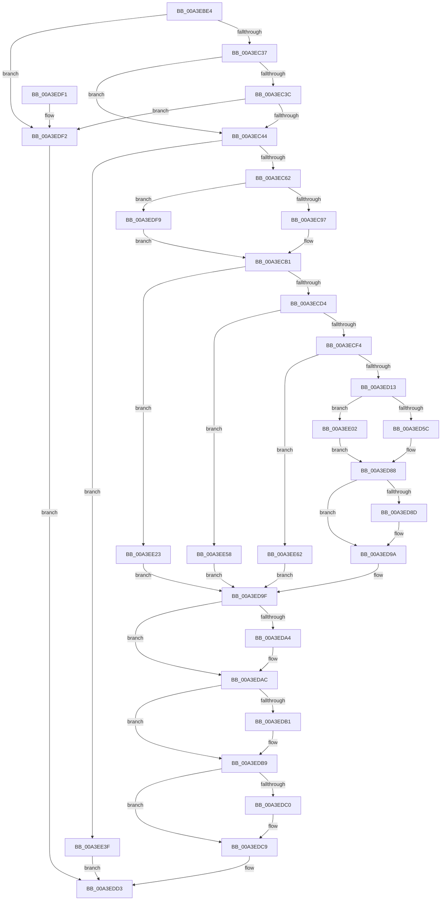

# BcdGetElementDataWithFlags

- RVA: `0x00A3EBE4`–`0x00A3EE99` (길이 `693` bytes)
- VA: `0x0000000140A3EBE4`
- 실행 섹션: `PAGE`
- PDB 이름 있음: `예`; PDB Function 태그: `아니요`
- unwind 정보 RVA: `0x000AE770`
- 디코드: `180`개 명령, `693/693` bytes 표시
- 미해석 바이트: `0` (있으면 어셈블리에 `.byte`로 보존)

> 이 문서는 커널 이미지의 기계어와 PDB 기호를 분석해 생성했습니다. 4번과 5번은 함수 원형과 자료형을 바이너리 사용 방식에서 추정한 C 해석이며 원본 소스 복구 결과는 아닙니다.

## 1. Dependencies

- 직접 호출 지점: **21**; 고유 호출 대상: **16**
- 직접 호출자로 확인된 함수: **1**
- RIP 상대 이미지 참조: **8**

### Outgoing calls
- `0x00A3EC44` → [BiIsOfflineHandle](../../text/4B/BiIsOfflineHandle_function_004B4FA0.md) (function, `0x004B4FA0`)
- `0x00A3EC52` → [BiAcquireBcdSyncMutant](../91/BiAcquireBcdSyncMutant_function_00916898.md) (function, `0x00916898`)
- `0x00A3EC77` → [RtlInitUnicodeString](../../text/42/RtlInitUnicodeString_function_0042A780.md) (function, `0x0042A780`)
- `0x00A3EC8A` → [BiGetObjectIdentifier](BiGetObjectIdentifier_function_00A3EEA0.md) (function, `0x00A3EEA0`)
- `0x00A3ECA2` → [RtlStringFromGUIDEx](../91/RtlStringFromGUIDEx_function_00915450.md) (function, `0x00915450`)
- `0x00A3ECC5` → [BiOpenKey](BiOpenKey_function_00A3F60C.md) (function, `0x00A3F60C`)
- `0x00A3ECE7` → [ultow_s](../../text/50/ultow_s_function_00504F30.md) (function, `0x00504F30`)
- `0x00A3ED06` → [BiOpenKey](BiOpenKey_function_00A3F60C.md) (function, `0x00A3F60C`)
- `0x00A3ED1B` → [BiConvertElementFormatToValueType](BiConvertElementFormatToValueType_function_00A3F7CC.md) (function, `0x00A3F7CC`)
- `0x00A3ED49` → [BiGetRegistryValue](BiGetRegistryValue_function_00A3F3CC.md) (function, `0x00A3F3CC`)
- `0x00A3ED81` → [BiConvertRegistryDataToElement](BiConvertRegistryDataToElement_function_00A3F804.md) (function, `0x00A3F804`)
- `0x00A3ED95` → [ExFreePoolWithTag](../../poolcode/B8/ExFreePoolWithTag_function_00B82870.md) (function, `0x00B82870`)
- `0x00A3EDA7` → [ExFreePool](../../poolcode/B8/ExFreePool_function_00B82850.md) (function, `0x00B82850`)
- `0x00A3EDB4` → [BiCloseKey](../91/BiCloseKey_function_00916A00.md) (function, `0x00916A00`)
- `0x00A3EDC4` → [BiCloseKey](../91/BiCloseKey_function_00916A00.md) (function, `0x00916A00`)
- `0x00A3EDCC` → [BiReleaseBcdSyncMutant](../91/BiReleaseBcdSyncMutant_function_0091695C.md) (function, `0x0091695C`)
- `0x00A3EDDA` → [_security_check_cookie](../../text/6A/_security_check_cookie_function_006AC640.md) (function, `0x006AC640`)
- `0x00A3EE19` → [BiLogMessage](BiLogMessage_function_00A3D3A8.md) (function, `0x00A3D3A8`)
- `0x00A3EE35` → [BiLogMessage](BiLogMessage_function_00A3D3A8.md) (function, `0x00A3D3A8`)
- `0x00A3EE4B` → [BiLogMessage](BiLogMessage_function_00A3D3A8.md) (function, `0x00A3D3A8`)
- `0x00A3EE86` → [BiLogMessage](BiLogMessage_function_00A3D3A8.md) (function, `0x00A3D3A8`)

### Direct callers
- [BcdGetElementData](BcdGetElementData_function_00A3E390.md) at `0x00A3E39C`

### Static image references
- `0x00A3EBFB` → RVA `0x00E0A740` (`.data`; read)
- `0x00A3EC83` → RVA `0x00B0B930` (` ?? ::NNGAKEGL::`string'`; read)
- `0x00A3ECBB` → RVA `0x00B0B390` (` ?? ::NNGAKEGL::`string'`; read)
- `0x00A3ED2D` → RVA `0x00B0BB20` (` ?? ::NNGAKEGL::`string'`; read)
- `0x00A3EE06` → RVA `0x00B0BB30` (` ?? ::NNGAKEGL::`string'`; read)
- `0x00A3EE26` → RVA `0x00B0B9E0` (` ?? ::NNGAKEGL::`string'`; read)
- `0x00A3EE3F` → RVA `0x00B0B940` (` ?? ::NNGAKEGL::`string'`; read)
- `0x00A3EE77` → RVA `0x00B0BA80` (` ?? ::NNGAKEGL::`string'`; read)

## 2. Other-region calls and transfers

- 다른 실행 섹션으로 향하는 call: **6**
  - `0x00A3EC44` → [BiIsOfflineHandle](../../text/4B/BiIsOfflineHandle_function_004B4FA0.md) (`PAGE` → `.text`)
  - `0x00A3EC77` → [RtlInitUnicodeString](../../text/42/RtlInitUnicodeString_function_0042A780.md) (`PAGE` → `.text`)
  - `0x00A3ECE7` → [ultow_s](../../text/50/ultow_s_function_00504F30.md) (`PAGE` → `.text`)
  - `0x00A3ED95` → [ExFreePoolWithTag](../../poolcode/B8/ExFreePoolWithTag_function_00B82870.md) (`PAGE` → `POOLCODE`)
  - `0x00A3EDA7` → [ExFreePool](../../poolcode/B8/ExFreePool_function_00B82850.md) (`PAGE` → `POOLCODE`)
  - `0x00A3EDDA` → [_security_check_cookie](../../text/6A/_security_check_cookie_function_006AC640.md) (`PAGE` → `.text`)
- 별도 외부 분기/꼬리 이동을 확인하지 못했습니다.

## 3. Assembly (complete function range)

```asm
00A3EBE4  40 55                           push rbp
00A3EBE6  53                              push rbx
00A3EBE7  56                              push rsi
00A3EBE8  57                              push rdi
00A3EBE9  41 54                           push r12
00A3EBEB  41 56                           push r14
00A3EBED  41 57                           push r15
00A3EBEF  48 8D 6C 24 E1                  lea rbp, [rsp - 0x1f]
00A3EBF4  48 81 EC E0 00 00 00            sub rsp, 0xe0
00A3EBFB  48 8B 05 3E BB 3C 00            mov rax, qword ptr [rip + 0x3cbb3e]
00A3EC02  48 33 C4                        xor rax, rsp
00A3EC05  48 89 45 0F                     mov qword ptr [rbp + 0xf], rax
00A3EC09  48 8B 45 7F                     mov rax, qword ptr [rbp + 0x7f]
00A3EC0D  33 DB                           xor ebx, ebx
00A3EC0F  4C 89 4D C7                     mov qword ptr [rbp - 0x39], r9
00A3EC13  0F 57 C0                        xorps xmm0, xmm0
00A3EC16  89 55 83                        mov dword ptr [rbp - 0x7d], edx
00A3EC19  0F 57 C9                        xorps xmm1, xmm1
00A3EC1C  48 89 45 BF                     mov qword ptr [rbp - 0x41], rax
00A3EC20  4C 8B F9                        mov r15, rcx
00A3EC23  89 5D 87                        mov dword ptr [rbp - 0x79], ebx
00A3EC26  0F 11 45 AF                     movups xmmword ptr [rbp - 0x51], xmm0
00A3EC2A  0F 11 4D CF                     movups xmmword ptr [rbp - 0x31], xmm1
00A3EC2E  48 85 C0                        test rax, rax
00A3EC31  0F 84 BB 01 00 00               je 0x140a3edf2
00A3EC37  4D 85 C9                        test r9, r9
00A3EC3A  75 08                           jne 0x140a3ec44
00A3EC3C  39 18                           cmp dword ptr [rax], ebx
00A3EC3E  0F 85 AE 01 00 00               jne 0x140a3edf2
00A3EC44  E8 57 63 A7 FF                  call 0x1404b4fa0
00A3EC49  8A C8                           mov cl, al
00A3EC4B  88 44 24 40                     mov byte ptr [rsp + 0x40], al
00A3EC4F  44 8A E0                        mov r12b, al
00A3EC52  E8 41 7C ED FF                  call 0x140916898
00A3EC57  44 8B C0                        mov r8d, eax
00A3EC5A  85 C0                           test eax, eax
00A3EC5C  0F 88 DD 01 00 00               js 0x140a3ee3f
00A3EC62  33 D2                           xor edx, edx
00A3EC64  48 89 5D 8F                     mov qword ptr [rbp - 0x71], rbx
00A3EC68  48 8D 4D AF                     lea rcx, [rbp - 0x51]
00A3EC6C  48 89 5D 9F                     mov qword ptr [rbp - 0x61], rbx
00A3EC70  48 8B F3                        mov rsi, rbx
00A3EC73  48 89 5D A7                     mov qword ptr [rbp - 0x59], rbx
00A3EC77  E8 04 BB 9E FF                  call 0x14042a780
00A3EC7C  48 8D 55 CF                     lea rdx, [rbp - 0x31]
00A3EC80  49 8B CF                        mov rcx, r15
00A3EC83  48 8D 3D A6 CC 0C 00            lea rdi, [rip + 0xccca6]
00A3EC8A  E8 11 02 00 00                  call 0x140a3eea0
00A3EC8F  85 C0                           test eax, eax
00A3EC91  0F 88 62 01 00 00               js 0x140a3edf9
00A3EC97  41 B0 01                        mov r8b, 1
00A3EC9A  48 8D 55 AF                     lea rdx, [rbp - 0x51]
00A3EC9E  48 8D 4D CF                     lea rcx, [rbp - 0x31]
00A3ECA2  E8 A9 67 ED FF                  call 0x140915450
00A3ECA7  4C 8B 75 B7                     mov r14, qword ptr [rbp - 0x49]
00A3ECAB  85 C0                           test eax, eax
00A3ECAD  49 0F 49 FE                     cmovns rdi, r14
00A3ECB1  4C 8D 4D 8F                     lea r9, [rbp - 0x71]
00A3ECB5  41 B8 19 00 02 00               mov r8d, 0x20019
00A3ECBB  48 8D 15 CE C6 0C 00            lea rdx, [rip + 0xcc6ce]
00A3ECC2  49 8B CF                        mov rcx, r15
00A3ECC5  E8 42 09 00 00                  call 0x140a3f60c
00A3ECCA  8B D8                           mov ebx, eax
00A3ECCC  85 C0                           test eax, eax
00A3ECCE  0F 88 4F 01 00 00               js 0x140a3ee23
00A3ECD4  8B 5D 83                        mov ebx, dword ptr [rbp - 0x7d]
00A3ECD7  48 8D 55 DF                     lea rdx, [rbp - 0x21]
00A3ECDB  41 B9 10 00 00 00               mov r9d, 0x10
00A3ECE1  8B CB                           mov ecx, ebx
00A3ECE3  45 8D 41 06                     lea r8d, [r9 + 6]
00A3ECE7  E8 44 62 AC FF                  call 0x140504f30
00A3ECEC  85 C0                           test eax, eax
00A3ECEE  0F 85 64 01 00 00               jne 0x140a3ee58
00A3ECF4  48 8B 4D 8F                     mov rcx, qword ptr [rbp - 0x71]
00A3ECF8  4C 8D 4D 9F                     lea r9, [rbp - 0x61]
00A3ECFC  41 B8 19 00 02 00               mov r8d, 0x20019
00A3ED02  48 8D 55 DF                     lea rdx, [rbp - 0x21]
00A3ED06  E8 01 09 00 00                  call 0x140a3f60c
00A3ED0B  85 C0                           test eax, eax
00A3ED0D  0F 88 4F 01 00 00               js 0x140a3ee62
00A3ED13  8B CB                           mov ecx, ebx
00A3ED15  C1 E9 18                        shr ecx, 0x18
00A3ED18  83 E1 0F                        and ecx, 0xf
00A3ED1B  E8 AC 0A 00 00                  call 0x140a3f7cc
00A3ED20  48 8B 75 9F                     mov rsi, qword ptr [rbp - 0x61]
00A3ED24  48 8D 4D 87                     lea rcx, [rbp - 0x79]
00A3ED28  48 89 4C 24 28                  mov qword ptr [rsp + 0x28], rcx
00A3ED2D  48 8D 15 EC CD 0C 00            lea rdx, [rip + 0xccdec]
00A3ED34  48 8D 4D A7                     lea rcx, [rbp - 0x59]
00A3ED38  89 45 97                        mov dword ptr [rbp - 0x69], eax
00A3ED3B  48 89 4C 24 20                  mov qword ptr [rsp + 0x20], rcx
00A3ED40  44 8B C8                        mov r9d, eax
00A3ED43  48 8B CE                        mov rcx, rsi
00A3ED46  45 33 C0                        xor r8d, r8d
00A3ED49  E8 7E 06 00 00                  call 0x140a3f3cc
00A3ED4E  4C 8B 65 A7                     mov r12, qword ptr [rbp - 0x59]
00A3ED52  8B D8                           mov ebx, eax
00A3ED54  85 C0                           test eax, eax
00A3ED56  0F 88 A6 00 00 00               js 0x140a3ee02
00A3ED5C  48 8B 45 BF                     mov rax, qword ptr [rbp - 0x41]
00A3ED60  49 8B D4                        mov rdx, r12
00A3ED63  44 8B 4D 83                     mov r9d, dword ptr [rbp - 0x7d]
00A3ED67  49 8B CF                        mov rcx, r15
00A3ED6A  44 8B 45 87                     mov r8d, dword ptr [rbp - 0x79]
00A3ED6E  48 89 44 24 30                  mov qword ptr [rsp + 0x30], rax
00A3ED73  48 8B 45 C7                     mov rax, qword ptr [rbp - 0x39]
00A3ED77  48 89 44 24 28                  mov qword ptr [rsp + 0x28], rax
00A3ED7C  83 64 24 20 00                  and dword ptr [rsp + 0x20], 0
00A3ED81  E8 7E 0A 00 00                  call 0x140a3f804
00A3ED86  8B D8                           mov ebx, eax
00A3ED88  4D 85 E4                        test r12, r12
00A3ED8B  74 0D                           je 0x140a3ed9a
00A3ED8D  BA 42 43 44 4B                  mov edx, 0x4b444342
00A3ED92  49 8B CC                        mov rcx, r12
00A3ED95  E8 D6 3A 14 00                  call 0x140b82870
00A3ED9A  44 8A 64 24 40                  mov r12b, byte ptr [rsp + 0x40]
00A3ED9F  4D 85 F6                        test r14, r14
00A3EDA2  74 08                           je 0x140a3edac
00A3EDA4  49 8B CE                        mov rcx, r14
00A3EDA7  E8 A4 3A 14 00                  call 0x140b82850
00A3EDAC  48 85 F6                        test rsi, rsi
00A3EDAF  74 08                           je 0x140a3edb9
00A3EDB1  48 8B CE                        mov rcx, rsi
00A3EDB4  E8 47 7C ED FF                  call 0x140916a00
00A3EDB9  48 83 7D 8F 00                  cmp qword ptr [rbp - 0x71], 0
00A3EDBE  74 09                           je 0x140a3edc9
00A3EDC0  48 8B 4D 8F                     mov rcx, qword ptr [rbp - 0x71]
00A3EDC4  E8 37 7C ED FF                  call 0x140916a00
00A3EDC9  41 8A CC                        mov cl, r12b
00A3EDCC  E8 8B 7B ED FF                  call 0x14091695c
00A3EDD1  8B C3                           mov eax, ebx
00A3EDD3  48 8B 4D 0F                     mov rcx, qword ptr [rbp + 0xf]
00A3EDD7  48 33 CC                        xor rcx, rsp
00A3EDDA  E8 61 D8 C6 FF                  call 0x1406ac640
00A3EDDF  48 81 C4 E0 00 00 00            add rsp, 0xe0
00A3EDE6  41 5F                           pop r15
00A3EDE8  41 5E                           pop r14
00A3EDEA  41 5C                           pop r12
00A3EDEC  5F                              pop rdi
00A3EDED  5E                              pop rsi
00A3EDEE  5B                              pop rbx
00A3EDEF  5D                              pop rbp
00A3EDF0  C3                              ret
00A3EDF1  CC                              int3
00A3EDF2  B8 0D 00 00 C0                  mov eax, 0xc000000d
00A3EDF7  EB DA                           jmp 0x140a3edd3
00A3EDF9  4C 8B 75 B7                     mov r14, qword ptr [rbp - 0x49]
00A3EDFD  E9 AF FE FF FF                  jmp 0x140a3ecb1
00A3EE02  44 8B 4D 97                     mov r9d, dword ptr [rbp - 0x69]
00A3EE06  48 8D 15 23 CD 0C 00            lea rdx, [rip + 0xccd23]
00A3EE0D  4C 8B C7                        mov r8, rdi
00A3EE10  89 44 24 20                     mov dword ptr [rsp + 0x20], eax
00A3EE14  B9 04 00 00 00                  mov ecx, 4
00A3EE19  E8 8A E5 FF FF                  call 0x140a3d3a8
00A3EE1E  E9 65 FF FF FF                  jmp 0x140a3ed88
00A3EE23  44 8B C8                        mov r9d, eax
00A3EE26  48 8D 15 B3 CB 0C 00            lea rdx, [rip + 0xccbb3]
00A3EE2D  4C 8B C7                        mov r8, rdi
00A3EE30  B9 04 00 00 00                  mov ecx, 4
00A3EE35  E8 6E E5 FF FF                  call 0x140a3d3a8
00A3EE3A  E9 60 FF FF FF                  jmp 0x140a3ed9f
00A3EE3F  48 8D 15 FA CA 0C 00            lea rdx, [rip + 0xccafa]
00A3EE46  B9 04 00 00 00                  mov ecx, 4
00A3EE4B  E8 58 E5 FF FF                  call 0x140a3d3a8
00A3EE50  41 8B C0                        mov eax, r8d
00A3EE53  E9 7B FF FF FF                  jmp 0x140a3edd3
00A3EE58  BB 01 00 00 C0                  mov ebx, 0xc0000001
00A3EE5D  E9 3D FF FF FF                  jmp 0x140a3ed9f
00A3EE62  B9 02 00 00 00                  mov ecx, 2
00A3EE67  89 44 24 20                     mov dword ptr [rsp + 0x20], eax
00A3EE6B  3D 34 00 00 C0                  cmp eax, 0xc0000034
00A3EE70  4C 8D 4D DF                     lea r9, [rbp - 0x21]
00A3EE74  4C 8B C7                        mov r8, rdi
00A3EE77  48 8D 15 02 CC 0C 00            lea rdx, [rip + 0xccc02]
00A3EE7E  44 8D 51 02                     lea r10d, [rcx + 2]
00A3EE82  41 0F 45 CA                     cmovne ecx, r10d
00A3EE86  E8 1D E5 FF FF                  call 0x140a3d3a8
00A3EE8B  48 8B 75 9F                     mov rsi, qword ptr [rbp - 0x61]
00A3EE8F  BB 25 02 00 C0                  mov ebx, 0xc0000225
00A3EE94  E9 06 FF FF FF                  jmp 0x140a3ed9f
```

## 4. C-style interpretation (structured pseudocode)

```c
__int64 __fastcall BcdGetElementDataWithFlags(__int64 a1, int a2, __int64 a3, __int64 a4, __int64 a5)
{
    __int64 result;
    __int64 v_rbx;
    __int64 v_rdi;
    __int64 v_rsp;
    unsigned __int64 v_stack_m48;
    unsigned __int64 v_stack_m57;
    unsigned __int64 v_stack_m78;
    unsigned __int64 v_stack_m88;
    unsigned __int64 v_stack_m90;
    unsigned __int64 v_stack_m98;
    unsigned __int64 v_stack_mA0;
    unsigned __int64 v_stack_mA8;
    unsigned __int64 v_stack_mB0;
    unsigned __int64 v_stack_mB8;
    unsigned int v_stack_mC0;
    unsigned __int64 v_stack_mC8;
    unsigned int v_stack_mD0;
    unsigned int v_stack_mD4;
    unsigned __int8 v_stack_mD8;
    unsigned __int64 v_stack_mE8;
    unsigned __int64 v_stack_mF0;
    unsigned __int64 v_stack_mF8;
    unsigned int v_stack_p20;

    v_rsp = (v_rsp) - (224);
    result = (*(unsigned __int64 *)(v_rip + 3980094)) ^ (v_rsp);
    v_stack_m48 = result;
    v_rbx = 0;
    v_stack_m90 = a4;
    v_stack_mD4 = a2;
    v_stack_m98 = a5;
    v_stack_mD0 = 0;
    v_stack_mA8 = v_xmm0;
    v_stack_m88 = v_xmm1;
    if (a5 == 0) goto loc_00A3EDF2;
    if (a4 != 0) goto loc_00A3EC44;
    if ((*(unsigned int *)(a5)) != 0) goto loc_00A3EDF2;
loc_00A3EC44:
    result = BiIsOfflineHandle(a1, a2, a3, a4);
    v_stack_mD8 = (unsigned __int8)(result);
    result = BiAcquireBcdSyncMutant((unsigned __int8)(result), a2, a3, a4);
    if (sign_flag) goto loc_00A3EE3F;
    a2 = 0;
    v_stack_mC8 = 0;
    v_stack_mB8 = 0;
    v_stack_mB0 = 0;
    result = RtlInitUnicodeString(v_stack_mA8, a2, (unsigned int)((unsigned int)(result)), a4);
    result = BiGetObjectIdentifier(a1, v_stack_m88, (unsigned int)((unsigned int)(result)), a4);
    if (sign_flag) goto loc_00A3EDF9;
    result = RtlStringFromGUIDEx(v_stack_m88, v_stack_mA8, 1, a4);
    v_rdi = v_rip + 838822;
    if (!sign_flag) { v_rdi = v_stack_mA0; }
loc_00A3ECB1:
    result = BiOpenKey(a1, v_rip + 837326, (unsigned int)(0x20019ULL), v_stack_mC8);
    if (sign_flag) goto loc_00A3EE23;
    result = ultow_s((unsigned int)((unsigned int)((unsigned int)(v_stack_mD4))), v_stack_m78, 16 + 6, 16);
    if ((unsigned int)(result) != 0) goto loc_00A3EE58;
    result = BiOpenKey(v_stack_mC8, v_stack_m78, (unsigned int)(0x20019ULL), v_stack_mB8);
    if (sign_flag) goto loc_00A3EE62;
    a1 = (unsigned int)(((unsigned int)((unsigned int)((unsigned int)(v_stack_mD4)))) >> (24));
    a1 = (unsigned int)((a1) & (15));
    result = BiConvertElementFormatToValueType(a1, v_stack_m78, (unsigned int)(0x20019ULL), v_stack_mB8);
    v_stack_mF0 = v_stack_mD0;
    v_stack_mC0 = (unsigned int)(result);
    v_stack_mF8 = v_stack_mB0;
    a3 = 0;
    result = BiGetRegistryValue(v_stack_mB8, v_rip + 839148, a3, (unsigned int)((unsigned int)(result)));
    if (sign_flag) goto loc_00A3EE02;
    v_stack_mE8 = v_stack_m98;
    v_stack_mF0 = v_stack_m90;
    result = BiConvertRegistryDataToElement(a1, v_stack_mB0, (unsigned int)(v_stack_mD0), (unsigned int)(v_stack_mD4));
loc_00A3ED88:
    if (v_stack_mB0 != 0) {
        a2 = 0x4B444342ULL;
        a1 = v_stack_mB0;
        result = ExFreePoolWithTag(a1, a2, (unsigned int)(v_stack_mD0), (unsigned int)(v_stack_mD4));
    }
loc_00A3ED9F:
    if (v_stack_mA0 != 0) {
        a1 = v_stack_mA0;
        result = ExFreePool(a1, a2, (unsigned int)(v_stack_mD0), (unsigned int)(v_stack_mD4));
    }
    if (v_stack_mB8 != 0) {
        a1 = v_stack_mB8;
        result = BiCloseKey(a1, a2, (unsigned int)(v_stack_mD0), (unsigned int)(v_stack_mD4));
    }
    if (v_stack_mC8 != 0) {
        a1 = v_stack_mC8;
        result = BiCloseKey(a1, a2, (unsigned int)(v_stack_mD0), (unsigned int)(v_stack_mD4));
    }
    result = BiReleaseBcdSyncMutant((unsigned __int8)(v_stack_mD8), a2, (unsigned int)(v_stack_mD0), (unsigned int)(v_stack_mD4));
loc_00A3EDD3:
    a1 = (v_stack_m48) ^ (v_rsp);
    result = _security_check_cookie(a1, a2, (unsigned int)(v_stack_mD0), (unsigned int)(v_stack_mD4));
    v_rsp = (v_rsp) + (224);
    return result;
loc_00A3EDF2:
    goto loc_00A3EDD3;
loc_00A3EDF9:
    goto loc_00A3ECB1;
loc_00A3EE02:
    v_stack_p20 = (unsigned int)((unsigned int)(0xC000000DULL));
    result = BiLogMessage(4, v_rip + 838947, v_rdi, (unsigned int)(v_stack_mC0));
    goto loc_00A3ED88;
loc_00A3EE23:
    result = BiLogMessage(4, v_rip + 838579, v_rdi, (unsigned int)((unsigned int)(result)));
    goto loc_00A3ED9F;
loc_00A3EE3F:
    result = BiLogMessage(4, v_rip + 838394, v_rdi, (unsigned int)((unsigned int)(result)));
    goto loc_00A3EDD3;
loc_00A3EE58:
    goto loc_00A3ED9F;
loc_00A3EE62:
    v_stack_p20 = (unsigned int)((unsigned int)((unsigned int)(v_rdi)));
    a1 = 2;
    if (((unsigned int)((unsigned int)((unsigned int)(v_rdi)))) != 0xC0000034ULL) { a1 = (unsigned int)(2 + 2); }
    result = BiLogMessage(a1, v_rip + 838658, v_rdi, v_stack_m78);
    goto loc_00A3ED9F;
}
```

## 5. (Beta) C Style

```c
int64_t BcdGetElementDataWithFlags(int64_t Arg1, int32_t Arg2, int64_t Arg3, int64_t Arg4, int64_t Arg5)
{
    int64_t result;
    int64_t local_rbx;
    int64_t local_rdi;
    int64_t local_rsp;
    uint64_t v_stack_m48;
    uint64_t v_stack_m57;
    uint64_t v_stack_m78;
    uint64_t v_stack_m88;
    uint64_t v_stack_m90;
    uint64_t v_stack_m98;
    uint64_t v_stack_mA0;
    uint64_t v_stack_mA8;
    uint64_t v_stack_mB0;
    uint64_t v_stack_mB8;
    uint32_t v_stack_mC0;
    uint64_t v_stack_mC8;
    uint32_t v_stack_mD0;
    uint32_t v_stack_mD4;
    uint8_t v_stack_mD8;
    uint64_t v_stack_mE8;
    uint64_t v_stack_mF0;
    uint64_t v_stack_mF8;
    uint32_t v_stack_p20;

    local_rsp = (local_rsp) - (224);
    result = (*(uint64_t *)(v_rip + 0x3CBB3E)) ^ (local_rsp);
    v_stack_m48 = result;
    local_rbx = 0;
    v_stack_m90 = Arg4;
    v_stack_mD4 = Arg2;
    v_stack_m98 = Arg5;
    v_stack_mD0 = 0;
    v_stack_mA8 = v_xmm0;
    v_stack_m88 = v_xmm1;
    if (Arg5 == 0) goto loc_00A3EDF2;
    if (Arg4 != 0) goto loc_00A3EC44;
    if ((*(uint32_t *)(Arg5)) != 0) goto loc_00A3EDF2;
loc_00A3EC44:
    result = BiIsOfflineHandle(Arg1, Arg2, Arg3, Arg4);
    v_stack_mD8 = (uint8_t)(result);
    result = BiAcquireBcdSyncMutant((uint8_t)(result), Arg2, Arg3, Arg4);
    if (sign_flag) goto loc_00A3EE3F;
    Arg2 = 0;
    v_stack_mC8 = 0;
    v_stack_mB8 = 0;
    v_stack_mB0 = 0;
    result = RtlInitUnicodeString(v_stack_mA8, Arg2, (uint32_t)((uint32_t)(result)), Arg4);
    result = BiGetObjectIdentifier(Arg1, v_stack_m88, (uint32_t)((uint32_t)(result)), Arg4);
    if (sign_flag) goto loc_00A3EDF9;
    result = RtlStringFromGUIDEx(v_stack_m88, v_stack_mA8, 1, Arg4);
    local_rdi = v_rip + 838822;
    if (!sign_flag) { local_rdi = v_stack_mA0; }
loc_00A3ECB1:
    result = BiOpenKey(Arg1, v_rip + 837326, (uint32_t)(0x20019ULL), v_stack_mC8);
    if (sign_flag) goto loc_00A3EE23;
    result = ultow_s((uint32_t)((uint32_t)((uint32_t)(v_stack_mD4))), v_stack_m78, 16 + 6, 16);
    if ((uint32_t)(result) != 0) goto loc_00A3EE58;
    result = BiOpenKey(v_stack_mC8, v_stack_m78, (uint32_t)(0x20019ULL), v_stack_mB8);
    if (sign_flag) goto loc_00A3EE62;
    Arg1 = (uint32_t)(((uint32_t)((uint32_t)((uint32_t)(v_stack_mD4)))) >> (24));
    Arg1 = (uint32_t)((Arg1) & (15));
    result = BiConvertElementFormatToValueType(Arg1, v_stack_m78, (uint32_t)(0x20019ULL), v_stack_mB8);
    v_stack_mF0 = v_stack_mD0;
    v_stack_mC0 = (uint32_t)(result);
    v_stack_mF8 = v_stack_mB0;
    Arg3 = 0;
    result = BiGetRegistryValue(v_stack_mB8, v_rip + 839148, Arg3, (uint32_t)((uint32_t)(result)));
    if (sign_flag) goto loc_00A3EE02;
    v_stack_mE8 = v_stack_m98;
    v_stack_mF0 = v_stack_m90;
    result = BiConvertRegistryDataToElement(Arg1, v_stack_mB0, (uint32_t)(v_stack_mD0), (uint32_t)(v_stack_mD4));
loc_00A3ED88:
    if (v_stack_mB0 != 0) {
        Arg2 = 0x4B444342ULL;
        Arg1 = v_stack_mB0;
        result = ExFreePoolWithTag(Arg1, Arg2, (uint32_t)(v_stack_mD0), (uint32_t)(v_stack_mD4));
    }
loc_00A3ED9F:
    if (v_stack_mA0 != 0) {
        Arg1 = v_stack_mA0;
        result = ExFreePool(Arg1, Arg2, (uint32_t)(v_stack_mD0), (uint32_t)(v_stack_mD4));
    }
    if (v_stack_mB8 != 0) {
        Arg1 = v_stack_mB8;
        result = BiCloseKey(Arg1, Arg2, (uint32_t)(v_stack_mD0), (uint32_t)(v_stack_mD4));
    }
    if (v_stack_mC8 != 0) {
        Arg1 = v_stack_mC8;
        result = BiCloseKey(Arg1, Arg2, (uint32_t)(v_stack_mD0), (uint32_t)(v_stack_mD4));
    }
    result = BiReleaseBcdSyncMutant((uint8_t)(v_stack_mD8), Arg2, (uint32_t)(v_stack_mD0), (uint32_t)(v_stack_mD4));
loc_00A3EDD3:
    Arg1 = (v_stack_m48) ^ (local_rsp);
    result = _security_check_cookie(Arg1, Arg2, (uint32_t)(v_stack_mD0), (uint32_t)(v_stack_mD4));
    local_rsp = (local_rsp) + (224);
    return result;
loc_00A3EDF2:
    goto loc_00A3EDD3;
loc_00A3EDF9:
    goto loc_00A3ECB1;
loc_00A3EE02:
    v_stack_p20 = (uint32_t)((uint32_t)(0xC000000DULL));
    result = BiLogMessage(4, v_rip + 838947, local_rdi, (uint32_t)(v_stack_mC0));
    goto loc_00A3ED88;
loc_00A3EE23:
    result = BiLogMessage(4, v_rip + 838579, local_rdi, (uint32_t)((uint32_t)(result)));
    goto loc_00A3ED9F;
loc_00A3EE3F:
    result = BiLogMessage(4, v_rip + 838394, local_rdi, (uint32_t)((uint32_t)(result)));
    goto loc_00A3EDD3;
loc_00A3EE58:
    goto loc_00A3ED9F;
loc_00A3EE62:
    v_stack_p20 = (uint32_t)((uint32_t)((uint32_t)(local_rdi)));
    Arg1 = 2;
    if (((uint32_t)((uint32_t)((uint32_t)(local_rdi)))) != 0xC0000034ULL) { Arg1 = (uint32_t)(2 + 2); }
    result = BiLogMessage(Arg1, v_rip + 838658, local_rdi, v_stack_m78);
    goto loc_00A3ED9F;
}
```

## 6. Execution-region graph

[열기: 2D/3D 그래프와 함수 탐색 컨트롤 패널](../../../control-panel.html?section=page&rva=0x00A3EBE4&view=graph)

- 2D 그래프는 위에서 아래로 흐르고, 3D 그래프는 빈 공간을 드래그해 회전합니다. Shift+드래그는 이동, 휠은 확대·축소, 함수 노드 선택은 대상 보고서 이동입니다.

### Static fallback


