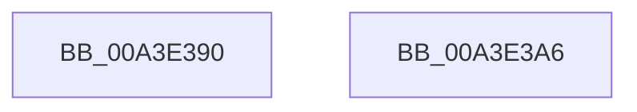

# BcdGetElementData

- RVA: `0x00A3E390`–`0x00A3E3A7` (길이 `23` bytes)
- VA: `0x0000000140A3E390`
- 실행 섹션: `PAGE`
- PDB 이름 있음: `예`; PDB Function 태그: `아니요`
- unwind 정보 RVA: `0x0005D2F4`
- 디코드: `7`개 명령, `23/23` bytes 표시
- 미해석 바이트: `0` (있으면 어셈블리에 `.byte`로 보존)

> 이 문서는 커널 이미지의 기계어와 PDB 기호를 분석해 생성했습니다. 4번과 5번은 함수 원형과 자료형을 바이너리 사용 방식에서 추정한 C 해석이며 원본 소스 복구 결과는 아닙니다.

## 1. Dependencies

- 직접 호출 지점: **1**; 고유 호출 대상: **1**
- 직접 호출자로 확인된 함수: **12**
- RIP 상대 이미지 참조: **0**

### Outgoing calls
- `0x00A3E39C` → [BcdGetElementDataWithFlags](BcdGetElementDataWithFlags_function_00A3EBE4.md) (function, `0x00A3EBE4`)

### Direct callers
- [WheaPersistBadPageToBcd](../../text/65/WheaPersistBadPageToBcd_function_0065F3D0.md) at `0x0065F470`
- [WheaPersistBadPageToBcd](../../text/65/WheaPersistBadPageToBcd_function_0065F3D0.md) at `0x0065F4C8`
- [PopAdaptiveGetSystemInitiatedRebootTargetBootEntry](../76/PopAdaptiveGetSystemInitiatedRebootTargetBootEntry_function_0076B69C.md) at `0x0076B6E6`
- [PopAdaptiveGetSystemInitiatedRebootTargetBootEntry](../76/PopAdaptiveGetSystemInitiatedRebootTargetBootEntry_function_0076B69C.md) at `0x0076B729`
- [PopBcdEstablishResumeObject](../77/PopBcdEstablishResumeObject_function_007700E4.md) at `0x0077015C`
- [PopBcdEstablishResumeObject](../77/PopBcdEstablishResumeObject_function_007700E4.md) at `0x007701E8`
- [PopBcdGetApplicationPathFromResumeObject](../77/PopBcdGetApplicationPathFromResumeObject_function_007702AC.md) at `0x00770346`
- [SepSecureBootUpdateBcdDataForRule](../7A/SepSecureBootUpdateBcdDataForRule_function_007A2514.md) at `0x007A25B1`
- [SepSecureBootUpdateBcdDataForRule](../7A/SepSecureBootUpdateBcdDataForRule_function_007A2514.md) at `0x007A25FE`
- [BiGetDefaultBootEntryIdentifier](../82/BiGetDefaultBootEntryIdentifier_function_0082397C.md) at `0x008239D9`
- [BiResolveLocateDevice](../82/BiResolveLocateDevice_function_00823AB4.md) at `0x00823B50`
- [BiResolveLocateDevice](../82/BiResolveLocateDevice_function_00823AB4.md) at `0x00823B94`
- [BiUpdateBcdObject](../82/BiUpdateBcdObject_function_008270D0.md) at `0x008271FB`
- [BiUpdateBcdObject](../82/BiUpdateBcdObject_function_008270D0.md) at `0x00827235`
- [PopBcdReadElement](PopBcdReadElement_function_00A3C740.md) at `0x00A3C76F`
- [PopBcdReadElement](PopBcdReadElement_function_00A3C740.md) at `0x00A3C7B2`
- [PopBcdSetDefaultResumeObjectElements](PopBcdSetDefaultResumeObjectElements_function_00A3C7F8.md) at `0x00A3C8A1`
- [PopBcdSetDefaultResumeObjectElements](PopBcdSetDefaultResumeObjectElements_function_00A3C7F8.md) at `0x00A3C8C0`
- [PopBcdSetDefaultResumeObjectElements](PopBcdSetDefaultResumeObjectElements_function_00A3C7F8.md) at `0x00A3C8DF`
- [BiGetElement](BiGetElement_function_00A3E2B4.md) at `0x00A3E2EA`
- [BiGetElement](BiGetElement_function_00A3E2B4.md) at `0x00A3E321`
- [BiBuildIdentifierList](BiBuildIdentifierList_function_00A3E584.md) at `0x00A3E78E`

### Static image references
- 디코드된 RIP-relative 메모리 참조가 없습니다.

## 2. Other-region calls and transfers

- 다른 실행 섹션으로 향하는 call: **0**
- 별도 외부 분기/꼬리 이동을 확인하지 못했습니다.

## 3. Assembly (complete function range)

```asm
00A3E390  48 83 EC 38                     sub rsp, 0x38
00A3E394  4C 89 4C 24 20                  mov qword ptr [rsp + 0x20], r9
00A3E399  4D 8B C8                        mov r9, r8
00A3E39C  E8 43 08 00 00                  call 0x140a3ebe4
00A3E3A1  48 83 C4 38                     add rsp, 0x38
00A3E3A5  C3                              ret
00A3E3A6  CC                              int3
```

## 4. C-style interpretation (structured pseudocode)

```c
__int64 __fastcall BcdGetElementData(__int64 a1, __int64 a2, __int64 a3, __int64 a4)
{
    __int64 result;
    __int64 v_rsp;
    unsigned __int64 v_stack_m18;

    v_rsp = (v_rsp) - (56);
    v_stack_m18 = a4;
    result = BcdGetElementDataWithFlags(a1, a2, a3, a3);
    v_rsp = (v_rsp) + (56);
    return result;
}
```

## 5. (Beta) C Style

```c
int64_t BcdGetElementData(int64_t Arg1, int64_t Arg2, int64_t Arg3, int64_t Arg4)
{
    int64_t result;
    int64_t local_rsp;
    uint64_t v_stack_m18;

    local_rsp = (local_rsp) - (56);
    v_stack_m18 = Arg4;
    result = BcdGetElementDataWithFlags(Arg1, Arg2, Arg3, Arg3);
    local_rsp = (local_rsp) + (56);
    return result;
}
```

## 6. Execution-region graph

[열기: 2D/3D 그래프와 함수 탐색 컨트롤 패널](../../../control-panel.html?section=page&rva=0x00A3E390&view=graph)

- 2D 그래프는 위에서 아래로 흐르고, 3D 그래프는 빈 공간을 드래그해 회전합니다. Shift+드래그는 이동, 휠은 확대·축소, 함수 노드 선택은 대상 보고서 이동입니다.

### Static fallback


