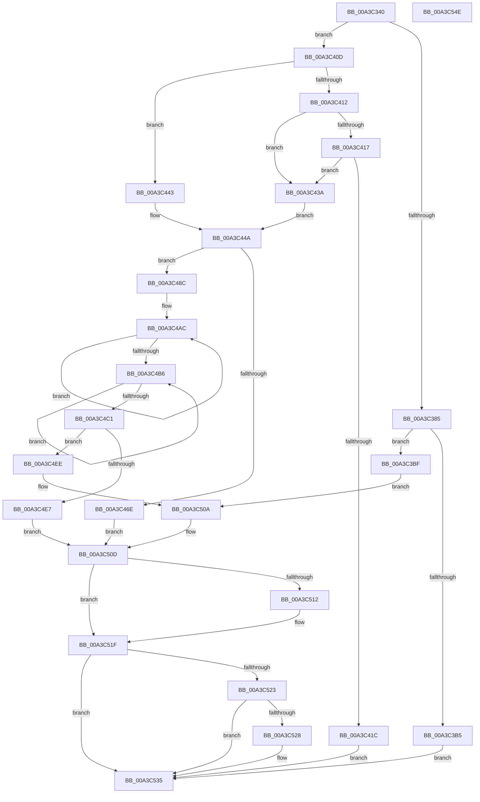

# BcdGetSystemStorePath

- RVA: `0x00A3C340`–`0x00A3C54F` (길이 `527` bytes)
- VA: `0x0000000140A3C340`
- 실행 섹션: `PAGE`
- PDB 이름 있음: `예`; PDB Function 태그: `아니요`
- unwind 정보 RVA: `0x000AE4A8`
- 디코드: `139`개 명령, `527/527` bytes 표시
- 미해석 바이트: `0` (있으면 어셈블리에 `.byte`로 보존)

> 이 문서는 커널 이미지의 기계어와 PDB 기호를 분석해 생성했습니다. 4번과 5번은 함수 원형과 자료형을 바이너리 사용 방식에서 추정한 C 해석이며 원본 소스 복구 결과는 아닙니다.

## 1. Dependencies

- 직접 호출 지점: **16**; 고유 호출 대상: **8**
- 직접 호출자로 확인된 함수: **1**
- RIP 상대 이미지 참조: **10**

### Outgoing calls
- `0x00A3C36F` → [BiGetFirmwareType](BiGetFirmwareType_function_00A3FA5C.md) (function, `0x00A3FA5C`)
- `0x00A3C385` → [RtlIsStateSeparationEnabled](RtlIsStateSeparationEnabled_function_00A3C560.md) (function, `0x00A3C560`)
- `0x00A3C3A8` → [ExAllocatePool2](../../poolcode/B8/ExAllocatePool2_function_00B820F0.md) (function, `0x00B820F0`)
- `0x00A3C3DA` → [wcscpy_s](../../text/50/wcscpy_s_function_005064B0.md) (function, `0x005064B0`)
- `0x00A3C3EC` → [wcscat_s](../../text/50/wcscat_s_function_00506410.md) (function, `0x00506410`)
- `0x00A3C400` → [BiLogMessage](BiLogMessage_function_00A3D3A8.md) (function, `0x00A3D3A8`)
- `0x00A3C430` → [BiLogMessage](BiLogMessage_function_00A3D3A8.md) (function, `0x00A3D3A8`)
- `0x00A3C459` → [BiLogMessage](BiLogMessage_function_00A3D3A8.md) (function, `0x00A3D3A8`)
- `0x00A3C463` → [BiGetSystemPartition](../6F/BiGetSystemPartition_function_006FF724.md) (function, `0x006FF724`)
- `0x00A3C47D` → [BiLogMessage](BiLogMessage_function_00A3D3A8.md) (function, `0x00A3D3A8`)
- `0x00A3C4A0` → [BiLogMessage](BiLogMessage_function_00A3D3A8.md) (function, `0x00A3D3A8`)
- `0x00A3C4DA` → [ExAllocatePool2](../../poolcode/B8/ExAllocatePool2_function_00B820F0.md) (function, `0x00B820F0`)
- `0x00A3C4F7` → [wcscpy_s](../../text/50/wcscpy_s_function_005064B0.md) (function, `0x005064B0`)
- `0x00A3C505` → [wcscat_s](../../text/50/wcscat_s_function_00506410.md) (function, `0x00506410`)
- `0x00A3C51A` → [ExFreePoolWithTag](../../poolcode/B8/ExFreePoolWithTag_function_00B82870.md) (function, `0x00B82870`)
- `0x00A3C530` → [ExFreePoolWithTag](../../poolcode/B8/ExFreePoolWithTag_function_00B82870.md) (function, `0x00B82870`)

### Direct callers
- [BiLoadSystemStore](BiLoadSystemStore_function_00A3C198.md) at `0x00A3C1CB`

### Static image references
- `0x00A3C3BF` → RVA `0x00AFC880` (` ?? ::NNGAKEGL::`string'`; read)
- `0x00A3C3C9` → RVA `0x00B0BDE0` (` ?? ::NNGAKEGL::`string'`; read)
- `0x00A3C3DF` → RVA `0x00B0BE10` (` ?? ::NNGAKEGL::`string'`; read)
- `0x00A3C3F4` → RVA `0x00B0BE40` (` ?? ::NNGAKEGL::`string'`; read)
- `0x00A3C421` → RVA `0x00B0A320` (` ?? ::NNGAKEGL::`string'`; read)
- `0x00A3C43A` → RVA `0x00B0C430` (` ?? ::NNGAKEGL::`string'`; read)
- `0x00A3C443` → RVA `0x00B0CE70` (` ?? ::NNGAKEGL::`string'`; read)
- `0x00A3C44D` → RVA `0x00B0BE80` (` ?? ::NNGAKEGL::`string'`; read)
- `0x00A3C471` → RVA `0x00B0BEB0` (` ?? ::NNGAKEGL::`string'`; read)
- `0x00A3C491` → RVA `0x00B0BF10` (` ?? ::NNGAKEGL::`string'`; read)

## 2. Other-region calls and transfers

- 다른 실행 섹션으로 향하는 call: **8**
  - `0x00A3C3A8` → [ExAllocatePool2](../../poolcode/B8/ExAllocatePool2_function_00B820F0.md) (`PAGE` → `POOLCODE`)
  - `0x00A3C3DA` → [wcscpy_s](../../text/50/wcscpy_s_function_005064B0.md) (`PAGE` → `.text`)
  - `0x00A3C3EC` → [wcscat_s](../../text/50/wcscat_s_function_00506410.md) (`PAGE` → `.text`)
  - `0x00A3C4DA` → [ExAllocatePool2](../../poolcode/B8/ExAllocatePool2_function_00B820F0.md) (`PAGE` → `POOLCODE`)
  - `0x00A3C4F7` → [wcscpy_s](../../text/50/wcscpy_s_function_005064B0.md) (`PAGE` → `.text`)
  - `0x00A3C505` → [wcscat_s](../../text/50/wcscat_s_function_00506410.md) (`PAGE` → `.text`)
  - `0x00A3C51A` → [ExFreePoolWithTag](../../poolcode/B8/ExFreePoolWithTag_function_00B82870.md) (`PAGE` → `POOLCODE`)
  - `0x00A3C530` → [ExFreePoolWithTag](../../poolcode/B8/ExFreePoolWithTag_function_00B82870.md) (`PAGE` → `POOLCODE`)
- 별도 외부 분기/꼬리 이동을 확인하지 못했습니다.

## 3. Assembly (complete function range)

```asm
00A3C340  48 8B C4                        mov rax, rsp
00A3C343  48 89 58 08                     mov qword ptr [rax + 8], rbx
00A3C347  48 89 68 20                     mov qword ptr [rax + 0x20], rbp
00A3C34B  56                              push rsi
00A3C34C  57                              push rdi
00A3C34D  41 54                           push r12
00A3C34F  41 56                           push r14
00A3C351  41 57                           push r15
00A3C353  48 83 EC 20                     sub rsp, 0x20
00A3C357  45 33 E4                        xor r12d, r12d
00A3C35A  4C 8B F9                        mov r15, rcx
00A3C35D  48 8D 48 18                     lea rcx, [rax + 0x18]
00A3C361  4C 89 60 18                     mov qword ptr [rax + 0x18], r12
00A3C365  41 8B FC                        mov edi, r12d
00A3C368  4C 89 60 10                     mov qword ptr [rax + 0x10], r12
00A3C36C  41 8B F4                        mov esi, r12d
00A3C36F  E8 E8 36 00 00                  call 0x140a3fa5c
00A3C374  48 F7 44 24 60 00 00 01 00      test qword ptr [rsp + 0x60], 0x10000
00A3C37D  8B D0                           mov edx, eax
00A3C37F  0F 84 88 00 00 00               je 0x140a3c40d
00A3C385  E8 D6 01 00 00                  call 0x140a3c560
00A3C38A  40 8A E8                        mov bpl, al
00A3C38D  B9 02 01 00 00                  mov ecx, 0x102
00A3C392  F6 D8                           neg al
00A3C394  41 B8 42 43 44 4B               mov r8d, 0x4b444342
00A3C39A  48 1B DB                        sbb rbx, rbx
00A3C39D  83 E3 08                        and ebx, 8
00A3C3A0  48 83 C3 24                     add rbx, 0x24
00A3C3A4  48 8D 14 1B                     lea rdx, [rbx + rbx]
00A3C3A8  E8 43 5D 14 00                  call 0x140b820f0
00A3C3AD  48 8B F8                        mov rdi, rax
00A3C3B0  48 85 C0                        test rax, rax
00A3C3B3  75 0A                           jne 0x140a3c3bf
00A3C3B5  BB 17 00 00 C0                  mov ebx, 0xc0000017
00A3C3BA  E9 76 01 00 00                  jmp 0x140a3c535
00A3C3BF  48 8D 05 BA 04 0C 00            lea rax, [rip + 0xc04ba]
00A3C3C6  40 84 ED                        test bpl, bpl
00A3C3C9  4C 8D 05 10 FA 0C 00            lea r8, [rip + 0xcfa10]
00A3C3D0  48 8B D3                        mov rdx, rbx
00A3C3D3  4C 0F 44 C0                     cmove r8, rax
00A3C3D7  48 8B CF                        mov rcx, rdi
00A3C3DA  E8 D1 A0 AC FF                  call 0x1405064b0
00A3C3DF  4C 8D 05 2A FA 0C 00            lea r8, [rip + 0xcfa2a]
00A3C3E6  48 8B D3                        mov rdx, rbx
00A3C3E9  48 8B CF                        mov rcx, rdi
00A3C3EC  E8 1F A0 AC FF                  call 0x140506410
00A3C3F1  4C 8B C7                        mov r8, rdi
00A3C3F4  48 8D 15 45 FA 0C 00            lea rdx, [rip + 0xcfa45]
00A3C3FB  B9 02 00 00 00                  mov ecx, 2
00A3C400  E8 A3 0F 00 00                  call 0x140a3d3a8
00A3C405  41 8B DC                        mov ebx, r12d
00A3C408  E9 FD 00 00 00                  jmp 0x140a3c50a
00A3C40D  83 EA 01                        sub edx, 1
00A3C410  74 31                           je 0x140a3c443
00A3C412  83 EA 01                        sub edx, 1
00A3C415  74 23                           je 0x140a3c43a
00A3C417  83 FA 01                        cmp edx, 1
00A3C41A  74 1E                           je 0x140a3c43a
00A3C41C  BB BB 00 00 C0                  mov ebx, 0xc00000bb
00A3C421  48 8D 15 F8 DE 0C 00            lea rdx, [rip + 0xcdef8]
00A3C428  44 8B C3                        mov r8d, ebx
00A3C42B  B9 04 00 00 00                  mov ecx, 4
00A3C430  E8 73 0F 00 00                  call 0x140a3d3a8
00A3C435  E9 FB 00 00 00                  jmp 0x140a3c535
00A3C43A  48 8D 2D EF FF 0C 00            lea rbp, [rip + 0xcffef]
00A3C441  EB 07                           jmp 0x140a3c44a
00A3C443  48 8D 2D 26 0A 0D 00            lea rbp, [rip + 0xd0a26]
00A3C44A  4C 8B C5                        mov r8, rbp
00A3C44D  48 8D 15 2C FA 0C 00            lea rdx, [rip + 0xcfa2c]
00A3C454  B9 02 00 00 00                  mov ecx, 2
00A3C459  E8 4A 0F 00 00                  call 0x140a3d3a8
00A3C45E  48 8D 4C 24 58                  lea rcx, [rsp + 0x58]
00A3C463  E8 BC 32 CC FF                  call 0x1406ff724
00A3C468  8B D8                           mov ebx, eax
00A3C46A  85 C0                           test eax, eax
00A3C46C  79 1E                           jns 0x140a3c48c
00A3C46E  44 8B C0                        mov r8d, eax
00A3C471  48 8D 15 38 FA 0C 00            lea rdx, [rip + 0xcfa38]
00A3C478  B9 04 00 00 00                  mov ecx, 4
00A3C47D  E8 26 0F 00 00                  call 0x140a3d3a8
00A3C482  48 8B 74 24 58                  mov rsi, qword ptr [rsp + 0x58]
00A3C487  E9 81 00 00 00                  jmp 0x140a3c50d
00A3C48C  48 8B 74 24 58                  mov rsi, qword ptr [rsp + 0x58]
00A3C491  48 8D 15 78 FA 0C 00            lea rdx, [rip + 0xcfa78]
00A3C498  4C 8B C6                        mov r8, rsi
00A3C49B  B9 02 00 00 00                  mov ecx, 2
00A3C4A0  E8 03 0F 00 00                  call 0x140a3d3a8
00A3C4A5  48 83 C8 FF                     or rax, 0xffffffffffffffff
00A3C4A9  48 8B C8                        mov rcx, rax
00A3C4AC  48 FF C1                        inc rcx
00A3C4AF  66 44 39 24 4E                  cmp word ptr [rsi + rcx*2], r12w
00A3C4B4  75 F6                           jne 0x140a3c4ac
00A3C4B6  48 FF C0                        inc rax
00A3C4B9  66 44 39 64 45 00               cmp word ptr [rbp + rax*2], r12w
00A3C4BF  75 F5                           jne 0x140a3c4b6
00A3C4C1  4C 8D 70 01                     lea r14, [rax + 1]
00A3C4C5  41 B8 42 43 44 4B               mov r8d, 0x4b444342
00A3C4CB  4C 03 F1                        add r14, rcx
00A3C4CE  B9 02 01 00 00                  mov ecx, 0x102
00A3C4D3  45 8B F6                        mov r14d, r14d
00A3C4D6  4B 8D 14 36                     lea rdx, [r14 + r14]
00A3C4DA  E8 11 5C 14 00                  call 0x140b820f0
00A3C4DF  48 8B F8                        mov rdi, rax
00A3C4E2  48 85 C0                        test rax, rax
00A3C4E5  75 07                           jne 0x140a3c4ee
00A3C4E7  BB 17 00 00 C0                  mov ebx, 0xc0000017
00A3C4EC  EB 1F                           jmp 0x140a3c50d
00A3C4EE  4C 8B C6                        mov r8, rsi
00A3C4F1  49 8B D6                        mov rdx, r14
00A3C4F4  48 8B CF                        mov rcx, rdi
00A3C4F7  E8 B4 9F AC FF                  call 0x1405064b0
00A3C4FC  4C 8B C5                        mov r8, rbp
00A3C4FF  49 8B D6                        mov rdx, r14
00A3C502  48 8B CF                        mov rcx, rdi
00A3C505  E8 06 9F AC FF                  call 0x140506410
00A3C50A  49 89 3F                        mov qword ptr [r15], rdi
00A3C50D  48 85 F6                        test rsi, rsi
00A3C510  74 0D                           je 0x140a3c51f
00A3C512  BA 42 43 44 4B                  mov edx, 0x4b444342
00A3C517  48 8B CE                        mov rcx, rsi
00A3C51A  E8 51 63 14 00                  call 0x140b82870
00A3C51F  85 DB                           test ebx, ebx
00A3C521  79 12                           jns 0x140a3c535
00A3C523  48 85 FF                        test rdi, rdi
00A3C526  74 0D                           je 0x140a3c535
00A3C528  BA 42 43 44 4B                  mov edx, 0x4b444342
00A3C52D  48 8B CF                        mov rcx, rdi
00A3C530  E8 3B 63 14 00                  call 0x140b82870
00A3C535  48 8B 6C 24 68                  mov rbp, qword ptr [rsp + 0x68]
00A3C53A  8B C3                           mov eax, ebx
00A3C53C  48 8B 5C 24 50                  mov rbx, qword ptr [rsp + 0x50]
00A3C541  48 83 C4 20                     add rsp, 0x20
00A3C545  41 5F                           pop r15
00A3C547  41 5E                           pop r14
00A3C549  41 5C                           pop r12
00A3C54B  5F                              pop rdi
00A3C54C  5E                              pop rsi
00A3C54D  C3                              ret
00A3C54E  CC                              int3
```

## 4. C-style interpretation (structured pseudocode)

```c
__int64 __fastcall BcdGetSystemStorePath(__int64 a1)
{
    __int64 result;
    __int64 v_r12;
    __int64 v_r14;
    __int64 v_rbx;
    __int64 v_rsp;
    unsigned __int64 v_stack_p10;
    unsigned __int64 v_stack_p18;
    unsigned __int64 v_stack_p20;
    unsigned __int64 v_stack_p8;

    *(unsigned __int64 *)(v_rsp + 8) = v_rbx;
    *(unsigned __int64 *)(v_rsp + 32) = v_rbp;
    v_rsp = (v_rsp) - (32);
    v_r12 = 0;
    *(unsigned __int64 *)(v_rsp + 24) = 0;
    *(unsigned __int64 *)(v_rsp + 16) = 0;
    result = BiGetFirmwareType(v_rsp + 24, a2, a3, a4);
    if (((v_stack_p18) & (0x10000ULL)) == 0) goto loc_00A3C40D;
    result = RtlIsStateSeparationEnabled(v_rsp + 24, (unsigned int)((unsigned int)(result)), a3, a4);
    result = (unsigned __int8)(-(result));
    v_rbx = (unsigned int)((v_rbx) & (8));
    v_rbx = (v_rbx) + (36);
    result = ExAllocatePool2(258, v_rbx + v_rbx * 1, (unsigned int)(0x4B444342ULL), a4);
    if (result != 0) goto loc_00A3C3BF;
    goto loc_00A3C535;
loc_00A3C3BF:
    a3 = v_rip + 850448;
    if ((unsigned __int8)((unsigned __int8)(result)) == 0) { a3 = v_rip + 787642; }
    result = wcscpy_s(result, (unsigned int)(0xC0000017ULL), a3, a4);
    result = wcscat_s(result, (unsigned int)(0xC0000017ULL), v_rip + 850474, a4);
    result = BiLogMessage(2, v_rip + 850501, result, a4);
    goto loc_00A3C50A;
loc_00A3C40D:
    a2 = (unsigned int)((v_rip + 850501) - (1));
    if (condition_is_equal) goto loc_00A3C443;
    a2 = (unsigned int)((a2) - (1));
    if (condition_is_equal) goto loc_00A3C43A;
    if (((unsigned int)(a2)) == 1) goto loc_00A3C43A;
    result = BiLogMessage(4, v_rip + 843512, (unsigned int)((unsigned int)((unsigned int)(0xC00000BBULL))), a4);
    goto loc_00A3C535;
loc_00A3C43A:
    goto loc_00A3C44A;
loc_00A3C443:
loc_00A3C44A:
    result = BiLogMessage(2, v_rip + 850476, v_rip + 854566, a4);
    result = BiGetSystemPartition(v_stack_p10, v_rip + 850476, v_rip + 854566, a4);
    if (!sign_flag) goto loc_00A3C48C;
    result = BiLogMessage(4, v_rip + 850488, (unsigned int)((unsigned int)(result)), a4);
    goto loc_00A3C50D;
loc_00A3C48C:
    result = BiLogMessage(2, v_rip + 850552, v_stack_p10, a4);
    result = (result) | (-1);
loc_00A3C4AC:
    a1 = (result) + 1;
    if ((*(unsigned __int16 *)(v_stack_p10 + a1 * 2)) != 0) goto loc_00A3C4AC;
loc_00A3C4B6:
    result = (result) + 1;
    if ((*(unsigned __int16 *)(v_rip + 854566 + result * 2)) != 0) goto loc_00A3C4B6;
    v_r14 = (result + 1) + (a1);
    result = ExAllocatePool2(258, (unsigned int)((unsigned int)(v_r14)) + (unsigned int)((unsigned int)(v_r14)) * 1, (unsigned int)(0x4B444342ULL), a4);
    if (result != 0) goto loc_00A3C4EE;
    goto loc_00A3C50D;
loc_00A3C4EE:
    result = wcscpy_s(result, (unsigned int)((unsigned int)(v_r14)), v_stack_p10, a4);
    result = wcscat_s(result, (unsigned int)((unsigned int)(v_r14)), v_rip + 854566, a4);
loc_00A3C50A:
    *(unsigned __int64 *)(a1) = result;
loc_00A3C50D:
    if (v_stack_p10 != 0) {
        a2 = 0x4B444342ULL;
        a1 = v_stack_p10;
        result = ExFreePoolWithTag(a1, a2, v_rip + 854566, a4);
    }
    if (!sign_flag) goto loc_00A3C535;
    if (result != 0) {
        a2 = 0x4B444342ULL;
        a1 = result;
        result = ExFreePoolWithTag(a1, a2, v_rip + 854566, a4);
    }
    v_rsp = (v_rsp) + (32);
    return (unsigned int)((unsigned int)((unsigned int)(0xC0000017ULL)));
}
```

## 5. (Beta) C Style

```c
int64_t BcdGetSystemStorePath(void *Arg1)
{
    uint8_t *arg1 = (uint8_t *)Arg1;

    int64_t result;
    int64_t local_r12;
    int64_t local_r14;
    int64_t local_rbx;
    int64_t local_rsp;
    uint64_t v_stack_p10;
    uint64_t v_stack_p18;
    uint64_t v_stack_p20;
    uint64_t v_stack_p8;

    *(uint64_t *)(local_rsp + 0x8) = local_rbx;
    *(uint64_t *)(local_rsp + 0x20) = local_rbp;
    local_rsp = (local_rsp) - (32);
    local_r12 = 0;
    *(uint64_t *)(local_rsp + 0x18) = 0;
    *(uint64_t *)(local_rsp + 0x10) = 0;
    result = BiGetFirmwareType(local_rsp + 24, a2, a3, a4);
    if (((v_stack_p18) & (0x10000ULL)) == 0) goto loc_00A3C40D;
    result = RtlIsStateSeparationEnabled(local_rsp + 24, (uint32_t)((uint32_t)(result)), a3, a4);
    result = (uint8_t)(-(result));
    local_rbx = (uint32_t)((local_rbx) & (8));
    local_rbx = (local_rbx) + (36);
    result = ExAllocatePool2(258, local_rbx + local_rbx * 1, (uint32_t)(0x4B444342ULL), a4);
    if (result != 0) goto loc_00A3C3BF;
    goto loc_00A3C535;
loc_00A3C3BF:
    a3 = v_rip + 850448;
    if ((uint8_t)((uint8_t)(result)) == 0) { a3 = v_rip + 787642; }
    result = wcscpy_s(result, (uint32_t)(0xC0000017ULL), a3, a4);
    result = wcscat_s(result, (uint32_t)(0xC0000017ULL), v_rip + 850474, a4);
    result = BiLogMessage(2, v_rip + 850501, result, a4);
    goto loc_00A3C50A;
loc_00A3C40D:
    a2 = (uint32_t)((v_rip + 850501) - (1));
    if (condition_is_equal) goto loc_00A3C443;
    a2 = (uint32_t)((a2) - (1));
    if (condition_is_equal) goto loc_00A3C43A;
    if (((uint32_t)(a2)) == 1) goto loc_00A3C43A;
    result = BiLogMessage(4, v_rip + 843512, (uint32_t)((uint32_t)((uint32_t)(0xC00000BBULL))), a4);
    goto loc_00A3C535;
loc_00A3C43A:
    goto loc_00A3C44A;
loc_00A3C443:
loc_00A3C44A:
    result = BiLogMessage(2, v_rip + 850476, v_rip + 854566, a4);
    result = BiGetSystemPartition(v_stack_p10, v_rip + 850476, v_rip + 854566, a4);
    if (!sign_flag) goto loc_00A3C48C;
    result = BiLogMessage(4, v_rip + 850488, (uint32_t)((uint32_t)(result)), a4);
    goto loc_00A3C50D;
loc_00A3C48C:
    result = BiLogMessage(2, v_rip + 850552, v_stack_p10, a4);
    result = (result) | (-1);
loc_00A3C4AC:
    Arg1 = (result) + 1;
    if ((*(uint16_t *)(v_stack_p10 + arg1 * 2)) != 0) goto loc_00A3C4AC;
loc_00A3C4B6:
    result = (result) + 1;
    if ((*(uint16_t *)(v_rip + 0xD0A26 + result * 2)) != 0) goto loc_00A3C4B6;
    local_r14 = (result + 1) + (Arg1);
    result = ExAllocatePool2(258, (uint32_t)((uint32_t)(local_r14)) + (uint32_t)((uint32_t)(local_r14)) * 1, (uint32_t)(0x4B444342ULL), a4);
    if (result != 0) goto loc_00A3C4EE;
    goto loc_00A3C50D;
loc_00A3C4EE:
    result = wcscpy_s(result, (uint32_t)((uint32_t)(local_r14)), v_stack_p10, a4);
    result = wcscat_s(result, (uint32_t)((uint32_t)(local_r14)), v_rip + 854566, a4);
loc_00A3C50A:
    *(uint64_t *)(arg1) = result;
loc_00A3C50D:
    if (v_stack_p10 != 0) {
        a2 = 0x4B444342ULL;
        Arg1 = v_stack_p10;
        result = ExFreePoolWithTag(Arg1, a2, v_rip + 854566, a4);
    }
    if (!sign_flag) goto loc_00A3C535;
    if (result != 0) {
        a2 = 0x4B444342ULL;
        Arg1 = result;
        result = ExFreePoolWithTag(Arg1, a2, v_rip + 854566, a4);
    }
    local_rsp = (local_rsp) + (32);
    return (uint32_t)((uint32_t)((uint32_t)(0xC0000017ULL)));
}
```

### 관측된 메모리 오프셋

구조체 형식이 확인되지 않은 접근은 인자 기준의 오프셋으로만 기록했습니다.

| 기준 인자 | 오프셋 표현 | 폭 (bit) | 접근 |
|---|---:|---:|---|
| `Arg1` | `+ 0x0` | `64` | `W` |

## 6. Execution-region graph

[열기: 2D/3D 그래프와 함수 탐색 컨트롤 패널](../../../control-panel.html?section=page&rva=0x00A3C340&view=graph)

- 2D 그래프는 위에서 아래로 흐르고, 3D 그래프는 빈 공간을 드래그해 회전합니다. Shift+드래그는 이동, 휠은 확대·축소, 함수 노드 선택은 대상 보고서 이동입니다.

### Static fallback


