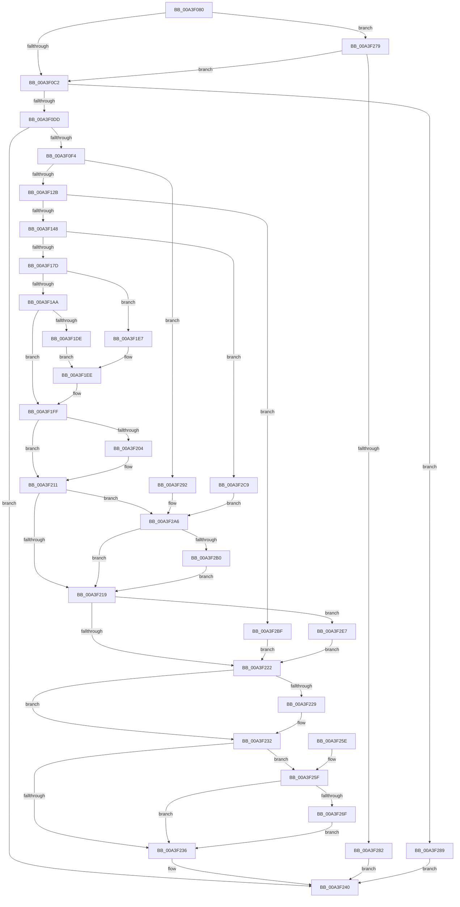

# BcdSetElementDataWithFlags

- RVA: `0x00A3F080`–`0x00A3F2F4` (길이 `628` bytes)
- VA: `0x0000000140A3F080`
- 실행 섹션: `PAGE`
- PDB 이름 있음: `예`; PDB Function 태그: `아니요`
- unwind 정보 RVA: `0x000AE7C4`
- 디코드: `168`개 명령, `628/628` bytes 표시
- 미해석 바이트: `0` (있으면 어셈블리에 `.byte`로 보존)

> 이 문서는 커널 이미지의 기계어와 PDB 기호를 분석해 생성했습니다. 4번과 5번은 함수 원형과 자료형을 바이너리 사용 방식에서 추정한 C 해석이며 원본 소스 복구 결과는 아닙니다.

## 1. Dependencies

- 직접 호출 지점: **21**; 고유 호출 대상: **17**
- 직접 호출자로 확인된 함수: **10**
- RIP 상대 이미지 참조: **8**

### Outgoing calls
- `0x00A3F0DD` → [BiIsOfflineHandle](../../text/4B/BiIsOfflineHandle_function_004B4FA0.md) (function, `0x004B4FA0`)
- `0x00A3F0E7` → [BiAcquireBcdSyncMutant](../91/BiAcquireBcdSyncMutant_function_00916898.md) (function, `0x00916898`)
- `0x00A3F103` → [BiLogMessage](BiLogMessage_function_00A3D3A8.md) (function, `0x00A3D3A8`)
- `0x00A3F11C` → [BiOpenKey](BiOpenKey_function_00A3F60C.md) (function, `0x00A3F60C`)
- `0x00A3F13B` → [ultow_s](../../text/50/ultow_s_function_00504F30.md) (function, `0x00504F30`)
- `0x00A3F16E` → [BiCreateKey](../A4/BiCreateKey_function_00A404DC.md) (function, `0x00A404DC`)
- `0x00A3F197` → [BiConvertElementToRegistryData](../A4/BiConvertElementToRegistryData_function_00A400A8.md) (function, `0x00A400A8`)
- `0x00A3F1B2` → [BiConvertElementFormatToValueType](BiConvertElementFormatToValueType_function_00A3F7CC.md) (function, `0x00A3F7CC`)
- `0x00A3F1D3` → [BiSetRegistryValue](BiSetRegistryValue_function_00A3E3B0.md) (function, `0x00A3E3B0`)
- `0x00A3F1FA` → [BiLogMessage](BiLogMessage_function_00A3D3A8.md) (function, `0x00A3D3A8`)
- `0x00A3F20C` → [ExFreePoolWithTag](../../poolcode/B8/ExFreePoolWithTag_function_00B82870.md) (function, `0x00B82870`)
- `0x00A3F22D` → [BiCloseKey](../91/BiCloseKey_function_00916A00.md) (function, `0x00916A00`)
- `0x00A3F239` → [BiReleaseBcdSyncMutant](../91/BiReleaseBcdSyncMutant_function_0091695C.md) (function, `0x0091695C`)
- `0x00A3F247` → [_security_check_cookie](../../text/6A/_security_check_cookie_function_006AC640.md) (function, `0x006AC640`)
- `0x00A3F266` → [BiIsLinkedToFirmwareVariable](BiIsLinkedToFirmwareVariable_function_00A3E4D0.md) (function, `0x00A3E4D0`)
- `0x00A3F272` → [BiSetFirmwareModifiedFromObject](../../text/4B/BiSetFirmwareModifiedFromObject_function_004B1CC8.md) (function, `0x004B1CC8`)
- `0x00A3F289` → [BiDeleteElement](BiDeleteElement_function_00A3E0F8.md) (function, `0x00A3E0F8`)
- `0x00A3F2A1` → [BiLogMessage](BiLogMessage_function_00A3D3A8.md) (function, `0x00A3D3A8`)
- `0x00A3F2B3` → [BiDeleteKey](BiDeleteKey_function_00A3FC58.md) (function, `0x00A3FC58`)
- `0x00A3F2DC` → [BiLogMessage](BiLogMessage_function_00A3D3A8.md) (function, `0x00A3D3A8`)
- `0x00A3F2EA` → [BiCloseKey](../91/BiCloseKey_function_00916A00.md) (function, `0x00916A00`)

### Direct callers
- [PopBcdCopyLoaderObjectSettings](../76/PopBcdCopyLoaderObjectSettings_function_0076FFF4.md) at `0x00770064`
- [PopBcdRegenerateResumeObject](../77/PopBcdRegenerateResumeObject_function_007704BC.md) at `0x00770584`
- [PopBcdRegenerateResumeObject](../77/PopBcdRegenerateResumeObject_function_007704BC.md) at `0x007705AE`
- [PopBcdRegenerateResumeObject](../77/PopBcdRegenerateResumeObject_function_007704BC.md) at `0x007705F2`
- [PopBcdRegenerateResumeObject](../77/PopBcdRegenerateResumeObject_function_007704BC.md) at `0x0077062C`
- [PopBcdRegenerateResumeObject](../77/PopBcdRegenerateResumeObject_function_007704BC.md) at `0x00770662`
- [PopBcdSetPendingResume](../77/PopBcdSetPendingResume_function_007706F8.md) at `0x0077076E`
- [PopBcdSetPendingResume](../77/PopBcdSetPendingResume_function_007706F8.md) at `0x007707BF`
- [PopBcdSetPendingResume](../77/PopBcdSetPendingResume_function_007706F8.md) at `0x007707E7`
- [PopBcdSetPendingResume](../77/PopBcdSetPendingResume_function_007706F8.md) at `0x00770814`
- [SepSecureBootUpdateBcdDataForRule](../7A/SepSecureBootUpdateBcdDataForRule_function_007A2514.md) at `0x007A267A`
- [BiAddBootEntryToEfiBootManagerDisplayOrder](../82/BiAddBootEntryToEfiBootManagerDisplayOrder_function_008262D8.md) at `0x008263D0`
- [BiUpdateBcdObject](../82/BiUpdateBcdObject_function_008270D0.md) at `0x00827284`
- [BiUpdateBcdObject](../82/BiUpdateBcdObject_function_008270D0.md) at `0x008272E2`
- [BiUpdateBcdObject](../82/BiUpdateBcdObject_function_008270D0.md) at `0x00827324`
- [PopBcdSetDefaultResumeObjectElements](PopBcdSetDefaultResumeObjectElements_function_00A3C7F8.md) at `0x00A3C9AD`
- [PopBcdSetDefaultResumeObjectElements](PopBcdSetDefaultResumeObjectElements_function_00A3C7F8.md) at `0x00A3C9DA`
- [PopBcdSetDefaultResumeObjectElements](PopBcdSetDefaultResumeObjectElements_function_00A3C7F8.md) at `0x00A3CA76`
- [PopBcdSetDefaultResumeObjectElements](PopBcdSetDefaultResumeObjectElements_function_00A3C7F8.md) at `0x00A3CAAA`
- [PopBcdSetDefaultResumeObjectElements](PopBcdSetDefaultResumeObjectElements_function_00A3C7F8.md) at `0x00A3CAD1`
- [PopBcdSetDefaultResumeObjectElements](PopBcdSetDefaultResumeObjectElements_function_00A3C7F8.md) at `0x00A3CAEB`
- [PopBcdSetDefaultResumeObjectElements](PopBcdSetDefaultResumeObjectElements_function_00A3C7F8.md) at `0x00A3CB05`
- [PopBcdSetupResumeObject](PopBcdSetupResumeObject_function_00A3D158.md) at `0x00A3D1CB`
- [PopBcdSetupResumeObject](PopBcdSetupResumeObject_function_00A3D158.md) at `0x00A3D1E5`
- [PopBcdSetupResumeObject](PopBcdSetupResumeObject_function_00A3D158.md) at `0x00A3D21A`
- [BiBindEfiBootManager](BiBindEfiBootManager_function_00A3DCB0.md) at `0x00A3DDF8`
- [BiBindEfiBootManager](BiBindEfiBootManager_function_00A3DCB0.md) at `0x00A3DE3A`
- [BiBindEfiBootManager](BiBindEfiBootManager_function_00A3DCB0.md) at `0x00A3DF1A`
- [BcdSetElementData](BcdSetElementData_function_00A3E370.md) at `0x00A3E37C`

### Static image references
- `0x00A3F097` → RVA `0x00E0A740` (`.data`; read)
- `0x00A3F0F7` → RVA `0x00B0BBF0` (` ?? ::NNGAKEGL::`string'`; read)
- `0x00A3F112` → RVA `0x00B0B390` (` ?? ::NNGAKEGL::`string'`; read)
- `0x00A3F1BA` → RVA `0x00B0BB20` (` ?? ::NNGAKEGL::`string'`; read)
- `0x00A3F1DE` → RVA `0x00B0B480` (` ?? ::NNGAKEGL::`string'`; read)
- `0x00A3F1E7` → RVA `0x00B0B410` (` ?? ::NNGAKEGL::`string'`; read)
- `0x00A3F295` → RVA `0x00B0BC20` (` ?? ::NNGAKEGL::`string'`; read)
- `0x00A3F2D0` → RVA `0x00B0B3B0` (` ?? ::NNGAKEGL::`string'`; read)

## 2. Other-region calls and transfers

- 다른 실행 섹션으로 향하는 call: **5**
  - `0x00A3F0DD` → [BiIsOfflineHandle](../../text/4B/BiIsOfflineHandle_function_004B4FA0.md) (`PAGE` → `.text`)
  - `0x00A3F13B` → [ultow_s](../../text/50/ultow_s_function_00504F30.md) (`PAGE` → `.text`)
  - `0x00A3F20C` → [ExFreePoolWithTag](../../poolcode/B8/ExFreePoolWithTag_function_00B82870.md) (`PAGE` → `POOLCODE`)
  - `0x00A3F247` → [_security_check_cookie](../../text/6A/_security_check_cookie_function_006AC640.md) (`PAGE` → `.text`)
  - `0x00A3F272` → [BiSetFirmwareModifiedFromObject](../../text/4B/BiSetFirmwareModifiedFromObject_function_004B1CC8.md) (`PAGE` → `.text`)
- 별도 외부 분기/꼬리 이동을 확인하지 못했습니다.

## 3. Assembly (complete function range)

```asm
00A3F080  40 55                           push rbp
00A3F082  53                              push rbx
00A3F083  56                              push rsi
00A3F084  57                              push rdi
00A3F085  41 55                           push r13
00A3F087  41 56                           push r14
00A3F089  41 57                           push r15
00A3F08B  48 8D 6C 24 E1                  lea rbp, [rsp - 0x1f]
00A3F090  48 81 EC 90 00 00 00            sub rsp, 0x90
00A3F097  48 8B 05 A2 B6 3C 00            mov rax, qword ptr [rip + 0x3cb6a2]
00A3F09E  48 33 C4                        xor rax, rsp
00A3F0A1  48 89 45 17                     mov qword ptr [rbp + 0x17], rax
00A3F0A5  44 8B 7D 7F                     mov r15d, dword ptr [rbp + 0x7f]
00A3F0A9  33 DB                           xor ebx, ebx
00A3F0AB  89 55 CF                        mov dword ptr [rbp - 0x31], edx
00A3F0AE  4D 8B E9                        mov r13, r9
00A3F0B1  89 5D C3                        mov dword ptr [rbp - 0x3d], ebx
00A3F0B4  8B F2                           mov esi, edx
00A3F0B6  4C 8B F1                        mov r14, rcx
00A3F0B9  4D 85 C9                        test r9, r9
00A3F0BC  0F 84 B7 01 00 00               je 0x140a3f279
00A3F0C2  48 89 5D C7                     mov qword ptr [rbp - 0x39], rbx
00A3F0C6  48 8B FB                        mov rdi, rbx
00A3F0C9  88 5D BF                        mov byte ptr [rbp - 0x41], bl
00A3F0CC  48 89 5D D7                     mov qword ptr [rbp - 0x29], rbx
00A3F0D0  48 89 5D DF                     mov qword ptr [rbp - 0x21], rbx
00A3F0D4  45 85 FF                        test r15d, r15d
00A3F0D7  0F 84 AC 01 00 00               je 0x140a3f289
00A3F0DD  E8 BE 5E A7 FF                  call 0x1404b4fa0
00A3F0E2  8A C8                           mov cl, al
00A3F0E4  88 45 C0                        mov byte ptr [rbp - 0x40], al
00A3F0E7  E8 AC 77 ED FF                  call 0x140916898
00A3F0EC  85 C0                           test eax, eax
00A3F0EE  0F 88 4C 01 00 00               js 0x140a3f240
00A3F0F4  44 8B C6                        mov r8d, esi
00A3F0F7  48 8D 15 F2 CA 0C 00            lea rdx, [rip + 0xccaf2]
00A3F0FE  B9 02 00 00 00                  mov ecx, 2
00A3F103  E8 A0 E2 FF FF                  call 0x140a3d3a8
00A3F108  4C 8D 4D C7                     lea r9, [rbp - 0x39]
00A3F10C  41 B8 1D 00 02 00               mov r8d, 0x2001d
00A3F112  48 8D 15 77 C2 0C 00            lea rdx, [rip + 0xcc277]
00A3F119  49 8B CE                        mov rcx, r14
00A3F11C  E8 EB 04 00 00                  call 0x140a3f60c
00A3F121  8B D8                           mov ebx, eax
00A3F123  85 C0                           test eax, eax
00A3F125  0F 88 67 01 00 00               js 0x140a3f292
00A3F12B  41 B9 10 00 00 00               mov r9d, 0x10
00A3F131  48 8D 55 E7                     lea rdx, [rbp - 0x19]
00A3F135  8B CE                           mov ecx, esi
00A3F137  45 8D 41 06                     lea r8d, [r9 + 6]
00A3F13B  E8 F0 5D AC FF                  call 0x140504f30
00A3F140  85 C0                           test eax, eax
00A3F142  0F 85 77 01 00 00               jne 0x140a3f2bf
00A3F148  48 8B 4D C7                     mov rcx, qword ptr [rbp - 0x39]
00A3F14C  48 8D 45 BF                     lea rax, [rbp - 0x41]
00A3F150  48 89 44 24 28                  mov qword ptr [rsp + 0x28], rax
00A3F155  48 8D 55 E7                     lea rdx, [rbp - 0x19]
00A3F159  48 8D 45 D7                     lea rax, [rbp - 0x29]
00A3F15D  41 B9 01 00 00 00               mov r9d, 1
00A3F163  41 B8 02 00 01 00               mov r8d, 0x10002
00A3F169  48 89 44 24 20                  mov qword ptr [rsp + 0x20], rax
00A3F16E  E8 69 13 00 00                  call 0x140a404dc
00A3F173  8B D8                           mov ebx, eax
00A3F175  85 C0                           test eax, eax
00A3F177  0F 88 4C 01 00 00               js 0x140a3f2c9
00A3F17D  48 8D 45 C3                     lea rax, [rbp - 0x3d]
00A3F181  45 8B C7                        mov r8d, r15d
00A3F184  48 89 44 24 28                  mov qword ptr [rsp + 0x28], rax
00A3F189  49 8B D5                        mov rdx, r13
00A3F18C  48 8D 45 DF                     lea rax, [rbp - 0x21]
00A3F190  8B CE                           mov ecx, esi
00A3F192  48 89 44 24 20                  mov qword ptr [rsp + 0x20], rax
00A3F197  E8 0C 0F 00 00                  call 0x140a400a8
00A3F19C  48 8B 7D D7                     mov rdi, qword ptr [rbp - 0x29]
00A3F1A0  8B D8                           mov ebx, eax
00A3F1A2  4C 8B 7D DF                     mov r15, qword ptr [rbp - 0x21]
00A3F1A6  85 C0                           test eax, eax
00A3F1A8  78 3D                           js 0x140a3f1e7
00A3F1AA  C1 EE 18                        shr esi, 0x18
00A3F1AD  83 E6 0F                        and esi, 0xf
00A3F1B0  8B CE                           mov ecx, esi
00A3F1B2  E8 15 06 00 00                  call 0x140a3f7cc
00A3F1B7  44 8B C8                        mov r9d, eax
00A3F1BA  48 8D 15 5F C9 0C 00            lea rdx, [rip + 0xcc95f]
00A3F1C1  8B 45 C3                        mov eax, dword ptr [rbp - 0x3d]
00A3F1C4  45 33 C0                        xor r8d, r8d
00A3F1C7  89 44 24 28                     mov dword ptr [rsp + 0x28], eax
00A3F1CB  48 8B CF                        mov rcx, rdi
00A3F1CE  4C 89 7C 24 20                  mov qword ptr [rsp + 0x20], r15
00A3F1D3  E8 D8 F1 FF FF                  call 0x140a3e3b0
00A3F1D8  8B D8                           mov ebx, eax
00A3F1DA  85 C0                           test eax, eax
00A3F1DC  79 21                           jns 0x140a3f1ff
00A3F1DE  48 8D 15 9B C2 0C 00            lea rdx, [rip + 0xcc29b]
00A3F1E5  EB 07                           jmp 0x140a3f1ee
00A3F1E7  48 8D 15 22 C2 0C 00            lea rdx, [rip + 0xcc222]
00A3F1EE  44 8B C8                        mov r9d, eax
00A3F1F1  4C 8D 45 E7                     lea r8, [rbp - 0x19]
00A3F1F5  B9 04 00 00 00                  mov ecx, 4
00A3F1FA  E8 A9 E1 FF FF                  call 0x140a3d3a8
00A3F1FF  4D 85 FF                        test r15, r15
00A3F202  74 0D                           je 0x140a3f211
00A3F204  BA 42 43 44 4B                  mov edx, 0x4b444342
00A3F209  49 8B CF                        mov rcx, r15
00A3F20C  E8 5F 36 14 00                  call 0x140b82870
00A3F211  85 DB                           test ebx, ebx
00A3F213  0F 88 8D 00 00 00               js 0x140a3f2a6
00A3F219  48 85 FF                        test rdi, rdi
00A3F21C  0F 85 C5 00 00 00               jne 0x140a3f2e7
00A3F222  48 83 7D C7 00                  cmp qword ptr [rbp - 0x39], 0
00A3F227  74 09                           je 0x140a3f232
00A3F229  48 8B 4D C7                     mov rcx, qword ptr [rbp - 0x39]
00A3F22D  E8 CE 77 ED FF                  call 0x140916a00
00A3F232  85 DB                           test ebx, ebx
00A3F234  79 29                           jns 0x140a3f25f
00A3F236  8A 4D C0                        mov cl, byte ptr [rbp - 0x40]
00A3F239  E8 1E 77 ED FF                  call 0x14091695c
00A3F23E  8B C3                           mov eax, ebx
00A3F240  48 8B 4D 17                     mov rcx, qword ptr [rbp + 0x17]
00A3F244  48 33 CC                        xor rcx, rsp
00A3F247  E8 F4 D3 C6 FF                  call 0x1406ac640
00A3F24C  48 81 C4 90 00 00 00            add rsp, 0x90
00A3F253  41 5F                           pop r15
00A3F255  41 5E                           pop r14
00A3F257  41 5D                           pop r13
00A3F259  5F                              pop rdi
00A3F25A  5E                              pop rsi
00A3F25B  5B                              pop rbx
00A3F25C  5D                              pop rbp
00A3F25D  C3                              ret
00A3F25E  CC                              int3
00A3F25F  48 8D 55 CF                     lea rdx, [rbp - 0x31]
00A3F263  49 8B CE                        mov rcx, r14
00A3F266  E8 65 F2 FF FF                  call 0x140a3e4d0
00A3F26B  84 C0                           test al, al
00A3F26D  74 C7                           je 0x140a3f236
00A3F26F  49 8B CE                        mov rcx, r14
00A3F272  E8 51 2A A7 FF                  call 0x1404b1cc8
00A3F277  EB BD                           jmp 0x140a3f236
00A3F279  45 85 FF                        test r15d, r15d
00A3F27C  0F 84 40 FE FF FF               je 0x140a3f0c2
00A3F282  B8 0D 00 00 C0                  mov eax, 0xc000000d
00A3F287  EB B7                           jmp 0x140a3f240
00A3F289  E8 6A EE FF FF                  call 0x140a3e0f8
00A3F28E  33 C0                           xor eax, eax
00A3F290  EB AE                           jmp 0x140a3f240
00A3F292  44 8B C0                        mov r8d, eax
00A3F295  48 8D 15 84 C9 0C 00            lea rdx, [rip + 0xcc984]
00A3F29C  B9 04 00 00 00                  mov ecx, 4
00A3F2A1  E8 02 E1 FF FF                  call 0x140a3d3a8
00A3F2A6  80 7D BF 00                     cmp byte ptr [rbp - 0x41], 0
00A3F2AA  0F 84 69 FF FF FF               je 0x140a3f219
00A3F2B0  48 8B CF                        mov rcx, rdi
00A3F2B3  E8 A0 09 00 00                  call 0x140a3fc58
00A3F2B8  33 FF                           xor edi, edi
00A3F2BA  E9 5A FF FF FF                  jmp 0x140a3f219
00A3F2BF  BB 01 00 00 C0                  mov ebx, 0xc0000001
00A3F2C4  E9 59 FF FF FF                  jmp 0x140a3f222
00A3F2C9  44 8B C8                        mov r9d, eax
00A3F2CC  4C 8D 45 E7                     lea r8, [rbp - 0x19]
00A3F2D0  48 8D 15 D9 C0 0C 00            lea rdx, [rip + 0xcc0d9]
00A3F2D7  B9 04 00 00 00                  mov ecx, 4
00A3F2DC  E8 C7 E0 FF FF                  call 0x140a3d3a8
00A3F2E1  48 8B 7D D7                     mov rdi, qword ptr [rbp - 0x29]
00A3F2E5  EB BF                           jmp 0x140a3f2a6
00A3F2E7  48 8B CF                        mov rcx, rdi
00A3F2EA  E8 11 77 ED FF                  call 0x140916a00
00A3F2EF  E9 2E FF FF FF                  jmp 0x140a3f222
```

## 4. C-style interpretation (structured pseudocode)

```c
__int64 __fastcall BcdSetElementDataWithFlags(__int64 a1, int a2, __int64 a3, __int64 a4, unsigned int a5)
{
    __int64 result;
    __int64 v_rbx;
    __int64 v_rdi;
    __int64 v_rsi;
    __int64 v_rsp;
    unsigned __int64 v_stack_m40;
    unsigned __int64 v_stack_m57;
    unsigned __int64 v_stack_m70;
    unsigned __int64 v_stack_m78;
    unsigned __int64 v_stack_m80;
    unsigned int v_stack_m88;
    unsigned __int64 v_stack_m90;
    unsigned int v_stack_m94;
    unsigned __int8 v_stack_m97;
    unsigned __int8 v_stack_m98;
    unsigned __int64 v_stack_mA0;
    unsigned __int64 v_stack_mA8;

    v_rsp = (v_rsp) - (144);
    result = (*(unsigned __int64 *)(v_rip + 3978914)) ^ (v_rsp);
    v_stack_m40 = result;
    v_rbx = 0;
    v_stack_m88 = a2;
    v_stack_m94 = 0;
    if (a4 == 0) goto loc_00A3F279;
loc_00A3F0C2:
    v_stack_m90 = 0;
    v_stack_m98 = 0;
    v_stack_m80 = 0;
    v_stack_m78 = 0;
    if ((unsigned int)((unsigned int)(a5)) == 0) goto loc_00A3F289;
    result = BiIsOfflineHandle(a1, a2, a3, a4);
    v_stack_m97 = (unsigned __int8)(result);
    result = BiAcquireBcdSyncMutant((unsigned __int8)(result), a2, a3, a4);
    if (sign_flag) goto loc_00A3F240;
    result = BiLogMessage(2, v_rip + 838386, (unsigned int)((unsigned int)((unsigned int)(a2))), a4);
    result = BiOpenKey(a1, v_rip + 836215, (unsigned int)(0x2001DULL), v_stack_m90);
    if (sign_flag) goto loc_00A3F292;
    result = ultow_s((unsigned int)((unsigned int)((unsigned int)(a2))), v_stack_m70, 16 + 6, 16);
    if ((unsigned int)(result) != 0) goto loc_00A3F2BF;
    v_stack_mA0 = v_stack_m98;
    v_stack_mA8 = v_stack_m80;
    result = BiCreateKey(v_stack_m90, v_stack_m70, (unsigned int)(0x10002ULL), 1);
    if (sign_flag) goto loc_00A3F2C9;
    v_stack_mA0 = v_stack_m94;
    v_stack_mA8 = v_stack_m78;
    result = BiConvertElementToRegistryData((unsigned int)((unsigned int)((unsigned int)(a2))), a4, (unsigned int)((unsigned int)((unsigned int)(a5))), 1);
    if (sign_flag) goto loc_00A3F1E7;
    v_rsi = (unsigned int)(((unsigned int)(a2)) >> (24));
    v_rsi = (unsigned int)((v_rsi) & (15));
    result = BiConvertElementFormatToValueType((unsigned int)((unsigned int)(v_rsi)), a4, (unsigned int)((unsigned int)((unsigned int)(a5))), 1);
    a3 = 0;
    v_stack_mA0 = (unsigned int)((unsigned int)(v_stack_m94));
    v_stack_mA8 = v_stack_m78;
    result = BiSetRegistryValue(v_stack_m80, v_rip + 837983, a3, (unsigned int)((unsigned int)(result)));
    if (!sign_flag) goto loc_00A3F1FF;
    goto loc_00A3F1EE;
loc_00A3F1E7:
loc_00A3F1EE:
    result = BiLogMessage(4, v_rip + 836130, v_stack_m70, (unsigned int)((unsigned int)(result)));
loc_00A3F1FF:
    if (v_stack_m78 != 0) {
        a2 = 0x4B444342ULL;
        a1 = v_stack_m78;
        result = ExFreePoolWithTag(a1, a2, v_stack_m70, (unsigned int)((unsigned int)(result)));
    }
    if (sign_flag) goto loc_00A3F2A6;
loc_00A3F219:
    if (v_stack_m80 != 0) goto loc_00A3F2E7;
loc_00A3F222:
    if (v_stack_m90 != 0) {
        a1 = v_stack_m90;
        result = BiCloseKey(a1, a2, v_stack_m70, (unsigned int)((unsigned int)(result)));
    }
    if (!sign_flag) goto loc_00A3F25F;
loc_00A3F236:
    result = BiReleaseBcdSyncMutant(v_stack_m97, a2, v_stack_m70, (unsigned int)((unsigned int)(result)));
loc_00A3F240:
    a1 = (v_stack_m40) ^ (v_rsp);
    result = _security_check_cookie(a1, a2, v_stack_m70, (unsigned int)((unsigned int)(result)));
    v_rsp = (v_rsp) + (144);
    return result;
loc_00A3F25F:
    result = BiIsLinkedToFirmwareVariable(a1, v_stack_m88, v_stack_m70, (unsigned int)((unsigned int)(result)));
    if ((unsigned __int8)(result) == 0) goto loc_00A3F236;
    result = BiSetFirmwareModifiedFromObject(a1, v_stack_m88, v_stack_m70, (unsigned int)((unsigned int)(result)));
    goto loc_00A3F236;
loc_00A3F279:
    if ((unsigned int)(v_stack_m78) == 0) goto loc_00A3F0C2;
    goto loc_00A3F240;
loc_00A3F289:
    result = BiDeleteElement(a1, v_stack_m88, v_stack_m70, (unsigned int)((unsigned int)(result)));
    result = 0;
    goto loc_00A3F240;
loc_00A3F292:
    result = BiLogMessage(4, v_rip + 838020, 0, (unsigned int)((unsigned int)(result)));
loc_00A3F2A6:
    if (v_stack_m98 == 0) goto loc_00A3F219;
    result = BiDeleteKey(v_stack_m80, v_rip + 838020, 0, (unsigned int)((unsigned int)(result)));
    v_rdi = 0;
    goto loc_00A3F219;
loc_00A3F2BF:
    goto loc_00A3F222;
loc_00A3F2C9:
    result = BiLogMessage(4, v_rip + 835801, v_stack_m70, (unsigned int)((unsigned int)(result)));
    goto loc_00A3F2A6;
loc_00A3F2E7:
    result = BiCloseKey(v_stack_m80, v_rip + 835801, v_stack_m70, (unsigned int)((unsigned int)(result)));
    goto loc_00A3F222;
}
```

## 5. (Beta) C Style

```c
int64_t BcdSetElementDataWithFlags(int64_t Arg1, int32_t Arg2, int64_t Arg3, int64_t Arg4, uint32_t Arg5)
{
    int64_t result;
    int64_t local_rbx;
    int64_t local_rdi;
    int64_t local_rsi;
    int64_t local_rsp;
    uint64_t v_stack_m40;
    uint64_t v_stack_m57;
    uint64_t v_stack_m70;
    uint64_t v_stack_m78;
    uint64_t v_stack_m80;
    uint32_t v_stack_m88;
    uint64_t v_stack_m90;
    uint32_t v_stack_m94;
    uint8_t v_stack_m97;
    uint8_t v_stack_m98;
    uint64_t v_stack_mA0;
    uint64_t v_stack_mA8;

    local_rsp = (local_rsp) - (144);
    result = (*(uint64_t *)(v_rip + 0x3CB6A2)) ^ (local_rsp);
    v_stack_m40 = result;
    local_rbx = 0;
    v_stack_m88 = Arg2;
    v_stack_m94 = 0;
    if (Arg4 == 0) goto loc_00A3F279;
loc_00A3F0C2:
    v_stack_m90 = 0;
    v_stack_m98 = 0;
    v_stack_m80 = 0;
    v_stack_m78 = 0;
    if ((uint32_t)((uint32_t)(Arg5)) == 0) goto loc_00A3F289;
    result = BiIsOfflineHandle(Arg1, Arg2, Arg3, Arg4);
    v_stack_m97 = (uint8_t)(result);
    result = BiAcquireBcdSyncMutant((uint8_t)(result), Arg2, Arg3, Arg4);
    if (sign_flag) goto loc_00A3F240;
    result = BiLogMessage(2, v_rip + 838386, (uint32_t)((uint32_t)((uint32_t)(Arg2))), Arg4);
    result = BiOpenKey(Arg1, v_rip + 836215, (uint32_t)(0x2001DULL), v_stack_m90);
    if (sign_flag) goto loc_00A3F292;
    result = ultow_s((uint32_t)((uint32_t)((uint32_t)(Arg2))), v_stack_m70, 16 + 6, 16);
    if ((uint32_t)(result) != 0) goto loc_00A3F2BF;
    v_stack_mA0 = v_stack_m98;
    v_stack_mA8 = v_stack_m80;
    result = BiCreateKey(v_stack_m90, v_stack_m70, (uint32_t)(0x10002ULL), 1);
    if (sign_flag) goto loc_00A3F2C9;
    v_stack_mA0 = v_stack_m94;
    v_stack_mA8 = v_stack_m78;
    result = BiConvertElementToRegistryData((uint32_t)((uint32_t)((uint32_t)(Arg2))), Arg4, (uint32_t)((uint32_t)((uint32_t)(Arg5))), 1);
    if (sign_flag) goto loc_00A3F1E7;
    local_rsi = (uint32_t)(((uint32_t)(Arg2)) >> (24));
    local_rsi = (uint32_t)((local_rsi) & (15));
    result = BiConvertElementFormatToValueType((uint32_t)((uint32_t)(local_rsi)), Arg4, (uint32_t)((uint32_t)((uint32_t)(Arg5))), 1);
    Arg3 = 0;
    v_stack_mA0 = (uint32_t)((uint32_t)(v_stack_m94));
    v_stack_mA8 = v_stack_m78;
    result = BiSetRegistryValue(v_stack_m80, v_rip + 837983, Arg3, (uint32_t)((uint32_t)(result)));
    if (!sign_flag) goto loc_00A3F1FF;
    goto loc_00A3F1EE;
loc_00A3F1E7:
loc_00A3F1EE:
    result = BiLogMessage(4, v_rip + 836130, v_stack_m70, (uint32_t)((uint32_t)(result)));
loc_00A3F1FF:
    if (v_stack_m78 != 0) {
        Arg2 = 0x4B444342ULL;
        Arg1 = v_stack_m78;
        result = ExFreePoolWithTag(Arg1, Arg2, v_stack_m70, (uint32_t)((uint32_t)(result)));
    }
    if (sign_flag) goto loc_00A3F2A6;
loc_00A3F219:
    if (v_stack_m80 != 0) goto loc_00A3F2E7;
loc_00A3F222:
    if (v_stack_m90 != 0) {
        Arg1 = v_stack_m90;
        result = BiCloseKey(Arg1, Arg2, v_stack_m70, (uint32_t)((uint32_t)(result)));
    }
    if (!sign_flag) goto loc_00A3F25F;
loc_00A3F236:
    result = BiReleaseBcdSyncMutant(v_stack_m97, Arg2, v_stack_m70, (uint32_t)((uint32_t)(result)));
loc_00A3F240:
    Arg1 = (v_stack_m40) ^ (local_rsp);
    result = _security_check_cookie(Arg1, Arg2, v_stack_m70, (uint32_t)((uint32_t)(result)));
    local_rsp = (local_rsp) + (144);
    return result;
loc_00A3F25F:
    result = BiIsLinkedToFirmwareVariable(Arg1, v_stack_m88, v_stack_m70, (uint32_t)((uint32_t)(result)));
    if ((uint8_t)(result) == 0) goto loc_00A3F236;
    result = BiSetFirmwareModifiedFromObject(Arg1, v_stack_m88, v_stack_m70, (uint32_t)((uint32_t)(result)));
    goto loc_00A3F236;
loc_00A3F279:
    if ((uint32_t)(v_stack_m78) == 0) goto loc_00A3F0C2;
    goto loc_00A3F240;
loc_00A3F289:
    result = BiDeleteElement(Arg1, v_stack_m88, v_stack_m70, (uint32_t)((uint32_t)(result)));
    result = 0;
    goto loc_00A3F240;
loc_00A3F292:
    result = BiLogMessage(4, v_rip + 838020, 0, (uint32_t)((uint32_t)(result)));
loc_00A3F2A6:
    if (v_stack_m98 == 0) goto loc_00A3F219;
    result = BiDeleteKey(v_stack_m80, v_rip + 838020, 0, (uint32_t)((uint32_t)(result)));
    local_rdi = 0;
    goto loc_00A3F219;
loc_00A3F2BF:
    goto loc_00A3F222;
loc_00A3F2C9:
    result = BiLogMessage(4, v_rip + 835801, v_stack_m70, (uint32_t)((uint32_t)(result)));
    goto loc_00A3F2A6;
loc_00A3F2E7:
    result = BiCloseKey(v_stack_m80, v_rip + 835801, v_stack_m70, (uint32_t)((uint32_t)(result)));
    goto loc_00A3F222;
}
```

## 6. Execution-region graph

[열기: 2D/3D 그래프와 함수 탐색 컨트롤 패널](../../../control-panel.html?section=page&rva=0x00A3F080&view=graph)

- 2D 그래프는 위에서 아래로 흐르고, 3D 그래프는 빈 공간을 드래그해 회전합니다. Shift+드래그는 이동, 휠은 확대·축소, 함수 노드 선택은 대상 보고서 이동입니다.

### Static fallback


