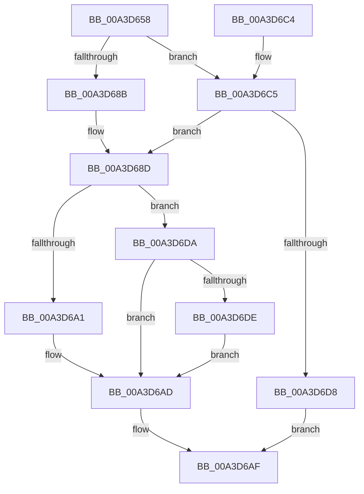

# BiAcquirePrivilege

- RVA: `0x00A3D658`–`0x00A3D701` (길이 `169` bytes)
- VA: `0x0000000140A3D658`
- 실행 섹션: `PAGE`
- PDB 이름 있음: `예`; PDB Function 태그: `아니요`
- unwind 정보 RVA: `0x000AE5DC`
- 디코드: `50`개 명령, `169/169` bytes 표시
- 미해석 바이트: `0` (있으면 어셈블리에 `.byte`로 보존)

> 이 문서는 커널 이미지의 기계어와 PDB 기호를 분석해 생성했습니다. 4번과 5번은 함수 원형과 자료형을 바이너리 사용 방식에서 추정한 C 해석이며 원본 소스 복구 결과는 아닙니다.

## 1. Dependencies

- 직접 호출 지점: **3**; 고유 호출 대상: **3**
- 직접 호출자로 확인된 함수: **13**
- RIP 상대 이미지 참조: **0**

### Outgoing calls
- `0x00A3D696` → [BiAdjustPrivilege](BiAdjustPrivilege_function_00A3D708.md) (function, `0x00A3D708`)
- `0x00A3D6CF` → [RtlImpersonateSelfEx](../87/RtlImpersonateSelfEx_function_008793A0.md) (function, `0x008793A0`)
- `0x00A3D6FA` → [ZwSetInformationThread](../../text/6A/ZwSetInformationThread_function_006AD270.md) (function, `0x006AD270`)

### Direct callers
- [BiAddBootEntry](../82/BiAddBootEntry_function_00826260.md) at `0x00826284`
- [BiDeleteBootEntry](../82/BiDeleteBootEntry_function_00826AB0.md) at `0x00826AE0`
- [BiModifyBootEntry](../82/BiModifyBootEntry_function_00826E80.md) at `0x00826E9D`
- [BiSetBootOptions](../82/BiSetBootOptions_function_00826FD0.md) at `0x00826FF3`
- [SiGetEspFromFirmware](../82/SiGetEspFromFirmware_function_008280C0.md) at `0x00828113`
- [BiSetBootEntryOrder](BiSetBootEntryOrder_function_00A3CC48.md) at `0x00A3CC6B`
- [BiDeleteEfiVariable](BiDeleteEfiVariable_function_00A3D2A8.md) at `0x00A3D2FC`
- [BiTranslateFilePath](BiTranslateFilePath_function_00A3D534.md) at `0x00A3D55D`
- [BiQueryBootOptions](BiQueryBootOptions_function_00A3DB04.md) at `0x00A3DB31`
- [BiQueryBootEntryOrder](BiQueryBootEntryOrder_function_00A3DBD4.md) at `0x00A3DBFA`
- [BiEnumerateBootEntries](../A4/BiEnumerateBootEntries_function_00A4074C.md) at `0x00A4076F`
- [BiLoadHive](../A4/BiLoadHive_function_00A412F4.md) at `0x00A4145A`
- [BiLoadHive](../A4/BiLoadHive_function_00A412F4.md) at `0x00A41544`
- [sub_00B3AB32](../B3/Unknown_function_00B3AB32.md) at `0x00B3AB8B`

### Static image references
- 디코드된 RIP-relative 메모리 참조가 없습니다.

## 2. Other-region calls and transfers

- 다른 실행 섹션으로 향하는 call: **1**
  - `0x00A3D6FA` → [ZwSetInformationThread](../../text/6A/ZwSetInformationThread_function_006AD270.md) (`PAGE` → `.text`)
- 별도 외부 분기/꼬리 이동을 확인하지 못했습니다.

## 3. Assembly (complete function range)

```asm
00A3D658  48 8B C4                        mov rax, rsp
00A3D65B  48 89 58 08                     mov qword ptr [rax + 8], rbx
00A3D65F  48 89 68 10                     mov qword ptr [rax + 0x10], rbp
00A3D663  48 89 70 20                     mov qword ptr [rax + 0x20], rsi
00A3D667  57                              push rdi
00A3D668  48 83 EC 20                     sub rsp, 0x20
00A3D66C  C6 40 18 00                     mov byte ptr [rax + 0x18], 0
00A3D670  48 8B F2                        mov rsi, rdx
00A3D673  65 48 8B 04 25 88 01 00 00      mov rax, qword ptr gs:[0x188]
00A3D67C  8B E9                           mov ebp, ecx
00A3D67E  44 8B 80 A0 05 00 00            mov r8d, dword ptr [rax + 0x5a0]
00A3D685  41 F6 C0 08                     test r8b, 8
00A3D689  74 3A                           je 0x140a3d6c5
00A3D68B  B3 01                           mov bl, 1
00A3D68D  4C 8D 44 24 40                  lea r8, [rsp + 0x40]
00A3D692  B2 01                           mov dl, 1
00A3D694  8B CD                           mov ecx, ebp
00A3D696  E8 6D 00 00 00                  call 0x140a3d708
00A3D69B  8B F8                           mov edi, eax
00A3D69D  85 C0                           test eax, eax
00A3D69F  78 39                           js 0x140a3d6da
00A3D6A1  8A 44 24 40                     mov al, byte ptr [rsp + 0x40]
00A3D6A5  88 46 04                        mov byte ptr [rsi + 4], al
00A3D6A8  88 5E 05                        mov byte ptr [rsi + 5], bl
00A3D6AB  89 2E                           mov dword ptr [rsi], ebp
00A3D6AD  8B C7                           mov eax, edi
00A3D6AF  48 8B 5C 24 30                  mov rbx, qword ptr [rsp + 0x30]
00A3D6B4  48 8B 6C 24 38                  mov rbp, qword ptr [rsp + 0x38]
00A3D6B9  48 8B 74 24 48                  mov rsi, qword ptr [rsp + 0x48]
00A3D6BE  48 83 C4 20                     add rsp, 0x20
00A3D6C2  5F                              pop rdi
00A3D6C3  C3                              ret
00A3D6C4  CC                              int3
00A3D6C5  33 D2                           xor edx, edx
00A3D6C7  45 33 C0                        xor r8d, r8d
00A3D6CA  32 DB                           xor bl, bl
00A3D6CC  8D 4A 02                        lea ecx, [rdx + 2]
00A3D6CF  E8 CC BC E3 FF                  call 0x1408793a0
00A3D6D4  85 C0                           test eax, eax
00A3D6D6  79 B5                           jns 0x140a3d68d
00A3D6D8  EB D5                           jmp 0x140a3d6af
00A3D6DA  84 DB                           test bl, bl
00A3D6DC  75 CF                           jne 0x140a3d6ad
00A3D6DE  48 83 64 24 40 00               and qword ptr [rsp + 0x40], 0
00A3D6E4  4C 8D 44 24 40                  lea r8, [rsp + 0x40]
00A3D6E9  41 B9 08 00 00 00               mov r9d, 8
00A3D6EF  48 C7 C1 FE FF FF FF            mov rcx, 0xfffffffffffffffe
00A3D6F6  41 8D 51 FD                     lea edx, [r9 - 3]
00A3D6FA  E8 71 FB C6 FF                  call 0x1406ad270
00A3D6FF  EB AC                           jmp 0x140a3d6ad
```

## 4. C-style interpretation (structured pseudocode)

```c
__int64 __fastcall BiAcquirePrivilege(int a1, __int64 a2)
{
    __int64 result;
    __int64 v_rbx;
    __int64 v_rsp;
    unsigned __int64 v_stack_p10;
    unsigned __int64 v_stack_p18;
    unsigned __int64 v_stack_p20;
    unsigned __int64 v_stack_p40;
    unsigned __int64 v_stack_p8;

    *(unsigned __int64 *)(v_rsp + 8) = v_rbx;
    *(unsigned __int64 *)(v_rsp + 16) = v_rbp;
    *(unsigned __int64 *)(v_rsp + 32) = v_rsi;
    v_rsp = (v_rsp) - (32);
    *(unsigned __int8 *)(v_rsp + 24) = 0;
    if ((((unsigned __int8)((unsigned int)(*(unsigned int *)(*(unsigned __int64 *)(gs_base + (0 + 392)) + 1440)))) & (8)) == 0) goto loc_00A3D6C5;
loc_00A3D68D:
    result = BiAdjustPrivilege((unsigned int)((unsigned int)((unsigned int)(a1))), 1, v_stack_p18, a4);
    if (sign_flag) goto loc_00A3D6DA;
    *(unsigned __int8 *)(a2 + 4) = (unsigned __int8)(v_stack_p18);
    *(unsigned __int8 *)(a2 + 5) = 1;
    *(unsigned int *)(a2) = (unsigned int)((unsigned int)(a1));
loc_00A3D6AD:
loc_00A3D6AF:
    v_rsp = (v_rsp) + (32);
    return (unsigned int)((unsigned int)((unsigned int)((unsigned int)(result))));
loc_00A3D6C5:
    a2 = 0;
    a3 = 0;
    v_rbx = 0;
    result = RtlImpersonateSelfEx(a2 + 2, a2, a3, a4);
    if (!sign_flag) goto loc_00A3D68D;
    goto loc_00A3D6AF;
loc_00A3D6DA:
    if (0 != 0) goto loc_00A3D6AD;
    result = ZwSetInformationThread(-2, 8 - 3, v_stack_p40, 8);
    goto loc_00A3D6AD;
}
```

## 5. (Beta) C Style

```c
int64_t BiAcquirePrivilege(int32_t Arg1, void *Arg2)
{
    uint8_t *arg2 = (uint8_t *)Arg2;

    int64_t result;
    int64_t local_rbx;
    int64_t local_rsp;
    uint64_t v_stack_p10;
    uint64_t v_stack_p18;
    uint64_t v_stack_p20;
    uint64_t v_stack_p40;
    uint64_t v_stack_p8;

    *(uint64_t *)(local_rsp + 0x8) = local_rbx;
    *(uint64_t *)(local_rsp + 0x10) = local_rbp;
    *(uint64_t *)(local_rsp + 0x20) = local_rsi;
    local_rsp = (local_rsp) - (32);
    *(uint8_t *)(local_rsp + 0x18) = 0;
    if ((((uint8_t)((uint32_t)(*(uint32_t *)(*(uint64_t *)(gs_base + (0 + 0x188)) + 0x5A0)))) & (8)) == 0) goto loc_00A3D6C5;
loc_00A3D68D:
    result = BiAdjustPrivilege((uint32_t)((uint32_t)((uint32_t)(Arg1))), 1, v_stack_p18, a4);
    if (sign_flag) goto loc_00A3D6DA;
    *(uint8_t *)(arg2 + 0x4) = (uint8_t)(v_stack_p18);
    *(uint8_t *)(arg2 + 0x5) = 1;
    *(uint32_t *)(arg2) = (uint32_t)((uint32_t)(Arg1));
loc_00A3D6AD:
loc_00A3D6AF:
    local_rsp = (local_rsp) + (32);
    return (uint32_t)((uint32_t)((uint32_t)((uint32_t)(result))));
loc_00A3D6C5:
    Arg2 = 0;
    a3 = 0;
    local_rbx = 0;
    result = RtlImpersonateSelfEx(Arg2 + 2, Arg2, a3, a4);
    if (!sign_flag) goto loc_00A3D68D;
    goto loc_00A3D6AF;
loc_00A3D6DA:
    if (0 != 0) goto loc_00A3D6AD;
    result = ZwSetInformationThread(-2, 8 - 3, v_stack_p40, 8);
    goto loc_00A3D6AD;
}
```

### 관측된 메모리 오프셋

구조체 형식이 확인되지 않은 접근은 인자 기준의 오프셋으로만 기록했습니다.

| 기준 인자 | 오프셋 표현 | 폭 (bit) | 접근 |
|---|---:|---:|---|
| `Arg2` | `+ 0x0` | `32` | `W` |
| `Arg2` | `+ 0x4` | `8` | `W` |
| `Arg2` | `+ 0x5` | `8` | `W` |

## 6. Execution-region graph

[열기: 2D/3D 그래프와 함수 탐색 컨트롤 패널](../../../control-panel.html?section=page&rva=0x00A3D658&view=graph)

- 2D 그래프는 위에서 아래로 흐르고, 3D 그래프는 빈 공간을 드래그해 회전합니다. Shift+드래그는 이동, 휠은 확대·축소, 함수 노드 선택은 대상 보고서 이동입니다.

### Static fallback


