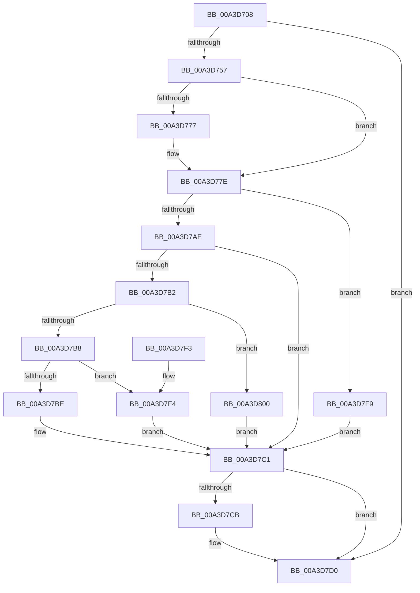

# BiAdjustPrivilege

- RVA: `0x00A3D708`–`0x00A3D80A` (길이 `258` bytes)
- VA: `0x0000000140A3D708`
- 실행 섹션: `PAGE`
- PDB 이름 있음: `예`; PDB Function 태그: `아니요`
- unwind 정보 RVA: `0x000AE5F4`
- 디코드: `76`개 명령, `258/258` bytes 표시
- 미해석 바이트: `0` (있으면 어셈블리에 `.byte`로 보존)

> 이 문서는 커널 이미지의 기계어와 PDB 기호를 분석해 생성했습니다. 4번과 5번은 함수 원형과 자료형을 바이너리 사용 방식에서 추정한 C 해석이며 원본 소스 복구 결과는 아닙니다.

## 1. Dependencies

- 직접 호출 지점: **4**; 고유 호출 대상: **4**
- 직접 호출자로 확인된 함수: **2**
- RIP 상대 이미지 참조: **1**

### Outgoing calls
- `0x00A3D74C` → [BiOpenEffectiveToken](BiOpenEffectiveToken_function_00A3D810.md) (function, `0x00A3D810`)
- `0x00A3D7A0` → [ZwAdjustPrivilegesToken](../../text/6A/ZwAdjustPrivilegesToken_function_006AD8F0.md) (function, `0x006AD8F0`)
- `0x00A3D7CB` → [ZwClose](../../text/6A/ZwClose_function_006AD2B0.md) (function, `0x006AD2B0`)
- `0x00A3D7D9` → [_security_check_cookie](../../text/6A/_security_check_cookie_function_006AC640.md) (function, `0x006AC640`)

### Direct callers
- [BiReleasePrivilege](BiReleasePrivilege_function_00A3D600.md) at `0x00A3D61D`
- [BiAcquirePrivilege](BiAcquirePrivilege_function_00A3D658.md) at `0x00A3D696`

### Static image references
- `0x00A3D71D` → RVA `0x00E0A740` (`.data`; read)

## 2. Other-region calls and transfers

- 다른 실행 섹션으로 향하는 call: **3**
  - `0x00A3D7A0` → [ZwAdjustPrivilegesToken](../../text/6A/ZwAdjustPrivilegesToken_function_006AD8F0.md) (`PAGE` → `.text`)
  - `0x00A3D7CB` → [ZwClose](../../text/6A/ZwClose_function_006AD2B0.md) (`PAGE` → `.text`)
  - `0x00A3D7D9` → [_security_check_cookie](../../text/6A/_security_check_cookie_function_006AC640.md) (`PAGE` → `.text`)
- 별도 외부 분기/꼬리 이동을 확인하지 못했습니다.

## 3. Assembly (complete function range)

```asm
00A3D708  48 89 5C 24 08                  mov qword ptr [rsp + 8], rbx
00A3D70D  48 89 74 24 10                  mov qword ptr [rsp + 0x10], rsi
00A3D712  55                              push rbp
00A3D713  57                              push rdi
00A3D714  41 56                           push r14
00A3D716  48 8B EC                        mov rbp, rsp
00A3D719  48 83 EC 70                     sub rsp, 0x70
00A3D71D  48 8B 05 1C D0 3C 00            mov rax, qword ptr [rip + 0x3cd01c]
00A3D724  48 33 C4                        xor rax, rsp
00A3D727  48 89 45 F8                     mov qword ptr [rbp - 8], rax
00A3D72B  83 65 C0 00                     and dword ptr [rbp - 0x40], 0
00A3D72F  44 8B F1                        mov r14d, ecx
00A3D732  83 65 E4 00                     and dword ptr [rbp - 0x1c], 0
00A3D736  48 8D 4D C8                     lea rcx, [rbp - 0x38]
00A3D73A  48 83 4D C8 FF                  or qword ptr [rbp - 0x38], 0xffffffffffffffff
00A3D73F  0F 57 C0                        xorps xmm0, xmm0
00A3D742  0F 11 45 E8                     movups xmmword ptr [rbp - 0x18], xmm0
00A3D746  49 8B F8                        mov rdi, r8
00A3D749  40 8A F2                        mov sil, dl
00A3D74C  E8 BF 00 00 00                  call 0x140a3d810
00A3D751  8B D8                           mov ebx, eax
00A3D753  85 C0                           test eax, eax
00A3D755  78 79                           js 0x140a3d7d0
00A3D757  83 65 D4 00                     and dword ptr [rbp - 0x2c], 0
00A3D75B  83 65 E4 00                     and dword ptr [rbp - 0x1c], 0
00A3D75F  44 89 75 D0                     mov dword ptr [rbp - 0x30], r14d
00A3D763  48 8B 45 D0                     mov rax, qword ptr [rbp - 0x30]
00A3D767  48 89 45 DC                     mov qword ptr [rbp - 0x24], rax
00A3D76B  C7 45 D8 01 00 00 00            mov dword ptr [rbp - 0x28], 1
00A3D772  40 84 F6                        test sil, sil
00A3D775  74 07                           je 0x140a3d77e
00A3D777  C7 45 E4 02 00 00 00            mov dword ptr [rbp - 0x1c], 2
00A3D77E  48 8B 4D C8                     mov rcx, qword ptr [rbp - 0x38]
00A3D782  48 8D 45 C0                     lea rax, [rbp - 0x40]
00A3D786  48 89 44 24 28                  mov qword ptr [rsp + 0x28], rax
00A3D78B  4C 8D 45 D8                     lea r8, [rbp - 0x28]
00A3D78F  48 8D 45 E8                     lea rax, [rbp - 0x18]
00A3D793  41 B9 10 00 00 00               mov r9d, 0x10
00A3D799  33 D2                           xor edx, edx
00A3D79B  48 89 44 24 20                  mov qword ptr [rsp + 0x20], rax
00A3D7A0  E8 4B 01 C7 FF                  call 0x1406ad8f0
00A3D7A5  8B D8                           mov ebx, eax
00A3D7A7  3D 06 01 00 00                  cmp eax, 0x106
00A3D7AC  74 4B                           je 0x140a3d7f9
00A3D7AE  85 C0                           test eax, eax
00A3D7B0  78 0F                           js 0x140a3d7c1
00A3D7B2  83 7D E8 00                     cmp dword ptr [rbp - 0x18], 0
00A3D7B6  74 48                           je 0x140a3d800
00A3D7B8  F6 45 F4 02                     test byte ptr [rbp - 0xc], 2
00A3D7BC  74 36                           je 0x140a3d7f4
00A3D7BE  C6 07 01                        mov byte ptr [rdi], 1
00A3D7C1  48 8B 4D C8                     mov rcx, qword ptr [rbp - 0x38]
00A3D7C5  48 83 F9 FF                     cmp rcx, -1
00A3D7C9  74 05                           je 0x140a3d7d0
00A3D7CB  E8 E0 FA C6 FF                  call 0x1406ad2b0
00A3D7D0  8B C3                           mov eax, ebx
00A3D7D2  48 8B 4D F8                     mov rcx, qword ptr [rbp - 8]
00A3D7D6  48 33 CC                        xor rcx, rsp
00A3D7D9  E8 62 EE C6 FF                  call 0x1406ac640
00A3D7DE  4C 8D 5C 24 70                  lea r11, [rsp + 0x70]
00A3D7E3  49 8B 5B 20                     mov rbx, qword ptr [r11 + 0x20]
00A3D7E7  49 8B 73 28                     mov rsi, qword ptr [r11 + 0x28]
00A3D7EB  49 8B E3                        mov rsp, r11
00A3D7EE  41 5E                           pop r14
00A3D7F0  5F                              pop rdi
00A3D7F1  5D                              pop rbp
00A3D7F2  C3                              ret
00A3D7F3  CC                              int3
00A3D7F4  C6 07 00                        mov byte ptr [rdi], 0
00A3D7F7  EB C8                           jmp 0x140a3d7c1
00A3D7F9  BB 61 00 00 C0                  mov ebx, 0xc0000061
00A3D7FE  EB C1                           jmp 0x140a3d7c1
00A3D800  40 84 F6                        test sil, sil
00A3D803  0F 95 C0                        setne al
00A3D806  88 07                           mov byte ptr [rdi], al
00A3D808  EB B7                           jmp 0x140a3d7c1
```

## 4. C-style interpretation (structured pseudocode)

```c
__int64 __fastcall BiAdjustPrivilege(int a1, int a2, __int64 a3)
{
    __int64 result;
    __int64 v_rsp;
    unsigned __int64 v_stack_m18;
    unsigned __int64 v_stack_m20;
    unsigned __int8 v_stack_m24;
    unsigned __int64 v_stack_m30;
    unsigned int v_stack_m34;
    unsigned __int64 v_stack_m3C;
    unsigned int v_stack_m40;
    unsigned int v_stack_m44;
    unsigned int v_stack_m48;
    unsigned __int64 v_stack_m50;
    unsigned int v_stack_m58;
    unsigned __int64 v_stack_m60;
    unsigned __int64 v_stack_m68;
    unsigned __int64 v_stack_p10;
    unsigned __int64 v_stack_p8;

    v_stack_p8 = v_rbx;
    v_stack_p10 = v_rsi;
    v_rsp = (v_rsp) - (112);
    result = (*(unsigned __int64 *)(v_rip + 3985436)) ^ (v_rsp);
    v_stack_m20 = result;
    v_stack_m30 = v_xmm0;
    result = BiOpenEffectiveToken(v_stack_m50, a2, a3, a4);
    if (sign_flag) goto loc_00A3D7D0;
    v_stack_m48 = (unsigned int)((unsigned int)(a1));
    v_stack_m3C = v_stack_m48;
    v_stack_m40 = 1;
    if ((unsigned __int8)((unsigned __int8)(a2)) != 0) {
        v_stack_m34 = 2;
    }
    v_stack_m60 = v_stack_m58;
    a2 = 0;
    v_stack_m68 = v_stack_m30;
    result = ZwAdjustPrivilegesToken(v_stack_m50, a2, v_stack_m40, 16);
    if (((unsigned int)(result)) == 262) goto loc_00A3D7F9;
    if (sign_flag) goto loc_00A3D7C1;
    if (v_stack_m30 == 0) goto loc_00A3D800;
    if (((v_stack_m24) & (2)) == 0) goto loc_00A3D7F4;
    *(unsigned __int8 *)(a3) = 1;
loc_00A3D7C1:
    if (v_stack_m50 != -1) {
        result = ZwClose(v_stack_m50, a2, v_stack_m40, 16);
    }
    a1 = (v_stack_m20) ^ (v_rsp);
    result = _security_check_cookie(a1, a2, v_stack_m40, 16);
    return result;
loc_00A3D7F4:
    *(unsigned __int8 *)(a3) = 0;
    goto loc_00A3D7C1;
loc_00A3D7F9:
    goto loc_00A3D7C1;
loc_00A3D800:
    result = ((unsigned __int8)(*(unsigned __int64 *)(v_stack_m18 + 40)) != 0) ? 1 : 0;
    *(unsigned __int8 *)(a3) = (unsigned __int8)(result);
    goto loc_00A3D7C1;
}
```

## 5. (Beta) C Style

```c
int64_t BiAdjustPrivilege(int32_t Arg1, int32_t Arg2, void *Arg3)
{
    uint8_t *arg3 = (uint8_t *)Arg3;

    int64_t result;
    int64_t local_rsp;
    uint64_t v_stack_m18;
    uint64_t v_stack_m20;
    uint8_t v_stack_m24;
    uint64_t v_stack_m30;
    uint32_t v_stack_m34;
    uint64_t v_stack_m3C;
    uint32_t v_stack_m40;
    uint32_t v_stack_m44;
    uint32_t v_stack_m48;
    uint64_t v_stack_m50;
    uint32_t v_stack_m58;
    uint64_t v_stack_m60;
    uint64_t v_stack_m68;
    uint64_t v_stack_p10;
    uint64_t v_stack_p8;

    v_stack_p8 = local_rbx;
    v_stack_p10 = local_rsi;
    local_rsp = (local_rsp) - (112);
    result = (*(uint64_t *)(v_rip + 0x3CD01C)) ^ (local_rsp);
    v_stack_m20 = result;
    v_stack_m30 = v_xmm0;
    result = BiOpenEffectiveToken(v_stack_m50, Arg2, Arg3, a4);
    if (sign_flag) goto loc_00A3D7D0;
    v_stack_m48 = (uint32_t)((uint32_t)(Arg1));
    v_stack_m3C = v_stack_m48;
    v_stack_m40 = 1;
    if ((uint8_t)((uint8_t)(Arg2)) != 0) {
        v_stack_m34 = 2;
    }
    v_stack_m60 = v_stack_m58;
    Arg2 = 0;
    v_stack_m68 = v_stack_m30;
    result = ZwAdjustPrivilegesToken(v_stack_m50, Arg2, v_stack_m40, 16);
    if (((uint32_t)(result)) == 262) goto loc_00A3D7F9;
    if (sign_flag) goto loc_00A3D7C1;
    if (v_stack_m30 == 0) goto loc_00A3D800;
    if (((v_stack_m24) & (2)) == 0) goto loc_00A3D7F4;
    *(uint8_t *)(arg3) = 1;
loc_00A3D7C1:
    if (v_stack_m50 != -1) {
        result = ZwClose(v_stack_m50, Arg2, v_stack_m40, 16);
    }
    Arg1 = (v_stack_m20) ^ (local_rsp);
    result = _security_check_cookie(Arg1, Arg2, v_stack_m40, 16);
    return result;
loc_00A3D7F4:
    *(uint8_t *)(arg3) = 0;
    goto loc_00A3D7C1;
loc_00A3D7F9:
    goto loc_00A3D7C1;
loc_00A3D800:
    result = ((uint8_t)(*(uint64_t *)(v_stack_m18 + 0x28)) != 0) ? 1 : 0;
    *(uint8_t *)(arg3) = (uint8_t)(result);
    goto loc_00A3D7C1;
}
```

### 관측된 메모리 오프셋

구조체 형식이 확인되지 않은 접근은 인자 기준의 오프셋으로만 기록했습니다.

| 기준 인자 | 오프셋 표현 | 폭 (bit) | 접근 |
|---|---:|---:|---|
| `Arg3` | `+ 0x0` | `8` | `W` |

## 6. Execution-region graph

[열기: 2D/3D 그래프와 함수 탐색 컨트롤 패널](../../../control-panel.html?section=page&rva=0x00A3D708&view=graph)

- 2D 그래프는 위에서 아래로 흐르고, 3D 그래프는 빈 공간을 드래그해 회전합니다. Shift+드래그는 이동, 휠은 확대·축소, 함수 노드 선택은 대상 보고서 이동입니다.

### Static fallback


