# BiBindEfiBootManager

- RVA: `0x00A3DCB0`–`0x00A3DF7B` (길이 `715` bytes)
- VA: `0x0000000140A3DCB0`
- 실행 섹션: `PAGE`
- PDB 이름 있음: `예`; PDB Function 태그: `예`
- unwind 정보 RVA: `0x000AE698`
- 디코드: `187`개 명령, `715/715` bytes 표시
- 미해석 바이트: `0` (있으면 어셈블리에 `.byte`로 보존)

> 이 문서는 커널 이미지의 기계어와 PDB 기호를 분석해 생성했습니다. 4번과 5번은 함수 원형과 자료형을 바이너리 사용 방식에서 추정한 C 해석이며 원본 소스 복구 결과는 아닙니다.

## 1. Dependencies

- 직접 호출 지점: **22**; 고유 호출 대상: **17**
- 직접 호출자로 확인된 함수: **1**
- RIP 상대 이미지 참조: **3**

### Outgoing calls
- `0x00A3DD11` → [BcdOpenObject](../91/BcdOpenObject_function_00916704.md) (function, `0x00916704`)
- `0x00A3DD33` → [BiIsOfflineHandle](../../text/4B/BiIsOfflineHandle_function_004B4FA0.md) (function, `0x004B4FA0`)
- `0x00A3DD3D` → [BiAcquireBcdSyncMutant](../91/BiAcquireBcdSyncMutant_function_00916898.md) (function, `0x00916898`)
- `0x00A3DD66` → [BiCreateObject](BiCreateObject_function_00A3D92C.md) (function, `0x00A3D92C`)
- `0x00A3DD7C` → [BiReleaseBcdSyncMutant](../91/BiReleaseBcdSyncMutant_function_0091695C.md) (function, `0x0091695C`)
- `0x00A3DD91` → [BiQueryBootEntryOrder](BiQueryBootEntryOrder_function_00A3DBD4.md) (function, `0x00A3DBD4`)
- `0x00A3DDBC` → [ExAllocatePool2](../../poolcode/B8/ExAllocatePool2_function_00B820F0.md) (function, `0x00B820F0`)
- `0x00A3DDDA` → [BiTranslateBootOrder](BiTranslateBootOrder_function_00A3CB4C.md) (function, `0x00A3CB4C`)
- `0x00A3DDF8` → [BcdSetElementDataWithFlags](BcdSetElementDataWithFlags_function_00A3F080.md) (function, `0x00A3F080`)
- `0x00A3DE0B` → [BiQueryBootOptions](BiQueryBootOptions_function_00A3DB04.md) (function, `0x00A3DB04`)
- `0x00A3DE3A` → [BcdSetElementDataWithFlags](BcdSetElementDataWithFlags_function_00A3F080.md) (function, `0x00A3F080`)
- `0x00A3DE60` → [ExFreePoolWithTag](../../poolcode/B8/ExFreePoolWithTag_function_00B82870.md) (function, `0x00B82870`)
- `0x00A3DE91` → [_security_check_cookie](../../text/6A/_security_check_cookie_function_006AC640.md) (function, `0x006AC640`)
- `0x00A3DEB7` → [BcdDeleteObject](BcdDeleteObject_function_00A3C578.md) (function, `0x00A3C578`)
- `0x00A3DECC` → [BiIsLinkedToFirmwareVariable](BiIsLinkedToFirmwareVariable_function_00A3E4D0.md) (function, `0x00A3E4D0`)
- `0x00A3DEDE` → [BiSetFirmwareModified](../../text/4B/BiSetFirmwareModified_function_004B1DF4.md) (function, `0x004B1DF4`)
- `0x00A3DEF9` → [BiTranslateBootEntryId](BiTranslateBootEntryId_function_00A3CBDC.md) (function, `0x00A3CBDC`)
- `0x00A3DF1A` → [BcdSetElementDataWithFlags](BcdSetElementDataWithFlags_function_00A3F080.md) (function, `0x00A3F080`)
- `0x00A3DF36` → [ExFreePoolWithTag](../../poolcode/B8/ExFreePoolWithTag_function_00B82870.md) (function, `0x00B82870`)
- `0x00A3DF48` → [ExFreePoolWithTag](../../poolcode/B8/ExFreePoolWithTag_function_00B82870.md) (function, `0x00B82870`)
- `0x00A3DF5D` → [BcdDeleteObject](BcdDeleteObject_function_00A3C578.md) (function, `0x00A3C578`)
- `0x00A3DF71` → [BiLogMessage](BiLogMessage_function_00A3D3A8.md) (function, `0x00A3D3A8`)

### Direct callers
- [BiBindEfiNamespaceObjects](../A4/BiBindEfiNamespaceObjects_function_00A40EB4.md) at `0x00A40F14`

### Static image references
- `0x00A3DCCC` → RVA `0x00E0A740` (`.data`; read)
- `0x00A3DCEE` → RVA `0x0001A4C0` (`.rdata`; read)
- `0x00A3DF65` → RVA `0x00B0CA20` (` ?? ::NNGAKEGL::`string'`; read)

## 2. Other-region calls and transfers

- 다른 실행 섹션으로 향하는 call: **7**
  - `0x00A3DD33` → [BiIsOfflineHandle](../../text/4B/BiIsOfflineHandle_function_004B4FA0.md) (`PAGE` → `.text`)
  - `0x00A3DDBC` → [ExAllocatePool2](../../poolcode/B8/ExAllocatePool2_function_00B820F0.md) (`PAGE` → `POOLCODE`)
  - `0x00A3DE60` → [ExFreePoolWithTag](../../poolcode/B8/ExFreePoolWithTag_function_00B82870.md) (`PAGE` → `POOLCODE`)
  - `0x00A3DE91` → [_security_check_cookie](../../text/6A/_security_check_cookie_function_006AC640.md) (`PAGE` → `.text`)
  - `0x00A3DEDE` → [BiSetFirmwareModified](../../text/4B/BiSetFirmwareModified_function_004B1DF4.md) (`PAGE` → `.text`)
  - `0x00A3DF36` → [ExFreePoolWithTag](../../poolcode/B8/ExFreePoolWithTag_function_00B82870.md) (`PAGE` → `POOLCODE`)
  - `0x00A3DF48` → [ExFreePoolWithTag](../../poolcode/B8/ExFreePoolWithTag_function_00B82870.md) (`PAGE` → `POOLCODE`)
- call이 아닌 외부 분기/꼬리 이동: **1**
  - `0x00A3DF57` → [sub_00B3A616](../B3/Unknown_function_00B3A616.md) (`tail-transfer`)

## 3. Assembly (complete function range)

```asm
00A3DCB0  48 89 5C 24 18                  mov qword ptr [rsp + 0x18], rbx
00A3DCB5  48 89 74 24 20                  mov qword ptr [rsp + 0x20], rsi
00A3DCBA  55                              push rbp
00A3DCBB  57                              push rdi
00A3DCBC  41 54                           push r12
00A3DCBE  41 56                           push r14
00A3DCC0  41 57                           push r15
00A3DCC2  48 8B EC                        mov rbp, rsp
00A3DCC5  48 81 EC 80 00 00 00            sub rsp, 0x80
00A3DCCC  48 8B 05 6D CA 3C 00            mov rax, qword ptr [rip + 0x3cca6d]
00A3DCD3  48 33 C4                        xor rax, rsp
00A3DCD6  48 89 45 F8                     mov qword ptr [rbp - 8], rax
00A3DCDA  83 65 C0 00                     and dword ptr [rbp - 0x40], 0
00A3DCDE  4C 8D 45 B8                     lea r8, [rbp - 0x48]
00A3DCE2  83 65 B0 00                     and dword ptr [rbp - 0x50], 0
00A3DCE6  4C 8B E2                        mov r12, rdx
00A3DCE9  48 83 65 E0 00                  and qword ptr [rbp - 0x20], 0
00A3DCEE  48 8D 15 CB C7 5D FF            lea rdx, [rip - 0xa23835]
00A3DCF5  48 83 65 D0 00                  and qword ptr [rbp - 0x30], 0
00A3DCFA  0F 57 C0                        xorps xmm0, xmm0
00A3DCFD  48 83 65 D8 00                  and qword ptr [rbp - 0x28], 0
00A3DD02  48 8B F1                        mov rsi, rcx
00A3DD05  48 83 65 B8 00                  and qword ptr [rbp - 0x48], 0
00A3DD0A  45 33 F6                        xor r14d, r14d
00A3DD0D  0F 11 45 E8                     movups xmmword ptr [rbp - 0x18], xmm0
00A3DD11  E8 EE 89 ED FF                  call 0x140916704
00A3DD16  85 C0                           test eax, eax
00A3DD18  0F 89 95 01 00 00               jns 0x140a3deb3
00A3DD1E  48 8B 7D B8                     mov rdi, qword ptr [rbp - 0x48]
00A3DD22  48 8B CE                        mov rcx, rsi
00A3DD25  C7 45 C8 01 00 00 00            mov dword ptr [rbp - 0x38], 1
00A3DD2C  C7 45 CC 01 00 10 10            mov dword ptr [rbp - 0x34], 0x10100001
00A3DD33  E8 68 72 A7 FF                  call 0x1404b4fa0
00A3DD38  8A C8                           mov cl, al
00A3DD3A  44 8A F8                        mov r15b, al
00A3DD3D  E8 56 8B ED FF                  call 0x140916898
00A3DD42  8B D8                           mov ebx, eax
00A3DD44  85 C0                           test eax, eax
00A3DD46  0F 88 2B 01 00 00               js 0x140a3de77
00A3DD4C  48 8D 45 B8                     lea rax, [rbp - 0x48]
00A3DD50  45 33 C9                        xor r9d, r9d
00A3DD53  4C 8D 45 C8                     lea r8, [rbp - 0x38]
00A3DD57  48 89 44 24 20                  mov qword ptr [rsp + 0x20], rax
00A3DD5C  48 8D 15 5D C7 5D FF            lea rdx, [rip - 0xa238a3]
00A3DD63  48 8B CE                        mov rcx, rsi
00A3DD66  E8 C1 FB FF FF                  call 0x140a3d92c
00A3DD6B  48 8B 7D B8                     mov rdi, qword ptr [rbp - 0x48]
00A3DD6F  8B D8                           mov ebx, eax
00A3DD71  85 C0                           test eax, eax
00A3DD73  0F 89 4E 01 00 00               jns 0x140a3dec7
00A3DD79  41 8A CF                        mov cl, r15b
00A3DD7C  E8 DB 8B ED FF                  call 0x14091695c
00A3DD81  85 DB                           test ebx, ebx
00A3DD83  0F 88 EE 00 00 00               js 0x140a3de77
00A3DD89  48 8D 55 B0                     lea rdx, [rbp - 0x50]
00A3DD8D  48 8D 4D D0                     lea rcx, [rbp - 0x30]
00A3DD91  E8 3E FE FF FF                  call 0x140a3dbd4
00A3DD96  4C 8B 7D D0                     mov r15, qword ptr [rbp - 0x30]
00A3DD9A  8B D8                           mov ebx, eax
00A3DD9C  85 C0                           test eax, eax
00A3DD9E  0F 88 C1 00 00 00               js 0x140a3de65
00A3DDA4  8B 45 B0                        mov eax, dword ptr [rbp - 0x50]
00A3DDA7  85 C0                           test eax, eax
00A3DDA9  74 58                           je 0x140a3de03
00A3DDAB  8B D0                           mov edx, eax
00A3DDAD  B9 02 01 00 00                  mov ecx, 0x102
00A3DDB2  48 C1 E2 04                     shl rdx, 4
00A3DDB6  41 B8 42 43 44 4B               mov r8d, 0x4b444342
00A3DDBC  E8 2F 43 14 00                  call 0x140b820f0
00A3DDC1  4C 8B F0                        mov r14, rax
00A3DDC4  48 85 C0                        test rax, rax
00A3DDC7  0F 84 1B 01 00 00               je 0x140a3dee8
00A3DDCD  4C 8D 4D B0                     lea r9, [rbp - 0x50]
00A3DDD1  4C 8B C0                        mov r8, rax
00A3DDD4  49 8B D7                        mov rdx, r15
00A3DDD7  49 8B CC                        mov rcx, r12
00A3DDDA  E8 6D ED FF FF                  call 0x140a3cb4c
00A3DDDF  8B 45 B0                        mov eax, dword ptr [rbp - 0x50]
00A3DDE2  85 C0                           test eax, eax
00A3DDE4  74 1D                           je 0x140a3de03
00A3DDE6  C1 E0 04                        shl eax, 4
00A3DDE9  4D 8B CE                        mov r9, r14
00A3DDEC  BA 01 00 00 24                  mov edx, 0x24000001
00A3DDF1  89 44 24 20                     mov dword ptr [rsp + 0x20], eax
00A3DDF5  48 8B CF                        mov rcx, rdi
00A3DDF8  E8 83 12 00 00                  call 0x140a3f080
00A3DDFD  8B D8                           mov ebx, eax
00A3DDFF  85 C0                           test eax, eax
00A3DE01  78 62                           js 0x140a3de65
00A3DE03  48 8D 55 C0                     lea rdx, [rbp - 0x40]
00A3DE07  48 8D 4D D8                     lea rcx, [rbp - 0x28]
00A3DE0B  E8 F4 FC FF FF                  call 0x140a3db04
00A3DE10  48 8B 75 D8                     mov rsi, qword ptr [rbp - 0x28]
00A3DE14  8B D8                           mov ebx, eax
00A3DE16  85 C0                           test eax, eax
00A3DE18  78 39                           js 0x140a3de53
00A3DE1A  8B 46 08                        mov eax, dword ptr [rsi + 8]
00A3DE1D  83 F8 FF                        cmp eax, -1
00A3DE20  74 23                           je 0x140a3de45
00A3DE22  4C 8D 4D E0                     lea r9, [rbp - 0x20]
00A3DE26  48 89 45 E0                     mov qword ptr [rbp - 0x20], rax
00A3DE2A  BA 04 00 00 25                  mov edx, 0x25000004
00A3DE2F  C7 44 24 20 08 00 00 00         mov dword ptr [rsp + 0x20], 8
00A3DE37  48 8B CF                        mov rcx, rdi
00A3DE3A  E8 41 12 00 00                  call 0x140a3f080
00A3DE3F  8B D8                           mov ebx, eax
00A3DE41  85 C0                           test eax, eax
00A3DE43  78 0E                           js 0x140a3de53
00A3DE45  8B 56 10                        mov edx, dword ptr [rsi + 0x10]
00A3DE48  83 FA FE                        cmp edx, -2
00A3DE4B  0F 85 A1 00 00 00               jne 0x140a3def2
00A3DE51  33 DB                           xor ebx, ebx
00A3DE53  48 85 F6                        test rsi, rsi
00A3DE56  74 0D                           je 0x140a3de65
00A3DE58  BA 42 43 44 4B                  mov edx, 0x4b444342
00A3DE5D  48 8B CE                        mov rcx, rsi
00A3DE60  E8 0B 4A 14 00                  call 0x140b82870
00A3DE65  4D 85 FF                        test r15, r15
00A3DE68  0F 85 C0 00 00 00               jne 0x140a3df2e
00A3DE6E  4D 85 F6                        test r14, r14
00A3DE71  0F 85 C9 00 00 00               jne 0x140a3df40
00A3DE77  48 85 FF                        test rdi, rdi
00A3DE7A  0F 85 D2 00 00 00               jne 0x140a3df52
00A3DE80  85 DB                           test ebx, ebx
00A3DE82  0F 88 DA 00 00 00               js 0x140a3df62
00A3DE88  8B C3                           mov eax, ebx
00A3DE8A  48 8B 4D F8                     mov rcx, qword ptr [rbp - 8]
00A3DE8E  48 33 CC                        xor rcx, rsp
00A3DE91  E8 AA E7 C6 FF                  call 0x1406ac640
00A3DE96  4C 8D 9C 24 80 00 00 00         lea r11, [rsp + 0x80]
00A3DE9E  49 8B 5B 40                     mov rbx, qword ptr [r11 + 0x40]
00A3DEA2  49 8B 73 48                     mov rsi, qword ptr [r11 + 0x48]
00A3DEA6  49 8B E3                        mov rsp, r11
00A3DEA9  41 5F                           pop r15
00A3DEAB  41 5E                           pop r14
00A3DEAD  41 5C                           pop r12
00A3DEAF  5F                              pop rdi
00A3DEB0  5D                              pop rbp
00A3DEB1  C3                              ret
00A3DEB2  CC                              int3
00A3DEB3  48 8B 4D B8                     mov rcx, qword ptr [rbp - 0x48]
00A3DEB7  E8 BC E6 FF FF                  call 0x140a3c578
00A3DEBC  33 FF                           xor edi, edi
00A3DEBE  48 89 7D B8                     mov qword ptr [rbp - 0x48], rdi
00A3DEC2  E9 5B FE FF FF                  jmp 0x140a3dd22
00A3DEC7  33 D2                           xor edx, edx
00A3DEC9  48 8B CF                        mov rcx, rdi
00A3DECC  E8 FF 05 00 00                  call 0x140a3e4d0
00A3DED1  84 C0                           test al, al
00A3DED3  0F 84 A0 FE FF FF               je 0x140a3dd79
00A3DED9  B2 01                           mov dl, 1
00A3DEDB  48 8B CE                        mov rcx, rsi
00A3DEDE  E8 11 3F A7 FF                  call 0x1404b1df4
00A3DEE3  E9 91 FE FF FF                  jmp 0x140a3dd79
00A3DEE8  BB 9A 00 00 C0                  mov ebx, 0xc000009a
00A3DEED  E9 73 FF FF FF                  jmp 0x140a3de65
00A3DEF2  4C 8D 45 E8                     lea r8, [rbp - 0x18]
00A3DEF6  49 8B CC                        mov rcx, r12
00A3DEF9  E8 DE EC FF FF                  call 0x140a3cbdc
00A3DEFE  85 C0                           test eax, eax
00A3DF00  0F 88 4B FF FF FF               js 0x140a3de51
00A3DF06  4C 8D 4D E8                     lea r9, [rbp - 0x18]
00A3DF0A  C7 44 24 20 10 00 00 00         mov dword ptr [rsp + 0x20], 0x10
00A3DF12  BA 02 00 00 24                  mov edx, 0x24000002
00A3DF17  48 8B CF                        mov rcx, rdi
00A3DF1A  E8 61 11 00 00                  call 0x140a3f080
00A3DF1F  8B D8                           mov ebx, eax
00A3DF21  85 C0                           test eax, eax
00A3DF23  0F 88 2A FF FF FF               js 0x140a3de53
00A3DF29  E9 23 FF FF FF                  jmp 0x140a3de51
00A3DF2E  BA 42 43 44 4B                  mov edx, 0x4b444342
00A3DF33  49 8B CF                        mov rcx, r15
00A3DF36  E8 35 49 14 00                  call 0x140b82870
00A3DF3B  E9 2E FF FF FF                  jmp 0x140a3de6e
00A3DF40  BA 42 43 44 4B                  mov edx, 0x4b444342
00A3DF45  49 8B CE                        mov rcx, r14
00A3DF48  E8 23 49 14 00                  call 0x140b82870
00A3DF4D  E9 25 FF FF FF                  jmp 0x140a3de77
00A3DF52  48 8B CF                        mov rcx, rdi
00A3DF55  85 DB                           test ebx, ebx
00A3DF57  0F 89 B9 C6 0F 00               jns 0x140b3a616
00A3DF5D  E8 16 E6 FF FF                  call 0x140a3c578
00A3DF62  44 8B C3                        mov r8d, ebx
00A3DF65  48 8D 15 B4 EA 0C 00            lea rdx, [rip + 0xceab4]
00A3DF6C  B9 04 00 00 00                  mov ecx, 4
00A3DF71  E8 32 F4 FF FF                  call 0x140a3d3a8
00A3DF76  E9 0D FF FF FF                  jmp 0x140a3de88
```

## 4. C-style interpretation (structured pseudocode)

```c
__int64 __fastcall BiBindEfiBootManager(__int64 a1, __int64 a2, __int64 a3, int a4)
{
    __int64 result;
    __int64 v_r14;
    __int64 v_rbx;
    __int64 v_rdi;
    __int64 v_rsp;
    unsigned __int64 v_stack_m28;
    unsigned __int64 v_stack_m30;
    unsigned __int64 v_stack_m40;
    unsigned __int64 v_stack_m48;
    unsigned __int64 v_stack_m50;
    unsigned __int64 v_stack_m58;
    unsigned int v_stack_m5C;
    unsigned int v_stack_m60;
    unsigned int v_stack_m68;
    unsigned __int64 v_stack_m70;
    unsigned int v_stack_m78;
    unsigned __int64 v_stack_m88;
    unsigned __int64 v_stack_p18;
    unsigned __int64 v_stack_p20;

    v_stack_p18 = v_rbx;
    v_stack_p20 = v_rsi;
    v_rsp = (v_rsp) - (128);
    result = (*(unsigned __int64 *)(v_rip + 3983981)) ^ (v_rsp);
    v_stack_m30 = result;
    v_r14 = 0;
    v_stack_m40 = v_xmm0;
    result = BcdOpenObject(a1, v_rip - 10631221, v_stack_m70, a4);
    if (!sign_flag) goto loc_00A3DEB3;
loc_00A3DD22:
    v_stack_m60 = 1;
    v_stack_m5C = 0x10100001ULL;
    result = BiIsOfflineHandle(a1, v_rip - 10631221, v_stack_m70, a4);
    result = BiAcquireBcdSyncMutant((unsigned __int8)(result), v_rip - 10631221, v_stack_m70, a4);
    if (sign_flag) goto loc_00A3DE77;
    a4 = 0;
    v_stack_m88 = v_stack_m70;
    result = BiCreateObject(a1, v_rip - 10631331, v_stack_m60, a4);
    if (!sign_flag) goto loc_00A3DEC7;
loc_00A3DD79:
    result = BiReleaseBcdSyncMutant((unsigned __int8)((unsigned __int8)(result)), v_rip - 10631331, v_stack_m60, a4);
    if (sign_flag) goto loc_00A3DE77;
    result = BiQueryBootEntryOrder(v_stack_m58, v_stack_m78, v_stack_m60, a4);
    if (sign_flag) goto loc_00A3DE65;
    if ((unsigned int)((unsigned int)(v_stack_m78)) == 0) goto loc_00A3DE03;
    a2 = ((unsigned int)((unsigned int)((unsigned int)(v_stack_m78)))) << (4);
    result = ExAllocatePool2(258, a2, (unsigned int)(0x4B444342ULL), a4);
    if (result == 0) goto loc_00A3DEE8;
    result = BiTranslateBootOrder(a2, v_stack_m58, result, v_stack_m78);
    if ((unsigned int)((unsigned int)(v_stack_m78)) == 0) goto loc_00A3DE03;
    result = (unsigned int)(((unsigned int)(v_stack_m78)) << (4));
    v_stack_m88 = (unsigned int)(result);
    result = BcdSetElementDataWithFlags(v_stack_m70, (unsigned int)(0x24000001ULL), result, result);
    if (sign_flag) goto loc_00A3DE65;
loc_00A3DE03:
    result = BiQueryBootOptions(v_stack_m50, v_stack_m68, result, result);
    if (sign_flag) goto loc_00A3DE53;
    if (((unsigned int)((unsigned int)(*(unsigned int *)(v_stack_m50 + 8)))) == -1) goto loc_00A3DE45;
    v_stack_m48 = (unsigned int)(*(unsigned int *)(v_stack_m50 + 8));
    v_stack_m88 = 8;
    result = BcdSetElementDataWithFlags(v_stack_m70, (unsigned int)(0x25000004ULL), result, v_stack_m48);
    if (sign_flag) goto loc_00A3DE53;
loc_00A3DE45:
    if (((unsigned int)((unsigned int)(*(unsigned int *)(v_stack_m50 + 16)))) != -2) goto loc_00A3DEF2;
loc_00A3DE51:
    v_rbx = 0;
loc_00A3DE53:
    if (v_stack_m50 != 0) {
        a2 = 0x4B444342ULL;
        a1 = v_stack_m50;
        result = ExFreePoolWithTag(a1, a2, result, v_stack_m48);
    }
    if (v_stack_m58 != 0) goto loc_00A3DF2E;
loc_00A3DE6E:
    if (result != 0) goto loc_00A3DF40;
loc_00A3DE77:
    if (v_stack_m70 != 0) goto loc_00A3DF52;
    if (sign_flag) goto loc_00A3DF62;
loc_00A3DE88:
    a1 = (v_stack_m30) ^ (v_rsp);
    result = _security_check_cookie(a1, a2, result, v_stack_m48);
    return result;
loc_00A3DEB3:
    result = BcdDeleteObject(v_stack_m70, a2, result, v_stack_m48);
    v_rdi = 0;
    v_stack_m70 = 0;
    goto loc_00A3DD22;
loc_00A3DEC7:
    a2 = 0;
    result = BiIsLinkedToFirmwareVariable(0, a2, result, v_stack_m48);
    if ((unsigned __int8)(result) == 0) goto loc_00A3DD79;
    result = BiSetFirmwareModified(*(unsigned __int64 *)(v_stack_m28 + 72), 1, result, v_stack_m48);
    goto loc_00A3DD79;
loc_00A3DEE8:
    goto loc_00A3DE65;
loc_00A3DEF2:
    result = BiTranslateBootEntryId(0, 1, v_stack_m40, v_stack_m48);
    if (sign_flag) goto loc_00A3DE51;
    v_stack_m60 = 16;
    result = BcdSetElementDataWithFlags(0, (unsigned int)(0x24000002ULL), v_stack_m40, v_stack_m40);
    if (sign_flag) goto loc_00A3DE53;
    goto loc_00A3DE51;
loc_00A3DF2E:
    result = ExFreePoolWithTag(v_stack_m58, (unsigned int)(0x4B444342ULL), v_stack_m40, v_stack_m40);
    goto loc_00A3DE6E;
loc_00A3DF40:
    result = ExFreePoolWithTag(result, (unsigned int)(0x4B444342ULL), v_stack_m40, v_stack_m40);
    goto loc_00A3DE77;
loc_00A3DF52:
    result = BcdDeleteObject(0, (unsigned int)(0x4B444342ULL), v_stack_m40, v_stack_m40);
loc_00A3DF62:
    result = BiLogMessage(4, v_rip + 846516, (unsigned int)((unsigned int)((unsigned int)((unsigned int)(result)))), v_stack_m40);
    goto loc_00A3DE88;
}
```

## 5. (Beta) C Style

```c
int64_t BiBindEfiBootManager(int64_t Arg1, int64_t Arg2, int64_t Arg3, int32_t Arg4)
{
    int64_t result;
    int64_t local_r14;
    int64_t local_rbx;
    int64_t local_rdi;
    int64_t local_rsp;
    uint64_t v_stack_m28;
    uint64_t v_stack_m30;
    uint64_t v_stack_m40;
    uint64_t v_stack_m48;
    uint64_t v_stack_m50;
    uint64_t v_stack_m58;
    uint32_t v_stack_m5C;
    uint32_t v_stack_m60;
    uint32_t v_stack_m68;
    uint64_t v_stack_m70;
    uint32_t v_stack_m78;
    uint64_t v_stack_m88;
    uint64_t v_stack_p18;
    uint64_t v_stack_p20;

    v_stack_p18 = local_rbx;
    v_stack_p20 = local_rsi;
    local_rsp = (local_rsp) - (128);
    result = (*(uint64_t *)(v_rip + 0x3CCA6D)) ^ (local_rsp);
    v_stack_m30 = result;
    local_r14 = 0;
    v_stack_m40 = v_xmm0;
    result = BcdOpenObject(Arg1, v_rip - 10631221, v_stack_m70, Arg4);
    if (!sign_flag) goto loc_00A3DEB3;
loc_00A3DD22:
    v_stack_m60 = 1;
    v_stack_m5C = 0x10100001ULL;
    result = BiIsOfflineHandle(Arg1, v_rip - 10631221, v_stack_m70, Arg4);
    result = BiAcquireBcdSyncMutant((uint8_t)(result), v_rip - 10631221, v_stack_m70, Arg4);
    if (sign_flag) goto loc_00A3DE77;
    Arg4 = 0;
    v_stack_m88 = v_stack_m70;
    result = BiCreateObject(Arg1, v_rip - 10631331, v_stack_m60, Arg4);
    if (!sign_flag) goto loc_00A3DEC7;
loc_00A3DD79:
    result = BiReleaseBcdSyncMutant((uint8_t)((uint8_t)(result)), v_rip - 10631331, v_stack_m60, Arg4);
    if (sign_flag) goto loc_00A3DE77;
    result = BiQueryBootEntryOrder(v_stack_m58, v_stack_m78, v_stack_m60, Arg4);
    if (sign_flag) goto loc_00A3DE65;
    if ((uint32_t)((uint32_t)(v_stack_m78)) == 0) goto loc_00A3DE03;
    Arg2 = ((uint32_t)((uint32_t)((uint32_t)(v_stack_m78)))) << (4);
    result = ExAllocatePool2(258, Arg2, (uint32_t)(0x4B444342ULL), Arg4);
    if (result == 0) goto loc_00A3DEE8;
    result = BiTranslateBootOrder(Arg2, v_stack_m58, result, v_stack_m78);
    if ((uint32_t)((uint32_t)(v_stack_m78)) == 0) goto loc_00A3DE03;
    result = (uint32_t)(((uint32_t)(v_stack_m78)) << (4));
    v_stack_m88 = (uint32_t)(result);
    result = BcdSetElementDataWithFlags(v_stack_m70, (uint32_t)(0x24000001ULL), result, result);
    if (sign_flag) goto loc_00A3DE65;
loc_00A3DE03:
    result = BiQueryBootOptions(v_stack_m50, v_stack_m68, result, result);
    if (sign_flag) goto loc_00A3DE53;
    if (((uint32_t)((uint32_t)(*(uint32_t *)(v_stack_m50 + 0x8)))) == -1) goto loc_00A3DE45;
    v_stack_m48 = (uint32_t)(*(uint32_t *)(v_stack_m50 + 0x8));
    v_stack_m88 = 8;
    result = BcdSetElementDataWithFlags(v_stack_m70, (uint32_t)(0x25000004ULL), result, v_stack_m48);
    if (sign_flag) goto loc_00A3DE53;
loc_00A3DE45:
    if (((uint32_t)((uint32_t)(*(uint32_t *)(v_stack_m50 + 0x10)))) != -2) goto loc_00A3DEF2;
loc_00A3DE51:
    local_rbx = 0;
loc_00A3DE53:
    if (v_stack_m50 != 0) {
        Arg2 = 0x4B444342ULL;
        Arg1 = v_stack_m50;
        result = ExFreePoolWithTag(Arg1, Arg2, result, v_stack_m48);
    }
    if (v_stack_m58 != 0) goto loc_00A3DF2E;
loc_00A3DE6E:
    if (result != 0) goto loc_00A3DF40;
loc_00A3DE77:
    if (v_stack_m70 != 0) goto loc_00A3DF52;
    if (sign_flag) goto loc_00A3DF62;
loc_00A3DE88:
    Arg1 = (v_stack_m30) ^ (local_rsp);
    result = _security_check_cookie(Arg1, Arg2, result, v_stack_m48);
    return result;
loc_00A3DEB3:
    result = BcdDeleteObject(v_stack_m70, Arg2, result, v_stack_m48);
    local_rdi = 0;
    v_stack_m70 = 0;
    goto loc_00A3DD22;
loc_00A3DEC7:
    Arg2 = 0;
    result = BiIsLinkedToFirmwareVariable(0, Arg2, result, v_stack_m48);
    if ((uint8_t)(result) == 0) goto loc_00A3DD79;
    result = BiSetFirmwareModified(*(uint64_t *)(v_stack_m28 + 0x48), 1, result, v_stack_m48);
    goto loc_00A3DD79;
loc_00A3DEE8:
    goto loc_00A3DE65;
loc_00A3DEF2:
    result = BiTranslateBootEntryId(0, 1, v_stack_m40, v_stack_m48);
    if (sign_flag) goto loc_00A3DE51;
    v_stack_m60 = 16;
    result = BcdSetElementDataWithFlags(0, (uint32_t)(0x24000002ULL), v_stack_m40, v_stack_m40);
    if (sign_flag) goto loc_00A3DE53;
    goto loc_00A3DE51;
loc_00A3DF2E:
    result = ExFreePoolWithTag(v_stack_m58, (uint32_t)(0x4B444342ULL), v_stack_m40, v_stack_m40);
    goto loc_00A3DE6E;
loc_00A3DF40:
    result = ExFreePoolWithTag(result, (uint32_t)(0x4B444342ULL), v_stack_m40, v_stack_m40);
    goto loc_00A3DE77;
loc_00A3DF52:
    result = BcdDeleteObject(0, (uint32_t)(0x4B444342ULL), v_stack_m40, v_stack_m40);
loc_00A3DF62:
    result = BiLogMessage(4, v_rip + 846516, (uint32_t)((uint32_t)((uint32_t)((uint32_t)(result)))), v_stack_m40);
    goto loc_00A3DE88;
}
```

## 6. Execution-region graph

[열기: 2D/3D 그래프와 함수 탐색 컨트롤 패널](../../../control-panel.html?section=page&rva=0x00A3DCB0&view=graph)

- 2D 그래프는 위에서 아래로 흐르고, 3D 그래프는 빈 공간을 드래그해 회전합니다. Shift+드래그는 이동, 휠은 확대·축소, 함수 노드 선택은 대상 보고서 이동입니다.

### Static fallback

```mermaid
flowchart TD
  bb_00A3DCB0[BB_00A3DCB0]
  bb_00A3DD1E[BB_00A3DD1E]
  bb_00A3DD22[BB_00A3DD22]
  bb_00A3DD4C[BB_00A3DD4C]
  bb_00A3DD79[BB_00A3DD79]
  bb_00A3DD89[BB_00A3DD89]
  bb_00A3DDA4[BB_00A3DDA4]
  bb_00A3DDAB[BB_00A3DDAB]
  bb_00A3DDCD[BB_00A3DDCD]
  bb_00A3DDE6[BB_00A3DDE6]
  bb_00A3DE03[BB_00A3DE03]
  bb_00A3DE1A[BB_00A3DE1A]
  bb_00A3DE22[BB_00A3DE22]
  bb_00A3DE45[BB_00A3DE45]
  bb_00A3DE51[BB_00A3DE51]
  bb_00A3DE53[BB_00A3DE53]
  bb_00A3DE58[BB_00A3DE58]
  bb_00A3DE65[BB_00A3DE65]
  bb_00A3DE6E[BB_00A3DE6E]
  bb_00A3DE77[BB_00A3DE77]
  bb_00A3DE80[BB_00A3DE80]
  bb_00A3DE88[BB_00A3DE88]
  bb_00A3DEB2[BB_00A3DEB2]
  bb_00A3DEB3[BB_00A3DEB3]
  bb_00A3DEC7[BB_00A3DEC7]
  bb_00A3DED9[BB_00A3DED9]
  bb_00A3DEE8[BB_00A3DEE8]
  bb_00A3DEF2[BB_00A3DEF2]
  bb_00A3DF06[BB_00A3DF06]
  bb_00A3DF29[BB_00A3DF29]
  bb_00A3DF2E[BB_00A3DF2E]
  bb_00A3DF40[BB_00A3DF40]
  bb_00A3DF52[BB_00A3DF52]
  bb_00A3DF5D[BB_00A3DF5D]
  bb_00A3DF62[BB_00A3DF62]
  bb_00A3DCB0 -->|branch| bb_00A3DEB3
  bb_00A3DCB0 -->|fallthrough| bb_00A3DD1E
  bb_00A3DD1E -->|flow| bb_00A3DD22
  bb_00A3DD22 -->|branch| bb_00A3DE77
  bb_00A3DD22 -->|fallthrough| bb_00A3DD4C
  bb_00A3DD4C -->|branch| bb_00A3DEC7
  bb_00A3DD4C -->|fallthrough| bb_00A3DD79
  bb_00A3DD79 -->|branch| bb_00A3DE77
  bb_00A3DD79 -->|fallthrough| bb_00A3DD89
  bb_00A3DD89 -->|branch| bb_00A3DE65
  bb_00A3DD89 -->|fallthrough| bb_00A3DDA4
  bb_00A3DDA4 -->|branch| bb_00A3DE03
  bb_00A3DDA4 -->|fallthrough| bb_00A3DDAB
  bb_00A3DDAB -->|branch| bb_00A3DEE8
  bb_00A3DDAB -->|fallthrough| bb_00A3DDCD
  bb_00A3DDCD -->|branch| bb_00A3DE03
  bb_00A3DDCD -->|fallthrough| bb_00A3DDE6
  bb_00A3DDE6 -->|branch| bb_00A3DE65
  bb_00A3DDE6 -->|fallthrough| bb_00A3DE03
  bb_00A3DE03 -->|branch| bb_00A3DE53
  bb_00A3DE03 -->|fallthrough| bb_00A3DE1A
  bb_00A3DE1A -->|branch| bb_00A3DE45
  bb_00A3DE1A -->|fallthrough| bb_00A3DE22
  bb_00A3DE22 -->|branch| bb_00A3DE53
  bb_00A3DE22 -->|fallthrough| bb_00A3DE45
  bb_00A3DE45 -->|branch| bb_00A3DEF2
  bb_00A3DE45 -->|fallthrough| bb_00A3DE51
  bb_00A3DE51 -->|flow| bb_00A3DE53
  bb_00A3DE53 -->|branch| bb_00A3DE65
  bb_00A3DE53 -->|fallthrough| bb_00A3DE58
  bb_00A3DE58 -->|flow| bb_00A3DE65
  bb_00A3DE65 -->|branch| bb_00A3DF2E
  bb_00A3DE65 -->|fallthrough| bb_00A3DE6E
  bb_00A3DE6E -->|branch| bb_00A3DF40
  bb_00A3DE6E -->|fallthrough| bb_00A3DE77
  bb_00A3DE77 -->|branch| bb_00A3DF52
  bb_00A3DE77 -->|fallthrough| bb_00A3DE80
  bb_00A3DE80 -->|branch| bb_00A3DF62
  bb_00A3DE80 -->|fallthrough| bb_00A3DE88
  bb_00A3DEB2 -->|flow| bb_00A3DEB3
  bb_00A3DEB3 -->|branch| bb_00A3DD22
  bb_00A3DEC7 -->|branch| bb_00A3DD79
  bb_00A3DEC7 -->|fallthrough| bb_00A3DED9
  bb_00A3DED9 -->|branch| bb_00A3DD79
  bb_00A3DEE8 -->|branch| bb_00A3DE65
  bb_00A3DEF2 -->|branch| bb_00A3DE51
  bb_00A3DEF2 -->|fallthrough| bb_00A3DF06
  bb_00A3DF06 -->|branch| bb_00A3DE53
  bb_00A3DF06 -->|fallthrough| bb_00A3DF29
  bb_00A3DF29 -->|branch| bb_00A3DE51
  bb_00A3DF2E -->|branch| bb_00A3DE6E
  bb_00A3DF40 -->|branch| bb_00A3DE77
  bb_00A3DF52 -->|fallthrough| bb_00A3DF5D
  bb_00A3DF5D -->|flow| bb_00A3DF62
  bb_00A3DF62 -->|branch| bb_00A3DE88
```


