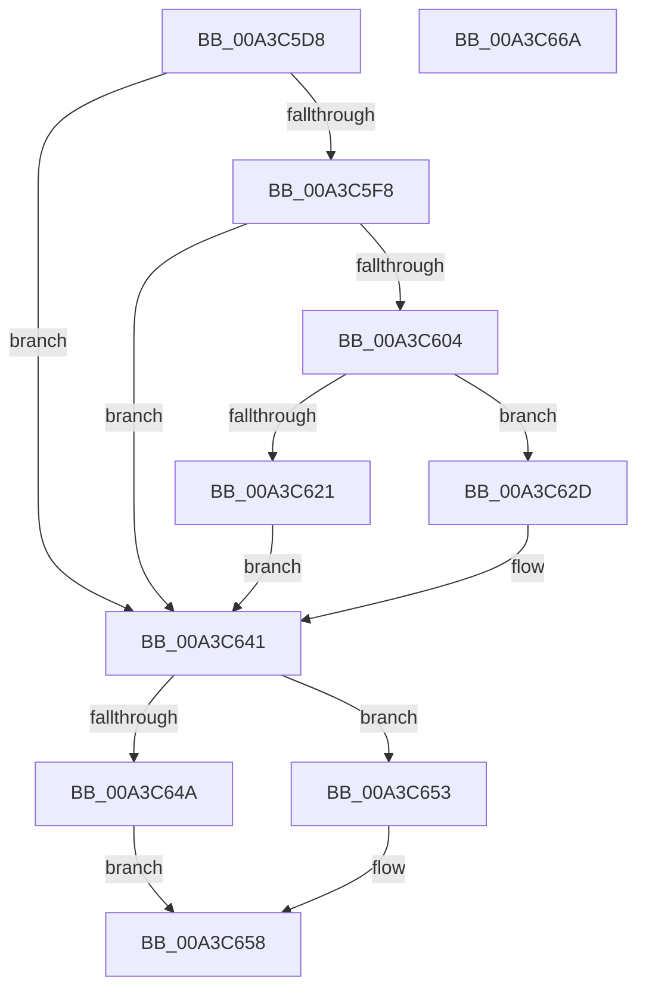

# BiCloseStore

- RVA: `0x00A3C5D8`–`0x00A3C66B` (길이 `147` bytes)
- VA: `0x0000000140A3C5D8`
- 실행 섹션: `PAGE`
- PDB 이름 있음: `예`; PDB Function 태그: `아니요`
- unwind 정보 RVA: `0x00060BC4`
- 디코드: `44`개 명령, `147/147` bytes 표시
- 미해석 바이트: `0` (있으면 어셈블리에 `.byte`로 보존)

> 이 문서는 커널 이미지의 기계어와 PDB 기호를 분석해 생성했습니다. 4번과 5번은 함수 원형과 자료형을 바이너리 사용 방식에서 추정한 C 해석이며 원본 소스 복구 결과는 아닙니다.

## 1. Dependencies

- 직접 호출 지점: **8**; 고유 호출 대상: **7**
- 직접 호출자로 확인된 함수: **2**
- RIP 상대 이미지 참조: **2**

### Outgoing calls
- `0x00A3C5EB` → [BiSanitizeHandle](../../text/4B/BiSanitizeHandle_function_004B0E4C.md) (function, `0x004B0E4C`)
- `0x00A3C5FB` → [BiWasFirmwareModified](../../text/4C/BiWasFirmwareModified_function_004CB8F4.md) (function, `0x004CB8F4`)
- `0x00A3C60E` → [BiLogMessage](BiLogMessage_function_00A3D3A8.md) (function, `0x00A3D3A8`)
- `0x00A3C616` → [BiExportStoreAlterationsToFirmware](../82/BiExportStoreAlterationsToFirmware_function_00826038.md) (function, `0x00826038`)
- `0x00A3C626` → [BiSetFirmwareModified](../../text/4B/BiSetFirmwareModified_function_004B1DF4.md) (function, `0x004B1DF4`)
- `0x00A3C63C` → [BiLogMessage](BiLogMessage_function_00A3D3A8.md) (function, `0x00A3D3A8`)
- `0x00A3C64C` → [BiUnloadHiveByHandle](../A4/BiUnloadHiveByHandle_function_00A4105C.md) (function, `0x00A4105C`)
- `0x00A3C653` → [BiCloseKey](../91/BiCloseKey_function_00916A00.md) (function, `0x00916A00`)

### Direct callers
- [BcdCloseStore](BcdCloseStore_function_00A3C68C.md) at `0x00A3C6DD`
- [BiOpenSystemStore](../A4/BiOpenSystemStore_function_00A40844.md) at `0x00A40A54`

### Static image references
- `0x00A3C604` → RVA `0x00B0AB70` (` ?? ::NNGAKEGL::`string'`; read)
- `0x00A3C630` → RVA `0x00B0ABC0` (` ?? ::NNGAKEGL::`string'`; read)

## 2. Other-region calls and transfers

- 다른 실행 섹션으로 향하는 call: **3**
  - `0x00A3C5EB` → [BiSanitizeHandle](../../text/4B/BiSanitizeHandle_function_004B0E4C.md) (`PAGE` → `.text`)
  - `0x00A3C5FB` → [BiWasFirmwareModified](../../text/4C/BiWasFirmwareModified_function_004CB8F4.md) (`PAGE` → `.text`)
  - `0x00A3C626` → [BiSetFirmwareModified](../../text/4B/BiSetFirmwareModified_function_004B1DF4.md) (`PAGE` → `.text`)
- 별도 외부 분기/꼬리 이동을 확인하지 못했습니다.

## 3. Assembly (complete function range)

```asm
00A3C5D8  48 89 5C 24 08                  mov qword ptr [rsp + 8], rbx
00A3C5DD  48 89 74 24 10                  mov qword ptr [rsp + 0x10], rsi
00A3C5E2  57                              push rdi
00A3C5E3  48 83 EC 20                     sub rsp, 0x20
00A3C5E7  8B F2                           mov esi, edx
00A3C5E9  33 FF                           xor edi, edi
00A3C5EB  E8 5C 48 A7 FF                  call 0x1404b0e4c
00A3C5F0  48 8B D8                        mov rbx, rax
00A3C5F3  F6 C2 04                        test dl, 4
00A3C5F6  74 49                           je 0x140a3c641
00A3C5F8  48 8B C8                        mov rcx, rax
00A3C5FB  E8 F4 F2 A8 FF                  call 0x1404cb8f4
00A3C600  84 C0                           test al, al
00A3C602  74 3D                           je 0x140a3c641
00A3C604  48 8D 15 65 E5 0C 00            lea rdx, [rip + 0xce565]
00A3C60B  8D 4F 02                        lea ecx, [rdi + 2]
00A3C60E  E8 95 0D 00 00                  call 0x140a3d3a8
00A3C613  48 8B CB                        mov rcx, rbx
00A3C616  E8 1D 9A DE FF                  call 0x140826038
00A3C61B  8B F8                           mov edi, eax
00A3C61D  85 C0                           test eax, eax
00A3C61F  78 0C                           js 0x140a3c62d
00A3C621  33 D2                           xor edx, edx
00A3C623  48 8B CB                        mov rcx, rbx
00A3C626  E8 C9 57 A7 FF                  call 0x1404b1df4
00A3C62B  EB 14                           jmp 0x140a3c641
00A3C62D  44 8B C0                        mov r8d, eax
00A3C630  48 8D 15 89 E5 0C 00            lea rdx, [rip + 0xce589]
00A3C637  B9 04 00 00 00                  mov ecx, 4
00A3C63C  E8 67 0D 00 00                  call 0x140a3d3a8
00A3C641  48 8B CB                        mov rcx, rbx
00A3C644  40 F6 C6 02                     test sil, 2
00A3C648  74 09                           je 0x140a3c653
00A3C64A  33 D2                           xor edx, edx
00A3C64C  E8 0B 4A 00 00                  call 0x140a4105c
00A3C651  EB 05                           jmp 0x140a3c658
00A3C653  E8 A8 A3 ED FF                  call 0x140916a00
00A3C658  48 8B 5C 24 30                  mov rbx, qword ptr [rsp + 0x30]
00A3C65D  8B C7                           mov eax, edi
00A3C65F  48 8B 74 24 38                  mov rsi, qword ptr [rsp + 0x38]
00A3C664  48 83 C4 20                     add rsp, 0x20
00A3C668  5F                              pop rdi
00A3C669  C3                              ret
00A3C66A  CC                              int3
```

## 4. C-style interpretation (structured pseudocode)

```c
__int64 __fastcall BiCloseStore(__int64 a1, int a2)
{
    __int64 result;
    __int64 v_rdi;
    __int64 v_rsp;
    unsigned __int64 v_stack_p10;
    unsigned __int64 v_stack_p8;

    v_stack_p8 = v_rbx;
    v_stack_p10 = v_rsi;
    v_rsp = (v_rsp) - (32);
    v_rdi = 0;
    result = BiSanitizeHandle(a1, a2, a3, a4);
    if ((((unsigned __int8)(a2)) & (4)) == 0) goto loc_00A3C641;
    result = BiWasFirmwareModified(result, a2, a3, a4);
    if ((unsigned __int8)(result) == 0) goto loc_00A3C641;
    result = BiLogMessage(v_rdi + 2, v_rip + 845157, a3, a4);
    result = BiExportStoreAlterationsToFirmware(result, v_rip + 845157, a3, a4);
    if (sign_flag) goto loc_00A3C62D;
    a2 = 0;
    result = BiSetFirmwareModified(result, a2, a3, a4);
    goto loc_00A3C641;
loc_00A3C62D:
    result = BiLogMessage(4, v_rip + 845193, (unsigned int)((unsigned int)(result)), a4);
loc_00A3C641:
    if ((((unsigned __int8)((unsigned int)(a2))) & (2)) == 0) goto loc_00A3C653;
    a2 = 0;
    result = BiUnloadHiveByHandle(result, a2, (unsigned int)((unsigned int)(result)), a4);
    goto loc_00A3C658;
loc_00A3C653:
    result = BiCloseKey(result, a2, (unsigned int)((unsigned int)(result)), a4);
loc_00A3C658:
    v_rsp = (v_rsp) + (32);
    return (unsigned int)((unsigned int)((unsigned int)((unsigned int)(result))));
}
```

## 5. (Beta) C Style

```c
int64_t BiCloseStore(int64_t Arg1, int32_t Arg2)
{
    int64_t result;
    int64_t local_rdi;
    int64_t local_rsp;
    uint64_t v_stack_p10;
    uint64_t v_stack_p8;

    v_stack_p8 = local_rbx;
    v_stack_p10 = local_rsi;
    local_rsp = (local_rsp) - (32);
    local_rdi = 0;
    result = BiSanitizeHandle(Arg1, Arg2, a3, a4);
    if ((((uint8_t)(Arg2)) & (4)) == 0) goto loc_00A3C641;
    result = BiWasFirmwareModified(result, Arg2, a3, a4);
    if ((uint8_t)(result) == 0) goto loc_00A3C641;
    result = BiLogMessage(local_rdi + 2, v_rip + 845157, a3, a4);
    result = BiExportStoreAlterationsToFirmware(result, v_rip + 845157, a3, a4);
    if (sign_flag) goto loc_00A3C62D;
    Arg2 = 0;
    result = BiSetFirmwareModified(result, Arg2, a3, a4);
    goto loc_00A3C641;
loc_00A3C62D:
    result = BiLogMessage(4, v_rip + 845193, (uint32_t)((uint32_t)(result)), a4);
loc_00A3C641:
    if ((((uint8_t)((uint32_t)(Arg2))) & (2)) == 0) goto loc_00A3C653;
    Arg2 = 0;
    result = BiUnloadHiveByHandle(result, Arg2, (uint32_t)((uint32_t)(result)), a4);
    goto loc_00A3C658;
loc_00A3C653:
    result = BiCloseKey(result, Arg2, (uint32_t)((uint32_t)(result)), a4);
loc_00A3C658:
    local_rsp = (local_rsp) + (32);
    return (uint32_t)((uint32_t)((uint32_t)((uint32_t)(result))));
}
```

## 6. Execution-region graph

[열기: 2D/3D 그래프와 함수 탐색 컨트롤 패널](../../../control-panel.html?section=page&rva=0x00A3C5D8&view=graph)

- 2D 그래프는 위에서 아래로 흐르고, 3D 그래프는 빈 공간을 드래그해 회전합니다. Shift+드래그는 이동, 휠은 확대·축소, 함수 노드 선택은 대상 보고서 이동입니다.

### Static fallback


