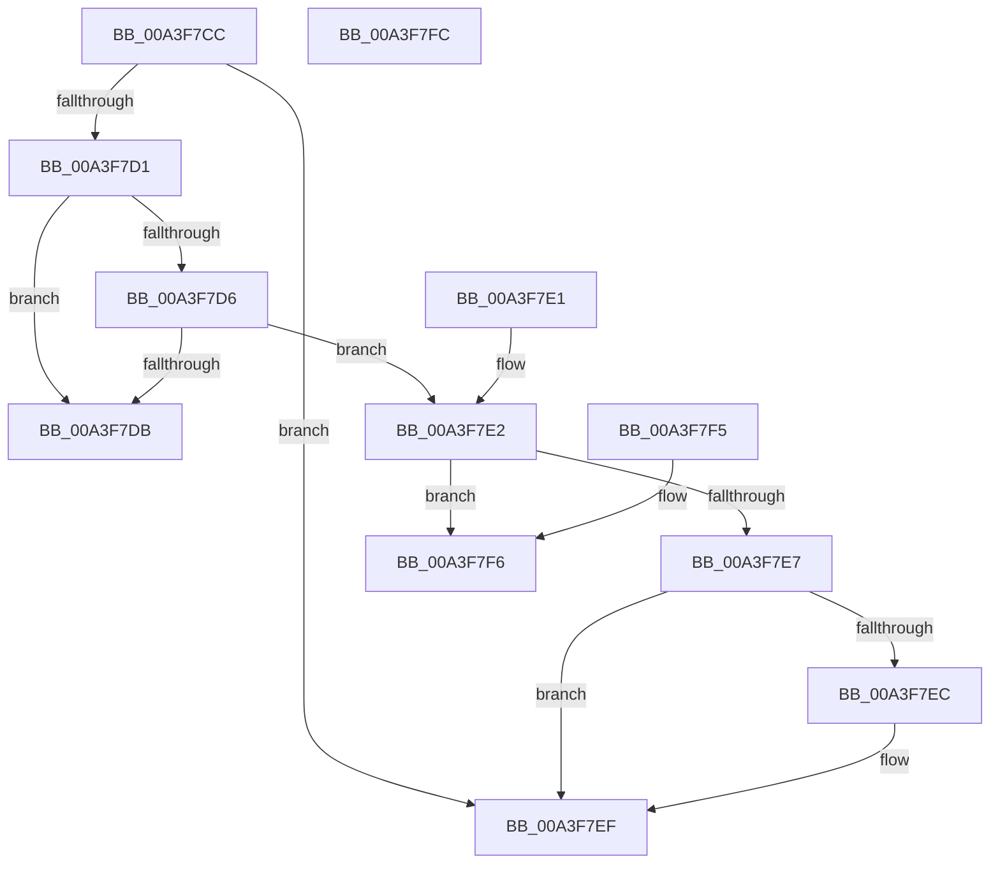

# BiConvertElementFormatToValueType

- RVA: `0x00A3F7CC`–`0x00A3F7FD` (길이 `49` bytes)
- VA: `0x0000000140A3F7CC`
- 실행 섹션: `PAGE`
- PDB 이름 있음: `예`; PDB Function 태그: `아니요`
- unwind 정보 RVA: `0x000DB714`
- 디코드: `20`개 명령, `49/49` bytes 표시
- 미해석 바이트: `0` (있으면 어셈블리에 `.byte`로 보존)

> 이 문서는 커널 이미지의 기계어와 PDB 기호를 분석해 생성했습니다. 4번과 5번은 함수 원형과 자료형을 바이너리 사용 방식에서 추정한 C 해석이며 원본 소스 복구 결과는 아닙니다.

## 1. Dependencies

- 직접 호출 지점: **0**; 고유 호출 대상: **0**
- 직접 호출자로 확인된 함수: **2**
- RIP 상대 이미지 참조: **0**

### Outgoing calls
- 직접 디코드된 call 명령이 없습니다.

### Direct callers
- [BcdGetElementDataWithFlags](BcdGetElementDataWithFlags_function_00A3EBE4.md) at `0x00A3ED1B`
- [BcdSetElementDataWithFlags](BcdSetElementDataWithFlags_function_00A3F080.md) at `0x00A3F1B2`

### Static image references
- 디코드된 RIP-relative 메모리 참조가 없습니다.

## 2. Other-region calls and transfers

- 다른 실행 섹션으로 향하는 call: **0**
- 별도 외부 분기/꼬리 이동을 확인하지 못했습니다.

## 3. Assembly (complete function range)

```asm
00A3F7CC  83 E9 01                        sub ecx, 1
00A3F7CF  74 1E                           je 0x140a3f7ef
00A3F7D1  83 E9 01                        sub ecx, 1
00A3F7D4  74 05                           je 0x140a3f7db
00A3F7D6  83 E9 01                        sub ecx, 1
00A3F7D9  75 07                           jne 0x140a3f7e2
00A3F7DB  B8 01 00 00 00                  mov eax, 1
00A3F7E0  C3                              ret
00A3F7E1  CC                              int3
00A3F7E2  83 E9 01                        sub ecx, 1
00A3F7E5  74 0F                           je 0x140a3f7f6
00A3F7E7  83 E9 01                        sub ecx, 1
00A3F7EA  74 03                           je 0x140a3f7ef
00A3F7EC  83 E9 01                        sub ecx, 1
00A3F7EF  B8 03 00 00 00                  mov eax, 3
00A3F7F4  C3                              ret
00A3F7F5  CC                              int3
00A3F7F6  B8 07 00 00 00                  mov eax, 7
00A3F7FB  C3                              ret
00A3F7FC  CC                              int3
```

## 4. C-style interpretation (structured pseudocode)

```c
__int64 __fastcall BiConvertElementFormatToValueType(int a1)
{
    a1 = (unsigned int)((a1) - (1));
    if (condition_is_equal) goto loc_00A3F7EF;
    a1 = (unsigned int)((a1) - (1));
    if (condition_is_equal) goto loc_00A3F7DB;
    a1 = (unsigned int)((a1) - (1));
    if (condition_is_not_equal) goto loc_00A3F7E2;
loc_00A3F7DB:
    return 1;
loc_00A3F7E2:
    a1 = (unsigned int)((a1) - (1));
    if (condition_is_equal) goto loc_00A3F7F6;
    a1 = (unsigned int)((a1) - (1));
    if (!(condition_is_equal)) {
        a1 = (unsigned int)((a1) - (1));
    }
    return 3;
loc_00A3F7F6:
    return 7;
}
```

## 5. (Beta) C Style

```c
int64_t BiConvertElementFormatToValueType(int32_t Arg1)
{
    Arg1 = (uint32_t)((Arg1) - (1));
    if (condition_is_equal) goto loc_00A3F7EF;
    Arg1 = (uint32_t)((Arg1) - (1));
    if (condition_is_equal) goto loc_00A3F7DB;
    Arg1 = (uint32_t)((Arg1) - (1));
    if (condition_is_not_equal) goto loc_00A3F7E2;
loc_00A3F7DB:
    return 1;
loc_00A3F7E2:
    Arg1 = (uint32_t)((Arg1) - (1));
    if (condition_is_equal) goto loc_00A3F7F6;
    Arg1 = (uint32_t)((Arg1) - (1));
    if (!(condition_is_equal)) {
        Arg1 = (uint32_t)((Arg1) - (1));
    }
    return 3;
loc_00A3F7F6:
    return 7;
}
```

## 6. Execution-region graph

[열기: 2D/3D 그래프와 함수 탐색 컨트롤 패널](../../../control-panel.html?section=page&rva=0x00A3F7CC&view=graph)

- 2D 그래프는 위에서 아래로 흐르고, 3D 그래프는 빈 공간을 드래그해 회전합니다. Shift+드래그는 이동, 휠은 확대·축소, 함수 노드 선택은 대상 보고서 이동입니다.

### Static fallback


