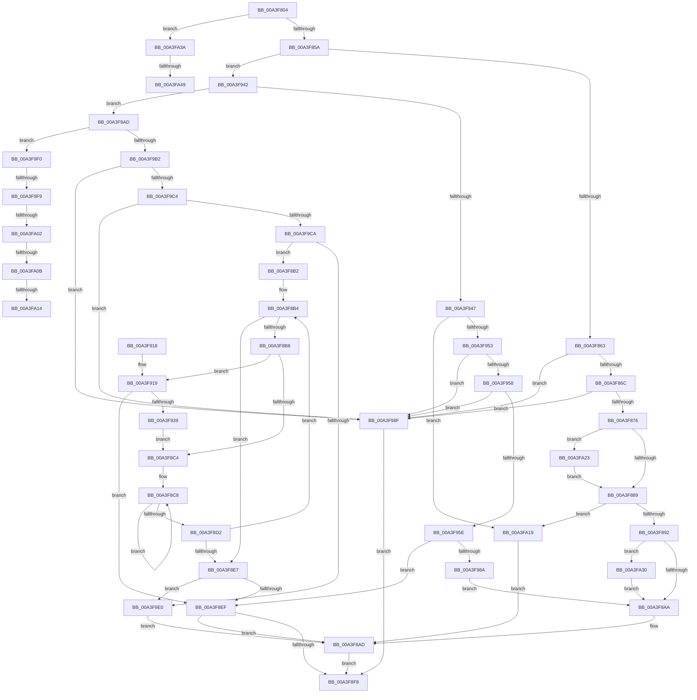

# BiConvertRegistryDataToElement

- RVA: `0x00A3F804`–`0x00A3FA55` (길이 `593` bytes)
- VA: `0x0000000140A3F804`
- 실행 섹션: `PAGE`
- PDB 이름 있음: `예`; PDB Function 태그: `예`
- unwind 정보 RVA: `0x000AE85C`
- 디코드: `165`개 명령, `593/593` bytes 표시
- 미해석 바이트: `0` (있으면 어셈블리에 `.byte`로 보존)

> 이 문서는 커널 이미지의 기계어와 PDB 기호를 분석해 생성했습니다. 4번과 5번은 함수 원형과 자료형을 바이너리 사용 방식에서 추정한 C 해석이며 원본 소스 복구 결과는 아닙니다.

## 1. Dependencies

- 직접 호출 지점: **6**; 고유 호출 대상: **4**
- 직접 호출자로 확인된 함수: **1**
- RIP 상대 이미지 참조: **2**

### Outgoing calls
- `0x00A3F89C` → [memcpy](../../text/6C/memcpy_function_006C6840.md) (function, `0x006C6840`)
- `0x00A3F920` → [RtlInitUnicodeString](../../text/42/RtlInitUnicodeString_function_0042A780.md) (function, `0x0042A780`)
- `0x00A3F92C` → [RtlGUIDFromString](../8F/RtlGUIDFromString_function_008F1EF0.md) (function, `0x008F1EF0`)
- `0x00A3F96E` → [RtlInitUnicodeString](../../text/42/RtlInitUnicodeString_function_0042A780.md) (function, `0x0042A780`)
- `0x00A3F97B` → [RtlGUIDFromString](../8F/RtlGUIDFromString_function_008F1EF0.md) (function, `0x008F1EF0`)
- `0x00A3F99E` → [BiLogMessage](BiLogMessage_function_00A3D3A8.md) (function, `0x00A3D3A8`)

### Direct callers
- [BcdGetElementDataWithFlags](BcdGetElementDataWithFlags_function_00A3EBE4.md) at `0x00A3ED81`

### Static image references
- `0x00A3F992` → RVA `0x00B0B8C0` (` ?? ::NNGAKEGL::`string'`; read)
- `0x00A3FA49` → RVA `0x00B0B610` (` ?? ::NNGAKEGL::`string'`; read)

## 2. Other-region calls and transfers

- 다른 실행 섹션으로 향하는 call: **3**
  - `0x00A3F89C` → [memcpy](../../text/6C/memcpy_function_006C6840.md) (`PAGE` → `.text`)
  - `0x00A3F920` → [RtlInitUnicodeString](../../text/42/RtlInitUnicodeString_function_0042A780.md) (`PAGE` → `.text`)
  - `0x00A3F96E` → [RtlInitUnicodeString](../../text/42/RtlInitUnicodeString_function_0042A780.md) (`PAGE` → `.text`)
- call이 아닌 외부 분기/꼬리 이동: **7**
  - `0x00A3F9F3` → [sub_00B3A622 + 0x98](../B3/Unknown_function_00B3A622.md) (`tail-transfer`)
  - `0x00A3F9FC` → [sub_00B3A622 + 0x4C](../B3/Unknown_function_00B3A622.md) (`tail-transfer`)
  - `0x00A3FA05` → [sub_00B3A622 + 0x35](../B3/Unknown_function_00B3A622.md) (`tail-transfer`)
  - `0x00A3FA0E` → [sub_00B3A622 + 0xF](../B3/Unknown_function_00B3A622.md) (`tail-transfer`)
  - `0x00A3FA14` → [sub_00B3A622 + 0x3](../B3/Unknown_function_00B3A622.md) (`tail-transfer`)
  - `0x00A3FA43` → [sub_00B3A622 + 0xDA](../B3/Unknown_function_00B3A622.md) (`tail-transfer`)
  - `0x00A3FA50` → [sub_00B3A622 + 0xB4](../B3/Unknown_function_00B3A622.md) (`tail-transfer`)

## 3. Assembly (complete function range)

```asm
00A3F804  48 89 5C 24 08                  mov qword ptr [rsp + 8], rbx
00A3F809  48 89 74 24 10                  mov qword ptr [rsp + 0x10], rsi
00A3F80E  48 89 7C 24 18                  mov qword ptr [rsp + 0x18], rdi
00A3F813  55                              push rbp
00A3F814  41 54                           push r12
00A3F816  41 55                           push r13
00A3F818  41 56                           push r14
00A3F81A  41 57                           push r15
00A3F81C  48 8B EC                        mov rbp, rsp
00A3F81F  48 83 EC 50                     sub rsp, 0x50
00A3F823  4C 8B 75 60                     mov r14, qword ptr [rbp + 0x60]
00A3F827  45 33 ED                        xor r13d, r13d
00A3F82A  41 8B C1                        mov eax, r9d
00A3F82D  41 8B F8                        mov edi, r8d
00A3F830  C1 E8 18                        shr eax, 0x18
00A3F833  0F 57 C0                        xorps xmm0, xmm0
00A3F836  83 E0 0F                        and eax, 0xf
00A3F839  4C 89 6D E0                     mov qword ptr [rbp - 0x20], r13
00A3F83D  44 89 6D 48                     mov dword ptr [rbp + 0x48], r13d
00A3F841  45 8B D1                        mov r10d, r9d
00A3F844  4C 8B FA                        mov r15, rdx
00A3F847  4C 8B E1                        mov r12, rcx
00A3F84A  41 8B F5                        mov esi, r13d
00A3F84D  0F 11 45 E8                     movups xmmword ptr [rbp - 0x18], xmm0
00A3F851  83 E8 01                        sub eax, 1
00A3F854  0F 84 E0 01 00 00               je 0x140a3fa3a
00A3F85A  83 E8 01                        sub eax, 1
00A3F85D  0F 85 DF 00 00 00               jne 0x140a3f942
00A3F863  45 85 C0                        test r8d, r8d
00A3F866  0F 84 23 01 00 00               je 0x140a3f98f
00A3F86C  40 F6 C7 01                     test dil, 1
00A3F870  0F 85 19 01 00 00               jne 0x140a3f98f
00A3F876  45 8A E5                        mov r12b, r13b
00A3F879  8B F7                           mov esi, edi
00A3F87B  8B DF                           mov ebx, edi
00A3F87D  66 44 39 6C 17 FE               cmp word ptr [rdi + rdx - 2], r13w
00A3F883  0F 85 9A 01 00 00               jne 0x140a3fa23
00A3F889  41 3B 3E                        cmp edi, dword ptr [r14]
00A3F88C  0F 87 87 01 00 00               ja 0x140a3fa19
00A3F892  48 8B 7D 58                     mov rdi, qword ptr [rbp + 0x58]
00A3F896  4C 8B C3                        mov r8, rbx
00A3F899  48 8B CF                        mov rcx, rdi
00A3F89C  E8 9F 6F C8 FF                  call 0x1406c6840
00A3F8A1  45 84 E4                        test r12b, r12b
00A3F8A4  0F 85 86 01 00 00               jne 0x140a3fa30
00A3F8AA  41 8B DD                        mov ebx, r13d
00A3F8AD  41 89 36                        mov dword ptr [r14], esi
00A3F8B0  EB 46                           jmp 0x140a3f8f8
00A3F8B2  33 D2                           xor edx, edx
00A3F8B4  3B CF                           cmp ecx, edi
00A3F8B6  73 2F                           jae 0x140a3f8e7
00A3F8B8  41 83 C5 10                     add r13d, 0x10
00A3F8BC  41 8B F5                        mov esi, r13d
00A3F8BF  45 3B 2E                        cmp r13d, dword ptr [r14]
00A3F8C2  76 55                           jbe 0x140a3f919
00A3F8C4  48 83 C8 FF                     or rax, 0xffffffffffffffff
00A3F8C8  48 FF C0                        inc rax
00A3F8CB  66 41 39 14 47                  cmp word ptr [r15 + rax*2], dx
00A3F8D0  75 F6                           jne 0x140a3f8c8
00A3F8D2  8D 0C 41                        lea ecx, [rcx + rax*2]
00A3F8D5  83 C1 02                        add ecx, 2
00A3F8D8  FF C0                           inc eax
00A3F8DA  89 4D 48                        mov dword ptr [rbp + 0x48], ecx
00A3F8DD  4D 8D 3C 47                     lea r15, [r15 + rax*2]
00A3F8E1  66 41 39 17                     cmp word ptr [r15], dx
00A3F8E5  75 CD                           jne 0x140a3f8b4
00A3F8E7  85 DB                           test ebx, ebx
00A3F8E9  0F 89 F1 00 00 00               jns 0x140a3f9e0
00A3F8EF  B8 23 00 00 C0                  mov eax, 0xc0000023
00A3F8F4  3B D8                           cmp ebx, eax
00A3F8F6  74 B5                           je 0x140a3f8ad
00A3F8F8  4C 8D 5C 24 50                  lea r11, [rsp + 0x50]
00A3F8FD  8B C3                           mov eax, ebx
00A3F8FF  49 8B 5B 30                     mov rbx, qword ptr [r11 + 0x30]
00A3F903  49 8B 73 38                     mov rsi, qword ptr [r11 + 0x38]
00A3F907  49 8B 7B 40                     mov rdi, qword ptr [r11 + 0x40]
00A3F90B  49 8B E3                        mov rsp, r11
00A3F90E  41 5F                           pop r15
00A3F910  41 5E                           pop r14
00A3F912  41 5D                           pop r13
00A3F914  41 5C                           pop r12
00A3F916  5D                              pop rbp
00A3F917  C3                              ret
00A3F918  CC                              int3
00A3F919  49 8B D7                        mov rdx, r15
00A3F91C  48 8D 4D E8                     lea rcx, [rbp - 0x18]
00A3F920  E8 5B AE 9E FF                  call 0x14042a780
00A3F925  49 8B D4                        mov rdx, r12
00A3F928  48 8D 4D E8                     lea rcx, [rbp - 0x18]
00A3F92C  E8 BF 25 EB FF                  call 0x1408f1ef0
00A3F931  33 D2                           xor edx, edx
00A3F933  8B D8                           mov ebx, eax
00A3F935  85 C0                           test eax, eax
00A3F937  78 B6                           js 0x140a3f8ef
00A3F939  8B 4D 48                        mov ecx, dword ptr [rbp + 0x48]
00A3F93C  49 83 C4 10                     add r12, 0x10
00A3F940  EB 82                           jmp 0x140a3f8c4
00A3F942  83 E8 01                        sub eax, 1
00A3F945  75 66                           jne 0x140a3f9ad
00A3F947  8D 70 10                        lea esi, [rax + 0x10]
00A3F94A  41 39 36                        cmp dword ptr [r14], esi
00A3F94D  0F 82 C6 00 00 00               jb 0x140a3fa19
00A3F953  83 FF 02                        cmp edi, 2
00A3F956  72 37                           jb 0x140a3f98f
00A3F958  40 F6 C7 01                     test dil, 1
00A3F95C  75 31                           jne 0x140a3f98f
00A3F95E  48 8B C7                        mov rax, rdi
00A3F961  48 8D 4D E8                     lea rcx, [rbp - 0x18]
00A3F965  48 D1 E8                        shr rax, 1
00A3F968  66 44 89 6C 42 FE               mov word ptr [rdx + rax*2 - 2], r13w
00A3F96E  E8 0D AE 9E FF                  call 0x14042a780
00A3F973  48 8B 55 58                     mov rdx, qword ptr [rbp + 0x58]
00A3F977  48 8D 4D E8                     lea rcx, [rbp - 0x18]
00A3F97B  E8 70 25 EB FF                  call 0x1408f1ef0
00A3F980  8B D8                           mov ebx, eax
00A3F982  85 C0                           test eax, eax
00A3F984  0F 88 65 FF FF FF               js 0x140a3f8ef
00A3F98A  E9 1B FF FF FF                  jmp 0x140a3f8aa
00A3F98F  44 8B C7                        mov r8d, edi
00A3F992  48 8D 15 27 BF 0C 00            lea rdx, [rip + 0xcbf27]
00A3F999  B9 04 00 00 00                  mov ecx, 4
00A3F99E  E8 05 DA FF FF                  call 0x140a3d3a8
00A3F9A3  BB 24 00 00 C0                  mov ebx, 0xc0000024
00A3F9A8  E9 4B FF FF FF                  jmp 0x140a3f8f8
00A3F9AD  83 E8 01                        sub eax, 1
00A3F9B0  75 3E                           jne 0x140a3f9f0
00A3F9B2  4C 8B 65 58                     mov r12, qword ptr [rbp + 0x58]
00A3F9B6  41 8B CD                        mov ecx, r13d
00A3F9B9  89 4D 48                        mov dword ptr [rbp + 0x48], ecx
00A3F9BC  41 8B DD                        mov ebx, r13d
00A3F9BF  83 FF 02                        cmp edi, 2
00A3F9C2  72 CB                           jb 0x140a3f98f
00A3F9C4  40 F6 C7 01                     test dil, 1
00A3F9C8  75 C5                           jne 0x140a3f98f
00A3F9CA  48 8B C7                        mov rax, rdi
00A3F9CD  48 D1 E8                        shr rax, 1
00A3F9D0  66 44 89 6C 42 FE               mov word ptr [rdx + rax*2 - 2], r13w
00A3F9D6  66 44 39 2A                     cmp word ptr [rdx], r13w
00A3F9DA  0F 85 D2 FE FF FF               jne 0x140a3f8b2
00A3F9E0  41 3B 36                        cmp esi, dword ptr [r14]
00A3F9E3  B8 23 00 00 C0                  mov eax, 0xc0000023
00A3F9E8  0F 47 D8                        cmova ebx, eax
00A3F9EB  E9 BD FE FF FF                  jmp 0x140a3f8ad
00A3F9F0  83 E8 01                        sub eax, 1
00A3F9F3  0F 84 C1 AC 0F 00               je 0x140b3a6ba
00A3F9F9  83 E8 01                        sub eax, 1
00A3F9FC  0F 84 6C AC 0F 00               je 0x140b3a66e
00A3FA02  83 F8 01                        cmp eax, 1
00A3FA05  0F 84 4C AC 0F 00               je 0x140b3a657
00A3FA0B  45 85 C0                        test r8d, r8d
00A3FA0E  0F 85 1D AC 0F 00               jne 0x140b3a631
00A3FA14  E9 0C AC 0F 00                  jmp 0x140b3a625
00A3FA19  BB 23 00 00 C0                  mov ebx, 0xc0000023
00A3FA1E  E9 8A FE FF FF                  jmp 0x140a3f8ad
00A3FA23  83 C7 02                        add edi, 2
00A3FA26  41 B4 01                        mov r12b, 1
00A3FA29  8B F7                           mov esi, edi
00A3FA2B  E9 59 FE FF FF                  jmp 0x140a3f889
00A3FA30  66 44 89 2C 3B                  mov word ptr [rbx + rdi], r13w
00A3FA35  E9 70 FE FF FF                  jmp 0x140a3f8aa
00A3FA3A  41 B9 1C 00 00 00               mov r9d, 0x1c
00A3FA40  41 3B F9                        cmp edi, r9d
00A3FA43  0F 83 B3 AC 0F 00               jae 0x140b3a6fc
00A3FA49  48 8D 15 C0 BB 0C 00            lea rdx, [rip + 0xcbbc0]
00A3FA50  E9 81 AC 0F 00                  jmp 0x140b3a6d6
```

## 4. C-style interpretation (structured pseudocode)

```c
__int64 __fastcall BiConvertRegistryDataToElement(__int64 a1, __int64 a2, int a3, int a4, __int64 a5, __int64 a6, __int64 a7)
{
    __int64 result;
    __int64 v_r12;
    __int64 v_r13;
    __int64 v_rbx;
    __int64 v_rdi;
    __int64 v_rsp;
    unsigned __int64 v_stack_m28;
    unsigned __int64 v_stack_m40;
    unsigned __int64 v_stack_m48;
    unsigned __int64 v_stack_p10;
    unsigned __int64 v_stack_p18;
    unsigned int v_stack_p20;
    unsigned __int64 v_stack_p8;

    v_stack_p8 = v_rbx;
    v_stack_p10 = v_rsi;
    v_stack_p18 = v_rdi;
    v_rsp = (v_rsp) - (80);
    v_r13 = 0;
    result = (unsigned int)(((unsigned int)(a4)) >> (24));
    result = (unsigned int)((result) & (15));
    v_stack_m48 = 0;
    v_stack_p20 = 0;
    v_stack_m40 = v_xmm0;
    result = (unsigned int)((result) - (1));
    if (condition_is_equal) goto loc_00A3FA3A;
    result = (unsigned int)((result) - (1));
    if (condition_is_not_equal) goto loc_00A3F942;
    if (a3 == 0) goto loc_00A3F98F;
    if ((((unsigned __int8)((unsigned int)(a3))) & (1)) != 0) goto loc_00A3F98F;
    if ((*(unsigned __int16 *)((unsigned int)(a3) + a2 * 1 - 2)) != 0) goto loc_00A3FA23;
loc_00A3F889:
    if (((unsigned int)((unsigned int)(a3))) > (*(unsigned int *)(a7))) goto loc_00A3FA19;
    result = memcpy(a6, a2, (unsigned int)((unsigned int)((unsigned int)(a3))), a4);
    if (0 != 0) goto loc_00A3FA30;
loc_00A3F8AA:
loc_00A3F8AD:
    *(unsigned int *)(a7) = (unsigned int)((unsigned int)((unsigned int)((unsigned int)(a3))));
    goto loc_00A3F8F8;
loc_00A3F8B2:
    a2 = 0;
loc_00A3F8B4:
    if (((unsigned int)(a6)) >= ((unsigned int)(a6))) goto loc_00A3F8E7;
    v_r13 = (unsigned int)((v_r13) + (16));
    if (((unsigned int)(v_r13)) <= (*(unsigned int *)(a7))) goto loc_00A3F919;
loc_00A3F8C4:
    result = (result) | (-1);
loc_00A3F8C8:
    result = (result) + 1;
    if ((*(unsigned __int16 *)(a2 + result * 2)) != 0) goto loc_00A3F8C8;
    a1 = (unsigned int)((a6 + result * 2) + (2));
    result = (unsigned int)((result) + 1);
    v_stack_p20 = (unsigned int)(a1);
    if ((*(unsigned __int16 *)(a2 + result * 2)) != 0) goto loc_00A3F8B4;
loc_00A3F8E7:
    if (!sign_flag) goto loc_00A3F9E0;
loc_00A3F8EF:
    if (0 == ((unsigned int)((unsigned int)(0xC0000023ULL)))) goto loc_00A3F8AD;
loc_00A3F8F8:
    return 0;
loc_00A3F919:
    result = RtlInitUnicodeString(v_stack_m40, a2 + result * 2, (unsigned int)((unsigned int)((unsigned int)(a3))), a4);
    result = RtlGUIDFromString(v_stack_m40, 0, (unsigned int)((unsigned int)((unsigned int)(a3))), a4);
    a2 = 0;
    if (sign_flag) goto loc_00A3F8EF;
    v_r12 = (0) + (16);
    goto loc_00A3F8C4;
loc_00A3F942:
    result = (unsigned int)((result) - (1));
    if (condition_is_not_equal) goto loc_00A3F9AD;
    if ((*(unsigned int *)(a7)) < ((unsigned int)(result + 16))) goto loc_00A3FA19;
    if (((unsigned int)(*(unsigned __int64 *)(v_stack_m28 + 64))) < 2) goto loc_00A3F98F;
    if ((((unsigned __int8)(*(unsigned __int64 *)(v_stack_m28 + 64))) & (1)) != 0) goto loc_00A3F98F;
    result = (*(unsigned __int64 *)(v_stack_m28 + 64)) >> (1);
    *(unsigned __int16 *)(a2 + result * 2 - 2) = (unsigned __int16)(v_r13);
    result = RtlInitUnicodeString(v_stack_m40, a2, (unsigned int)((unsigned int)((unsigned int)(a3))), a4);
    result = RtlGUIDFromString(v_stack_m40, a6, (unsigned int)((unsigned int)((unsigned int)(a3))), a4);
    if (sign_flag) goto loc_00A3F8EF;
    goto loc_00A3F8AA;
loc_00A3F98F:
    result = BiLogMessage(4, v_rip + 835367, (unsigned int)((unsigned int)(*(unsigned __int64 *)(v_stack_m28 + 64))), a4);
    goto loc_00A3F8F8;
loc_00A3F9AD:
    result = (unsigned int)((result) - (1));
    if (condition_is_not_equal) goto loc_00A3F9F0;
    v_stack_p20 = (unsigned int)((unsigned int)((unsigned int)(v_r13)));
    if (((unsigned int)(*(unsigned __int64 *)(v_stack_m28 + 64))) < 2) goto loc_00A3F98F;
    if ((((unsigned __int8)(*(unsigned __int64 *)(v_stack_m28 + 64))) & (1)) != 0) goto loc_00A3F98F;
    result = (*(unsigned __int64 *)(v_stack_m28 + 64)) >> (1);
    *(unsigned __int16 *)(v_rip + 835367 + result * 2 - 2) = (unsigned __int16)(v_r13);
    if ((*(unsigned __int16 *)(v_rip + 835367)) != ((unsigned __int16)(v_r13))) goto loc_00A3F8B2;
loc_00A3F9E0:
    v_rbx = (unsigned int)((unsigned int)(v_r13));
    if (((unsigned int)(result + 16)) > (*(unsigned int *)(a7))) { v_rbx = (unsigned int)((unsigned int)(0xC0000023ULL)); }
    goto loc_00A3F8AD;
loc_00A3F9F0:
    result = (unsigned int)(((unsigned int)(0xC0000023ULL)) - (1));
    result = (unsigned int)((result) - (1));
loc_00A3FA19:
    goto loc_00A3F8AD;
loc_00A3FA23:
    v_rdi = (unsigned int)((*(unsigned __int64 *)(v_stack_m28 + 64)) + (2));
    goto loc_00A3F889;
loc_00A3FA30:
    *(unsigned __int16 *)((unsigned int)(0xC0000023ULL) + v_rdi * 1) = (unsigned __int16)(v_r13);
    goto loc_00A3F8AA;
loc_00A3FA3A:
}
```

## 5. (Beta) C Style

```c
int64_t BiConvertRegistryDataToElement(int64_t Arg1, void *Arg2, int32_t Arg3, int32_t Arg4, uint64_t Arg5, int64_t Arg6, void *Arg7)
{
    uint8_t *arg2 = (uint8_t *)Arg2;
    uint8_t *arg7 = (uint8_t *)Arg7;

    int64_t result;
    int64_t local_r12;
    int64_t local_r13;
    int64_t local_rbx;
    int64_t local_rdi;
    int64_t local_rsp;
    uint64_t v_stack_m28;
    uint64_t v_stack_m40;
    uint64_t v_stack_m48;
    uint64_t v_stack_p10;
    uint64_t v_stack_p18;
    uint32_t v_stack_p20;
    uint64_t v_stack_p8;

    v_stack_p8 = local_rbx;
    v_stack_p10 = local_rsi;
    v_stack_p18 = local_rdi;
    local_rsp = (local_rsp) - (80);
    local_r13 = 0;
    result = (uint32_t)(((uint32_t)(Arg4)) >> (24));
    result = (uint32_t)((result) & (15));
    v_stack_m48 = 0;
    v_stack_p20 = 0;
    v_stack_m40 = v_xmm0;
    result = (uint32_t)((result) - (1));
    if (condition_is_equal) goto loc_00A3FA3A;
    result = (uint32_t)((result) - (1));
    if (condition_is_not_equal) goto loc_00A3F942;
    if (Arg3 == 0) goto loc_00A3F98F;
    if ((((uint8_t)((uint32_t)(Arg3))) & (1)) != 0) goto loc_00A3F98F;
    if ((*(uint16_t *)((uint32_t)(Arg3) + arg2 * 1 - 0x2)) != 0) goto loc_00A3FA23;
loc_00A3F889:
    if (((uint32_t)((uint32_t)(Arg3))) > (*(uint32_t *)(arg7))) goto loc_00A3FA19;
    result = memcpy(Arg6, Arg2, (uint32_t)((uint32_t)((uint32_t)(Arg3))), Arg4);
    if (0 != 0) goto loc_00A3FA30;
loc_00A3F8AA:
loc_00A3F8AD:
    *(uint32_t *)(arg7) = (uint32_t)((uint32_t)((uint32_t)((uint32_t)(Arg3))));
    goto loc_00A3F8F8;
loc_00A3F8B2:
    Arg2 = 0;
loc_00A3F8B4:
    if (((uint32_t)(Arg6)) >= ((uint32_t)(Arg6))) goto loc_00A3F8E7;
    local_r13 = (uint32_t)((local_r13) + (16));
    if (((uint32_t)(local_r13)) <= (*(uint32_t *)(arg7))) goto loc_00A3F919;
loc_00A3F8C4:
    result = (result) | (-1);
loc_00A3F8C8:
    result = (result) + 1;
    if ((*(uint16_t *)(arg2 + result * 2)) != 0) goto loc_00A3F8C8;
    Arg1 = (uint32_t)((Arg6 + result * 2) + (2));
    result = (uint32_t)((result) + 1);
    v_stack_p20 = (uint32_t)(Arg1);
    if ((*(uint16_t *)(arg2 + result * 2)) != 0) goto loc_00A3F8B4;
loc_00A3F8E7:
    if (!sign_flag) goto loc_00A3F9E0;
loc_00A3F8EF:
    if (0 == ((uint32_t)((uint32_t)(0xC0000023ULL)))) goto loc_00A3F8AD;
loc_00A3F8F8:
    return 0;
loc_00A3F919:
    result = RtlInitUnicodeString(v_stack_m40, Arg2 + result * 2, (uint32_t)((uint32_t)((uint32_t)(Arg3))), Arg4);
    result = RtlGUIDFromString(v_stack_m40, 0, (uint32_t)((uint32_t)((uint32_t)(Arg3))), Arg4);
    Arg2 = 0;
    if (sign_flag) goto loc_00A3F8EF;
    local_r12 = (0) + (16);
    goto loc_00A3F8C4;
loc_00A3F942:
    result = (uint32_t)((result) - (1));
    if (condition_is_not_equal) goto loc_00A3F9AD;
    if ((*(uint32_t *)(arg7)) < ((uint32_t)(result + 16))) goto loc_00A3FA19;
    if (((uint32_t)(*(uint64_t *)(v_stack_m28 + 0x40))) < 2) goto loc_00A3F98F;
    if ((((uint8_t)(*(uint64_t *)(v_stack_m28 + 0x40))) & (1)) != 0) goto loc_00A3F98F;
    result = (*(uint64_t *)(v_stack_m28 + 0x40)) >> (1);
    *(uint16_t *)(arg2 + result * 2 - 0x2) = (uint16_t)(local_r13);
    result = RtlInitUnicodeString(v_stack_m40, Arg2, (uint32_t)((uint32_t)((uint32_t)(Arg3))), Arg4);
    result = RtlGUIDFromString(v_stack_m40, Arg6, (uint32_t)((uint32_t)((uint32_t)(Arg3))), Arg4);
    if (sign_flag) goto loc_00A3F8EF;
    goto loc_00A3F8AA;
loc_00A3F98F:
    result = BiLogMessage(4, v_rip + 835367, (uint32_t)((uint32_t)(*(uint64_t *)(v_stack_m28 + 0x40))), Arg4);
    goto loc_00A3F8F8;
loc_00A3F9AD:
    result = (uint32_t)((result) - (1));
    if (condition_is_not_equal) goto loc_00A3F9F0;
    v_stack_p20 = (uint32_t)((uint32_t)((uint32_t)(local_r13)));
    if (((uint32_t)(*(uint64_t *)(v_stack_m28 + 0x40))) < 2) goto loc_00A3F98F;
    if ((((uint8_t)(*(uint64_t *)(v_stack_m28 + 0x40))) & (1)) != 0) goto loc_00A3F98F;
    result = (*(uint64_t *)(v_stack_m28 + 0x40)) >> (1);
    *(uint16_t *)(v_rip + 0xCBF27 + result * 2 - 0x2) = (uint16_t)(local_r13);
    if ((*(uint16_t *)(v_rip + 0xCBF27)) != ((uint16_t)(local_r13))) goto loc_00A3F8B2;
loc_00A3F9E0:
    local_rbx = (uint32_t)((uint32_t)(local_r13));
    if (((uint32_t)(result + 16)) > (*(uint32_t *)(arg7))) { local_rbx = (uint32_t)((uint32_t)(0xC0000023ULL)); }
    goto loc_00A3F8AD;
loc_00A3F9F0:
    result = (uint32_t)(((uint32_t)(0xC0000023ULL)) - (1));
    result = (uint32_t)((result) - (1));
loc_00A3FA19:
    goto loc_00A3F8AD;
loc_00A3FA23:
    local_rdi = (uint32_t)((*(uint64_t *)(v_stack_m28 + 0x40)) + (2));
    goto loc_00A3F889;
loc_00A3FA30:
    *(uint16_t *)((uint32_t)(0xC0000023ULL) + local_rdi * 1) = (uint16_t)(local_r13);
    goto loc_00A3F8AA;
loc_00A3FA3A:
}
```

### 관측된 메모리 오프셋

구조체 형식이 확인되지 않은 접근은 인자 기준의 오프셋으로만 기록했습니다.

| 기준 인자 | 오프셋 표현 | 폭 (bit) | 접근 |
|---|---:|---:|---|
| `Arg2` | `- 0x2 + rax*2` | `16` | `W` |
| `Arg2` | `+ 0x0` | `16` | `R` |
| `Arg2` | `+ 0x0 + rax*2` | `16` | `R` |
| `Arg2` | `+ 0x0 + rax*2` | `64` | `R` |
| `Arg7` | `+ 0x0` | `32` | `R` |
| `Arg7` | `+ 0x0` | `32` | `W` |

## 6. Execution-region graph

[열기: 2D/3D 그래프와 함수 탐색 컨트롤 패널](../../../control-panel.html?section=page&rva=0x00A3F804&view=graph)

- 2D 그래프는 위에서 아래로 흐르고, 3D 그래프는 빈 공간을 드래그해 회전합니다. Shift+드래그는 이동, 휠은 확대·축소, 함수 노드 선택은 대상 보고서 이동입니다.

### Static fallback


