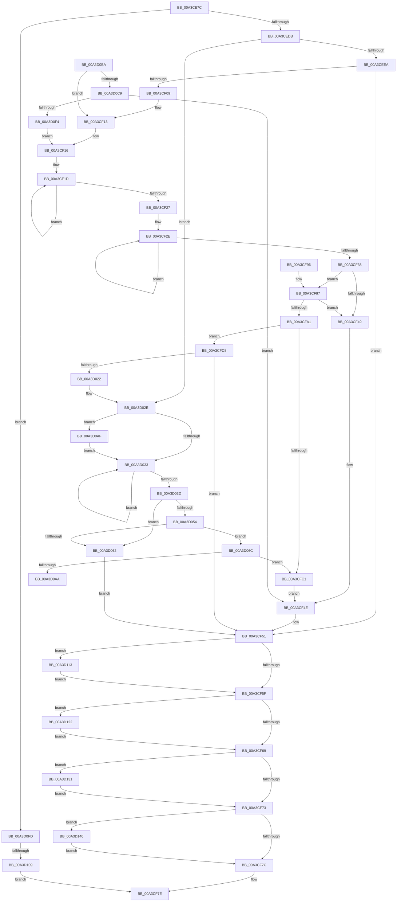

# BiCreateMergedBootEntry

- RVA: `0x00A3CE7C`–`0x00A3D14F` (길이 `723` bytes)
- VA: `0x0000000140A3CE7C`
- 실행 섹션: `PAGE`
- PDB 이름 있음: `예`; PDB Function 태그: `예`
- unwind 정보 RVA: `0x000AE530`
- 디코드: `200`개 명령, `723/723` bytes 표시
- 미해석 바이트: `0` (있으면 어셈블리에 `.byte`로 보존)

> 이 문서는 커널 이미지의 기계어와 PDB 기호를 분석해 생성했습니다. 4번과 5번은 함수 원형과 자료형을 바이너리 사용 방식에서 추정한 C 해석이며 원본 소스 복구 결과는 아닙니다.

## 1. Dependencies

- 직접 호출 지점: **11**; 고유 호출 대상: **6**
- 직접 호출자로 확인된 함수: **2**
- RIP 상대 이미지 참조: **0**

### Outgoing calls
- `0x00A3CEFA` → [BiGetDeviceFromEfiPath](BiGetDeviceFromEfiPath_function_00A3D3BC.md) (function, `0x00A3D3BC`)
- `0x00A3CFB4` → [ExAllocatePool2](../../poolcode/B8/ExAllocatePool2_function_00B820F0.md) (function, `0x00B820F0`)
- `0x00A3CFE8` → [memcpy](../../text/6C/memcpy_function_006C6840.md) (function, `0x006C6840`)
- `0x00A3CFFB` → [memcpy](../../text/6C/memcpy_function_006C6840.md) (function, `0x006C6840`)
- `0x00A3D00C` → [BiTranslateFilePath](BiTranslateFilePath_function_00A3D534.md) (function, `0x00A3D534`)
- `0x00A3D098` → [ExAllocatePool2](../../poolcode/B8/ExAllocatePool2_function_00B820F0.md) (function, `0x00B820F0`)
- `0x00A3D0DF` → [BiGetFilePathFromEfiPath](../A9/BiGetFilePathFromEfiPath_function_00A90C1C.md) (function, `0x00A90C1C`)
- `0x00A3D118` → [ExFreePoolWithTag](../../poolcode/B8/ExFreePoolWithTag_function_00B82870.md) (function, `0x00B82870`)
- `0x00A3D127` → [ExFreePoolWithTag](../../poolcode/B8/ExFreePoolWithTag_function_00B82870.md) (function, `0x00B82870`)
- `0x00A3D136` → [ExFreePoolWithTag](../../poolcode/B8/ExFreePoolWithTag_function_00B82870.md) (function, `0x00B82870`)
- `0x00A3D145` → [ExFreePoolWithTag](../../poolcode/B8/ExFreePoolWithTag_function_00B82870.md) (function, `0x00B82870`)

### Direct callers
- [BiUpdateBcdObject](../82/BiUpdateBcdObject_function_008270D0.md) at `0x00827343`
- [BiUpdateEfiEntry](BiUpdateEfiEntry_function_00A3CCC0.md) at `0x00A3CD54`

### Static image references
- 디코드된 RIP-relative 메모리 참조가 없습니다.

## 2. Other-region calls and transfers

- 다른 실행 섹션으로 향하는 call: **8**
  - `0x00A3CFB4` → [ExAllocatePool2](../../poolcode/B8/ExAllocatePool2_function_00B820F0.md) (`PAGE` → `POOLCODE`)
  - `0x00A3CFE8` → [memcpy](../../text/6C/memcpy_function_006C6840.md) (`PAGE` → `.text`)
  - `0x00A3CFFB` → [memcpy](../../text/6C/memcpy_function_006C6840.md) (`PAGE` → `.text`)
  - `0x00A3D098` → [ExAllocatePool2](../../poolcode/B8/ExAllocatePool2_function_00B820F0.md) (`PAGE` → `POOLCODE`)
  - `0x00A3D118` → [ExFreePoolWithTag](../../poolcode/B8/ExFreePoolWithTag_function_00B82870.md) (`PAGE` → `POOLCODE`)
  - `0x00A3D127` → [ExFreePoolWithTag](../../poolcode/B8/ExFreePoolWithTag_function_00B82870.md) (`PAGE` → `POOLCODE`)
  - `0x00A3D136` → [ExFreePoolWithTag](../../poolcode/B8/ExFreePoolWithTag_function_00B82870.md) (`PAGE` → `POOLCODE`)
  - `0x00A3D145` → [ExFreePoolWithTag](../../poolcode/B8/ExFreePoolWithTag_function_00B82870.md) (`PAGE` → `POOLCODE`)
- call이 아닌 외부 분기/꼬리 이동: **2**
  - `0x00A3D0AA` → [sub_00B3A40A + 0x13](../B3/Unknown_function_00B3A40A.md) (`tail-transfer`)
  - `0x00A3D103` → [sub_00B3A40A](../B3/Unknown_function_00B3A40A.md) (`tail-transfer`)

## 3. Assembly (complete function range)

```asm
00A3CE7C  48 89 5C 24 08                  mov qword ptr [rsp + 8], rbx
00A3CE81  4C 89 4C 24 20                  mov qword ptr [rsp + 0x20], r9
00A3CE86  48 89 54 24 10                  mov qword ptr [rsp + 0x10], rdx
00A3CE8B  55                              push rbp
00A3CE8C  56                              push rsi
00A3CE8D  57                              push rdi
00A3CE8E  41 54                           push r12
00A3CE90  41 55                           push r13
00A3CE92  41 56                           push r14
00A3CE94  41 57                           push r15
00A3CE96  48 8B EC                        mov rbp, rsp
00A3CE99  48 83 EC 50                     sub rsp, 0x50
00A3CE9D  45 33 E4                        xor r12d, r12d
00A3CEA0  48 83 C8 FF                     or rax, 0xffffffffffffffff
00A3CEA4  44 89 65 D8                     mov dword ptr [rbp - 0x28], r12d
00A3CEA8  48 8B DA                        mov rbx, rdx
00A3CEAB  44 89 65 D4                     mov dword ptr [rbp - 0x2c], r12d
00A3CEAF  48 8B F1                        mov rsi, rcx
00A3CEB2  4C 89 65 F0                     mov qword ptr [rbp - 0x10], r12
00A3CEB6  45 8B EC                        mov r13d, r12d
00A3CEB9  4C 89 65 E0                     mov qword ptr [rbp - 0x20], r12
00A3CEBD  41 8B FC                        mov edi, r12d
00A3CEC0  44 88 65 50                     mov byte ptr [rbp + 0x50], r12b
00A3CEC4  45 8B FC                        mov r15d, r12d
00A3CEC7  4C 89 65 E8                     mov qword ptr [rbp - 0x18], r12
00A3CECB  45 8B F4                        mov r14d, r12d
00A3CECE  44 88 65 D0                     mov byte ptr [rbp - 0x30], r12b
00A3CED2  4D 85 C0                        test r8, r8
00A3CED5  0F 85 22 02 00 00               jne 0x140a3d0fd
00A3CEDB  8B 79 14                        mov edi, dword ptr [rcx + 0x14]
00A3CEDE  48 03 F9                        add rdi, rcx
00A3CEE1  4D 85 C9                        test r9, r9
00A3CEE4  0F 84 44 01 00 00               je 0x140a3d02e
00A3CEEA  48 8D 4F 0C                     lea rcx, [rdi + 0xc]
00A3CEEE  48 89 7D E0                     mov qword ptr [rbp - 0x20], rdi
00A3CEF2  4C 8D 45 D8                     lea r8, [rbp - 0x28]
00A3CEF6  48 8D 55 F0                     lea rdx, [rbp - 0x10]
00A3CEFA  E8 BD 04 00 00                  call 0x140a3d3bc
00A3CEFF  4C 8B 6D F0                     mov r13, qword ptr [rbp - 0x10]
00A3CF03  8B D8                           mov ebx, eax
00A3CF05  85 C0                           test eax, eax
00A3CF07  78 48                           js 0x140a3cf51
00A3CF09  4C 8B 4D 58                     mov r9, qword ptr [rbp + 0x58]
00A3CF0D  4D 8D 65 14                     lea r12, [r13 + 0x14]
00A3CF11  33 D2                           xor edx, edx
00A3CF13  4D 8B F9                        mov r15, r9
00A3CF16  48 83 C9 FF                     or rcx, 0xffffffffffffffff
00A3CF1A  48 8B C1                        mov rax, rcx
00A3CF1D  48 FF C0                        inc rax
00A3CF20  66 41 39 14 44                  cmp word ptr [r12 + rax*2], dx
00A3CF25  75 F6                           jne 0x140a3cf1d
00A3CF27  8D 1C 45 02 00 00 00            lea ebx, [rax*2 + 2]
00A3CF2E  48 FF C1                        inc rcx
00A3CF31  66 41 39 14 4F                  cmp word ptr [r15 + rcx*2], dx
00A3CF36  75 F6                           jne 0x140a3cf2e
00A3CF38  8D 0C 4D 02 00 00 00            lea ecx, [rcx*2 + 2]
00A3CF3F  8D 04 19                        lea eax, [rcx + rbx]
00A3CF42  89 4D D8                        mov dword ptr [rbp - 0x28], ecx
00A3CF45  3B C3                           cmp eax, ebx
00A3CF47  73 4E                           jae 0x140a3cf97
00A3CF49  BB 95 00 00 C0                  mov ebx, 0xc0000095
00A3CF4E  45 33 E4                        xor r12d, r12d
00A3CF51  BE 42 43 44 4B                  mov esi, 0x4b444342
00A3CF56  4D 85 ED                        test r13, r13
00A3CF59  0F 85 B4 01 00 00               jne 0x140a3d113
00A3CF5F  44 38 65 50                     cmp byte ptr [rbp + 0x50], r12b
00A3CF63  0F 85 B9 01 00 00               jne 0x140a3d122
00A3CF69  44 38 65 D0                     cmp byte ptr [rbp - 0x30], r12b
00A3CF6D  0F 85 BE 01 00 00               jne 0x140a3d131
00A3CF73  4D 85 F6                        test r14, r14
00A3CF76  0F 85 C4 01 00 00               jne 0x140a3d140
00A3CF7C  8B C3                           mov eax, ebx
00A3CF7E  48 8B 9C 24 90 00 00 00         mov rbx, qword ptr [rsp + 0x90]
00A3CF86  48 83 C4 50                     add rsp, 0x50
00A3CF8A  41 5F                           pop r15
00A3CF8C  41 5E                           pop r14
00A3CF8E  41 5D                           pop r13
00A3CF90  41 5C                           pop r12
00A3CF92  5F                              pop rdi
00A3CF93  5E                              pop rsi
00A3CF94  5D                              pop rbp
00A3CF95  C3                              ret
00A3CF96  CC                              int3
00A3CF97  8D 04 0B                        lea eax, [rbx + rcx]
00A3CF9A  8D 48 0C                        lea ecx, [rax + 0xc]
00A3CF9D  3B C8                           cmp ecx, eax
00A3CF9F  72 A8                           jb 0x140a3cf49
00A3CFA1  8B C1                           mov eax, ecx
00A3CFA3  41 B8 42 43 44 4B               mov r8d, 0x4b444342
00A3CFA9  8B D1                           mov edx, ecx
00A3CFAB  B9 02 01 00 00                  mov ecx, 0x102
00A3CFB0  48 89 45 F0                     mov qword ptr [rbp - 0x10], rax
00A3CFB4  E8 37 51 14 00                  call 0x140b820f0
00A3CFB9  4C 8B F0                        mov r14, rax
00A3CFBC  48 85 C0                        test rax, rax
00A3CFBF  75 07                           jne 0x140a3cfc8
00A3CFC1  BB 9A 00 00 C0                  mov ebx, 0xc000009a
00A3CFC6  EB 86                           jmp 0x140a3cf4e
00A3CFC8  C7 00 01 00 00 00               mov dword ptr [rax], 1
00A3CFCE  49 8D 4E 0C                     lea rcx, [r14 + 0xc]
00A3CFD2  48 8B 45 F0                     mov rax, qword ptr [rbp - 0x10]
00A3CFD6  4C 8B C3                        mov r8, rbx
00A3CFD9  49 8B D4                        mov rdx, r12
00A3CFDC  41 89 46 04                     mov dword ptr [r14 + 4], eax
00A3CFE0  41 C7 46 08 03 00 00 00         mov dword ptr [r14 + 8], 3
00A3CFE8  E8 53 98 C8 FF                  call 0x1406c6840
00A3CFED  44 8B 45 D8                     mov r8d, dword ptr [rbp - 0x28]
00A3CFF1  49 8D 4E 0C                     lea rcx, [r14 + 0xc]
00A3CFF5  48 03 CB                        add rcx, rbx
00A3CFF8  49 8B D7                        mov rdx, r15
00A3CFFB  E8 40 98 C8 FF                  call 0x1406c6840
00A3D000  4C 8D 45 E0                     lea r8, [rbp - 0x20]
00A3D004  BA 04 00 00 00                  mov edx, 4
00A3D009  49 8B CE                        mov rcx, r14
00A3D00C  E8 23 05 00 00                  call 0x140a3d534
00A3D011  48 8B 7D E0                     mov rdi, qword ptr [rbp - 0x20]
00A3D015  45 33 E4                        xor r12d, r12d
00A3D018  8B D8                           mov ebx, eax
00A3D01A  85 C0                           test eax, eax
00A3D01C  0F 88 2F FF FF FF               js 0x140a3cf51
00A3D022  48 8B 5D 48                     mov rbx, qword ptr [rbp + 0x48]
00A3D026  48 83 C8 FF                     or rax, 0xffffffffffffffff
00A3D02A  C6 45 50 01                     mov byte ptr [rbp + 0x50], 1
00A3D02E  48 85 DB                        test rbx, rbx
00A3D031  74 7C                           je 0x140a3d0af
00A3D033  48 FF C0                        inc rax
00A3D036  66 44 39 24 43                  cmp word ptr [rbx + rax*2], r12w
00A3D03B  75 F6                           jne 0x140a3d033
00A3D03D  8B 56 18                        mov edx, dword ptr [rsi + 0x18]
00A3D040  44 8D 04 45 02 00 00 00         lea r8d, [rax*2 + 2]
00A3D048  44 89 45 E0                     mov dword ptr [rbp - 0x20], r8d
00A3D04C  42 8D 0C 02                     lea ecx, [rdx + r8]
00A3D050  3B CA                           cmp ecx, edx
00A3D052  72 0E                           jb 0x140a3d062
00A3D054  44 8B 4F 04                     mov r9d, dword ptr [rdi + 4]
00A3D058  41 8D 41 24                     lea eax, [r9 + 0x24]
00A3D05C  03 C1                           add eax, ecx
00A3D05E  3B C1                           cmp eax, ecx
00A3D060  73 0A                           jae 0x140a3d06c
00A3D062  BB 95 00 00 C0                  mov ebx, 0xc0000095
00A3D067  E9 E5 FE FF FF                  jmp 0x140a3cf51
00A3D06C  8D 42 1F                        lea eax, [rdx + 0x1f]
00A3D06F  B9 02 01 00 00                  mov ecx, 0x102
00A3D074  BA FC FF FF FF                  mov edx, 0xfffffffc
00A3D079  23 C2                           and eax, edx
00A3D07B  89 45 D8                        mov dword ptr [rbp - 0x28], eax
00A3D07E  44 8D 60 03                     lea r12d, [rax + 3]
00A3D082  45 03 E0                        add r12d, r8d
00A3D085  41 B8 42 43 44 4B               mov r8d, 0x4b444342
00A3D08B  44 23 E2                        and r12d, edx
00A3D08E  44 89 65 D4                     mov dword ptr [rbp - 0x2c], r12d
00A3D092  45 03 E1                        add r12d, r9d
00A3D095  41 8B D4                        mov edx, r12d
00A3D098  E8 53 50 14 00                  call 0x140b820f0
00A3D09D  48 89 45 F0                     mov qword ptr [rbp - 0x10], rax
00A3D0A1  48 85 C0                        test rax, rax
00A3D0A4  0F 84 17 FF FF FF               je 0x140a3cfc1
00A3D0AA  E9 6E D3 0F 00                  jmp 0x140b3a41d
00A3D0AF  8B 5E 10                        mov ebx, dword ptr [rsi + 0x10]
00A3D0B2  48 03 DE                        add rbx, rsi
00A3D0B5  E9 79 FF FF FF                  jmp 0x140a3d033
00A3D0BA  33 D2                           xor edx, edx
00A3D0BC  4D 8D 60 14                     lea r12, [r8 + 0x14]
00A3D0C0  4D 85 C9                        test r9, r9
00A3D0C3  0F 85 4A FE FF FF               jne 0x140a3cf13
00A3D0C9  8B 79 14                        mov edi, dword ptr [rcx + 0x14]
00A3D0CC  4C 8D 45 D4                     lea r8, [rbp - 0x2c]
00A3D0D0  48 03 FE                        add rdi, rsi
00A3D0D3  48 8D 55 E8                     lea rdx, [rbp - 0x18]
00A3D0D7  48 89 7D E0                     mov qword ptr [rbp - 0x20], rdi
00A3D0DB  48 8D 4F 0C                     lea rcx, [rdi + 0xc]
00A3D0DF  E8 38 3B 05 00                  call 0x140a90c1c
00A3D0E4  4C 8B 7D E8                     mov r15, qword ptr [rbp - 0x18]
00A3D0E8  33 D2                           xor edx, edx
00A3D0EA  8B D8                           mov ebx, eax
00A3D0EC  85 C0                           test eax, eax
00A3D0EE  0F 88 5A FE FF FF               js 0x140a3cf4e
00A3D0F4  C6 45 D0 01                     mov byte ptr [rbp - 0x30], 1
00A3D0F8  E9 19 FE FF FF                  jmp 0x140a3cf16
00A3D0FD  41 8B 00                        mov eax, dword ptr [r8]
00A3D100  83 F8 05                        cmp eax, 5
00A3D103  0F 85 01 D3 0F 00               jne 0x140b3a40a
00A3D109  B8 0E 00 00 C0                  mov eax, 0xc000000e
00A3D10E  E9 6B FE FF FF                  jmp 0x140a3cf7e
00A3D113  8B D6                           mov edx, esi
00A3D115  49 8B CD                        mov rcx, r13
00A3D118  E8 53 57 14 00                  call 0x140b82870
00A3D11D  E9 3D FE FF FF                  jmp 0x140a3cf5f
00A3D122  8B D6                           mov edx, esi
00A3D124  48 8B CF                        mov rcx, rdi
00A3D127  E8 44 57 14 00                  call 0x140b82870
00A3D12C  E9 38 FE FF FF                  jmp 0x140a3cf69
00A3D131  8B D6                           mov edx, esi
00A3D133  49 8B CF                        mov rcx, r15
00A3D136  E8 35 57 14 00                  call 0x140b82870
00A3D13B  E9 33 FE FF FF                  jmp 0x140a3cf73
00A3D140  8B D6                           mov edx, esi
00A3D142  49 8B CE                        mov rcx, r14
00A3D145  E8 26 57 14 00                  call 0x140b82870
00A3D14A  E9 2D FE FF FF                  jmp 0x140a3cf7c
```

## 4. C-style interpretation (structured pseudocode)

```c
__int64 __fastcall BiCreateMergedBootEntry(__int64 a1, __int64 a2, __int64 a3, __int64 a4)
{
    __int64 result;
    __int64 v_r12;
    __int64 v_rbx;
    __int64 v_rdi;
    __int64 v_rsp;
    unsigned __int64 v_stack_m48;
    unsigned __int64 v_stack_m50;
    unsigned __int64 v_stack_m58;
    unsigned int v_stack_m60;
    unsigned int v_stack_m64;
    unsigned __int8 v_stack_m68;
    unsigned __int64 v_stack_p10;
    unsigned __int8 v_stack_p18;
    unsigned __int64 v_stack_p20;
    unsigned __int64 v_stack_p8;

    v_stack_p8 = v_rbx;
    v_stack_p20 = a4;
    v_stack_p10 = a2;
    v_rsp = (v_rsp) - (80);
    v_r12 = 0;
    result = (result) | (-1);
    v_stack_m60 = 0;
    v_stack_m64 = 0;
    v_stack_m48 = 0;
    v_stack_m58 = 0;
    v_stack_p18 = 0;
    v_stack_m50 = 0;
    v_stack_m68 = 0;
    if (a3 != 0) goto loc_00A3D0FD;
    v_rdi = ((unsigned int)(*(unsigned int *)(a1 + 20))) + (a1);
    if (a4 == 0) goto loc_00A3D02E;
    v_stack_m58 = v_rdi;
    result = BiGetDeviceFromEfiPath(v_rdi + 12, v_stack_m48, v_stack_m60, a4);
    if (sign_flag) goto loc_00A3CF51;
    a2 = 0;
loc_00A3CF13:
loc_00A3CF16:
    a1 = (v_rdi + 12) | (-1);
loc_00A3CF1D:
    result = (a1) + 1;
    if ((*(unsigned __int16 *)(v_stack_m48 + 20 + result * 2)) != 0) goto loc_00A3CF1D;
loc_00A3CF2E:
    a1 = (a1) + 1;
    if ((*(unsigned __int16 *)(v_stack_p20 + a1 * 2)) != 0) goto loc_00A3CF2E;
    v_stack_m60 = (unsigned int)(a1 * 2 + 2);
    if (((unsigned int)(a1 * 2 + 2 + result * 2 + 2 * 1)) >= ((unsigned int)(result * 2 + 2))) goto loc_00A3CF97;
loc_00A3CF49:
loc_00A3CF4E:
    v_r12 = 0;
loc_00A3CF51:
    if (v_stack_m48 != 0) goto loc_00A3D113;
loc_00A3CF5F:
    if (v_stack_p18 != 0) goto loc_00A3D122;
loc_00A3CF69:
    if (v_stack_m68 != 0) goto loc_00A3D131;
loc_00A3CF73:
    if (0 != 0) goto loc_00A3D140;
loc_00A3CF7C:
loc_00A3CF7E:
    v_rsp = (v_rsp) + (80);
    return (unsigned int)((unsigned int)((unsigned int)(0xC0000095ULL)));
loc_00A3CF97:
    if (((unsigned int)(v_stack_p8 + a1 * 2 + 2 * 1 + 12)) < ((unsigned int)(v_stack_p8 + a1 * 2 + 2 * 1))) goto loc_00A3CF49;
    v_stack_m48 = (unsigned int)((unsigned int)(v_stack_p8 + a1 * 2 + 2 * 1 + 12));
    result = ExAllocatePool2(258, (unsigned int)((unsigned int)(v_stack_p8 + a1 * 2 + 2 * 1 + 12)), (unsigned int)(0x4B444342ULL), v_stack_p20);
    if (result != 0) goto loc_00A3CFC8;
loc_00A3CFC1:
    goto loc_00A3CF4E;
loc_00A3CFC8:
    *(unsigned int *)(result) = 1;
    *(unsigned int *)(result + 4) = (unsigned int)(v_stack_m48);
    *(unsigned int *)(result + 8) = 3;
    result = memcpy(result + 12, 0, (unsigned int)(0xC000009AULL), v_stack_p20);
    a1 = (result + 12) + ((unsigned int)(0xC000009AULL));
    result = memcpy(a1, v_stack_p20, (unsigned int)(v_stack_m60), v_stack_p20);
    result = BiTranslateFilePath(result, 4, v_stack_m58, v_stack_p20);
    v_r12 = 0;
    if (sign_flag) goto loc_00A3CF51;
    result = (result) | (-1);
    v_stack_p18 = 1;
loc_00A3D02E:
    if (v_stack_p10 == 0) goto loc_00A3D0AF;
loc_00A3D033:
    result = (result) + 1;
    if ((*(unsigned __int16 *)(v_stack_p10 + result * 2)) != 0) goto loc_00A3D033;
    v_stack_m58 = (unsigned int)(result * 2 + 2);
    if (((unsigned int)((unsigned int)(*(unsigned int *)((unsigned int)(0x4B444342ULL) + 24)) + result * 2 + 2 * 1)) < ((unsigned int)((unsigned int)(*(unsigned int *)((unsigned int)(0x4B444342ULL) + 24))))) goto loc_00A3D062;
    result = (unsigned int)(((unsigned int)(*(unsigned int *)(v_stack_m58 + 4)) + 36) + ((unsigned int)((unsigned int)(*(unsigned int *)((unsigned int)(0x4B444342ULL) + 24)) + result * 2 + 2 * 1)));
    if (((unsigned int)(result)) >= ((unsigned int)((unsigned int)(*(unsigned int *)((unsigned int)(0x4B444342ULL) + 24)) + result * 2 + 2 * 1))) goto loc_00A3D06C;
loc_00A3D062:
    goto loc_00A3CF51;
loc_00A3D06C:
    result = (unsigned int)(((unsigned int)(*(unsigned int *)((unsigned int)(0x4B444342ULL) + 24)) + 31) & ((unsigned int)((unsigned int)(0xFFFFFFFCULL))));
    v_stack_m60 = (unsigned int)(result);
    v_r12 = (unsigned int)((result + 3) + ((unsigned int)(result * 2 + 2)));
    v_r12 = (unsigned int)((v_r12) & ((unsigned int)((unsigned int)(0xFFFFFFFCULL))));
    v_stack_m64 = (unsigned int)(v_r12);
    v_r12 = (unsigned int)((v_r12) + ((unsigned int)((unsigned int)(*(unsigned int *)(v_stack_m58 + 4)))));
    result = ExAllocatePool2(258, (unsigned int)((unsigned int)(v_r12)), (unsigned int)(0x4B444342ULL), (unsigned int)(*(unsigned int *)(v_stack_m58 + 4)));
    v_stack_m48 = result;
    if (result == 0) goto loc_00A3CFC1;
loc_00A3D0AF:
    v_rbx = ((unsigned int)(*(unsigned int *)((unsigned int)(0x4B444342ULL) + 16))) + ((unsigned int)(0x4B444342ULL));
    goto loc_00A3D033;
loc_00A3D0FD:
    goto loc_00A3CF7E;
loc_00A3D113:
    result = ExFreePoolWithTag(v_stack_m48, (unsigned int)((unsigned int)((unsigned int)(0x4B444342ULL))), (unsigned int)(0x4B444342ULL), (unsigned int)(*(unsigned int *)(v_stack_m58 + 4)));
    goto loc_00A3CF5F;
loc_00A3D122:
    result = ExFreePoolWithTag(v_stack_m58, (unsigned int)((unsigned int)((unsigned int)(0x4B444342ULL))), (unsigned int)(0x4B444342ULL), (unsigned int)(*(unsigned int *)(v_stack_m58 + 4)));
    goto loc_00A3CF69;
loc_00A3D131:
    result = ExFreePoolWithTag(v_stack_p20, (unsigned int)((unsigned int)((unsigned int)(0x4B444342ULL))), (unsigned int)(0x4B444342ULL), (unsigned int)(*(unsigned int *)(v_stack_m58 + 4)));
    goto loc_00A3CF73;
loc_00A3D140:
    result = ExFreePoolWithTag(result, (unsigned int)((unsigned int)((unsigned int)(0x4B444342ULL))), (unsigned int)(0x4B444342ULL), (unsigned int)(*(unsigned int *)(v_stack_m58 + 4)));
    goto loc_00A3CF7C;
}
```

## 5. (Beta) C Style

```c
int64_t BiCreateMergedBootEntry(void *Arg1, int64_t Arg2, int64_t Arg3, int64_t Arg4)
{
    uint8_t *arg1 = (uint8_t *)Arg1;

    int64_t result;
    int64_t local_r12;
    int64_t local_rbx;
    int64_t local_rdi;
    int64_t local_rsp;
    uint64_t v_stack_m48;
    uint64_t v_stack_m50;
    uint64_t v_stack_m58;
    uint32_t v_stack_m60;
    uint32_t v_stack_m64;
    uint8_t v_stack_m68;
    uint64_t v_stack_p10;
    uint8_t v_stack_p18;
    uint64_t v_stack_p20;
    uint64_t v_stack_p8;

    v_stack_p8 = local_rbx;
    v_stack_p20 = Arg4;
    v_stack_p10 = Arg2;
    local_rsp = (local_rsp) - (80);
    local_r12 = 0;
    result = (result) | (-1);
    v_stack_m60 = 0;
    v_stack_m64 = 0;
    v_stack_m48 = 0;
    v_stack_m58 = 0;
    v_stack_p18 = 0;
    v_stack_m50 = 0;
    v_stack_m68 = 0;
    if (Arg3 != 0) goto loc_00A3D0FD;
    local_rdi = ((uint32_t)(*(uint32_t *)(arg1 + 0x14))) + (Arg1);
    if (Arg4 == 0) goto loc_00A3D02E;
    v_stack_m58 = local_rdi;
    result = BiGetDeviceFromEfiPath(local_rdi + 12, v_stack_m48, v_stack_m60, Arg4);
    if (sign_flag) goto loc_00A3CF51;
    Arg2 = 0;
loc_00A3CF13:
loc_00A3CF16:
    Arg1 = (local_rdi + 12) | (-1);
loc_00A3CF1D:
    result = (Arg1) + 1;
    if ((*(uint16_t *)(v_stack_m48 + 0x14 + result * 2)) != 0) goto loc_00A3CF1D;
loc_00A3CF2E:
    Arg1 = (Arg1) + 1;
    if ((*(uint16_t *)(v_stack_p20 + arg1 * 2)) != 0) goto loc_00A3CF2E;
    v_stack_m60 = (uint32_t)(Arg1 * 2 + 2);
    if (((uint32_t)(Arg1 * 2 + 2 + result * 2 + 2 * 1)) >= ((uint32_t)(result * 2 + 2))) goto loc_00A3CF97;
loc_00A3CF49:
loc_00A3CF4E:
    local_r12 = 0;
loc_00A3CF51:
    if (v_stack_m48 != 0) goto loc_00A3D113;
loc_00A3CF5F:
    if (v_stack_p18 != 0) goto loc_00A3D122;
loc_00A3CF69:
    if (v_stack_m68 != 0) goto loc_00A3D131;
loc_00A3CF73:
    if (0 != 0) goto loc_00A3D140;
loc_00A3CF7C:
loc_00A3CF7E:
    local_rsp = (local_rsp) + (80);
    return (uint32_t)((uint32_t)((uint32_t)(0xC0000095ULL)));
loc_00A3CF97:
    if (((uint32_t)(v_stack_p8 + Arg1 * 2 + 2 * 1 + 12)) < ((uint32_t)(v_stack_p8 + Arg1 * 2 + 2 * 1))) goto loc_00A3CF49;
    v_stack_m48 = (uint32_t)((uint32_t)(v_stack_p8 + Arg1 * 2 + 2 * 1 + 12));
    result = ExAllocatePool2(258, (uint32_t)((uint32_t)(v_stack_p8 + Arg1 * 2 + 2 * 1 + 12)), (uint32_t)(0x4B444342ULL), v_stack_p20);
    if (result != 0) goto loc_00A3CFC8;
loc_00A3CFC1:
    goto loc_00A3CF4E;
loc_00A3CFC8:
    *(uint32_t *)(result) = 1;
    *(uint32_t *)(result + 0x4) = (uint32_t)(v_stack_m48);
    *(uint32_t *)(result + 0x8) = 3;
    result = memcpy(result + 12, 0, (uint32_t)(0xC000009AULL), v_stack_p20);
    Arg1 = (result + 12) + ((uint32_t)(0xC000009AULL));
    result = memcpy(Arg1, v_stack_p20, (uint32_t)(v_stack_m60), v_stack_p20);
    result = BiTranslateFilePath(result, 4, v_stack_m58, v_stack_p20);
    local_r12 = 0;
    if (sign_flag) goto loc_00A3CF51;
    result = (result) | (-1);
    v_stack_p18 = 1;
loc_00A3D02E:
    if (v_stack_p10 == 0) goto loc_00A3D0AF;
loc_00A3D033:
    result = (result) + 1;
    if ((*(uint16_t *)(v_stack_p10 + result * 2)) != 0) goto loc_00A3D033;
    v_stack_m58 = (uint32_t)(result * 2 + 2);
    if (((uint32_t)((uint32_t)(*(uint32_t *)((uint32_t)(0x4B444342ULL) + 0x18)) + result * 2 + 2 * 1)) < ((uint32_t)((uint32_t)(*(uint32_t *)((uint32_t)(0x4B444342ULL) + 0x18))))) goto loc_00A3D062;
    result = (uint32_t)(((uint32_t)(*(uint32_t *)(v_stack_m58 + 0x4)) + 36) + ((uint32_t)((uint32_t)(*(uint32_t *)((uint32_t)(0x4B444342ULL) + 0x18)) + result * 2 + 2 * 1)));
    if (((uint32_t)(result)) >= ((uint32_t)((uint32_t)(*(uint32_t *)((uint32_t)(0x4B444342ULL) + 0x18)) + result * 2 + 2 * 1))) goto loc_00A3D06C;
loc_00A3D062:
    goto loc_00A3CF51;
loc_00A3D06C:
    result = (uint32_t)(((uint32_t)(*(uint32_t *)((uint32_t)(0x4B444342ULL) + 0x18)) + 31) & ((uint32_t)((uint32_t)(0xFFFFFFFCULL))));
    v_stack_m60 = (uint32_t)(result);
    local_r12 = (uint32_t)((result + 3) + ((uint32_t)(result * 2 + 2)));
    local_r12 = (uint32_t)((local_r12) & ((uint32_t)((uint32_t)(0xFFFFFFFCULL))));
    v_stack_m64 = (uint32_t)(local_r12);
    local_r12 = (uint32_t)((local_r12) + ((uint32_t)((uint32_t)(*(uint32_t *)(v_stack_m58 + 0x4)))));
    result = ExAllocatePool2(258, (uint32_t)((uint32_t)(local_r12)), (uint32_t)(0x4B444342ULL), (uint32_t)(*(uint32_t *)(v_stack_m58 + 0x4)));
    v_stack_m48 = result;
    if (result == 0) goto loc_00A3CFC1;
loc_00A3D0AF:
    local_rbx = ((uint32_t)(*(uint32_t *)((uint32_t)(0x4B444342ULL) + 0x10))) + ((uint32_t)(0x4B444342ULL));
    goto loc_00A3D033;
loc_00A3D0FD:
    goto loc_00A3CF7E;
loc_00A3D113:
    result = ExFreePoolWithTag(v_stack_m48, (uint32_t)((uint32_t)((uint32_t)(0x4B444342ULL))), (uint32_t)(0x4B444342ULL), (uint32_t)(*(uint32_t *)(v_stack_m58 + 0x4)));
    goto loc_00A3CF5F;
loc_00A3D122:
    result = ExFreePoolWithTag(v_stack_m58, (uint32_t)((uint32_t)((uint32_t)(0x4B444342ULL))), (uint32_t)(0x4B444342ULL), (uint32_t)(*(uint32_t *)(v_stack_m58 + 0x4)));
    goto loc_00A3CF69;
loc_00A3D131:
    result = ExFreePoolWithTag(v_stack_p20, (uint32_t)((uint32_t)((uint32_t)(0x4B444342ULL))), (uint32_t)(0x4B444342ULL), (uint32_t)(*(uint32_t *)(v_stack_m58 + 0x4)));
    goto loc_00A3CF73;
loc_00A3D140:
    result = ExFreePoolWithTag(result, (uint32_t)((uint32_t)((uint32_t)(0x4B444342ULL))), (uint32_t)(0x4B444342ULL), (uint32_t)(*(uint32_t *)(v_stack_m58 + 0x4)));
    goto loc_00A3CF7C;
}
```

### 관측된 메모리 오프셋

구조체 형식이 확인되지 않은 접근은 인자 기준의 오프셋으로만 기록했습니다.

| 기준 인자 | 오프셋 표현 | 폭 (bit) | 접근 |
|---|---:|---:|---|
| `Arg1` | `+ 0x10` | `32` | `R` |
| `Arg1` | `+ 0x14` | `32` | `R` |
| `Arg1` | `+ 0x18` | `32` | `R` |

## 6. Execution-region graph

[열기: 2D/3D 그래프와 함수 탐색 컨트롤 패널](../../../control-panel.html?section=page&rva=0x00A3CE7C&view=graph)

- 2D 그래프는 위에서 아래로 흐르고, 3D 그래프는 빈 공간을 드래그해 회전합니다. Shift+드래그는 이동, 휠은 확대·축소, 함수 노드 선택은 대상 보고서 이동입니다.

### Static fallback


