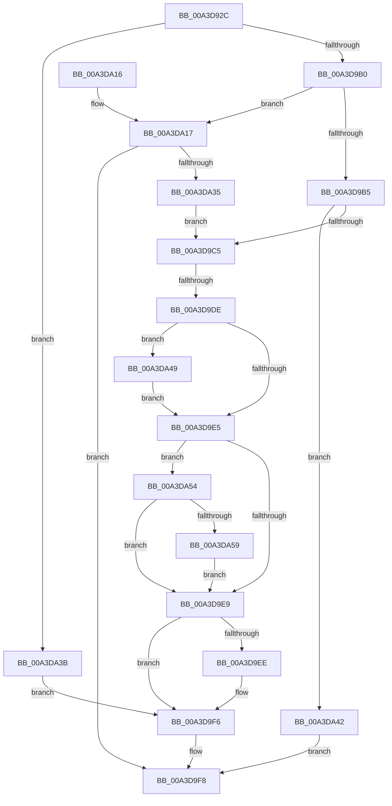

# BiCreateObject

- RVA: `0x00A3D92C`–`0x00A3DA63` (길이 `311` bytes)
- VA: `0x0000000140A3D92C`
- 실행 섹션: `PAGE`
- PDB 이름 있음: `예`; PDB Function 태그: `예`
- unwind 정보 RVA: `0x000AE630`
- 디코드: `96`개 명령, `311/311` bytes 표시
- 미해석 바이트: `0` (있으면 어셈블리에 `.byte`로 보존)

> 이 문서는 커널 이미지의 기계어와 PDB 기호를 분석해 생성했습니다. 4번과 5번은 함수 원형과 자료형을 바이너리 사용 방식에서 추정한 C 해석이며 원본 소스 복구 결과는 아닙니다.

## 1. Dependencies

- 직접 호출 지점: **10**; 고유 호출 대상: **8**
- 직접 호출자로 확인된 함수: **3**
- RIP 상대 이미지 참조: **3**

### Outgoing calls
- `0x00A3D995` → [BiLogMessage](BiLogMessage_function_00A3D3A8.md) (function, `0x00A3D3A8`)
- `0x00A3D9A3` → [BiIsValidObject](BiIsValidObject_function_00A3DA6C.md) (function, `0x00A3DA6C`)
- `0x00A3D9BC` → [BiIsObjectAliased](BiIsObjectAliased_function_00A3D250.md) (function, `0x00A3D250`)
- `0x00A3D9CF` → [RtlStringFromGUIDEx](../91/RtlStringFromGUIDEx_function_00915450.md) (function, `0x00915450`)
- `0x00A3D9F1` → [BiCloseKey](../91/BiCloseKey_function_00916A00.md) (function, `0x00916A00`)
- `0x00A3D9FF` → [_security_check_cookie](../../text/6A/_security_check_cookie_function_006AC640.md) (function, `0x006AC640`)
- `0x00A3DA23` → [BiLogMessage](BiLogMessage_function_00A3D3A8.md) (function, `0x00A3D3A8`)
- `0x00A3DA2C` → [ExUuidCreate](../91/ExUuidCreate_function_00917500.md) (function, `0x00917500`)
- `0x00A3DA4D` → [RtlFreeAnsiString](../9C/RtlFreeAnsiString_function_009C0800.md) (function, `0x009C0800`)
- `0x00A3DA5C` → [BiCloseKey](../91/BiCloseKey_function_00916A00.md) (function, `0x00916A00`)

### Direct callers
- [BcdCreateObject](BcdCreateObject_function_00A3D890.md) at `0x00A3D8D9`
- [BiBindEfiBootManager](BiBindEfiBootManager_function_00A3DCB0.md) at `0x00A3DD66`
- [BiBindEfiEntryToBcdObject](../AD/BiBindEfiEntryToBcdObject_function_00AD502C.md) at `0x00AD5095`

### Static image references
- `0x00A3D941` → RVA `0x00E0A740` (`.data`; read)
- `0x00A3D96E` → RVA `0x00B0B2E0` (` ?? ::NNGAKEGL::`string'`; read)
- `0x00A3DA17` → RVA `0x00B0B340` (` ?? ::NNGAKEGL::`string'`; read)

## 2. Other-region calls and transfers

- 다른 실행 섹션으로 향하는 call: **1**
  - `0x00A3D9FF` → [_security_check_cookie](../../text/6A/_security_check_cookie_function_006AC640.md) (`PAGE` → `.text`)
- call이 아닌 외부 분기/꼬리 이동: **1**
  - `0x00A3D9D8` → [sub_00B3A518](../B3/Unknown_function_00B3A518.md) (`tail-transfer`)

## 3. Assembly (complete function range)

```asm
00A3D92C  40 55                           push rbp
00A3D92E  53                              push rbx
00A3D92F  56                              push rsi
00A3D930  57                              push rdi
00A3D931  41 54                           push r12
00A3D933  41 55                           push r13
00A3D935  41 57                           push r15
00A3D937  48 8B EC                        mov rbp, rsp
00A3D93A  48 81 EC 80 00 00 00            sub rsp, 0x80
00A3D941  48 8B 05 F8 CD 3C 00            mov rax, qword ptr [rip + 0x3ccdf8]
00A3D948  48 33 C4                        xor rax, rsp
00A3D94B  48 89 45 F8                     mov qword ptr [rbp - 8], rax
00A3D94F  4C 8B 65 60                     mov r12, qword ptr [rbp + 0x60]
00A3D953  33 DB                           xor ebx, ebx
00A3D955  45 8B D1                        mov r10d, r9d
00A3D958  48 89 5D C8                     mov qword ptr [rbp - 0x38], rbx
00A3D95C  4C 8B DA                        mov r11, rdx
00A3D95F  48 89 5D C0                     mov qword ptr [rbp - 0x40], rbx
00A3D963  4C 8B E9                        mov r13, rcx
00A3D966  48 89 5D B8                     mov qword ptr [rbp - 0x48], rbx
00A3D96A  49 89 1C 24                     mov qword ptr [r12], rbx
00A3D96E  48 8D 15 6B D9 0C 00            lea rdx, [rip + 0xcd96b]
00A3D975  45 8B 48 04                     mov r9d, dword ptr [r8 + 4]
00A3D979  8D 4B 02                        lea ecx, [rbx + 2]
00A3D97C  0F 57 C0                        xorps xmm0, xmm0
00A3D97F  48 89 5D D8                     mov qword ptr [rbp - 0x28], rbx
00A3D983  4D 8B F8                        mov r15, r8
00A3D986  48 89 5D D0                     mov qword ptr [rbp - 0x30], rbx
00A3D98A  45 8B 00                        mov r8d, dword ptr [r8]
00A3D98D  8B F3                           mov esi, ebx
00A3D98F  0F 11 45 E8                     movups xmmword ptr [rbp - 0x18], xmm0
00A3D993  8B FB                           mov edi, ebx
00A3D995  E8 0E FA FF FF                  call 0x140a3d3a8
00A3D99A  45 8B C2                        mov r8d, r10d
00A3D99D  49 8B D3                        mov rdx, r11
00A3D9A0  49 8B CF                        mov rcx, r15
00A3D9A3  E8 C4 00 00 00                  call 0x140a3da6c
00A3D9A8  84 C0                           test al, al
00A3D9AA  0F 84 8B 00 00 00               je 0x140a3da3b
00A3D9B0  4D 85 DB                        test r11, r11
00A3D9B3  74 62                           je 0x140a3da17
00A3D9B5  48 8D 55 E0                     lea rdx, [rbp - 0x20]
00A3D9B9  49 8B CB                        mov rcx, r11
00A3D9BC  E8 8F F8 FF FF                  call 0x140a3d250
00A3D9C1  84 C0                           test al, al
00A3D9C3  75 7D                           jne 0x140a3da42
00A3D9C5  41 B0 01                        mov r8b, 1
00A3D9C8  48 8D 55 C8                     lea rdx, [rbp - 0x38]
00A3D9CC  49 8B CB                        mov rcx, r11
00A3D9CF  E8 7C 7A ED FF                  call 0x140915450
00A3D9D4  8B D8                           mov ebx, eax
00A3D9D6  85 C0                           test eax, eax
00A3D9D8  0F 89 3A CB 0F 00               jns 0x140b3a518
00A3D9DE  48 83 7D D0 00                  cmp qword ptr [rbp - 0x30], 0
00A3D9E3  75 64                           jne 0x140a3da49
00A3D9E5  85 DB                           test ebx, ebx
00A3D9E7  78 6B                           js 0x140a3da54
00A3D9E9  48 85 F6                        test rsi, rsi
00A3D9EC  74 08                           je 0x140a3d9f6
00A3D9EE  48 8B CE                        mov rcx, rsi
00A3D9F1  E8 0A 90 ED FF                  call 0x140916a00
00A3D9F6  8B C3                           mov eax, ebx
00A3D9F8  48 8B 4D F8                     mov rcx, qword ptr [rbp - 8]
00A3D9FC  48 33 CC                        xor rcx, rsp
00A3D9FF  E8 3C EC C6 FF                  call 0x1406ac640
00A3DA04  48 81 C4 80 00 00 00            add rsp, 0x80
00A3DA0B  41 5F                           pop r15
00A3DA0D  41 5D                           pop r13
00A3DA0F  41 5C                           pop r12
00A3DA11  5F                              pop rdi
00A3DA12  5E                              pop rsi
00A3DA13  5B                              pop rbx
00A3DA14  5D                              pop rbp
00A3DA15  C3                              ret
00A3DA16  CC                              int3
00A3DA17  48 8D 15 22 D9 0C 00            lea rdx, [rip + 0xcd922]
00A3DA1E  B9 02 00 00 00                  mov ecx, 2
00A3DA23  E8 80 F9 FF FF                  call 0x140a3d3a8
00A3DA28  48 8D 4D E8                     lea rcx, [rbp - 0x18]
00A3DA2C  E8 CF 9A ED FF                  call 0x140917500
00A3DA31  85 C0                           test eax, eax
00A3DA33  78 C3                           js 0x140a3d9f8
00A3DA35  4C 8D 5D E8                     lea r11, [rbp - 0x18]
00A3DA39  EB 8A                           jmp 0x140a3d9c5
00A3DA3B  BB BB 00 00 C0                  mov ebx, 0xc00000bb
00A3DA40  EB B4                           jmp 0x140a3d9f6
00A3DA42  B8 33 00 00 C0                  mov eax, 0xc0000033
00A3DA47  EB AF                           jmp 0x140a3d9f8
00A3DA49  48 8D 4D C8                     lea rcx, [rbp - 0x38]
00A3DA4D  E8 AE 2D F8 FF                  call 0x1409c0800
00A3DA52  EB 91                           jmp 0x140a3d9e5
00A3DA54  48 85 FF                        test rdi, rdi
00A3DA57  74 90                           je 0x140a3d9e9
00A3DA59  48 8B CF                        mov rcx, rdi
00A3DA5C  E8 9F 8F ED FF                  call 0x140916a00
00A3DA61  EB 86                           jmp 0x140a3d9e9
```

## 4. C-style interpretation (structured pseudocode)

```c
__int64 __fastcall BiCreateObject(__int64 a1, __int64 a2, __int64 a3, int a4, __int64 a5)
{
    __int64 result;
    __int64 v_rbx;
    __int64 v_rsp;
    unsigned __int64 v_stack_m40;
    unsigned __int64 v_stack_m50;
    unsigned __int64 v_stack_m58;
    unsigned __int64 v_stack_m60;
    unsigned __int64 v_stack_m68;
    unsigned __int64 v_stack_m70;
    unsigned __int64 v_stack_m78;
    unsigned __int64 v_stack_m80;

    v_rsp = (v_rsp) - (128);
    result = (*(unsigned __int64 *)(v_rip + 3984888)) ^ (v_rsp);
    v_stack_m40 = result;
    v_rbx = 0;
    v_stack_m70 = 0;
    v_stack_m78 = 0;
    v_stack_m80 = 0;
    *(unsigned __int64 *)(a5) = 0;
    v_stack_m60 = 0;
    v_stack_m68 = 0;
    v_stack_m50 = v_xmm0;
    result = BiLogMessage(v_rbx + 2, v_rip + 842091, (unsigned int)(*(unsigned int *)(a3)), (unsigned int)(*(unsigned int *)(a3 + 4)));
    result = BiIsValidObject(a3, a2, (unsigned int)((unsigned int)((unsigned int)(a4))), (unsigned int)(*(unsigned int *)(a3 + 4)));
    if ((unsigned __int8)(result) == 0) goto loc_00A3DA3B;
    if (a2 == 0) goto loc_00A3DA17;
    result = BiIsObjectAliased(a2, v_stack_m58, (unsigned int)((unsigned int)((unsigned int)(a4))), (unsigned int)(*(unsigned int *)(a3 + 4)));
    if ((unsigned __int8)(result) != 0) goto loc_00A3DA42;
loc_00A3D9C5:
    result = RtlStringFromGUIDEx(a2, v_stack_m70, 1, (unsigned int)(*(unsigned int *)(a3 + 4)));
    if (v_stack_m68 != 0) goto loc_00A3DA49;
loc_00A3D9E5:
    if (sign_flag) goto loc_00A3DA54;
loc_00A3D9E9:
    if (0 != 0) {
        a1 = 0;
        result = BiCloseKey(a1, v_stack_m70, 1, (unsigned int)(*(unsigned int *)(a3 + 4)));
    }
loc_00A3D9F8:
    a1 = (v_stack_m40) ^ (v_rsp);
    result = _security_check_cookie(a1, v_stack_m70, 1, (unsigned int)(*(unsigned int *)(a3 + 4)));
    v_rsp = (v_rsp) + (128);
    return result;
loc_00A3DA17:
    result = BiLogMessage(2, v_rip + 842018, 1, (unsigned int)(*(unsigned int *)(a3 + 4)));
    result = ExUuidCreate(v_stack_m50, v_rip + 842018, 1, (unsigned int)(*(unsigned int *)(a3 + 4)));
    if (sign_flag) goto loc_00A3D9F8;
    goto loc_00A3D9C5;
loc_00A3DA3B:
    goto loc_00A3D9F6;
loc_00A3DA42:
    goto loc_00A3D9F8;
loc_00A3DA49:
    result = RtlFreeAnsiString(v_stack_m70, v_rip + 842018, 1, (unsigned int)(*(unsigned int *)(a3 + 4)));
    goto loc_00A3D9E5;
loc_00A3DA54:
    if (0 == 0) goto loc_00A3D9E9;
    result = BiCloseKey(0, v_rip + 842018, 1, (unsigned int)(*(unsigned int *)(a3 + 4)));
    goto loc_00A3D9E9;
}
```

## 5. (Beta) C Style

```c
int64_t BiCreateObject(int64_t Arg1, int64_t Arg2, void *Arg3, int32_t Arg4, void *Arg5)
{
    uint8_t *arg3 = (uint8_t *)Arg3;
    uint8_t *arg5 = (uint8_t *)Arg5;

    int64_t result;
    int64_t local_rbx;
    int64_t local_rsp;
    uint64_t v_stack_m40;
    uint64_t v_stack_m50;
    uint64_t v_stack_m58;
    uint64_t v_stack_m60;
    uint64_t v_stack_m68;
    uint64_t v_stack_m70;
    uint64_t v_stack_m78;
    uint64_t v_stack_m80;

    local_rsp = (local_rsp) - (128);
    result = (*(uint64_t *)(v_rip + 0x3CCDF8)) ^ (local_rsp);
    v_stack_m40 = result;
    local_rbx = 0;
    v_stack_m70 = 0;
    v_stack_m78 = 0;
    v_stack_m80 = 0;
    *(uint64_t *)(arg5) = 0;
    v_stack_m60 = 0;
    v_stack_m68 = 0;
    v_stack_m50 = v_xmm0;
    result = BiLogMessage(local_rbx + 2, v_rip + 842091, (uint32_t)(*(uint32_t *)(arg3)), (uint32_t)(*(uint32_t *)(arg3 + 0x4)));
    result = BiIsValidObject(Arg3, Arg2, (uint32_t)((uint32_t)((uint32_t)(Arg4))), (uint32_t)(*(uint32_t *)(arg3 + 0x4)));
    if ((uint8_t)(result) == 0) goto loc_00A3DA3B;
    if (Arg2 == 0) goto loc_00A3DA17;
    result = BiIsObjectAliased(Arg2, v_stack_m58, (uint32_t)((uint32_t)((uint32_t)(Arg4))), (uint32_t)(*(uint32_t *)(arg3 + 0x4)));
    if ((uint8_t)(result) != 0) goto loc_00A3DA42;
loc_00A3D9C5:
    result = RtlStringFromGUIDEx(Arg2, v_stack_m70, 1, (uint32_t)(*(uint32_t *)(arg3 + 0x4)));
    if (v_stack_m68 != 0) goto loc_00A3DA49;
loc_00A3D9E5:
    if (sign_flag) goto loc_00A3DA54;
loc_00A3D9E9:
    if (0 != 0) {
        Arg1 = 0;
        result = BiCloseKey(Arg1, v_stack_m70, 1, (uint32_t)(*(uint32_t *)(arg3 + 0x4)));
    }
loc_00A3D9F8:
    Arg1 = (v_stack_m40) ^ (local_rsp);
    result = _security_check_cookie(Arg1, v_stack_m70, 1, (uint32_t)(*(uint32_t *)(arg3 + 0x4)));
    local_rsp = (local_rsp) + (128);
    return result;
loc_00A3DA17:
    result = BiLogMessage(2, v_rip + 842018, 1, (uint32_t)(*(uint32_t *)(arg3 + 0x4)));
    result = ExUuidCreate(v_stack_m50, v_rip + 842018, 1, (uint32_t)(*(uint32_t *)(arg3 + 0x4)));
    if (sign_flag) goto loc_00A3D9F8;
    goto loc_00A3D9C5;
loc_00A3DA3B:
    goto loc_00A3D9F6;
loc_00A3DA42:
    goto loc_00A3D9F8;
loc_00A3DA49:
    result = RtlFreeAnsiString(v_stack_m70, v_rip + 842018, 1, (uint32_t)(*(uint32_t *)(arg3 + 0x4)));
    goto loc_00A3D9E5;
loc_00A3DA54:
    if (0 == 0) goto loc_00A3D9E9;
    result = BiCloseKey(0, v_rip + 842018, 1, (uint32_t)(*(uint32_t *)(arg3 + 0x4)));
    goto loc_00A3D9E9;
}
```

### 관측된 메모리 오프셋

구조체 형식이 확인되지 않은 접근은 인자 기준의 오프셋으로만 기록했습니다.

| 기준 인자 | 오프셋 표현 | 폭 (bit) | 접근 |
|---|---:|---:|---|
| `Arg3` | `+ 0x0` | `32` | `R` |
| `Arg3` | `+ 0x4` | `32` | `R` |
| `Arg5` | `+ 0x0` | `64` | `W` |

## 6. Execution-region graph

[열기: 2D/3D 그래프와 함수 탐색 컨트롤 패널](../../../control-panel.html?section=page&rva=0x00A3D92C&view=graph)

- 2D 그래프는 위에서 아래로 흐르고, 3D 그래프는 빈 공간을 드래그해 회전합니다. Shift+드래그는 이동, 휠은 확대·축소, 함수 노드 선택은 대상 보고서 이동입니다.

### Static fallback


