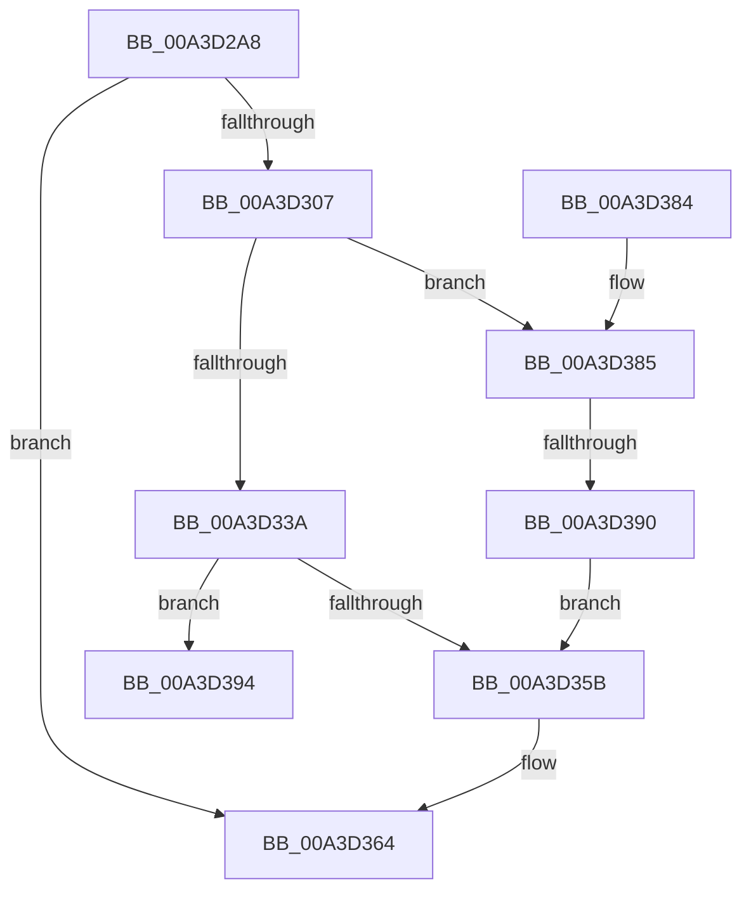

# BiDeleteEfiVariable

- RVA: `0x00A3D2A8`–`0x00A3D3A0` (길이 `248` bytes)
- VA: `0x0000000140A3D2A8`
- 실행 섹션: `PAGE`
- PDB 이름 있음: `예`; PDB Function 태그: `예`
- unwind 정보 RVA: `0x000AE55C`
- 디코드: `63`개 명령, `248/248` bytes 표시
- 미해석 바이트: `0` (있으면 어셈블리에 `.byte`로 보존)

> 이 문서는 커널 이미지의 기계어와 PDB 기호를 분석해 생성했습니다. 4번과 5번은 함수 원형과 자료형을 바이너리 사용 방식에서 추정한 C 해석이며 원본 소스 복구 결과는 아닙니다.

## 1. Dependencies

- 직접 호출 지점: **6**; 고유 호출 대상: **6**
- 직접 호출자로 확인된 함수: **1**
- RIP 상대 이미지 참조: **2**

### Outgoing calls
- `0x00A3D2FC` → [BiAcquirePrivilege](BiAcquirePrivilege_function_00A3D658.md) (function, `0x00A3D658`)
- `0x00A3D312` → [RtlInitUnicodeString](../../text/42/RtlInitUnicodeString_function_0042A780.md) (function, `0x0042A780`)
- `0x00A3D32C` → [ZwQuerySystemEnvironmentValueEx](../../text/6A/ZwQuerySystemEnvironmentValueEx_function_006AFE90.md) (function, `0x006AFE90`)
- `0x00A3D350` → [ZwSetSystemEnvironmentValueEx](../../text/6B/ZwSetSystemEnvironmentValueEx_function_006B0850.md) (function, `0x006B0850`)
- `0x00A3D35F` → [BiReleasePrivilege](BiReleasePrivilege_function_00A3D600.md) (function, `0x00A3D600`)
- `0x00A3D36D` → [_security_check_cookie](../../text/6A/_security_check_cookie_function_006AC640.md) (function, `0x006AC640`)

### Direct callers
- [BiExportEfiBootManager](../AC/BiExportEfiBootManager_function_00ACB13C.md) at `0x00ACB31A`
- [BiExportEfiBootManager](../AC/BiExportEfiBootManager_function_00ACB13C.md) at `0x00ACB37F`

### Static image references
- `0x00A3D2BA` → RVA `0x00E0A740` (`.data`; read)
- `0x00A3D394` → RVA `0x00B0C980` (` ?? ::NNGAKEGL::`string'`; read)

## 2. Other-region calls and transfers

- 다른 실행 섹션으로 향하는 call: **4**
  - `0x00A3D312` → [RtlInitUnicodeString](../../text/42/RtlInitUnicodeString_function_0042A780.md) (`PAGE` → `.text`)
  - `0x00A3D32C` → [ZwQuerySystemEnvironmentValueEx](../../text/6A/ZwQuerySystemEnvironmentValueEx_function_006AFE90.md) (`PAGE` → `.text`)
  - `0x00A3D350` → [ZwSetSystemEnvironmentValueEx](../../text/6B/ZwSetSystemEnvironmentValueEx_function_006B0850.md) (`PAGE` → `.text`)
  - `0x00A3D36D` → [_security_check_cookie](../../text/6A/_security_check_cookie_function_006AC640.md) (`PAGE` → `.text`)
- call이 아닌 외부 분기/꼬리 이동: **2**
  - `0x00A3D38A` → [sub_00B3A4AA](../B3/Unknown_function_00B3A4AA.md) (`tail-transfer`)
  - `0x00A3D39B` → [sub_00B3A4AA + 0x7](../B3/Unknown_function_00B3A4AA.md) (`tail-transfer`)

## 3. Assembly (complete function range)

```asm
00A3D2A8  48 89 5C 24 10                  mov qword ptr [rsp + 0x10], rbx
00A3D2AD  48 89 7C 24 18                  mov qword ptr [rsp + 0x18], rdi
00A3D2B2  55                              push rbp
00A3D2B3  48 8B EC                        mov rbp, rsp
00A3D2B6  48 83 EC 70                     sub rsp, 0x70
00A3D2BA  48 8B 05 7F D4 3C 00            mov rax, qword ptr [rip + 0x3cd47f]
00A3D2C1  48 33 C4                        xor rax, rsp
00A3D2C4  48 89 45 F0                     mov qword ptr [rbp - 0x10], rax
00A3D2C8  48 83 65 C8 00                  and qword ptr [rbp - 0x38], 0
00A3D2CD  48 8D 55 C8                     lea rdx, [rbp - 0x38]
00A3D2D1  48 8B F9                        mov rdi, rcx
00A3D2D4  C7 45 E0 61 DF E4 8B            mov dword ptr [rbp - 0x20], 0x8be4df61
00A3D2DB  0F 57 C0                        xorps xmm0, xmm0
00A3D2DE  C7 45 E4 CA 93 D2 11            mov dword ptr [rbp - 0x1c], 0x11d293ca
00A3D2E5  B9 16 00 00 00                  mov ecx, 0x16
00A3D2EA  C7 45 E8 AA 0D 00 E0            mov dword ptr [rbp - 0x18], 0xe0000daa
00A3D2F1  0F 11 45 D0                     movups xmmword ptr [rbp - 0x30], xmm0
00A3D2F5  C7 45 EC 98 03 2B 8C            mov dword ptr [rbp - 0x14], 0x8c2b0398
00A3D2FC  E8 57 03 00 00                  call 0x140a3d658
00A3D301  8B D8                           mov ebx, eax
00A3D303  85 C0                           test eax, eax
00A3D305  78 5D                           js 0x140a3d364
00A3D307  83 65 C0 00                     and dword ptr [rbp - 0x40], 0
00A3D30B  48 8D 4D D0                     lea rcx, [rbp - 0x30]
00A3D30F  48 8B D7                        mov rdx, rdi
00A3D312  E8 69 D4 9E FF                  call 0x14042a780
00A3D317  48 83 64 24 20 00               and qword ptr [rsp + 0x20], 0
00A3D31D  4C 8D 4D C0                     lea r9, [rbp - 0x40]
00A3D321  45 33 C0                        xor r8d, r8d
00A3D324  48 8D 55 E0                     lea rdx, [rbp - 0x20]
00A3D328  48 8D 4D D0                     lea rcx, [rbp - 0x30]
00A3D32C  E8 5F 2B C7 FF                  call 0x1406afe90
00A3D331  8B D8                           mov ebx, eax
00A3D333  3D 23 00 00 C0                  cmp eax, 0xc0000023
00A3D338  75 4B                           jne 0x140a3d385
00A3D33A  45 33 C9                        xor r9d, r9d
00A3D33D  C7 44 24 20 01 00 00 00         mov dword ptr [rsp + 0x20], 1
00A3D345  45 33 C0                        xor r8d, r8d
00A3D348  48 8D 55 E0                     lea rdx, [rbp - 0x20]
00A3D34C  48 8D 4D D0                     lea rcx, [rbp - 0x30]
00A3D350  E8 FB 34 C7 FF                  call 0x1406b0850
00A3D355  8B D8                           mov ebx, eax
00A3D357  85 C0                           test eax, eax
00A3D359  78 39                           js 0x140a3d394
00A3D35B  48 8D 4D C8                     lea rcx, [rbp - 0x38]
00A3D35F  E8 9C 02 00 00                  call 0x140a3d600
00A3D364  8B C3                           mov eax, ebx
00A3D366  48 8B 4D F0                     mov rcx, qword ptr [rbp - 0x10]
00A3D36A  48 33 CC                        xor rcx, rsp
00A3D36D  E8 CE F2 C6 FF                  call 0x1406ac640
00A3D372  4C 8D 5C 24 70                  lea r11, [rsp + 0x70]
00A3D377  49 8B 5B 18                     mov rbx, qword ptr [r11 + 0x18]
00A3D37B  49 8B 7B 20                     mov rdi, qword ptr [r11 + 0x20]
00A3D37F  49 8B E3                        mov rsp, r11
00A3D382  5D                              pop rbp
00A3D383  C3                              ret
00A3D384  CC                              int3
00A3D385  3D 00 01 00 C0                  cmp eax, 0xc0000100
00A3D38A  0F 85 1A D1 0F 00               jne 0x140b3a4aa
00A3D390  33 DB                           xor ebx, ebx
00A3D392  EB C7                           jmp 0x140a3d35b
00A3D394  48 8D 15 E5 F5 0C 00            lea rdx, [rip + 0xcf5e5]
00A3D39B  E9 11 D1 0F 00                  jmp 0x140b3a4b1
```

## 4. C-style interpretation (structured pseudocode)

```c
__int64 __fastcall BiDeleteEfiVariable(__int64 a1, __int64 a2, int a3)
{
    __int64 result;
    __int64 v_rbx;
    __int64 v_rsp;
    unsigned __int64 v_stack_m18;
    unsigned int v_stack_m1C;
    unsigned int v_stack_m20;
    unsigned int v_stack_m24;
    unsigned int v_stack_m28;
    unsigned __int64 v_stack_m38;
    unsigned __int64 v_stack_m40;
    unsigned int v_stack_m48;
    unsigned __int64 v_stack_m58;
    unsigned __int64 v_stack_m8;
    unsigned __int64 v_stack_p10;
    unsigned __int64 v_stack_p18;

    v_stack_p10 = v_rbx;
    v_stack_p18 = v_rdi;
    v_rsp = (v_rsp) - (112);
    result = (*(unsigned __int64 *)(v_rip + 3986559)) ^ (v_rsp);
    v_stack_m18 = result;
    v_stack_m28 = 0x8BE4DF61ULL;
    v_stack_m24 = 0x11D293CAULL;
    v_stack_m20 = 0xE0000DAAULL;
    v_stack_m38 = v_xmm0;
    v_stack_m1C = 0x8C2B0398ULL;
    result = BiAcquirePrivilege(22, v_stack_m40, a3, a4);
    if (sign_flag) goto loc_00A3D364;
    result = RtlInitUnicodeString(v_stack_m38, a1, a3, a4);
    a3 = 0;
    result = ZwQuerySystemEnvironmentValueEx(v_stack_m38, v_stack_m28, a3, v_stack_m48);
    if (((unsigned int)(result)) != 0xC0000023ULL) goto loc_00A3D385;
    a4 = 0;
    v_stack_m58 = 1;
    a3 = 0;
    result = ZwSetSystemEnvironmentValueEx(v_stack_m38, v_stack_m28, a3, a4);
    if (sign_flag) goto loc_00A3D394;
loc_00A3D35B:
    result = BiReleasePrivilege(v_stack_m40, v_stack_m28, a3, a4);
loc_00A3D364:
    a1 = (v_stack_m18) ^ (v_rsp);
    result = _security_check_cookie(a1, v_stack_m28, a3, a4);
    return result;
loc_00A3D385:
    v_rbx = 0;
    goto loc_00A3D35B;
loc_00A3D394:
}
```

## 5. (Beta) C Style

```c
int64_t BiDeleteEfiVariable(int64_t Arg1, int64_t Arg2, int32_t Arg3)
{
    int64_t result;
    int64_t local_rbx;
    int64_t local_rsp;
    uint64_t v_stack_m18;
    uint32_t v_stack_m1C;
    uint32_t v_stack_m20;
    uint32_t v_stack_m24;
    uint32_t v_stack_m28;
    uint64_t v_stack_m38;
    uint64_t v_stack_m40;
    uint32_t v_stack_m48;
    uint64_t v_stack_m58;
    uint64_t v_stack_m8;
    uint64_t v_stack_p10;
    uint64_t v_stack_p18;

    v_stack_p10 = local_rbx;
    v_stack_p18 = local_rdi;
    local_rsp = (local_rsp) - (112);
    result = (*(uint64_t *)(v_rip + 0x3CD47F)) ^ (local_rsp);
    v_stack_m18 = result;
    v_stack_m28 = 0x8BE4DF61ULL;
    v_stack_m24 = 0x11D293CAULL;
    v_stack_m20 = 0xE0000DAAULL;
    v_stack_m38 = v_xmm0;
    v_stack_m1C = 0x8C2B0398ULL;
    result = BiAcquirePrivilege(22, v_stack_m40, Arg3, a4);
    if (sign_flag) goto loc_00A3D364;
    result = RtlInitUnicodeString(v_stack_m38, Arg1, Arg3, a4);
    Arg3 = 0;
    result = ZwQuerySystemEnvironmentValueEx(v_stack_m38, v_stack_m28, Arg3, v_stack_m48);
    if (((uint32_t)(result)) != 0xC0000023ULL) goto loc_00A3D385;
    a4 = 0;
    v_stack_m58 = 1;
    Arg3 = 0;
    result = ZwSetSystemEnvironmentValueEx(v_stack_m38, v_stack_m28, Arg3, a4);
    if (sign_flag) goto loc_00A3D394;
loc_00A3D35B:
    result = BiReleasePrivilege(v_stack_m40, v_stack_m28, Arg3, a4);
loc_00A3D364:
    Arg1 = (v_stack_m18) ^ (local_rsp);
    result = _security_check_cookie(Arg1, v_stack_m28, Arg3, a4);
    return result;
loc_00A3D385:
    local_rbx = 0;
    goto loc_00A3D35B;
loc_00A3D394:
}
```

## 6. Execution-region graph

[열기: 2D/3D 그래프와 함수 탐색 컨트롤 패널](../../../control-panel.html?section=page&rva=0x00A3D2A8&view=graph)

- 2D 그래프는 위에서 아래로 흐르고, 3D 그래프는 빈 공간을 드래그해 회전합니다. Shift+드래그는 이동, 휠은 확대·축소, 함수 노드 선택은 대상 보고서 이동입니다.

### Static fallback


