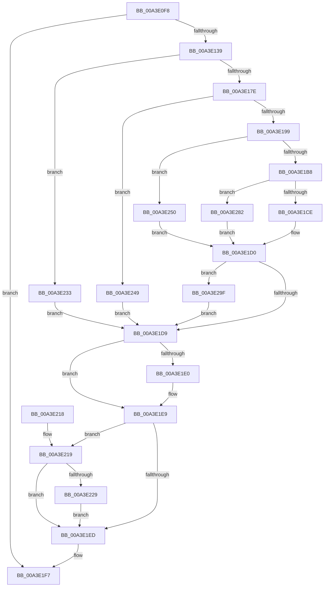

# BiDeleteElement

- RVA: `0x00A3E0F8`–`0x00A3E2AC` (길이 `436` bytes)
- VA: `0x0000000140A3E0F8`
- 실행 섹션: `PAGE`
- PDB 이름 있음: `예`; PDB Function 태그: `아니요`
- unwind 정보 RVA: `0x000AE6DC`
- 디코드: `114`개 명령, `436/436` bytes 표시
- 미해석 바이트: `0` (있으면 어셈블리에 `.byte`로 보존)

> 이 문서는 커널 이미지의 기계어와 PDB 기호를 분석해 생성했습니다. 4번과 5번은 함수 원형과 자료형을 바이너리 사용 방식에서 추정한 C 해석이며 원본 소스 복구 결과는 아닙니다.

## 1. Dependencies

- 직접 호출 지점: **16**; 고유 호출 대상: **11**
- 직접 호출자로 확인된 함수: **7**
- RIP 상대 이미지 참조: **5**

### Outgoing calls
- `0x00A3E122` → [BiIsOfflineHandle](../../text/4B/BiIsOfflineHandle_function_004B4FA0.md) (function, `0x004B4FA0`)
- `0x00A3E12C` → [BiAcquireBcdSyncMutant](../91/BiAcquireBcdSyncMutant_function_00916898.md) (function, `0x00916898`)
- `0x00A3E14C` → [BiLogMessage](BiLogMessage_function_00A3D3A8.md) (function, `0x00A3D3A8`)
- `0x00A3E16F` → [BiOpenKey](BiOpenKey_function_00A3F60C.md) (function, `0x00A3F60C`)
- `0x00A3E18C` → [ultow_s](../../text/50/ultow_s_function_00504F30.md) (function, `0x00504F30`)
- `0x00A3E1AB` → [BiOpenKey](BiOpenKey_function_00A3F60C.md) (function, `0x00A3F60C`)
- `0x00A3E1BF` → [BiDeleteKey](BiDeleteKey_function_00A3FC58.md) (function, `0x00A3FC58`)
- `0x00A3E1E4` → [BiCloseKey](../91/BiCloseKey_function_00916A00.md) (function, `0x00916A00`)
- `0x00A3E1F0` → [BiReleaseBcdSyncMutant](../91/BiReleaseBcdSyncMutant_function_0091695C.md) (function, `0x0091695C`)
- `0x00A3E1FE` → [_security_check_cookie](../../text/6A/_security_check_cookie_function_006AC640.md) (function, `0x006AC640`)
- `0x00A3E220` → [BiIsLinkedToFirmwareVariable](BiIsLinkedToFirmwareVariable_function_00A3E4D0.md) (function, `0x00A3E4D0`)
- `0x00A3E22C` → [BiSetFirmwareModifiedFromObject](../../text/4B/BiSetFirmwareModifiedFromObject_function_004B1CC8.md) (function, `0x004B1CC8`)
- `0x00A3E242` → [BiLogMessage](BiLogMessage_function_00A3D3A8.md) (function, `0x00A3D3A8`)
- `0x00A3E26F` → [BiLogMessage](BiLogMessage_function_00A3D3A8.md) (function, `0x00A3D3A8`)
- `0x00A3E295` → [BiLogMessage](BiLogMessage_function_00A3D3A8.md) (function, `0x00A3D3A8`)
- `0x00A3E2A2` → [BiCloseKey](../91/BiCloseKey_function_00916A00.md) (function, `0x00916A00`)

### Direct callers
- [PopAdaptiveClearInitialSystemPowerState](../76/PopAdaptiveClearInitialSystemPowerState_function_0076B55C.md) at `0x0076B5AC`
- [PopBcdCopyLoaderObjectSettings](../76/PopBcdCopyLoaderObjectSettings_function_0076FFF4.md) at `0x0077008E`
- [SepSecureBootUpdateBcdDataForRule](../7A/SepSecureBootUpdateBcdDataForRule_function_007A2514.md) at `0x007A256B`
- [BiHandleFirmwareDefaultEntry](../82/BiHandleFirmwareDefaultEntry_function_00826D08.md) at `0x00826D6F`
- [BiUpdateBcdObject](../82/BiUpdateBcdObject_function_008270D0.md) at `0x00827270`
- [BiUpdateBcdObject](../82/BiUpdateBcdObject_function_008270D0.md) at `0x008272BA`
- [BiUpdateBcdObject](../82/BiUpdateBcdObject_function_008270D0.md) at `0x0082730C`
- [PopBcdClearPendingResume](PopBcdClearPendingResume_function_00A3E07C.md) at `0x00A3E0AE`
- [PopBcdClearPendingResume](PopBcdClearPendingResume_function_00A3E07C.md) at `0x00A3E0DB`
- [BcdSetElementDataWithFlags](BcdSetElementDataWithFlags_function_00A3F080.md) at `0x00A3F289`

### Static image references
- `0x00A3E10C` → RVA `0x00E0A740` (`.data`; read)
- `0x00A3E13F` → RVA `0x00B0B4F0` (` ?? ::NNGAKEGL::`string'`; read)
- `0x00A3E15F` → RVA `0x00B0B390` (` ?? ::NNGAKEGL::`string'`; read)
- `0x00A3E236` → RVA `0x00B0B520` (` ?? ::NNGAKEGL::`string'`; read)
- `0x00A3E25E` → RVA `0x00B0B5A0` (` ?? ::NNGAKEGL::`string'`; read)

## 2. Other-region calls and transfers

- 다른 실행 섹션으로 향하는 call: **4**
  - `0x00A3E122` → [BiIsOfflineHandle](../../text/4B/BiIsOfflineHandle_function_004B4FA0.md) (`PAGE` → `.text`)
  - `0x00A3E18C` → [ultow_s](../../text/50/ultow_s_function_00504F30.md) (`PAGE` → `.text`)
  - `0x00A3E1FE` → [_security_check_cookie](../../text/6A/_security_check_cookie_function_006AC640.md) (`PAGE` → `.text`)
  - `0x00A3E22C` → [BiSetFirmwareModifiedFromObject](../../text/4B/BiSetFirmwareModifiedFromObject_function_004B1CC8.md) (`PAGE` → `.text`)
- 별도 외부 분기/꼬리 이동을 확인하지 못했습니다.

## 3. Assembly (complete function range)

```asm
00A3E0F8  48 89 5C 24 18                  mov qword ptr [rsp + 0x18], rbx
00A3E0FD  55                              push rbp
00A3E0FE  57                              push rdi
00A3E0FF  41 54                           push r12
00A3E101  41 56                           push r14
00A3E103  41 57                           push r15
00A3E105  48 8B EC                        mov rbp, rsp
00A3E108  48 83 EC 70                     sub rsp, 0x70
00A3E10C  48 8B 05 2D C6 3C 00            mov rax, qword ptr [rip + 0x3cc62d]
00A3E113  48 33 C4                        xor rax, rsp
00A3E116  48 89 45 F8                     mov qword ptr [rbp - 8], rax
00A3E11A  8B FA                           mov edi, edx
00A3E11C  89 55 B8                        mov dword ptr [rbp - 0x48], edx
00A3E11F  4C 8B F1                        mov r14, rcx
00A3E122  E8 79 6E A7 FF                  call 0x1404b4fa0
00A3E127  8A C8                           mov cl, al
00A3E129  44 8A E0                        mov r12b, al
00A3E12C  E8 67 87 ED FF                  call 0x140916898
00A3E131  85 C0                           test eax, eax
00A3E133  0F 88 BE 00 00 00               js 0x140a3e1f7
00A3E139  41 BF 02 00 00 00               mov r15d, 2
00A3E13F  48 8D 15 AA D3 0C 00            lea rdx, [rip + 0xcd3aa]
00A3E146  41 8B CF                        mov ecx, r15d
00A3E149  44 8B C7                        mov r8d, edi
00A3E14C  E8 57 F2 FF FF                  call 0x140a3d3a8
00A3E151  48 83 65 B0 00                  and qword ptr [rbp - 0x50], 0
00A3E156  4C 8D 4D B0                     lea r9, [rbp - 0x50]
00A3E15A  48 83 65 C0 00                  and qword ptr [rbp - 0x40], 0
00A3E15F  48 8D 15 2A D2 0C 00            lea rdx, [rip + 0xcd22a]
00A3E166  41 B8 19 00 02 00               mov r8d, 0x20019
00A3E16C  49 8B CE                        mov rcx, r14
00A3E16F  E8 98 14 00 00                  call 0x140a3f60c
00A3E174  8B D8                           mov ebx, eax
00A3E176  85 C0                           test eax, eax
00A3E178  0F 88 B5 00 00 00               js 0x140a3e233
00A3E17E  45 8D 4F 0E                     lea r9d, [r15 + 0xe]
00A3E182  8B CF                           mov ecx, edi
00A3E184  45 8D 47 14                     lea r8d, [r15 + 0x14]
00A3E188  48 8D 55 C8                     lea rdx, [rbp - 0x38]
00A3E18C  E8 9F 6D AC FF                  call 0x140504f30
00A3E191  85 C0                           test eax, eax
00A3E193  0F 85 B0 00 00 00               jne 0x140a3e249
00A3E199  48 8B 4D B0                     mov rcx, qword ptr [rbp - 0x50]
00A3E19D  4C 8D 4D C0                     lea r9, [rbp - 0x40]
00A3E1A1  41 B8 00 00 01 00               mov r8d, 0x10000
00A3E1A7  48 8D 55 C8                     lea rdx, [rbp - 0x38]
00A3E1AB  E8 5C 14 00 00                  call 0x140a3f60c
00A3E1B0  85 C0                           test eax, eax
00A3E1B2  0F 88 98 00 00 00               js 0x140a3e250
00A3E1B8  48 8B 7D C0                     mov rdi, qword ptr [rbp - 0x40]
00A3E1BC  48 8B CF                        mov rcx, rdi
00A3E1BF  E8 94 1A 00 00                  call 0x140a3fc58
00A3E1C4  8B D8                           mov ebx, eax
00A3E1C6  85 C0                           test eax, eax
00A3E1C8  0F 88 B4 00 00 00               js 0x140a3e282
00A3E1CE  33 FF                           xor edi, edi
00A3E1D0  48 85 FF                        test rdi, rdi
00A3E1D3  0F 85 C6 00 00 00               jne 0x140a3e29f
00A3E1D9  48 83 7D B0 00                  cmp qword ptr [rbp - 0x50], 0
00A3E1DE  74 09                           je 0x140a3e1e9
00A3E1E0  48 8B 4D B0                     mov rcx, qword ptr [rbp - 0x50]
00A3E1E4  E8 17 88 ED FF                  call 0x140916a00
00A3E1E9  85 DB                           test ebx, ebx
00A3E1EB  79 2C                           jns 0x140a3e219
00A3E1ED  41 8A CC                        mov cl, r12b
00A3E1F0  E8 67 87 ED FF                  call 0x14091695c
00A3E1F5  8B C3                           mov eax, ebx
00A3E1F7  48 8B 4D F8                     mov rcx, qword ptr [rbp - 8]
00A3E1FB  48 33 CC                        xor rcx, rsp
00A3E1FE  E8 3D E4 C6 FF                  call 0x1406ac640
00A3E203  48 8B 9C 24 B0 00 00 00         mov rbx, qword ptr [rsp + 0xb0]
00A3E20B  48 83 C4 70                     add rsp, 0x70
00A3E20F  41 5F                           pop r15
00A3E211  41 5E                           pop r14
00A3E213  41 5C                           pop r12
00A3E215  5F                              pop rdi
00A3E216  5D                              pop rbp
00A3E217  C3                              ret
00A3E218  CC                              int3
00A3E219  48 8D 55 B8                     lea rdx, [rbp - 0x48]
00A3E21D  49 8B CE                        mov rcx, r14
00A3E220  E8 AB 02 00 00                  call 0x140a3e4d0
00A3E225  84 C0                           test al, al
00A3E227  74 C4                           je 0x140a3e1ed
00A3E229  49 8B CE                        mov rcx, r14
00A3E22C  E8 97 3A A7 FF                  call 0x1404b1cc8
00A3E231  EB BA                           jmp 0x140a3e1ed
00A3E233  44 8B C0                        mov r8d, eax
00A3E236  48 8D 15 E3 D2 0C 00            lea rdx, [rip + 0xcd2e3]
00A3E23D  B9 04 00 00 00                  mov ecx, 4
00A3E242  E8 61 F1 FF FF                  call 0x140a3d3a8
00A3E247  EB 90                           jmp 0x140a3e1d9
00A3E249  BB 01 00 00 C0                  mov ebx, 0xc0000001
00A3E24E  EB 89                           jmp 0x140a3e1d9
00A3E250  3D 34 00 00 C0                  cmp eax, 0xc0000034
00A3E255  4C 8D 45 C8                     lea r8, [rbp - 0x38]
00A3E259  B9 04 00 00 00                  mov ecx, 4
00A3E25E  48 8D 15 3B D3 0C 00            lea rdx, [rip + 0xcd33b]
00A3E265  44 0F 45 F9                     cmovne r15d, ecx
00A3E269  44 8B C8                        mov r9d, eax
00A3E26C  41 8B CF                        mov ecx, r15d
00A3E26F  E8 34 F1 FF FF                  call 0x140a3d3a8
00A3E274  48 8B 7D C0                     mov rdi, qword ptr [rbp - 0x40]
00A3E278  BB 25 02 00 C0                  mov ebx, 0xc0000225
00A3E27D  E9 4E FF FF FF                  jmp 0x140a3e1d0
00A3E282  44 8B C8                        mov r9d, eax
00A3E285  4C 8D 45 C8                     lea r8, [rbp - 0x38]
00A3E289  48 8D 15 10 D3 0C 00            lea rdx, [rip + 0xcd310]
00A3E290  B9 04 00 00 00                  mov ecx, 4
00A3E295  E8 0E F1 FF FF                  call 0x140a3d3a8
00A3E29A  E9 31 FF FF FF                  jmp 0x140a3e1d0
00A3E29F  48 8B CF                        mov rcx, rdi
00A3E2A2  E8 59 87 ED FF                  call 0x140916a00
00A3E2A7  E9 2D FF FF FF                  jmp 0x140a3e1d9
```

## 4. C-style interpretation (structured pseudocode)

```c
__int64 __fastcall BiDeleteElement(__int64 a1, int a2)
{
    __int64 result;
    __int64 v_r15;
    __int64 v_rdi;
    __int64 v_rsp;
    unsigned __int64 v_stack_m30;
    unsigned __int64 v_stack_m60;
    unsigned __int64 v_stack_m68;
    unsigned int v_stack_m70;
    unsigned __int64 v_stack_m78;
    unsigned __int64 v_stack_p18;

    v_stack_p18 = v_rbx;
    v_rsp = (v_rsp) - (112);
    result = (*(unsigned __int64 *)(v_rip + 3982893)) ^ (v_rsp);
    v_stack_m30 = result;
    v_stack_m70 = a2;
    result = BiIsOfflineHandle(a1, a2, a3, a4);
    result = BiAcquireBcdSyncMutant((unsigned __int8)(result), a2, a3, a4);
    if (sign_flag) goto loc_00A3E1F7;
    result = BiLogMessage(2, v_rip + 840618, (unsigned int)((unsigned int)((unsigned int)(a2))), a4);
    result = BiOpenKey(a1, v_rip + 840234, (unsigned int)(0x20019ULL), v_stack_m78);
    if (sign_flag) goto loc_00A3E233;
    result = ultow_s((unsigned int)((unsigned int)((unsigned int)(a2))), v_stack_m60, 2 + 20, 2 + 14);
    if ((unsigned int)(result) != 0) goto loc_00A3E249;
    result = BiOpenKey(v_stack_m78, v_stack_m60, (unsigned int)(0x10000ULL), v_stack_m68);
    if (sign_flag) goto loc_00A3E250;
    result = BiDeleteKey(v_stack_m68, v_stack_m60, (unsigned int)(0x10000ULL), v_stack_m68);
    if (sign_flag) goto loc_00A3E282;
    v_rdi = 0;
loc_00A3E1D0:
    if (0 != 0) goto loc_00A3E29F;
loc_00A3E1D9:
    if (v_stack_m78 != 0) {
        a1 = v_stack_m78;
        result = BiCloseKey(a1, v_stack_m60, (unsigned int)(0x10000ULL), v_stack_m68);
    }
    if (!sign_flag) goto loc_00A3E219;
loc_00A3E1ED:
    result = BiReleaseBcdSyncMutant((unsigned __int8)((unsigned __int8)(result)), v_stack_m60, (unsigned int)(0x10000ULL), v_stack_m68);
loc_00A3E1F7:
    a1 = (v_stack_m30) ^ (v_rsp);
    result = _security_check_cookie(a1, v_stack_m60, (unsigned int)(0x10000ULL), v_stack_m68);
    v_rsp = (v_rsp) + (112);
    return result;
loc_00A3E219:
    result = BiIsLinkedToFirmwareVariable(a1, v_stack_m70, (unsigned int)(0x10000ULL), v_stack_m68);
    if ((unsigned __int8)(result) == 0) goto loc_00A3E1ED;
    result = BiSetFirmwareModifiedFromObject(a1, v_stack_m70, (unsigned int)(0x10000ULL), v_stack_m68);
    goto loc_00A3E1ED;
loc_00A3E233:
    result = BiLogMessage(4, v_rip + 840419, (unsigned int)((unsigned int)(result)), v_stack_m68);
    goto loc_00A3E1D9;
loc_00A3E249:
    goto loc_00A3E1D9;
loc_00A3E250:
    v_r15 = 2;
    if (((unsigned int)(result)) != 0xC0000034ULL) { v_r15 = 4; }
    result = BiLogMessage((unsigned int)((unsigned int)(v_r15)), v_rip + 840507, v_stack_m60, (unsigned int)((unsigned int)(result)));
    goto loc_00A3E1D0;
loc_00A3E282:
    result = BiLogMessage(4, v_rip + 840464, v_stack_m60, (unsigned int)((unsigned int)(result)));
    goto loc_00A3E1D0;
loc_00A3E29F:
    result = BiCloseKey(v_stack_m68, v_rip + 840464, v_stack_m60, (unsigned int)((unsigned int)(result)));
    goto loc_00A3E1D9;
}
```

## 5. (Beta) C Style

```c
int64_t BiDeleteElement(int64_t Arg1, int32_t Arg2)
{
    int64_t result;
    int64_t local_r15;
    int64_t local_rdi;
    int64_t local_rsp;
    uint64_t v_stack_m30;
    uint64_t v_stack_m60;
    uint64_t v_stack_m68;
    uint32_t v_stack_m70;
    uint64_t v_stack_m78;
    uint64_t v_stack_p18;

    v_stack_p18 = local_rbx;
    local_rsp = (local_rsp) - (112);
    result = (*(uint64_t *)(v_rip + 0x3CC62D)) ^ (local_rsp);
    v_stack_m30 = result;
    v_stack_m70 = Arg2;
    result = BiIsOfflineHandle(Arg1, Arg2, a3, a4);
    result = BiAcquireBcdSyncMutant((uint8_t)(result), Arg2, a3, a4);
    if (sign_flag) goto loc_00A3E1F7;
    result = BiLogMessage(2, v_rip + 840618, (uint32_t)((uint32_t)((uint32_t)(Arg2))), a4);
    result = BiOpenKey(Arg1, v_rip + 840234, (uint32_t)(0x20019ULL), v_stack_m78);
    if (sign_flag) goto loc_00A3E233;
    result = ultow_s((uint32_t)((uint32_t)((uint32_t)(Arg2))), v_stack_m60, 2 + 20, 2 + 14);
    if ((uint32_t)(result) != 0) goto loc_00A3E249;
    result = BiOpenKey(v_stack_m78, v_stack_m60, (uint32_t)(0x10000ULL), v_stack_m68);
    if (sign_flag) goto loc_00A3E250;
    result = BiDeleteKey(v_stack_m68, v_stack_m60, (uint32_t)(0x10000ULL), v_stack_m68);
    if (sign_flag) goto loc_00A3E282;
    local_rdi = 0;
loc_00A3E1D0:
    if (0 != 0) goto loc_00A3E29F;
loc_00A3E1D9:
    if (v_stack_m78 != 0) {
        Arg1 = v_stack_m78;
        result = BiCloseKey(Arg1, v_stack_m60, (uint32_t)(0x10000ULL), v_stack_m68);
    }
    if (!sign_flag) goto loc_00A3E219;
loc_00A3E1ED:
    result = BiReleaseBcdSyncMutant((uint8_t)((uint8_t)(result)), v_stack_m60, (uint32_t)(0x10000ULL), v_stack_m68);
loc_00A3E1F7:
    Arg1 = (v_stack_m30) ^ (local_rsp);
    result = _security_check_cookie(Arg1, v_stack_m60, (uint32_t)(0x10000ULL), v_stack_m68);
    local_rsp = (local_rsp) + (112);
    return result;
loc_00A3E219:
    result = BiIsLinkedToFirmwareVariable(Arg1, v_stack_m70, (uint32_t)(0x10000ULL), v_stack_m68);
    if ((uint8_t)(result) == 0) goto loc_00A3E1ED;
    result = BiSetFirmwareModifiedFromObject(Arg1, v_stack_m70, (uint32_t)(0x10000ULL), v_stack_m68);
    goto loc_00A3E1ED;
loc_00A3E233:
    result = BiLogMessage(4, v_rip + 840419, (uint32_t)((uint32_t)(result)), v_stack_m68);
    goto loc_00A3E1D9;
loc_00A3E249:
    goto loc_00A3E1D9;
loc_00A3E250:
    local_r15 = 2;
    if (((uint32_t)(result)) != 0xC0000034ULL) { local_r15 = 4; }
    result = BiLogMessage((uint32_t)((uint32_t)(local_r15)), v_rip + 840507, v_stack_m60, (uint32_t)((uint32_t)(result)));
    goto loc_00A3E1D0;
loc_00A3E282:
    result = BiLogMessage(4, v_rip + 840464, v_stack_m60, (uint32_t)((uint32_t)(result)));
    goto loc_00A3E1D0;
loc_00A3E29F:
    result = BiCloseKey(v_stack_m68, v_rip + 840464, v_stack_m60, (uint32_t)((uint32_t)(result)));
    goto loc_00A3E1D9;
}
```

## 6. Execution-region graph

[열기: 2D/3D 그래프와 함수 탐색 컨트롤 패널](../../../control-panel.html?section=page&rva=0x00A3E0F8&view=graph)

- 2D 그래프는 위에서 아래로 흐르고, 3D 그래프는 빈 공간을 드래그해 회전합니다. Shift+드래그는 이동, 휠은 확대·축소, 함수 노드 선택은 대상 보고서 이동입니다.

### Static fallback


