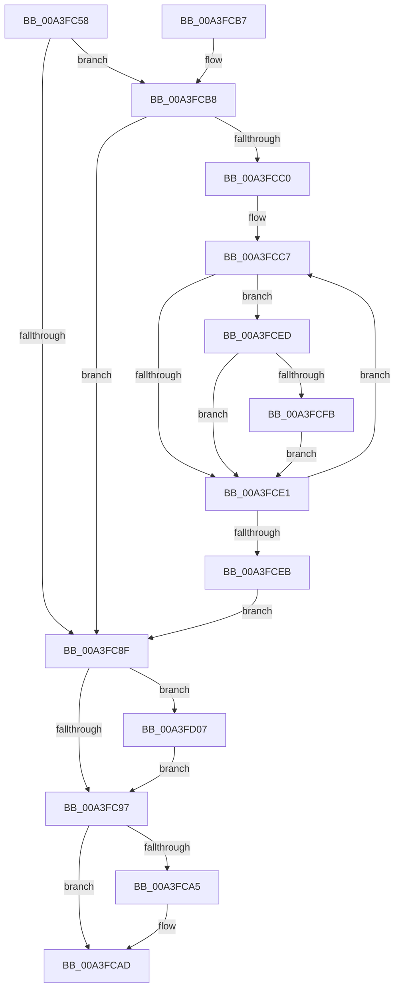

# BiDeleteKey

- RVA: `0x00A3FC58`–`0x00A3FD1B` (길이 `195` bytes)
- VA: `0x0000000140A3FC58`
- 실행 섹션: `PAGE`
- PDB 이름 있음: `예`; PDB Function 태그: `아니요`
- unwind 정보 RVA: `0x000AE8E8`
- 디코드: `58`개 명령, `195/195` bytes 표시
- 미해석 바이트: `0` (있으면 어셈블리에 `.byte`로 보존)

> 이 문서는 커널 이미지의 기계어와 PDB 기호를 분석해 생성했습니다. 4번과 5번은 함수 원형과 자료형을 바이너리 사용 방식에서 추정한 C 해석이며 원본 소스 복구 결과는 아닙니다.

## 1. Dependencies

- 직접 호출 지점: **8**; 고유 호출 대상: **8**
- 직접 호출자로 확인된 함수: **4**
- RIP 상대 이미지 참조: **0**

### Outgoing calls
- `0x00A3FC6B` → [BiSanitizeHandle](../../text/4B/BiSanitizeHandle_function_004B0E4C.md) (function, `0x004B0E4C`)
- `0x00A3FC86` → [BiEnumerateSubKeys](BiEnumerateSubKeys_function_00A3FD24.md) (function, `0x00A3FD24`)
- `0x00A3FC9A` → [BiZwDeleteKey](../../text/4C/BiZwDeleteKey_function_004CBF24.md) (function, `0x004CBF24`)
- `0x00A3FCA8` → [BiZwClose](../../text/4A/BiZwClose_function_004A85DC.md) (function, `0x004A85DC`)
- `0x00A3FCD8` → [BiOpenKey](BiOpenKey_function_00A3F60C.md) (function, `0x00A3F60C`)
- `0x00A3FCF2` → [BiDeleteKey](BiDeleteKey_function_00A3FC58.md) (function, `0x00A3FC58`)
- `0x00A3FD00` → [BiCloseKey](../91/BiCloseKey_function_00916A00.md) (function, `0x00916A00`)
- `0x00A3FD11` → [ExFreePoolWithTag](../../poolcode/B8/ExFreePoolWithTag_function_00B82870.md) (function, `0x00B82870`)

### Direct callers
- [BcdDeleteObject](BcdDeleteObject_function_00A3C578.md) at `0x00A3C5B5`
- [BiDeleteElement](BiDeleteElement_function_00A3E0F8.md) at `0x00A3E1BF`
- [BcdSetElementDataWithFlags](BcdSetElementDataWithFlags_function_00A3F080.md) at `0x00A3F2B3`
- [BiDeleteKey](BiDeleteKey_function_00A3FC58.md) at `0x00A3FCF2`

### Static image references
- 디코드된 RIP-relative 메모리 참조가 없습니다.

## 2. Other-region calls and transfers

- 다른 실행 섹션으로 향하는 call: **4**
  - `0x00A3FC6B` → [BiSanitizeHandle](../../text/4B/BiSanitizeHandle_function_004B0E4C.md) (`PAGE` → `.text`)
  - `0x00A3FC9A` → [BiZwDeleteKey](../../text/4C/BiZwDeleteKey_function_004CBF24.md) (`PAGE` → `.text`)
  - `0x00A3FCA8` → [BiZwClose](../../text/4A/BiZwClose_function_004A85DC.md) (`PAGE` → `.text`)
  - `0x00A3FD11` → [ExFreePoolWithTag](../../poolcode/B8/ExFreePoolWithTag_function_00B82870.md) (`PAGE` → `POOLCODE`)
- 별도 외부 분기/꼬리 이동을 확인하지 못했습니다.

## 3. Assembly (complete function range)

```asm
00A3FC58  40 53                           push rbx
00A3FC5A  55                              push rbp
00A3FC5B  56                              push rsi
00A3FC5C  48 83 EC 20                     sub rsp, 0x20
00A3FC60  83 64 24 48 00                  and dword ptr [rsp + 0x48], 0
00A3FC65  48 83 64 24 58 00               and qword ptr [rsp + 0x58], 0
00A3FC6B  E8 DC 11 A7 FF                  call 0x1404b0e4c
00A3FC70  48 83 64 24 50 00               and qword ptr [rsp + 0x50], 0
00A3FC76  4C 8D 44 24 48                  lea r8, [rsp + 0x48]
00A3FC7B  48 8B C8                        mov rcx, rax
00A3FC7E  48 8D 54 24 50                  lea rdx, [rsp + 0x50]
00A3FC83  48 8B F0                        mov rsi, rax
00A3FC86  E8 99 00 00 00                  call 0x140a3fd24
00A3FC8B  85 C0                           test eax, eax
00A3FC8D  79 29                           jns 0x140a3fcb8
00A3FC8F  48 83 7C 24 50 00               cmp qword ptr [rsp + 0x50], 0
00A3FC95  75 70                           jne 0x140a3fd07
00A3FC97  48 8B CE                        mov rcx, rsi
00A3FC9A  E8 85 C2 A8 FF                  call 0x1404cbf24
00A3FC9F  8B D8                           mov ebx, eax
00A3FCA1  85 C0                           test eax, eax
00A3FCA3  78 08                           js 0x140a3fcad
00A3FCA5  48 8B CE                        mov rcx, rsi
00A3FCA8  E8 2F 89 A6 FF                  call 0x1404a85dc
00A3FCAD  8B C3                           mov eax, ebx
00A3FCAF  48 83 C4 20                     add rsp, 0x20
00A3FCB3  5E                              pop rsi
00A3FCB4  5D                              pop rbp
00A3FCB5  5B                              pop rbx
00A3FCB6  C3                              ret
00A3FCB7  CC                              int3
00A3FCB8  8B 4C 24 48                     mov ecx, dword ptr [rsp + 0x48]
00A3FCBC  85 C9                           test ecx, ecx
00A3FCBE  74 CF                           je 0x140a3fc8f
00A3FCC0  48 8B 5C 24 50                  mov rbx, qword ptr [rsp + 0x50]
00A3FCC5  8B E9                           mov ebp, ecx
00A3FCC7  48 8B 13                        mov rdx, qword ptr [rbx]
00A3FCCA  4C 8D 4C 24 58                  lea r9, [rsp + 0x58]
00A3FCCF  41 B8 3F 00 0F 00               mov r8d, 0xf003f
00A3FCD5  48 8B CE                        mov rcx, rsi
00A3FCD8  E8 2F F9 FF FF                  call 0x140a3f60c
00A3FCDD  85 C0                           test eax, eax
00A3FCDF  79 0C                           jns 0x140a3fced
00A3FCE1  48 83 C3 08                     add rbx, 8
00A3FCE5  48 83 ED 01                     sub rbp, 1
00A3FCE9  75 DC                           jne 0x140a3fcc7
00A3FCEB  EB A2                           jmp 0x140a3fc8f
00A3FCED  48 8B 4C 24 58                  mov rcx, qword ptr [rsp + 0x58]
00A3FCF2  E8 61 FF FF FF                  call 0x140a3fc58
00A3FCF7  85 C0                           test eax, eax
00A3FCF9  79 E6                           jns 0x140a3fce1
00A3FCFB  48 8B 4C 24 58                  mov rcx, qword ptr [rsp + 0x58]
00A3FD00  E8 FB 6C ED FF                  call 0x140916a00
00A3FD05  EB DA                           jmp 0x140a3fce1
00A3FD07  48 8B 4C 24 50                  mov rcx, qword ptr [rsp + 0x50]
00A3FD0C  BA 42 43 44 4B                  mov edx, 0x4b444342
00A3FD11  E8 5A 2B 14 00                  call 0x140b82870
00A3FD16  E9 7C FF FF FF                  jmp 0x140a3fc97
```

## 4. C-style interpretation (structured pseudocode)

```c
__int64 __fastcall BiDeleteKey(void)
{
    __int64 result;
    __int64 v_rbp;
    __int64 v_rbx;
    __int64 v_rsp;
    unsigned int v_stack_p10;
    unsigned __int64 v_stack_p18;
    unsigned __int64 v_stack_p20;
    unsigned int v_stack_p48;
    unsigned __int64 v_stack_p50;
    unsigned __int64 v_stack_p58;

    v_rsp = (v_rsp) - (32);
    result = BiSanitizeHandle(a1, a2, a3, a4);
    result = BiEnumerateSubKeys(result, v_stack_p18, v_stack_p10, a4);
    if (!sign_flag) goto loc_00A3FCB8;
loc_00A3FC8F:
    if (v_stack_p18 != 0) goto loc_00A3FD07;
loc_00A3FC97:
    result = BiZwDeleteKey(result, v_stack_p18, v_stack_p10, a4);
    if (!(sign_flag)) {
        a1 = result;
        result = BiZwClose(a1, v_stack_p18, v_stack_p10, a4);
    }
    v_rsp = (v_rsp) + (32);
    return (unsigned int)((unsigned int)((unsigned int)((unsigned int)(result))));
loc_00A3FCB8:
    if ((unsigned int)((unsigned int)(v_stack_p48)) == 0) goto loc_00A3FC8F;
loc_00A3FCC7:
    result = BiOpenKey(result, *(unsigned __int64 *)(v_stack_p50), (unsigned int)(0xF003FULL), v_stack_p58);
    if (!sign_flag) goto loc_00A3FCED;
loc_00A3FCE1:
    v_rbx = (v_stack_p50) + (8);
    v_rbp = ((unsigned int)((unsigned int)((unsigned int)(v_stack_p48)))) - (1);
    if (condition_is_not_equal) goto loc_00A3FCC7;
    goto loc_00A3FC8F;
loc_00A3FCED:
    result = BiDeleteKey(v_stack_p58, *(unsigned __int64 *)(v_stack_p50), (unsigned int)(0xF003FULL), v_stack_p58);
    if (!sign_flag) goto loc_00A3FCE1;
    result = BiCloseKey(v_stack_p58, *(unsigned __int64 *)(v_stack_p50), (unsigned int)(0xF003FULL), v_stack_p58);
    goto loc_00A3FCE1;
loc_00A3FD07:
    result = ExFreePoolWithTag(v_stack_p50, (unsigned int)(0x4B444342ULL), (unsigned int)(0xF003FULL), v_stack_p58);
    goto loc_00A3FC97;
}
```

## 5. (Beta) C Style

```c
void BiDeleteKey(void)
{
    int64_t result;
    int64_t local_rbp;
    int64_t local_rbx;
    int64_t local_rsp;
    uint32_t v_stack_p10;
    uint64_t v_stack_p18;
    uint64_t v_stack_p20;
    uint32_t v_stack_p48;
    uint64_t v_stack_p50;
    uint64_t v_stack_p58;

    local_rsp = (local_rsp) - (32);
    result = BiSanitizeHandle(a1, a2, a3, a4);
    result = BiEnumerateSubKeys(result, v_stack_p18, v_stack_p10, a4);
    if (!sign_flag) goto loc_00A3FCB8;
loc_00A3FC8F:
    if (v_stack_p18 != 0) goto loc_00A3FD07;
loc_00A3FC97:
    result = BiZwDeleteKey(result, v_stack_p18, v_stack_p10, a4);
    if (!(sign_flag)) {
        a1 = result;
        result = BiZwClose(a1, v_stack_p18, v_stack_p10, a4);
    }
    local_rsp = (local_rsp) + (32);
    return (uint32_t)((uint32_t)((uint32_t)((uint32_t)(result))));
loc_00A3FCB8:
    if ((uint32_t)((uint32_t)(v_stack_p48)) == 0) goto loc_00A3FC8F;
loc_00A3FCC7:
    result = BiOpenKey(result, *(uint64_t *)(v_stack_p50), (uint32_t)(0xF003FULL), v_stack_p58);
    if (!sign_flag) goto loc_00A3FCED;
loc_00A3FCE1:
    local_rbx = (v_stack_p50) + (8);
    local_rbp = ((uint32_t)((uint32_t)((uint32_t)(v_stack_p48)))) - (1);
    if (condition_is_not_equal) goto loc_00A3FCC7;
    goto loc_00A3FC8F;
loc_00A3FCED:
    result = BiDeleteKey(v_stack_p58, *(uint64_t *)(v_stack_p50), (uint32_t)(0xF003FULL), v_stack_p58);
    if (!sign_flag) goto loc_00A3FCE1;
    result = BiCloseKey(v_stack_p58, *(uint64_t *)(v_stack_p50), (uint32_t)(0xF003FULL), v_stack_p58);
    goto loc_00A3FCE1;
loc_00A3FD07:
    result = ExFreePoolWithTag(v_stack_p50, (uint32_t)(0x4B444342ULL), (uint32_t)(0xF003FULL), v_stack_p58);
    goto loc_00A3FC97;
}
```

## 6. Execution-region graph

[열기: 2D/3D 그래프와 함수 탐색 컨트롤 패널](../../../control-panel.html?section=page&rva=0x00A3FC58&view=graph)

- 2D 그래프는 위에서 아래로 흐르고, 3D 그래프는 빈 공간을 드래그해 회전합니다. Shift+드래그는 이동, 휠은 확대·축소, 함수 노드 선택은 대상 보고서 이동입니다.

### Static fallback


