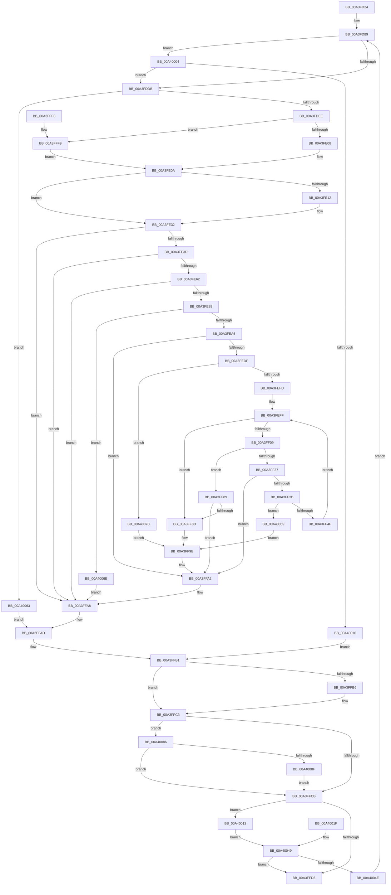

# BiEnumerateSubKeys

- RVA: `0x00A3FD24`–`0x00A400A1` (길이 `893` bytes)
- VA: `0x0000000140A3FD24`
- 실행 섹션: `PAGE`
- PDB 이름 있음: `예`; PDB Function 태그: `아니요`
- unwind 정보 RVA: `0x000AE8F8`
- 디코드: `235`개 명령, `893/893` bytes 표시
- 미해석 바이트: `0` (있으면 어셈블리에 `.byte`로 보존)

> 이 문서는 커널 이미지의 기계어와 PDB 기호를 분석해 생성했습니다. 4번과 5번은 함수 원형과 자료형을 바이너리 사용 방식에서 추정한 C 해석이며 원본 소스 복구 결과는 아닙니다.

## 1. Dependencies

- 직접 호출 지점: **9**; 고유 호출 대상: **7**
- 직접 호출자로 확인된 함수: **4**
- RIP 상대 이미지 참조: **1**

### Outgoing calls
- `0x00A3FD98` → [BiSanitizeHandle](../../text/4B/BiSanitizeHandle_function_004B0E4C.md) (function, `0x004B0E4C`)
- `0x00A3FDC1` → [BiZwQueryKey](../../text/4B/BiZwQueryKey_function_004B2384.md) (function, `0x004B2384`)
- `0x00A3FE95` → [ExAllocatePool2](../../poolcode/B8/ExAllocatePool2_function_00B820F0.md) (function, `0x00B820F0`)
- `0x00A3FEEC` → [ExAllocatePool2](../../poolcode/B8/ExAllocatePool2_function_00B820F0.md) (function, `0x00B820F0`)
- `0x00A3FF25` → [BiZwEnumerateKey](../../text/4B/BiZwEnumerateKey_function_004B6998.md) (function, `0x004B6998`)
- `0x00A3FF61` → [memcpy](../../text/6C/memcpy_function_006C6840.md) (function, `0x006C6840`)
- `0x00A3FFBE` → [ExFreePoolWithTag](../../poolcode/B8/ExFreePoolWithTag_function_00B82870.md) (function, `0x00B82870`)
- `0x00A3FFE0` → [_security_check_cookie](../../text/6A/_security_check_cookie_function_006AC640.md) (function, `0x006AC640`)
- `0x00A40097` → [ExFreePoolWithTag](../../poolcode/B8/ExFreePoolWithTag_function_00B82870.md) (function, `0x00B82870`)

### Direct callers
- [BcdEnumerateObjects](../82/BcdEnumerateObjects_function_00823594.md) at `0x00823645`
- [BiBuildIdentifierList](BiBuildIdentifierList_function_00A3E584.md) at `0x00A3E64D`
- [BiDeleteKey](BiDeleteKey_function_00A3FC58.md) at `0x00A3FC86`
- [BiOpenSystemStore](../A4/BiOpenSystemStore_function_00A40844.md) at `0x00A4090D`
- [BiOpenSystemStore](../A4/BiOpenSystemStore_function_00A40844.md) at `0x00A40A66`
- [BiOpenSystemStore](../A4/BiOpenSystemStore_function_00A40844.md) at `0x00A40AA5`

### Static image references
- `0x00A3FD39` → RVA `0x00E0A740` (`.data`; read)

## 2. Other-region calls and transfers

- 다른 실행 섹션으로 향하는 call: **9**
  - `0x00A3FD98` → [BiSanitizeHandle](../../text/4B/BiSanitizeHandle_function_004B0E4C.md) (`PAGE` → `.text`)
  - `0x00A3FDC1` → [BiZwQueryKey](../../text/4B/BiZwQueryKey_function_004B2384.md) (`PAGE` → `.text`)
  - `0x00A3FE95` → [ExAllocatePool2](../../poolcode/B8/ExAllocatePool2_function_00B820F0.md) (`PAGE` → `POOLCODE`)
  - `0x00A3FEEC` → [ExAllocatePool2](../../poolcode/B8/ExAllocatePool2_function_00B820F0.md) (`PAGE` → `POOLCODE`)
  - `0x00A3FF25` → [BiZwEnumerateKey](../../text/4B/BiZwEnumerateKey_function_004B6998.md) (`PAGE` → `.text`)
  - `0x00A3FF61` → [memcpy](../../text/6C/memcpy_function_006C6840.md) (`PAGE` → `.text`)
  - `0x00A3FFBE` → [ExFreePoolWithTag](../../poolcode/B8/ExFreePoolWithTag_function_00B82870.md) (`PAGE` → `POOLCODE`)
  - `0x00A3FFE0` → [_security_check_cookie](../../text/6A/_security_check_cookie_function_006AC640.md) (`PAGE` → `.text`)
  - `0x00A40097` → [ExFreePoolWithTag](../../poolcode/B8/ExFreePoolWithTag_function_00B82870.md) (`PAGE` → `POOLCODE`)
- 별도 외부 분기/꼬리 이동을 확인하지 못했습니다.

## 3. Assembly (complete function range)

```asm
00A3FD24  4C 8B DC                        mov r11, rsp
00A3FD27  53                              push rbx
00A3FD28  56                              push rsi
00A3FD29  57                              push rdi
00A3FD2A  41 54                           push r12
00A3FD2C  41 55                           push r13
00A3FD2E  41 56                           push r14
00A3FD30  41 57                           push r15
00A3FD32  48 81 EC B0 00 00 00            sub rsp, 0xb0
00A3FD39  48 8B 05 00 AA 3C 00            mov rax, qword ptr [rip + 0x3caa00]
00A3FD40  48 33 C4                        xor rax, rsp
00A3FD43  48 89 84 24 A0 00 00 00         mov qword ptr [rsp + 0xa0], rax
00A3FD4B  4C 89 44 24 58                  mov qword ptr [rsp + 0x58], r8
00A3FD50  48 8B C2                        mov rax, rdx
00A3FD53  48 89 54 24 50                  mov qword ptr [rsp + 0x50], rdx
00A3FD58  4C 8B F1                        mov r14, rcx
00A3FD5B  48 89 54 24 60                  mov qword ptr [rsp + 0x60], rdx
00A3FD60  4C 89 44 24 68                  mov qword ptr [rsp + 0x68], r8
00A3FD65  0F 57 C0                        xorps xmm0, xmm0
00A3FD68  0F 11 44 24 70                  movups xmmword ptr [rsp + 0x70], xmm0
00A3FD6D  41 0F 11 43 98                  movups xmmword ptr [r11 - 0x68], xmm0
00A3FD72  41 0F 11 43 A8                  movups xmmword ptr [r11 - 0x58], xmm0
00A3FD77  33 FF                           xor edi, edi
00A3FD79  89 7C 24 40                     mov dword ptr [rsp + 0x40], edi
00A3FD7D  8B F7                           mov esi, edi
00A3FD7F  89 7C 24 34                     mov dword ptr [rsp + 0x34], edi
00A3FD83  41 BC FF FF FF FF               mov r12d, 0xffffffff
00A3FD89  48 89 38                        mov qword ptr [rax], rdi
00A3FD8C  41 89 38                        mov dword ptr [r8], edi
00A3FD8F  4C 8B FF                        mov r15, rdi
00A3FD92  4C 8B EF                        mov r13, rdi
00A3FD95  49 8B CE                        mov rcx, r14
00A3FD98  E8 AF 10 A7 FF                  call 0x1404b0e4c
00A3FD9D  4C 8B F0                        mov r14, rax
00A3FDA0  48 89 44 24 38                  mov qword ptr [rsp + 0x38], rax
00A3FDA5  48 8D 44 24 40                  lea rax, [rsp + 0x40]
00A3FDAA  48 89 44 24 20                  mov qword ptr [rsp + 0x20], rax
00A3FDAF  41 B9 30 00 00 00               mov r9d, 0x30
00A3FDB5  4C 8D 44 24 70                  lea r8, [rsp + 0x70]
00A3FDBA  41 8D 51 D2                     lea edx, [r9 - 0x2e]
00A3FDBE  49 8B CE                        mov rcx, r14
00A3FDC1  E8 BE 25 A7 FF                  call 0x1404b2384
00A3FDC6  8B D8                           mov ebx, eax
00A3FDC8  89 44 24 30                     mov dword ptr [rsp + 0x30], eax
00A3FDCC  B9 00 00 00 80                  mov ecx, 0x80000000
00A3FDD1  03 C1                           add eax, ecx
00A3FDD3  85 C1                           test ecx, eax
00A3FDD5  0F 84 29 02 00 00               je 0x140a40004
00A3FDDB  8B B4 24 84 00 00 00            mov esi, dword ptr [rsp + 0x84]
00A3FDE2  89 74 24 44                     mov dword ptr [rsp + 0x44], esi
00A3FDE6  85 F6                           test esi, esi
00A3FDE8  0F 84 75 02 00 00               je 0x140a40063
00A3FDEE  8B 84 24 88 00 00 00            mov eax, dword ptr [rsp + 0x88]
00A3FDF5  44 8D 70 02                     lea r14d, [rax + 2]
00A3FDF9  41 B9 95 00 00 C0               mov r9d, 0xc0000095
00A3FDFF  44 3B F0                        cmp r14d, eax
00A3FE02  0F 82 F1 01 00 00               jb 0x140a3fff9
00A3FE08  8B DF                           mov ebx, edi
00A3FE0A  89 5C 24 30                     mov dword ptr [rsp + 0x30], ebx
00A3FE0E  85 DB                           test ebx, ebx
00A3FE10  78 20                           js 0x140a3fe32
00A3FE12  48 8B CE                        mov rcx, rsi
00A3FE15  41 8B C6                        mov eax, r14d
00A3FE18  48 0F AF C8                     imul rcx, rax
00A3FE1C  45 8B F4                        mov r14d, r12d
00A3FE1F  49 3B CC                        cmp rcx, r12
00A3FE22  44 0F 46 F1                     cmovbe r14d, ecx
00A3FE26  4C 3B E1                        cmp r12, rcx
00A3FE29  1B DB                           sbb ebx, ebx
00A3FE2B  41 23 D9                        and ebx, r9d
00A3FE2E  89 5C 24 30                     mov dword ptr [rsp + 0x30], ebx
00A3FE32  44 8B C7                        mov r8d, edi
00A3FE35  85 DB                           test ebx, ebx
00A3FE37  0F 88 6B 01 00 00               js 0x140a3ffa8
00A3FE3D  48 8B C6                        mov rax, rsi
00A3FE40  48 C1 E0 03                     shl rax, 3
00A3FE44  45 8B C4                        mov r8d, r12d
00A3FE47  49 3B C4                        cmp rax, r12
00A3FE4A  44 0F 46 C0                     cmovbe r8d, eax
00A3FE4E  4C 3B E0                        cmp r12, rax
00A3FE51  1B DB                           sbb ebx, ebx
00A3FE53  41 23 D9                        and ebx, r9d
00A3FE56  89 5C 24 30                     mov dword ptr [rsp + 0x30], ebx
00A3FE5A  85 DB                           test ebx, ebx
00A3FE5C  0F 88 46 01 00 00               js 0x140a3ffa8
00A3FE62  41 8B D0                        mov edx, r8d
00A3FE65  43 8D 0C 30                     lea ecx, [r8 + r14]
00A3FE69  41 8B C4                        mov eax, r12d
00A3FE6C  41 3B C8                        cmp ecx, r8d
00A3FE6F  0F 43 C1                        cmovae eax, ecx
00A3FE72  44 8B C0                        mov r8d, eax
00A3FE75  3B CA                           cmp ecx, edx
00A3FE77  1B DB                           sbb ebx, ebx
00A3FE79  41 23 D9                        and ebx, r9d
00A3FE7C  89 5C 24 30                     mov dword ptr [rsp + 0x30], ebx
00A3FE80  85 DB                           test ebx, ebx
00A3FE82  0F 88 20 01 00 00               js 0x140a3ffa8
00A3FE88  8B D0                           mov edx, eax
00A3FE8A  B9 02 01 00 00                  mov ecx, 0x102
00A3FE8F  41 B8 42 43 44 4B               mov r8d, 0x4b444342
00A3FE95  E8 56 22 14 00                  call 0x140b820f0
00A3FE9A  4C 8B E8                        mov r13, rax
00A3FE9D  48 85 C0                        test rax, rax
00A3FEA0  0F 84 C8 01 00 00               je 0x140a4006e
00A3FEA6  4C 8D 24 F5 00 00 00 00         lea r12, [rsi*8]
00A3FEAE  4C 03 E0                        add r12, rax
00A3FEB1  8B 84 24 88 00 00 00            mov eax, dword ptr [rsp + 0x88]
00A3FEB8  83 C0 1A                        add eax, 0x1a
00A3FEBB  B9 FF FF FF FF                  mov ecx, 0xffffffff
00A3FEC0  83 F8 1A                        cmp eax, 0x1a
00A3FEC3  0F 43 C8                        cmovae ecx, eax
00A3FEC6  89 4C 24 48                     mov dword ptr [rsp + 0x48], ecx
00A3FECA  1B DB                           sbb ebx, ebx
00A3FECC  81 E3 95 00 00 C0               and ebx, 0xc0000095
00A3FED2  89 5C 24 30                     mov dword ptr [rsp + 0x30], ebx
00A3FED6  83 F8 1A                        cmp eax, 0x1a
00A3FED9  0F 82 C3 00 00 00               jb 0x140a3ffa2
00A3FEDF  8B D1                           mov edx, ecx
00A3FEE1  B9 02 01 00 00                  mov ecx, 0x102
00A3FEE6  41 B8 42 43 44 4B               mov r8d, 0x4b444342
00A3FEEC  E8 FF 21 14 00                  call 0x140b820f0
00A3FEF1  4C 8B F8                        mov r15, rax
00A3FEF4  48 85 C0                        test rax, rax
00A3FEF7  0F 84 7F 01 00 00               je 0x140a4007c
00A3FEFD  8B F7                           mov esi, edi
00A3FEFF  3B 74 24 44                     cmp esi, dword ptr [rsp + 0x44]
00A3FF03  0F 83 84 00 00 00               jae 0x140a3ff8d
00A3FF09  48 8D 44 24 40                  lea rax, [rsp + 0x40]
00A3FF0E  48 89 44 24 28                  mov qword ptr [rsp + 0x28], rax
00A3FF13  8B 44 24 48                     mov eax, dword ptr [rsp + 0x48]
00A3FF17  89 44 24 20                     mov dword ptr [rsp + 0x20], eax
00A3FF1B  4D 8B CF                        mov r9, r15
00A3FF1E  8B D6                           mov edx, esi
00A3FF20  48 8B 4C 24 38                  mov rcx, qword ptr [rsp + 0x38]
00A3FF25  E8 6E 6A A7 FF                  call 0x1404b6998
00A3FF2A  8B D8                           mov ebx, eax
00A3FF2C  89 44 24 30                     mov dword ptr [rsp + 0x30], eax
00A3FF30  3D 1A 00 00 80                  cmp eax, 0x8000001a
00A3FF35  74 52                           je 0x140a3ff89
00A3FF37  85 C0                           test eax, eax
00A3FF39  78 67                           js 0x140a3ffa2
00A3FF3B  41 8B 4F 0C                     mov ecx, dword ptr [r15 + 0xc]
00A3FF3F  48 83 C1 02                     add rcx, 2
00A3FF43  41 8B C6                        mov eax, r14d
00A3FF46  48 3B C8                        cmp rcx, rax
00A3FF49  0F 87 0A 01 00 00               ja 0x140a40059
00A3FF4F  8B C6                           mov eax, esi
00A3FF51  4D 89 64 C5 00                  mov qword ptr [r13 + rax*8], r12
00A3FF56  45 8B 47 0C                     mov r8d, dword ptr [r15 + 0xc]
00A3FF5A  49 8D 57 10                     lea rdx, [r15 + 0x10]
00A3FF5E  49 8B CC                        mov rcx, r12
00A3FF61  E8 DA 68 C8 FF                  call 0x1406c6840
00A3FF66  41 8B 47 0C                     mov eax, dword ptr [r15 + 0xc]
00A3FF6A  4C 03 E0                        add r12, rax
00A3FF6D  66 41 89 3C 24                  mov word ptr [r12], di
00A3FF72  49 83 C4 02                     add r12, 2
00A3FF76  B8 FE FF FF FF                  mov eax, 0xfffffffe
00A3FF7B  41 2B 47 0C                     sub eax, dword ptr [r15 + 0xc]
00A3FF7F  44 03 F0                        add r14d, eax
00A3FF82  FF C6                           inc esi
00A3FF84  E9 76 FF FF FF                  jmp 0x140a3feff
00A3FF89  85 F6                           test esi, esi
00A3FF8B  74 15                           je 0x140a3ffa2
00A3FF8D  48 8B 44 24 50                  mov rax, qword ptr [rsp + 0x50]
00A3FF92  4C 89 28                        mov qword ptr [rax], r13
00A3FF95  48 8B 44 24 58                  mov rax, qword ptr [rsp + 0x58]
00A3FF9A  89 30                           mov dword ptr [rax], esi
00A3FF9C  8B DF                           mov ebx, edi
00A3FF9E  89 5C 24 30                     mov dword ptr [rsp + 0x30], ebx
00A3FFA2  41 BC FF FF FF FF               mov r12d, 0xffffffff
00A3FFA8  4C 8B 74 24 38                  mov r14, qword ptr [rsp + 0x38]
00A3FFAD  8B 74 24 34                     mov esi, dword ptr [rsp + 0x34]
00A3FFB1  4D 85 FF                        test r15, r15
00A3FFB4  74 0D                           je 0x140a3ffc3
00A3FFB6  BA 42 43 44 4B                  mov edx, 0x4b444342
00A3FFBB  49 8B CF                        mov rcx, r15
00A3FFBE  E8 AD 28 14 00                  call 0x140b82870
00A3FFC3  85 DB                           test ebx, ebx
00A3FFC5  0F 88 BB 00 00 00               js 0x140a40086
00A3FFCB  81 FB 7D 01 00 C0               cmp ebx, 0xc000017d
00A3FFD1  74 3F                           je 0x140a40012
00A3FFD3  8B C3                           mov eax, ebx
00A3FFD5  48 8B 8C 24 A0 00 00 00         mov rcx, qword ptr [rsp + 0xa0]
00A3FFDD  48 33 CC                        xor rcx, rsp
00A3FFE0  E8 5B C6 C6 FF                  call 0x1406ac640
00A3FFE5  48 81 C4 B0 00 00 00            add rsp, 0xb0
00A3FFEC  41 5F                           pop r15
00A3FFEE  41 5E                           pop r14
00A3FFF0  41 5D                           pop r13
00A3FFF2  41 5C                           pop r12
00A3FFF4  5F                              pop rdi
00A3FFF5  5E                              pop rsi
00A3FFF6  5B                              pop rbx
00A3FFF7  C3                              ret
00A3FFF8  CC                              int3
00A3FFF9  45 8B F4                        mov r14d, r12d
00A3FFFC  41 8B D9                        mov ebx, r9d
00A3FFFF  E9 06 FE FF FF                  jmp 0x140a3fe0a
00A40004  81 FB 05 00 00 80               cmp ebx, 0x80000005
00A4000A  0F 84 CB FD FF FF               je 0x140a3fddb
00A40010  EB 9F                           jmp 0x140a3ffb1
00A40012  CC                              int3
00A40013  48 8B 44 24 50                  mov rax, qword ptr [rsp + 0x50]
00A40018  4C 8B 44 24 58                  mov r8, qword ptr [rsp + 0x58]
00A4001D  EB 2A                           jmp 0x140a40049
00A4001F  BE 05 00 00 00                  mov esi, 5
00A40024  33 FF                           xor edi, edi
00A40026  41 BC FF FF FF FF               mov r12d, 0xffffffff
00A4002C  8B 5C 24 30                     mov ebx, dword ptr [rsp + 0x30]
00A40030  4C 8B 74 24 38                  mov r14, qword ptr [rsp + 0x38]
00A40035  48 8B 44 24 60                  mov rax, qword ptr [rsp + 0x60]
00A4003A  48 89 44 24 50                  mov qword ptr [rsp + 0x50], rax
00A4003F  4C 8B 44 24 68                  mov r8, qword ptr [rsp + 0x68]
00A40044  4C 89 44 24 58                  mov qword ptr [rsp + 0x58], r8
00A40049  83 FE 05                        cmp esi, 5
00A4004C  73 85                           jae 0x140a3ffd3
00A4004E  FF C6                           inc esi
00A40050  89 74 24 34                     mov dword ptr [rsp + 0x34], esi
00A40054  E9 30 FD FF FF                  jmp 0x140a3fd89
00A40059  BB 23 00 00 C0                  mov ebx, 0xc0000023
00A4005E  E9 3B FF FF FF                  jmp 0x140a3ff9e
00A40063  8B DF                           mov ebx, edi
00A40065  89 5C 24 30                     mov dword ptr [rsp + 0x30], ebx
00A40069  E9 3F FF FF FF                  jmp 0x140a3ffad
00A4006E  BB 9A 00 00 C0                  mov ebx, 0xc000009a
00A40073  89 5C 24 30                     mov dword ptr [rsp + 0x30], ebx
00A40077  E9 2C FF FF FF                  jmp 0x140a3ffa8
00A4007C  BB 9A 00 00 C0                  mov ebx, 0xc000009a
00A40081  E9 18 FF FF FF                  jmp 0x140a3ff9e
00A40086  4D 85 ED                        test r13, r13
00A40089  0F 84 3C FF FF FF               je 0x140a3ffcb
00A4008F  BA 42 43 44 4B                  mov edx, 0x4b444342
00A40094  49 8B CD                        mov rcx, r13
00A40097  E8 D4 27 14 00                  call 0x140b82870
00A4009C  E9 2A FF FF FF                  jmp 0x140a3ffcb
```

## 4. C-style interpretation (structured pseudocode)

```c
__int64 __fastcall BiEnumerateSubKeys(__int64 a1, __int64 a2, __int64 a3)
{
    __int64 result;
    __int64 v_r12;
    __int64 v_r14;
    __int64 v_rbx;
    __int64 v_rdi;
    __int64 v_rsi;
    __int64 v_rsp;
    unsigned __int64 v_stack_m48;
    unsigned int v_stack_m60;
    unsigned int v_stack_m64;
    unsigned __int64 v_stack_m78;
    unsigned __int64 v_stack_m80;
    unsigned __int64 v_stack_m88;
    unsigned __int64 v_stack_m90;
    unsigned __int64 v_stack_m98;
    unsigned int v_stack_mA0;
    unsigned int v_stack_mA4;
    unsigned int v_stack_mA8;
    unsigned __int64 v_stack_mB0;
    unsigned int v_stack_mB4;
    unsigned int v_stack_mB8;
    unsigned __int64 v_stack_mC0;
    unsigned __int64 v_stack_mC8;
    unsigned int v_stack_p30;
    unsigned int v_stack_p34;
    unsigned __int64 v_stack_p38;
    unsigned __int64 v_stack_p50;
    unsigned __int64 v_stack_p58;
    unsigned __int64 v_stack_p60;
    unsigned __int64 v_stack_p68;

    v_rsp = (v_rsp) - (176);
    result = (*(unsigned __int64 *)(v_rip + 3975680)) ^ (v_rsp);
    v_stack_m48 = result;
    v_stack_m90 = a3;
    v_stack_m98 = a2;
    v_stack_m88 = a2;
    v_stack_m80 = a3;
    v_stack_m78 = v_xmm0;
    *(unsigned __int64 *)(v_rsp - 104) = v_xmm0;
    *(unsigned __int64 *)(v_rsp - 88) = v_xmm0;
    v_rdi = 0;
    v_stack_mA8 = 0;
    v_stack_mB4 = 0;
loc_00A3FD89:
    *(unsigned __int64 *)(a2) = 0;
    *(unsigned int *)(a3) = 0;
    result = BiSanitizeHandle(a1, a2, a3, a4);
    v_stack_mB0 = result;
    v_stack_mC8 = v_stack_mA8;
    result = BiZwQueryKey(result, 48 - 46, v_stack_m78, 48);
    v_stack_mB8 = (unsigned int)(result);
    result = (unsigned int)((result) + ((unsigned int)((unsigned int)(0x80000000ULL))));
    if ((((unsigned int)((unsigned int)(0x80000000ULL))) & ((unsigned int)(result))) == 0) goto loc_00A40004;
loc_00A3FDDB:
    v_stack_mA4 = (unsigned int)((unsigned int)(v_stack_m64));
    if ((unsigned int)((unsigned int)(v_stack_m64)) == 0) goto loc_00A40063;
    if (((unsigned int)((unsigned int)(v_stack_m60) + 2)) < ((unsigned int)((unsigned int)(v_stack_m60)))) goto loc_00A3FFF9;
loc_00A3FE0A:
    v_stack_mB8 = 0;
    result = (unsigned int)(v_stack_m60);
    v_rbx = 0;
    v_r14 = (unsigned int)(v_stack_m60) + 2;
    if (!(sign_flag)) {
        a1 = (unsigned int)(v_stack_m64);
        result = (unsigned int)((unsigned int)(v_stack_m60) + 2);
        a1 = (a1) * (result);
        v_r14 = (unsigned int)((unsigned int)(0xFFFFFFFFULL));
        if (a1 <= ((unsigned int)(0xFFFFFFFFULL))) { v_r14 = (unsigned int)(a1); }
        v_rbx = (unsigned int)((0) & ((unsigned int)((unsigned int)(0xC0000095ULL))));
        v_stack_mB8 = (unsigned int)(v_rbx);
    }
    if (sign_flag) goto loc_00A3FFA8;
    result = ((unsigned int)(v_stack_m64)) << (3);
    a3 = (unsigned int)((unsigned int)((unsigned int)(0xFFFFFFFFULL)));
    if (result <= ((unsigned int)(0xFFFFFFFFULL))) { a3 = (unsigned int)(result); }
    v_rbx = (unsigned int)((v_rbx) & ((unsigned int)((unsigned int)(0xC0000095ULL))));
    v_stack_mB8 = (unsigned int)(v_rbx);
    if (sign_flag) goto loc_00A3FFA8;
    result = (unsigned int)((unsigned int)((unsigned int)(0xFFFFFFFFULL)));
    if (((unsigned int)(a3 + v_r14 * 1)) >= ((unsigned int)(a3))) { result = (unsigned int)(a3 + v_r14 * 1); }
    v_rbx = (unsigned int)((v_rbx) & ((unsigned int)((unsigned int)(0xC0000095ULL))));
    v_stack_mB8 = (unsigned int)(v_rbx);
    if (sign_flag) goto loc_00A3FFA8;
    result = ExAllocatePool2(258, (unsigned int)((unsigned int)(result)), (unsigned int)(0x4B444342ULL), (unsigned int)(0xC0000095ULL));
    if (result == 0) goto loc_00A4006E;
    v_r12 = ((unsigned int)(v_stack_m64) * 8) + (result);
    result = (unsigned int)(((unsigned int)(v_stack_m60)) + (26));
    a1 = (unsigned int)(0xFFFFFFFFULL);
    if (((unsigned int)(result)) >= 26) { a1 = (unsigned int)(result); }
    v_stack_mA0 = (unsigned int)(a1);
    v_rbx = (unsigned int)((v_rbx) & (0xC0000095ULL));
    v_stack_mB8 = (unsigned int)(v_rbx);
    if (((unsigned int)(result)) < 26) goto loc_00A3FFA2;
    result = ExAllocatePool2(258, (unsigned int)((unsigned int)(a1)), (unsigned int)(0x4B444342ULL), (unsigned int)(0xC0000095ULL));
    if (result == 0) goto loc_00A4007C;
loc_00A3FEFF:
    if (0 >= v_stack_mA4) goto loc_00A3FF8D;
    v_stack_mC0 = v_stack_mA8;
    v_stack_mC8 = (unsigned int)((unsigned int)(v_stack_mA0));
    result = BiZwEnumerateKey(v_stack_mB0, 0, (unsigned int)(0x4B444342ULL), result);
    v_stack_mB8 = (unsigned int)(result);
    if (((unsigned int)(result)) == 0x8000001AULL) goto loc_00A3FF89;
    if (sign_flag) goto loc_00A3FFA2;
    a1 = ((unsigned int)(*(unsigned int *)(result + 12))) + (2);
    if (a1 > ((unsigned int)((unsigned int)(v_r14)))) goto loc_00A40059;
    *(unsigned __int64 *)(result + 0 * 8) = v_r12;
    result = memcpy(v_r12, result + 16, (unsigned int)(*(unsigned int *)(result + 12)), result);
    v_r12 = (v_r12) + ((unsigned int)(*(unsigned int *)(result + 12)));
    *(unsigned __int16 *)(v_r12) = 0;
    v_r12 = (v_r12) + (2);
    result = (unsigned int)(((unsigned int)(0xFFFFFFFEULL)) - (*(unsigned int *)(result + 12)));
    v_r14 = (unsigned int)((v_r14) + ((unsigned int)(result)));
    v_rsi = (unsigned int)((0) + 1);
    goto loc_00A3FEFF;
loc_00A3FF89:
    if ((unsigned int)(v_rsi) == 0) goto loc_00A3FFA2;
loc_00A3FF8D:
    *(unsigned __int64 *)(v_stack_m98) = result;
    *(unsigned int *)(v_stack_m90) = (unsigned int)(v_rsi);
loc_00A3FF9E:
    v_stack_mB8 = 0;
loc_00A3FFA2:
loc_00A3FFA8:
loc_00A3FFAD:
loc_00A3FFB1:
    result = v_stack_m90;
    if (result != 0) {
        a2 = 0x4B444342ULL;
        a1 = result;
        result = ExFreePoolWithTag(a1, a2, (unsigned int)(*(unsigned int *)(result + 12)), result);
    }
    if (sign_flag) goto loc_00A40086;
loc_00A3FFCB:
    if (0 == 0xC000017DULL) goto loc_00A40012;
loc_00A3FFD3:
    a1 = (v_stack_m48) ^ (v_rsp);
    result = _security_check_cookie(a1, a2, (unsigned int)(*(unsigned int *)(result + 12)), result);
    v_rsp = (v_rsp) + (176);
    return result;
loc_00A3FFF9:
    goto loc_00A3FE0A;
loc_00A40004:
    if (((unsigned int)((unsigned int)((unsigned int)(result)))) == 0x80000005ULL) goto loc_00A3FDDB;
    goto loc_00A3FFB1;
loc_00A40012:
    goto loc_00A40049;
loc_00A40049:
    if (((unsigned int)((unsigned int)(v_stack_mB4))) >= 5) goto loc_00A3FFD3;
    v_rsi = (unsigned int)(((unsigned int)(v_stack_mB4)) + 1);
    v_stack_p34 = (unsigned int)(v_rsi);
    goto loc_00A3FD89;
loc_00A40059:
    goto loc_00A3FF9E;
loc_00A40063:
    v_stack_p30 = 0;
    goto loc_00A3FFAD;
loc_00A4006E:
    v_stack_p30 = (unsigned int)((unsigned int)(0xC000009AULL));
    goto loc_00A3FFA8;
loc_00A4007C:
    goto loc_00A3FF9E;
loc_00A40086:
    if (result == 0) goto loc_00A3FFCB;
    result = ExFreePoolWithTag(result, (unsigned int)(0x4B444342ULL), v_stack_p58, result);
    goto loc_00A3FFCB;
}
```

## 5. (Beta) C Style

```c
int64_t BiEnumerateSubKeys(int64_t Arg1, int64_t Arg2, int64_t Arg3)
{
    int64_t result;
    int64_t local_r12;
    int64_t local_r14;
    int64_t local_rbx;
    int64_t local_rdi;
    int64_t local_rsi;
    int64_t local_rsp;
    uint64_t v_stack_m48;
    uint32_t v_stack_m60;
    uint32_t v_stack_m64;
    uint64_t v_stack_m78;
    uint64_t v_stack_m80;
    uint64_t v_stack_m88;
    uint64_t v_stack_m90;
    uint64_t v_stack_m98;
    uint32_t v_stack_mA0;
    uint32_t v_stack_mA4;
    uint32_t v_stack_mA8;
    uint64_t v_stack_mB0;
    uint32_t v_stack_mB4;
    uint32_t v_stack_mB8;
    uint64_t v_stack_mC0;
    uint64_t v_stack_mC8;
    uint32_t v_stack_p30;
    uint32_t v_stack_p34;
    uint64_t v_stack_p38;
    uint64_t v_stack_p50;
    uint64_t v_stack_p58;
    uint64_t v_stack_p60;
    uint64_t v_stack_p68;

    local_rsp = (local_rsp) - (176);
    result = (*(uint64_t *)(v_rip + 0x3CAA00)) ^ (local_rsp);
    v_stack_m48 = result;
    v_stack_m90 = Arg3;
    v_stack_m98 = Arg2;
    v_stack_m88 = Arg2;
    v_stack_m80 = Arg3;
    v_stack_m78 = v_xmm0;
    *(uint64_t *)(local_rsp - 0x68) = v_xmm0;
    *(uint64_t *)(local_rsp - 0x58) = v_xmm0;
    local_rdi = 0;
    v_stack_mA8 = 0;
    v_stack_mB4 = 0;
loc_00A3FD89:
    *(uint64_t *)(Arg2) = 0;
    *(uint32_t *)(Arg3) = 0;
    result = BiSanitizeHandle(Arg1, Arg2, Arg3, a4);
    v_stack_mB0 = result;
    v_stack_mC8 = v_stack_mA8;
    result = BiZwQueryKey(result, 48 - 46, v_stack_m78, 48);
    v_stack_mB8 = (uint32_t)(result);
    result = (uint32_t)((result) + ((uint32_t)((uint32_t)(0x80000000ULL))));
    if ((((uint32_t)((uint32_t)(0x80000000ULL))) & ((uint32_t)(result))) == 0) goto loc_00A40004;
loc_00A3FDDB:
    v_stack_mA4 = (uint32_t)((uint32_t)(v_stack_m64));
    if ((uint32_t)((uint32_t)(v_stack_m64)) == 0) goto loc_00A40063;
    if (((uint32_t)((uint32_t)(v_stack_m60) + 2)) < ((uint32_t)((uint32_t)(v_stack_m60)))) goto loc_00A3FFF9;
loc_00A3FE0A:
    v_stack_mB8 = 0;
    result = (uint32_t)(v_stack_m60);
    local_rbx = 0;
    local_r14 = (uint32_t)(v_stack_m60) + 2;
    if (!(sign_flag)) {
        Arg1 = (uint32_t)(v_stack_m64);
        result = (uint32_t)((uint32_t)(v_stack_m60) + 2);
        Arg1 = (Arg1) * (result);
        local_r14 = (uint32_t)((uint32_t)(0xFFFFFFFFULL));
        if (Arg1 <= ((uint32_t)(0xFFFFFFFFULL))) { local_r14 = (uint32_t)(Arg1); }
        local_rbx = (uint32_t)((0) & ((uint32_t)((uint32_t)(0xC0000095ULL))));
        v_stack_mB8 = (uint32_t)(local_rbx);
    }
    if (sign_flag) goto loc_00A3FFA8;
    result = ((uint32_t)(v_stack_m64)) << (3);
    Arg3 = (uint32_t)((uint32_t)((uint32_t)(0xFFFFFFFFULL)));
    if (result <= ((uint32_t)(0xFFFFFFFFULL))) { Arg3 = (uint32_t)(result); }
    local_rbx = (uint32_t)((local_rbx) & ((uint32_t)((uint32_t)(0xC0000095ULL))));
    v_stack_mB8 = (uint32_t)(local_rbx);
    if (sign_flag) goto loc_00A3FFA8;
    result = (uint32_t)((uint32_t)((uint32_t)(0xFFFFFFFFULL)));
    if (((uint32_t)(Arg3 + local_r14 * 1)) >= ((uint32_t)(Arg3))) { result = (uint32_t)(Arg3 + local_r14 * 1); }
    local_rbx = (uint32_t)((local_rbx) & ((uint32_t)((uint32_t)(0xC0000095ULL))));
    v_stack_mB8 = (uint32_t)(local_rbx);
    if (sign_flag) goto loc_00A3FFA8;
    result = ExAllocatePool2(258, (uint32_t)((uint32_t)(result)), (uint32_t)(0x4B444342ULL), (uint32_t)(0xC0000095ULL));
    if (result == 0) goto loc_00A4006E;
    local_r12 = ((uint32_t)(v_stack_m64) * 8) + (result);
    result = (uint32_t)(((uint32_t)(v_stack_m60)) + (26));
    Arg1 = (uint32_t)(0xFFFFFFFFULL);
    if (((uint32_t)(result)) >= 26) { Arg1 = (uint32_t)(result); }
    v_stack_mA0 = (uint32_t)(Arg1);
    local_rbx = (uint32_t)((local_rbx) & (0xC0000095ULL));
    v_stack_mB8 = (uint32_t)(local_rbx);
    if (((uint32_t)(result)) < 26) goto loc_00A3FFA2;
    result = ExAllocatePool2(258, (uint32_t)((uint32_t)(Arg1)), (uint32_t)(0x4B444342ULL), (uint32_t)(0xC0000095ULL));
    if (result == 0) goto loc_00A4007C;
loc_00A3FEFF:
    if (0 >= v_stack_mA4) goto loc_00A3FF8D;
    v_stack_mC0 = v_stack_mA8;
    v_stack_mC8 = (uint32_t)((uint32_t)(v_stack_mA0));
    result = BiZwEnumerateKey(v_stack_mB0, 0, (uint32_t)(0x4B444342ULL), result);
    v_stack_mB8 = (uint32_t)(result);
    if (((uint32_t)(result)) == 0x8000001AULL) goto loc_00A3FF89;
    if (sign_flag) goto loc_00A3FFA2;
    Arg1 = ((uint32_t)(*(uint32_t *)(result + 0xC))) + (2);
    if (Arg1 > ((uint32_t)((uint32_t)(local_r14)))) goto loc_00A40059;
    *(uint64_t *)(result + 0x0 * 8) = local_r12;
    result = memcpy(local_r12, result + 16, (uint32_t)(*(uint32_t *)(result + 0xC)), result);
    local_r12 = (local_r12) + ((uint32_t)(*(uint32_t *)(result + 0xC)));
    *(uint16_t *)(local_r12) = 0;
    local_r12 = (local_r12) + (2);
    result = (uint32_t)(((uint32_t)(0xFFFFFFFEULL)) - (*(uint32_t *)(result + 0xC)));
    local_r14 = (uint32_t)((local_r14) + ((uint32_t)(result)));
    local_rsi = (uint32_t)((0) + 1);
    goto loc_00A3FEFF;
loc_00A3FF89:
    if ((uint32_t)(local_rsi) == 0) goto loc_00A3FFA2;
loc_00A3FF8D:
    *(uint64_t *)(v_stack_m98) = result;
    *(uint32_t *)(v_stack_m90) = (uint32_t)(local_rsi);
loc_00A3FF9E:
    v_stack_mB8 = 0;
loc_00A3FFA2:
loc_00A3FFA8:
loc_00A3FFAD:
loc_00A3FFB1:
    result = v_stack_m90;
    if (result != 0) {
        Arg2 = 0x4B444342ULL;
        Arg1 = result;
        result = ExFreePoolWithTag(Arg1, Arg2, (uint32_t)(*(uint32_t *)(result + 0xC)), result);
    }
    if (sign_flag) goto loc_00A40086;
loc_00A3FFCB:
    if (0 == 0xC000017DULL) goto loc_00A40012;
loc_00A3FFD3:
    Arg1 = (v_stack_m48) ^ (local_rsp);
    result = _security_check_cookie(Arg1, Arg2, (uint32_t)(*(uint32_t *)(result + 0xC)), result);
    local_rsp = (local_rsp) + (176);
    return result;
loc_00A3FFF9:
    goto loc_00A3FE0A;
loc_00A40004:
    if (((uint32_t)((uint32_t)((uint32_t)(result)))) == 0x80000005ULL) goto loc_00A3FDDB;
    goto loc_00A3FFB1;
loc_00A40012:
    goto loc_00A40049;
loc_00A40049:
    if (((uint32_t)((uint32_t)(v_stack_mB4))) >= 5) goto loc_00A3FFD3;
    local_rsi = (uint32_t)(((uint32_t)(v_stack_mB4)) + 1);
    v_stack_p34 = (uint32_t)(local_rsi);
    goto loc_00A3FD89;
loc_00A40059:
    goto loc_00A3FF9E;
loc_00A40063:
    v_stack_p30 = 0;
    goto loc_00A3FFAD;
loc_00A4006E:
    v_stack_p30 = (uint32_t)((uint32_t)(0xC000009AULL));
    goto loc_00A3FFA8;
loc_00A4007C:
    goto loc_00A3FF9E;
loc_00A40086:
    if (result == 0) goto loc_00A3FFCB;
    result = ExFreePoolWithTag(result, (uint32_t)(0x4B444342ULL), v_stack_p58, result);
    goto loc_00A3FFCB;
}
```

## 6. Execution-region graph

[열기: 2D/3D 그래프와 함수 탐색 컨트롤 패널](../../../control-panel.html?section=page&rva=0x00A3FD24&view=graph)

- 2D 그래프는 위에서 아래로 흐르고, 3D 그래프는 빈 공간을 드래그해 회전합니다. Shift+드래그는 이동, 휠은 확대·축소, 함수 노드 선택은 대상 보고서 이동입니다.

### Static fallback


