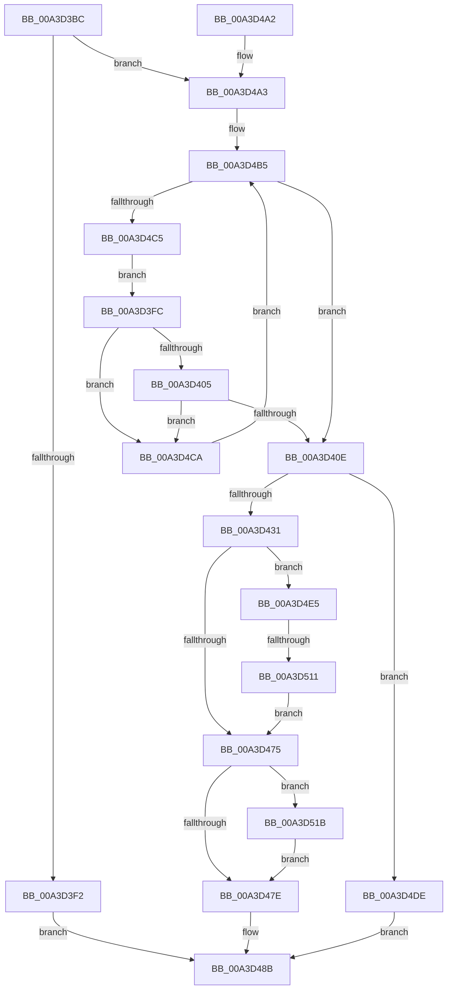

# BiGetDeviceFromEfiPath

- RVA: `0x00A3D3BC`–`0x00A3D52D` (길이 `369` bytes)
- VA: `0x0000000140A3D3BC`
- 실행 섹션: `PAGE`
- PDB 이름 있음: `예`; PDB Function 태그: `예`
- unwind 정보 RVA: `0x000AE588`
- 디코드: `102`개 명령, `369/369` bytes 표시
- 미해석 바이트: `0` (있으면 어셈블리에 `.byte`로 보존)

> 이 문서는 커널 이미지의 기계어와 PDB 기호를 분석해 생성했습니다. 4번과 5번은 함수 원형과 자료형을 바이너리 사용 방식에서 추정한 C 해석이며 원본 소스 복구 결과는 아닙니다.

## 1. Dependencies

- 직접 호출 지점: **6**; 고유 호출 대상: **4**
- 직접 호출자로 확인된 함수: **2**
- RIP 상대 이미지 참조: **0**

### Outgoing calls
- `0x00A3D420` → [ExAllocatePool2](../../poolcode/B8/ExAllocatePool2_function_00B820F0.md) (function, `0x00B820F0`)
- `0x00A3D44B` → [memcpy](../../text/6C/memcpy_function_006C6840.md) (function, `0x006C6840`)
- `0x00A3D465` → [BiTranslateFilePath](BiTranslateFilePath_function_00A3D534.md) (function, `0x00A3D534`)
- `0x00A3D486` → [ExFreePoolWithTag](../../poolcode/B8/ExFreePoolWithTag_function_00B82870.md) (function, `0x00B82870`)
- `0x00A3D500` → [ExAllocatePool2](../../poolcode/B8/ExAllocatePool2_function_00B820F0.md) (function, `0x00B820F0`)
- `0x00A3D523` → [ExFreePoolWithTag](../../poolcode/B8/ExFreePoolWithTag_function_00B82870.md) (function, `0x00B82870`)

### Direct callers
- [BiUpdateBcdObject](../82/BiUpdateBcdObject_function_008270D0.md) at `0x008272A7`
- [BiCreateMergedBootEntry](BiCreateMergedBootEntry_function_00A3CE7C.md) at `0x00A3CEFA`

### Static image references
- 디코드된 RIP-relative 메모리 참조가 없습니다.

## 2. Other-region calls and transfers

- 다른 실행 섹션으로 향하는 call: **5**
  - `0x00A3D420` → [ExAllocatePool2](../../poolcode/B8/ExAllocatePool2_function_00B820F0.md) (`PAGE` → `POOLCODE`)
  - `0x00A3D44B` → [memcpy](../../text/6C/memcpy_function_006C6840.md) (`PAGE` → `.text`)
  - `0x00A3D486` → [ExFreePoolWithTag](../../poolcode/B8/ExFreePoolWithTag_function_00B82870.md) (`PAGE` → `POOLCODE`)
  - `0x00A3D500` → [ExAllocatePool2](../../poolcode/B8/ExAllocatePool2_function_00B820F0.md) (`PAGE` → `POOLCODE`)
  - `0x00A3D523` → [ExFreePoolWithTag](../../poolcode/B8/ExFreePoolWithTag_function_00B82870.md) (`PAGE` → `POOLCODE`)
- call이 아닌 외부 분기/꼬리 이동: **1**
  - `0x00A3D50B` → [sub_00B3A4C8](../B3/Unknown_function_00B3A4C8.md) (`tail-transfer`)

## 3. Assembly (complete function range)

```asm
00A3D3BC  48 89 5C 24 18                  mov qword ptr [rsp + 0x18], rbx
00A3D3C1  48 89 54 24 10                  mov qword ptr [rsp + 0x10], rdx
00A3D3C6  55                              push rbp
00A3D3C7  56                              push rsi
00A3D3C8  57                              push rdi
00A3D3C9  41 54                           push r12
00A3D3CB  41 55                           push r13
00A3D3CD  41 56                           push r14
00A3D3CF  41 57                           push r15
00A3D3D1  48 83 EC 20                     sub rsp, 0x20
00A3D3D5  8A 01                           mov al, byte ptr [rcx]
00A3D3D7  41 B6 7F                        mov r14b, 0x7f
00A3D3DA  48 83 64 24 60 00               and qword ptr [rsp + 0x60], 0
00A3D3E0  41 22 C6                        and al, r14b
00A3D3E3  4D 8B E8                        mov r13, r8
00A3D3E6  48 8B F9                        mov rdi, rcx
00A3D3E9  41 3A C6                        cmp al, r14b
00A3D3EC  0F 85 B1 00 00 00               jne 0x140a3d4a3
00A3D3F2  BB 3A 00 00 C0                  mov ebx, 0xc000003a
00A3D3F7  E9 8F 00 00 00                  jmp 0x140a3d48b
00A3D3FC  80 F9 04                        cmp cl, 4
00A3D3FF  0F 85 C5 00 00 00               jne 0x140a3d4ca
00A3D405  38 4B 01                        cmp byte ptr [rbx + 1], cl
00A3D408  0F 85 BC 00 00 00               jne 0x140a3d4ca
00A3D40E  2B DF                           sub ebx, edi
00A3D410  B9 02 01 00 00                  mov ecx, 0x102
00A3D415  41 B8 42 43 44 4B               mov r8d, 0x4b444342
00A3D41B  8D 6B 10                        lea ebp, [rbx + 0x10]
00A3D41E  8B D5                           mov edx, ebp
00A3D420  E8 CB 4C 14 00                  call 0x140b820f0
00A3D425  48 8B F0                        mov rsi, rax
00A3D428  48 85 C0                        test rax, rax
00A3D42B  0F 84 AD 00 00 00               je 0x140a3d4de
00A3D431  48 8D 48 0C                     lea rcx, [rax + 0xc]
00A3D435  C7 00 01 00 00 00               mov dword ptr [rax], 1
00A3D43B  44 8B C3                        mov r8d, ebx
00A3D43E  89 68 04                        mov dword ptr [rax + 4], ebp
00A3D441  48 8B D7                        mov rdx, rdi
00A3D444  C7 40 08 04 00 00 00            mov dword ptr [rax + 8], 4
00A3D44B  E8 F0 93 C8 FF                  call 0x1406c6840
00A3D450  4C 8D 44 24 60                  lea r8, [rsp + 0x60]
00A3D455  C7 44 33 0C 7F FF 04 00         mov dword ptr [rbx + rsi + 0xc], 0x4ff7f
00A3D45D  BA 03 00 00 00                  mov edx, 3
00A3D462  48 8B CE                        mov rcx, rsi
00A3D465  E8 CA 00 00 00                  call 0x140a3d534
00A3D46A  48 8B 7C 24 60                  mov rdi, qword ptr [rsp + 0x60]
00A3D46F  8B D8                           mov ebx, eax
00A3D471  85 C0                           test eax, eax
00A3D473  79 70                           jns 0x140a3d4e5
00A3D475  48 85 FF                        test rdi, rdi
00A3D478  0F 85 9D 00 00 00               jne 0x140a3d51b
00A3D47E  BA 42 43 44 4B                  mov edx, 0x4b444342
00A3D483  48 8B CE                        mov rcx, rsi
00A3D486  E8 E5 53 14 00                  call 0x140b82870
00A3D48B  8B C3                           mov eax, ebx
00A3D48D  48 8B 5C 24 70                  mov rbx, qword ptr [rsp + 0x70]
00A3D492  48 83 C4 20                     add rsp, 0x20
00A3D496  41 5F                           pop r15
00A3D498  41 5E                           pop r14
00A3D49A  41 5D                           pop r13
00A3D49C  41 5C                           pop r12
00A3D49E  5F                              pop rdi
00A3D49F  5E                              pop rsi
00A3D4A0  5D                              pop rbp
00A3D4A1  C3                              ret
00A3D4A2  CC                              int3
00A3D4A3  0F B6 59 03                     movzx ebx, byte ptr [rcx + 3]
00A3D4A7  0F B6 41 02                     movzx eax, byte ptr [rcx + 2]
00A3D4AB  48 C1 E3 08                     shl rbx, 8
00A3D4AF  48 0B D8                        or rbx, rax
00A3D4B2  48 03 DF                        add rbx, rdi
00A3D4B5  8A 0B                           mov cl, byte ptr [rbx]
00A3D4B7  8A C1                           mov al, cl
00A3D4B9  41 22 C6                        and al, r14b
00A3D4BC  41 3A C6                        cmp al, r14b
00A3D4BF  0F 84 49 FF FF FF               je 0x140a3d40e
00A3D4C5  E9 32 FF FF FF                  jmp 0x140a3d3fc
00A3D4CA  0F B6 4B 03                     movzx ecx, byte ptr [rbx + 3]
00A3D4CE  0F B6 43 02                     movzx eax, byte ptr [rbx + 2]
00A3D4D2  48 C1 E1 08                     shl rcx, 8
00A3D4D6  48 0B C8                        or rcx, rax
00A3D4D9  48 03 D9                        add rbx, rcx
00A3D4DC  EB D7                           jmp 0x140a3d4b5
00A3D4DE  BB 9A 00 00 C0                  mov ebx, 0xc000009a
00A3D4E3  EB A6                           jmp 0x140a3d48b
00A3D4E5  8B 6F 04                        mov ebp, dword ptr [rdi + 4]
00A3D4E8  41 B8 42 43 44 4B               mov r8d, 0x4b444342
00A3D4EE  83 ED 0C                        sub ebp, 0xc
00A3D4F1  B9 02 01 00 00                  mov ecx, 0x102
00A3D4F6  44 8D 7D 14                     lea r15d, [rbp + 0x14]
00A3D4FA  41 8B D7                        mov edx, r15d
00A3D4FD  45 8B E7                        mov r12d, r15d
00A3D500  E8 EB 4B 14 00                  call 0x140b820f0
00A3D505  4C 8B F0                        mov r14, rax
00A3D508  48 85 C0                        test rax, rax
00A3D50B  0F 85 B7 CF 0F 00               jne 0x140b3a4c8
00A3D511  BB 9A 00 00 C0                  mov ebx, 0xc000009a
00A3D516  E9 5A FF FF FF                  jmp 0x140a3d475
00A3D51B  BA 42 43 44 4B                  mov edx, 0x4b444342
00A3D520  48 8B CF                        mov rcx, rdi
00A3D523  E8 48 53 14 00                  call 0x140b82870
00A3D528  E9 51 FF FF FF                  jmp 0x140a3d47e
```

## 4. C-style interpretation (structured pseudocode)

```c
__int64 __fastcall BiGetDeviceFromEfiPath(__int64 a1, __int64 a2, __int64 a3)
{
    __int64 result;
    __int64 v_rbp;
    __int64 v_rbx;
    __int64 v_rsp;
    unsigned __int64 v_stack_p10;
    unsigned __int64 v_stack_p18;
    unsigned __int64 v_stack_p8;

    v_stack_p18 = v_rbx;
    v_stack_p10 = a2;
    v_rsp = (v_rsp) - (32);
    result = (unsigned __int8)((*(unsigned __int8 *)(a1)) & (127));
    if (((unsigned __int8)(result)) != 127) goto loc_00A3D4A3;
    goto loc_00A3D48B;
loc_00A3D3FC:
    if (((unsigned __int8)(a1)) != 4) goto loc_00A3D4CA;
    if ((*(unsigned __int8 *)((unsigned int)(0xC000003AULL) + 1)) != ((unsigned __int8)(a1))) goto loc_00A3D4CA;
loc_00A3D40E:
    v_rbx = (unsigned int)(((unsigned int)(0xC000003AULL)) - ((unsigned int)(a1)));
    result = ExAllocatePool2(258, (unsigned int)((unsigned int)(v_rbx + 16)), (unsigned int)(0x4B444342ULL), a4);
    if (result == 0) goto loc_00A3D4DE;
    *(unsigned int *)(result) = 1;
    *(unsigned int *)(result + 4) = (unsigned int)(v_rbx + 16);
    *(unsigned int *)(result + 8) = 4;
    result = memcpy(result + 12, a1, (unsigned int)((unsigned int)(v_rbx)), a4);
    *(unsigned int *)(v_rbx + result * 1 + 12) = 0x4FF7FULL;
    result = BiTranslateFilePath(result, 3, v_stack_p8, a4);
    if (!sign_flag) goto loc_00A3D4E5;
loc_00A3D475:
    if (v_stack_p8 != 0) goto loc_00A3D51B;
loc_00A3D47E:
    result = ExFreePoolWithTag(result, (unsigned int)(0x4B444342ULL), v_stack_p8, a4);
loc_00A3D48B:
    v_rsp = (v_rsp) + (32);
    return (unsigned int)((unsigned int)((unsigned int)((unsigned int)(result))));
loc_00A3D4A3:
    v_rbx = (*(unsigned __int8 *)(result + 3)) << (8);
    v_rbx = (v_rbx) | (*(unsigned __int8 *)(result + 2));
    v_rbx = (v_rbx) + (v_stack_p8);
loc_00A3D4B5:
    result = (unsigned __int8)(((unsigned __int8)(*(unsigned __int8 *)(v_rbx))) & (127));
    if (((unsigned __int8)(result)) == 127) goto loc_00A3D40E;
    goto loc_00A3D3FC;
loc_00A3D4CA:
    a1 = (*(unsigned __int8 *)(v_rbx + 3)) << (8);
    a1 = (a1) | (*(unsigned __int8 *)(v_rbx + 2));
    v_rbx = (v_rbx) + (a1);
    goto loc_00A3D4B5;
loc_00A3D4DE:
    goto loc_00A3D48B;
loc_00A3D4E5:
    v_rbp = (unsigned int)(((unsigned int)(*(unsigned int *)(v_stack_p8 + 4))) - (12));
    result = ExAllocatePool2(258, (unsigned int)((unsigned int)(v_rbp + 20)), (unsigned int)(0x4B444342ULL), a4);
    goto loc_00A3D475;
loc_00A3D51B:
    result = ExFreePoolWithTag(v_stack_p8, (unsigned int)(0x4B444342ULL), (unsigned int)(0x4B444342ULL), a4);
    goto loc_00A3D47E;
}
```

## 5. (Beta) C Style

```c
int64_t BiGetDeviceFromEfiPath(void *Arg1, int64_t Arg2, int64_t Arg3)
{
    uint8_t *arg1 = (uint8_t *)Arg1;

    int64_t result;
    int64_t local_rbp;
    int64_t local_rbx;
    int64_t local_rsp;
    uint64_t v_stack_p10;
    uint64_t v_stack_p18;
    uint64_t v_stack_p8;

    v_stack_p18 = local_rbx;
    v_stack_p10 = Arg2;
    local_rsp = (local_rsp) - (32);
    result = (uint8_t)((*(uint8_t *)(arg1)) & (127));
    if (((uint8_t)(result)) != 127) goto loc_00A3D4A3;
    goto loc_00A3D48B;
loc_00A3D3FC:
    if (((uint8_t)(Arg1)) != 4) goto loc_00A3D4CA;
    if ((*(uint8_t *)((uint32_t)(0xC000003AULL) + 0x1)) != ((uint8_t)(Arg1))) goto loc_00A3D4CA;
loc_00A3D40E:
    local_rbx = (uint32_t)(((uint32_t)(0xC000003AULL)) - ((uint32_t)(Arg1)));
    result = ExAllocatePool2(258, (uint32_t)((uint32_t)(local_rbx + 16)), (uint32_t)(0x4B444342ULL), a4);
    if (result == 0) goto loc_00A3D4DE;
    *(uint32_t *)(result) = 1;
    *(uint32_t *)(result + 0x4) = (uint32_t)(local_rbx + 16);
    *(uint32_t *)(result + 0x8) = 4;
    result = memcpy(result + 12, Arg1, (uint32_t)((uint32_t)(local_rbx)), a4);
    *(uint32_t *)(local_rbx + result * 1 + 0xC) = 0x4FF7FULL;
    result = BiTranslateFilePath(result, 3, v_stack_p8, a4);
    if (!sign_flag) goto loc_00A3D4E5;
loc_00A3D475:
    if (v_stack_p8 != 0) goto loc_00A3D51B;
loc_00A3D47E:
    result = ExFreePoolWithTag(result, (uint32_t)(0x4B444342ULL), v_stack_p8, a4);
loc_00A3D48B:
    local_rsp = (local_rsp) + (32);
    return (uint32_t)((uint32_t)((uint32_t)((uint32_t)(result))));
loc_00A3D4A3:
    local_rbx = (*(uint8_t *)(result + 0x3)) << (8);
    local_rbx = (local_rbx) | (*(uint8_t *)(result + 0x2));
    local_rbx = (local_rbx) + (v_stack_p8);
loc_00A3D4B5:
    result = (uint8_t)(((uint8_t)(*(uint8_t *)(local_rbx))) & (127));
    if (((uint8_t)(result)) == 127) goto loc_00A3D40E;
    goto loc_00A3D3FC;
loc_00A3D4CA:
    Arg1 = (*(uint8_t *)(local_rbx + 0x3)) << (8);
    Arg1 = (Arg1) | (*(uint8_t *)(local_rbx + 0x2));
    local_rbx = (local_rbx) + (Arg1);
    goto loc_00A3D4B5;
loc_00A3D4DE:
    goto loc_00A3D48B;
loc_00A3D4E5:
    local_rbp = (uint32_t)(((uint32_t)(*(uint32_t *)(v_stack_p8 + 0x4))) - (12));
    result = ExAllocatePool2(258, (uint32_t)((uint32_t)(local_rbp + 20)), (uint32_t)(0x4B444342ULL), a4);
    goto loc_00A3D475;
loc_00A3D51B:
    result = ExFreePoolWithTag(v_stack_p8, (uint32_t)(0x4B444342ULL), (uint32_t)(0x4B444342ULL), a4);
    goto loc_00A3D47E;
}
```

### 관측된 메모리 오프셋

구조체 형식이 확인되지 않은 접근은 인자 기준의 오프셋으로만 기록했습니다.

| 기준 인자 | 오프셋 표현 | 폭 (bit) | 접근 |
|---|---:|---:|---|
| `Arg1` | `+ 0x0` | `8` | `R` |
| `Arg1` | `+ 0x2` | `8` | `R` |
| `Arg1` | `+ 0x3` | `8` | `R` |

## 6. Execution-region graph

[열기: 2D/3D 그래프와 함수 탐색 컨트롤 패널](../../../control-panel.html?section=page&rva=0x00A3D3BC&view=graph)

- 2D 그래프는 위에서 아래로 흐르고, 3D 그래프는 빈 공간을 드래그해 회전합니다. Shift+드래그는 이동, 휠은 확대·축소, 함수 노드 선택은 대상 보고서 이동입니다.

### Static fallback


