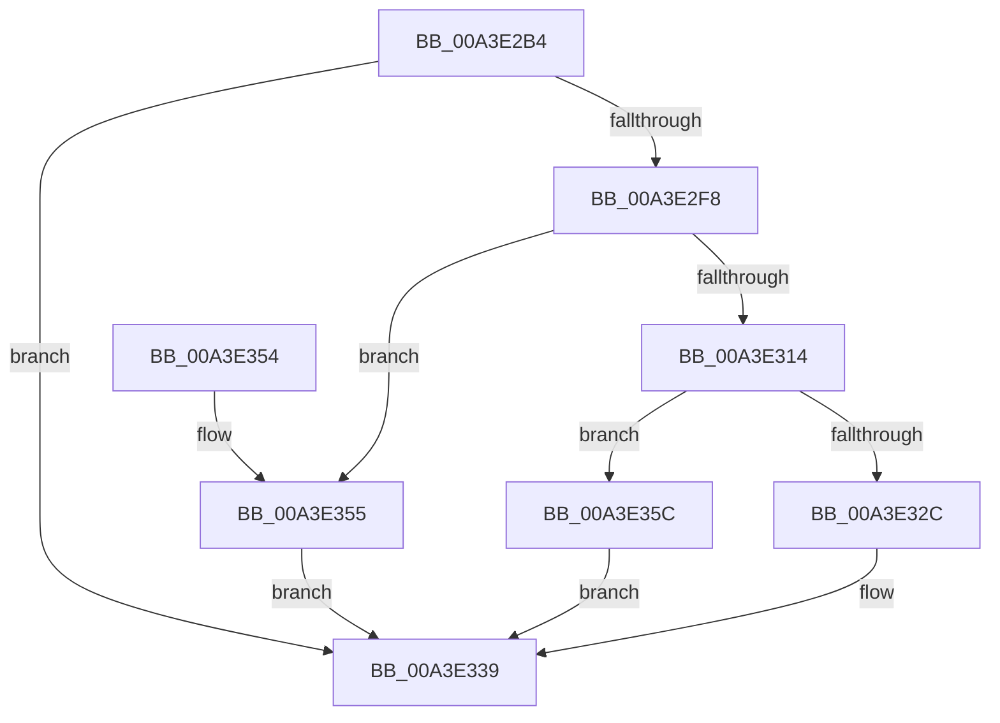

# BiGetElement

- RVA: `0x00A3E2B4`–`0x00A3E367` (길이 `179` bytes)
- VA: `0x0000000140A3E2B4`
- 실행 섹션: `PAGE`
- PDB 이름 있음: `예`; PDB Function 태그: `아니요`
- unwind 정보 RVA: `0x000AE6FC`
- 디코드: `55`개 명령, `179/179` bytes 표시
- 미해석 바이트: `0` (있으면 어셈블리에 `.byte`로 보존)

> 이 문서는 커널 이미지의 기계어와 PDB 기호를 분석해 생성했습니다. 4번과 5번은 함수 원형과 자료형을 바이너리 사용 방식에서 추정한 C 해석이며 원본 소스 복구 결과는 아닙니다.

## 1. Dependencies

- 직접 호출 지점: **4**; 고유 호출 대상: **3**
- 직접 호출자로 확인된 함수: **6**
- RIP 상대 이미지 참조: **0**

### Outgoing calls
- `0x00A3E2EA` → [BcdGetElementData](BcdGetElementData_function_00A3E390.md) (function, `0x00A3E390`)
- `0x00A3E307` → [ExAllocatePool2](../../poolcode/B8/ExAllocatePool2_function_00B820F0.md) (function, `0x00B820F0`)
- `0x00A3E321` → [BcdGetElementData](BcdGetElementData_function_00A3E390.md) (function, `0x00A3E390`)
- `0x00A3E334` → [ExFreePoolWithTag](../../poolcode/B8/ExFreePoolWithTag_function_00B82870.md) (function, `0x00B82870`)

### Direct callers
- [BiAddBootEntryToEfiBootManagerDisplayOrder](../82/BiAddBootEntryToEfiBootManagerDisplayOrder_function_008262D8.md) at `0x00826327`
- [BiCreateBootEntry](../82/BiCreateBootEntry_function_00826510.md) at `0x00826569`
- [BiCreateBootEntry](../82/BiCreateBootEntry_function_00826510.md) at `0x0082659C`
- [BiCreateBootEntry](../82/BiCreateBootEntry_function_00826510.md) at `0x008265D4`
- [BiHandleFirmwareDefaultEntry](../82/BiHandleFirmwareDefaultEntry_function_00826D08.md) at `0x00826D50`
- [BiUpdateEfiEntry](BiUpdateEfiEntry_function_00A3CCC0.md) at `0x00A3CD26`
- [BiUpdateEfiEntry](BiUpdateEfiEntry_function_00A3CCC0.md) at `0x00A3CDBD`
- [BiExportEfiBootManager](../AC/BiExportEfiBootManager_function_00ACB13C.md) at `0x00ACB1E6`
- [BiExportEfiBootManager](../AC/BiExportEfiBootManager_function_00ACB13C.md) at `0x00ACB2E2`
- [BiExportEfiBootManager](../AC/BiExportEfiBootManager_function_00ACB13C.md) at `0x00ACB33D`
- [sub_00B3A3D0](../B3/Unknown_function_00B3A3D0.md) at `0x00B3A3E1`

### Static image references
- 디코드된 RIP-relative 메모리 참조가 없습니다.

## 2. Other-region calls and transfers

- 다른 실행 섹션으로 향하는 call: **2**
  - `0x00A3E307` → [ExAllocatePool2](../../poolcode/B8/ExAllocatePool2_function_00B820F0.md) (`PAGE` → `POOLCODE`)
  - `0x00A3E334` → [ExFreePoolWithTag](../../poolcode/B8/ExFreePoolWithTag_function_00B82870.md) (`PAGE` → `POOLCODE`)
- 별도 외부 분기/꼬리 이동을 확인하지 못했습니다.

## 3. Assembly (complete function range)

```asm
00A3E2B4  48 8B C4                        mov rax, rsp
00A3E2B7  48 89 58 08                     mov qword ptr [rax + 8], rbx
00A3E2BB  48 89 68 10                     mov qword ptr [rax + 0x10], rbp
00A3E2BF  48 89 70 20                     mov qword ptr [rax + 0x20], rsi
00A3E2C3  57                              push rdi
00A3E2C4  41 56                           push r14
00A3E2C6  41 57                           push r15
00A3E2C8  48 83 EC 20                     sub rsp, 0x20
00A3E2CC  49 83 20 00                     and qword ptr [r8], 0
00A3E2D0  49 8B F1                        mov rsi, r9
00A3E2D3  41 83 21 00                     and dword ptr [r9], 0
00A3E2D7  4D 8B F0                        mov r14, r8
00A3E2DA  83 60 18 00                     and dword ptr [rax + 0x18], 0
00A3E2DE  4C 8D 48 18                     lea r9, [rax + 0x18]
00A3E2E2  45 33 C0                        xor r8d, r8d
00A3E2E5  8B EA                           mov ebp, edx
00A3E2E7  4C 8B F9                        mov r15, rcx
00A3E2EA  E8 A1 00 00 00                  call 0x140a3e390
00A3E2EF  8B D8                           mov ebx, eax
00A3E2F1  3D 23 00 00 C0                  cmp eax, 0xc0000023
00A3E2F6  75 41                           jne 0x140a3e339
00A3E2F8  8B 54 24 50                     mov edx, dword ptr [rsp + 0x50]
00A3E2FC  B9 02 01 00 00                  mov ecx, 0x102
00A3E301  41 B8 42 43 44 4B               mov r8d, 0x4b444342
00A3E307  E8 E4 3D 14 00                  call 0x140b820f0
00A3E30C  48 8B F8                        mov rdi, rax
00A3E30F  48 85 C0                        test rax, rax
00A3E312  74 41                           je 0x140a3e355
00A3E314  4C 8D 4C 24 50                  lea r9, [rsp + 0x50]
00A3E319  4C 8B C0                        mov r8, rax
00A3E31C  8B D5                           mov edx, ebp
00A3E31E  49 8B CF                        mov rcx, r15
00A3E321  E8 6A 00 00 00                  call 0x140a3e390
00A3E326  8B D8                           mov ebx, eax
00A3E328  85 C0                           test eax, eax
00A3E32A  79 30                           jns 0x140a3e35c
00A3E32C  BA 42 43 44 4B                  mov edx, 0x4b444342
00A3E331  48 8B CF                        mov rcx, rdi
00A3E334  E8 37 45 14 00                  call 0x140b82870
00A3E339  48 8B 6C 24 48                  mov rbp, qword ptr [rsp + 0x48]
00A3E33E  8B C3                           mov eax, ebx
00A3E340  48 8B 5C 24 40                  mov rbx, qword ptr [rsp + 0x40]
00A3E345  48 8B 74 24 58                  mov rsi, qword ptr [rsp + 0x58]
00A3E34A  48 83 C4 20                     add rsp, 0x20
00A3E34E  41 5F                           pop r15
00A3E350  41 5E                           pop r14
00A3E352  5F                              pop rdi
00A3E353  C3                              ret
00A3E354  CC                              int3
00A3E355  BB 9A 00 00 C0                  mov ebx, 0xc000009a
00A3E35A  EB DD                           jmp 0x140a3e339
00A3E35C  8B 4C 24 50                     mov ecx, dword ptr [rsp + 0x50]
00A3E360  89 0E                           mov dword ptr [rsi], ecx
00A3E362  49 89 3E                        mov qword ptr [r14], rdi
00A3E365  EB D2                           jmp 0x140a3e339
```

## 4. C-style interpretation (structured pseudocode)

```c
__int64 __fastcall BiGetElement(__int64 a1, int a2, __int64 a3, __int64 a4)
{
    __int64 result;
    __int64 v_rsp;
    unsigned __int64 v_stack_p10;
    unsigned int v_stack_p18;
    unsigned __int64 v_stack_p20;
    unsigned int v_stack_p50;
    unsigned __int64 v_stack_p8;

    *(unsigned __int64 *)(v_rsp + 8) = v_rbx;
    *(unsigned __int64 *)(v_rsp + 16) = v_rbp;
    *(unsigned __int64 *)(v_rsp + 32) = v_rsi;
    v_rsp = (v_rsp) - (32);
    a3 = 0;
    result = BcdGetElementData(a1, a2, a3, v_rsp + 24);
    if (((unsigned int)(result)) != 0xC0000023ULL) goto loc_00A3E339;
    result = ExAllocatePool2(258, (unsigned int)(v_stack_p18), (unsigned int)(0x4B444342ULL), v_rsp + 24);
    if (result == 0) goto loc_00A3E355;
    result = BcdGetElementData(a1, (unsigned int)((unsigned int)((unsigned int)(a2))), result, v_stack_p18);
    if (!sign_flag) goto loc_00A3E35C;
    result = ExFreePoolWithTag(result, (unsigned int)(0x4B444342ULL), result, v_stack_p18);
loc_00A3E339:
    v_rsp = (v_rsp) + (32);
    return (unsigned int)((unsigned int)((unsigned int)((unsigned int)(result))));
loc_00A3E355:
    goto loc_00A3E339;
loc_00A3E35C:
    *(unsigned int *)(v_stack_p20) = (unsigned int)((unsigned int)(v_stack_p50));
    *(unsigned __int64 *)(a3) = result;
    goto loc_00A3E339;
}
```

## 5. (Beta) C Style

```c
int64_t BiGetElement(int64_t Arg1, int32_t Arg2, void *Arg3, void *Arg4)
{
    uint8_t *arg3 = (uint8_t *)Arg3;
    uint8_t *arg4 = (uint8_t *)Arg4;

    int64_t result;
    int64_t local_rsp;
    uint64_t v_stack_p10;
    uint32_t v_stack_p18;
    uint64_t v_stack_p20;
    uint32_t v_stack_p50;
    uint64_t v_stack_p8;

    *(uint64_t *)(local_rsp + 0x8) = local_rbx;
    *(uint64_t *)(local_rsp + 0x10) = local_rbp;
    *(uint64_t *)(local_rsp + 0x20) = local_rsi;
    local_rsp = (local_rsp) - (32);
    Arg3 = 0;
    result = BcdGetElementData(Arg1, Arg2, Arg3, local_rsp + 24);
    if (((uint32_t)(result)) != 0xC0000023ULL) goto loc_00A3E339;
    result = ExAllocatePool2(258, (uint32_t)(v_stack_p18), (uint32_t)(0x4B444342ULL), local_rsp + 24);
    if (result == 0) goto loc_00A3E355;
    result = BcdGetElementData(Arg1, (uint32_t)((uint32_t)((uint32_t)(Arg2))), result, v_stack_p18);
    if (!sign_flag) goto loc_00A3E35C;
    result = ExFreePoolWithTag(result, (uint32_t)(0x4B444342ULL), result, v_stack_p18);
loc_00A3E339:
    local_rsp = (local_rsp) + (32);
    return (uint32_t)((uint32_t)((uint32_t)((uint32_t)(result))));
loc_00A3E355:
    goto loc_00A3E339;
loc_00A3E35C:
    *(uint32_t *)(v_stack_p20) = (uint32_t)((uint32_t)(v_stack_p50));
    *(uint64_t *)(arg3) = result;
    goto loc_00A3E339;
}
```

### 관측된 메모리 오프셋

구조체 형식이 확인되지 않은 접근은 인자 기준의 오프셋으로만 기록했습니다.

| 기준 인자 | 오프셋 표현 | 폭 (bit) | 접근 |
|---|---:|---:|---|
| `Arg3` | `+ 0x0` | `64` | `R/W` |
| `Arg3` | `+ 0x0` | `64` | `W` |
| `Arg4` | `+ 0x0` | `32` | `R/W` |
| `Arg4` | `+ 0x0` | `32` | `W` |

## 6. Execution-region graph

[열기: 2D/3D 그래프와 함수 탐색 컨트롤 패널](../../../control-panel.html?section=page&rva=0x00A3E2B4&view=graph)

- 2D 그래프는 위에서 아래로 흐르고, 3D 그래프는 빈 공간을 드래그해 회전합니다. Shift+드래그는 이동, 휠은 확대·축소, 함수 노드 선택은 대상 보고서 이동입니다.

### Static fallback


