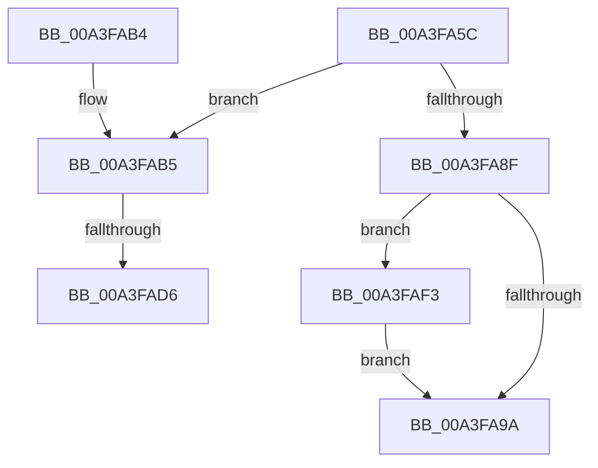

# BiGetFirmwareType

- RVA: `0x00A3FA5C`–`0x00A3FAFF` (길이 `163` bytes)
- VA: `0x0000000140A3FA5C`
- 실행 섹션: `PAGE`
- PDB 이름 있음: `예`; PDB Function 태그: `예`
- unwind 정보 RVA: `0x000AE88C`
- 디코드: `42`개 명령, `163/163` bytes 표시
- 미해석 바이트: `0` (있으면 어셈블리에 `.byte`로 보존)

> 이 문서는 커널 이미지의 기계어와 PDB 기호를 분석해 생성했습니다. 4번과 5번은 함수 원형과 자료형을 바이너리 사용 방식에서 추정한 C 해석이며 원본 소스 복구 결과는 아닙니다.

## 1. Dependencies

- 직접 호출 지점: **2**; 고유 호출 대상: **2**
- 직접 호출자로 확인된 함수: **4**
- RIP 상대 이미지 참조: **5**

### Outgoing calls
- `0x00A3FAA4` → [_security_check_cookie](../../text/6A/_security_check_cookie_function_006AC640.md) (function, `0x006AC640`)
- `0x00A3FAC9` → [ZwQuerySystemInformation](../../text/6A/ZwQuerySystemInformation_function_006AD790.md) (function, `0x006AD790`)

### Direct callers
- [BiExportStoreAlterationsToFirmware](../82/BiExportStoreAlterationsToFirmware_function_00826038.md) at `0x00826043`
- [BcdGetSystemStorePath](BcdGetSystemStorePath_function_00A3C340.md) at `0x00A3C36F`
- [BiIsLinkedToFirmwareVariable](BiIsLinkedToFirmwareVariable_function_00A3E4D0.md) at `0x00A3E4E7`
- [BiOpenSystemStore](../A4/BiOpenSystemStore_function_00A40844.md) at `0x00A40999`

### Static image references
- `0x00A3FA66` → RVA `0x00E0A740` (`.data`; read)
- `0x00A3FA75` → RVA `0x00EEFEC0` (`.data`; read)
- `0x00A3FA8F` → RVA `0x00E0EEA8` (`.data`; read)
- `0x00A3FAE2` → RVA `0x00E620B8` (`.data`; write)
- `0x00A3FAF3` → RVA `0x00E620B8` (`.data`; read)

## 2. Other-region calls and transfers

- 다른 실행 섹션으로 향하는 call: **2**
  - `0x00A3FAA4` → [_security_check_cookie](../../text/6A/_security_check_cookie_function_006AC640.md) (`PAGE` → `.text`)
  - `0x00A3FAC9` → [ZwQuerySystemInformation](../../text/6A/ZwQuerySystemInformation_function_006AD790.md) (`PAGE` → `.text`)
- call이 아닌 외부 분기/꼬리 이동: **2**
  - `0x00A3FAD0` → [sub_00B3A7D8](../B3/Unknown_function_00B3A7D8.md) (`tail-transfer`)
  - `0x00A3FAEE` → [sub_00B3A7D8](../B3/Unknown_function_00B3A7D8.md) (`tail-transfer`)

## 3. Assembly (complete function range)

```asm
00A3FA5C  48 89 5C 24 10                  mov qword ptr [rsp + 0x10], rbx
00A3FA61  57                              push rdi
00A3FA62  48 83 EC 50                     sub rsp, 0x50
00A3FA66  48 8B 05 D3 AC 3C 00            mov rax, qword ptr [rip + 0x3cacd3]
00A3FA6D  48 33 C4                        xor rax, rsp
00A3FA70  48 89 44 24 40                  mov qword ptr [rsp + 0x40], rax
00A3FA75  8A 05 45 04 4B 00               mov al, byte ptr [rip + 0x4b0445]
00A3FA7B  0F 57 C0                        xorps xmm0, xmm0
00A3FA7E  48 8B F9                        mov rdi, rcx
00A3FA81  0F 11 44 24 20                  movups xmmword ptr [rsp + 0x20], xmm0
00A3FA86  0F 11 44 24 30                  movups xmmword ptr [rsp + 0x30], xmm0
00A3FA8B  84 C0                           test al, al
00A3FA8D  74 26                           je 0x140a3fab5
00A3FA8F  8B 1D 13 F4 3C 00               mov ebx, dword ptr [rip + 0x3cf413]
00A3FA95  48 85 FF                        test rdi, rdi
00A3FA98  75 59                           jne 0x140a3faf3
00A3FA9A  8B C3                           mov eax, ebx
00A3FA9C  48 8B 4C 24 40                  mov rcx, qword ptr [rsp + 0x40]
00A3FAA1  48 33 CC                        xor rcx, rsp
00A3FAA4  E8 97 CB C6 FF                  call 0x1406ac640
00A3FAA9  48 8B 5C 24 68                  mov rbx, qword ptr [rsp + 0x68]
00A3FAAE  48 83 C4 50                     add rsp, 0x50
00A3FAB2  5F                              pop rdi
00A3FAB3  C3                              ret
00A3FAB4  CC                              int3
00A3FAB5  BB 01 00 00 00                  mov ebx, 1
00A3FABA  48 8D 54 24 20                  lea rdx, [rsp + 0x20]
00A3FABF  45 33 C9                        xor r9d, r9d
00A3FAC2  44 8D 43 1F                     lea r8d, [rbx + 0x1f]
00A3FAC6  8D 4B 59                        lea ecx, [rbx + 0x59]
00A3FAC9  E8 C2 DC C6 FF                  call 0x1406ad790
00A3FACE  85 C0                           test eax, eax
00A3FAD0  0F 88 02 AD 0F 00               js 0x140b3a7d8
00A3FAD6  48 8B 44 24 38                  mov rax, qword ptr [rsp + 0x38]
00A3FADB  33 DB                           xor ebx, ebx
00A3FADD  83 7C 24 30 03                  cmp dword ptr [rsp + 0x30], 3
00A3FAE2  48 89 05 CF 25 42 00            mov qword ptr [rip + 0x4225cf], rax
00A3FAE9  0F 4C 5C 24 30                  cmovl ebx, dword ptr [rsp + 0x30]
00A3FAEE  E9 E5 AC 0F 00                  jmp 0x140b3a7d8
00A3FAF3  48 8B 0D BE 25 42 00            mov rcx, qword ptr [rip + 0x4225be]
00A3FAFA  48 89 0F                        mov qword ptr [rdi], rcx
00A3FAFD  EB 9B                           jmp 0x140a3fa9a
```

## 4. C-style interpretation (structured pseudocode)

```c
__int64 __fastcall BiGetFirmwareType(__int64 a1, __int64 a2, __int64 a3, int a4)
{
    __int64 result;
    __int64 v_rbx;
    __int64 v_rsp;
    unsigned __int64 v_stack_m18;
    unsigned __int64 v_stack_m28;
    unsigned __int64 v_stack_m38;
    unsigned __int64 v_stack_p10;
    unsigned __int64 v_stack_p20;
    unsigned int v_stack_p30;
    unsigned __int64 v_stack_p38;

    v_stack_p10 = v_rbx;
    v_rsp = (v_rsp) - (80);
    result = (*(unsigned __int64 *)(v_rip + 3976403)) ^ (v_rsp);
    v_stack_m18 = result;
    v_stack_m38 = v_xmm0;
    v_stack_m28 = v_xmm0;
    if ((unsigned __int8)(*(unsigned __int8 *)(v_rip + 4916293)) == 0) goto loc_00A3FAB5;
    if (a1 != 0) goto loc_00A3FAF3;
loc_00A3FA9A:
    a1 = (v_stack_m18) ^ (v_rsp);
    result = _security_check_cookie(a1, a2, a3, a4);
    v_rsp = (v_rsp) + (80);
    return result;
loc_00A3FAB5:
    a4 = 0;
    result = ZwQuerySystemInformation(1 + 89, v_stack_p20, 1 + 31, a4);
    v_rbx = 0;
    *(unsigned __int64 *)(v_rip + 4335055) = v_stack_p38;
    if (v_stack_p30 < 3) { v_rbx = v_stack_p30; }
loc_00A3FAF3:
    *(unsigned __int64 *)(a1) = *(unsigned __int64 *)(v_rip + 4335038);
    goto loc_00A3FA9A;
}
```

## 5. (Beta) C Style

```c
int64_t BiGetFirmwareType(int64_t Arg1, int64_t Arg2, int64_t Arg3, int32_t Arg4)
{
    int64_t result;
    int64_t local_rbx;
    int64_t local_rsp;
    uint64_t v_stack_m18;
    uint64_t v_stack_m28;
    uint64_t v_stack_m38;
    uint64_t v_stack_p10;
    uint64_t v_stack_p20;
    uint32_t v_stack_p30;
    uint64_t v_stack_p38;

    v_stack_p10 = local_rbx;
    local_rsp = (local_rsp) - (80);
    result = (*(uint64_t *)(v_rip + 0x3CACD3)) ^ (local_rsp);
    v_stack_m18 = result;
    v_stack_m38 = v_xmm0;
    v_stack_m28 = v_xmm0;
    if ((uint8_t)(*(uint8_t *)(v_rip + 0x4B0445)) == 0) goto loc_00A3FAB5;
    if (Arg1 != 0) goto loc_00A3FAF3;
loc_00A3FA9A:
    Arg1 = (v_stack_m18) ^ (local_rsp);
    result = _security_check_cookie(Arg1, Arg2, Arg3, Arg4);
    local_rsp = (local_rsp) + (80);
    return result;
loc_00A3FAB5:
    Arg4 = 0;
    result = ZwQuerySystemInformation(1 + 89, v_stack_p20, 1 + 31, Arg4);
    local_rbx = 0;
    *(uint64_t *)(v_rip + 0x4225CF) = v_stack_p38;
    if (v_stack_p30 < 3) { local_rbx = v_stack_p30; }
loc_00A3FAF3:
    *(uint64_t *)(Arg1) = *(uint64_t *)(v_rip + 0x4225BE);
    goto loc_00A3FA9A;
}
```

## 6. Execution-region graph

[열기: 2D/3D 그래프와 함수 탐색 컨트롤 패널](../../../control-panel.html?section=page&rva=0x00A3FA5C&view=graph)

- 2D 그래프는 위에서 아래로 흐르고, 3D 그래프는 빈 공간을 드래그해 회전합니다. Shift+드래그는 이동, 휠은 확대·축소, 함수 노드 선택은 대상 보고서 이동입니다.

### Static fallback


