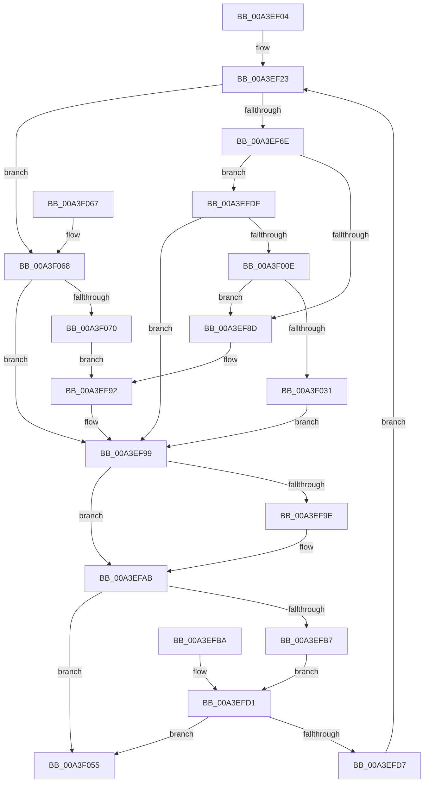

# BiGetKeyName

- RVA: `0x00A3EF04`–`0x00A3F07A` (길이 `374` bytes)
- VA: `0x0000000140A3EF04`
- 실행 섹션: `PAGE`
- PDB 이름 있음: `예`; PDB Function 태그: `아니요`
- unwind 정보 RVA: `0x000AE794`
- 디코드: `100`개 명령, `374/374` bytes 표시
- 미해석 바이트: `0` (있으면 어셈블리에 `.byte`로 보존)

> 이 문서는 커널 이미지의 기계어와 PDB 기호를 분석해 생성했습니다. 4번과 5번은 함수 원형과 자료형을 바이너리 사용 방식에서 추정한 C 해석이며 원본 소스 복구 결과는 아닙니다.

## 1. Dependencies

- 직접 호출 지점: **7**; 고유 호출 대상: **5**
- 직접 호출자로 확인된 함수: **3**
- RIP 상대 이미지 참조: **0**

### Outgoing calls
- `0x00A3EF26` → [BiSanitizeHandle](../../text/4B/BiSanitizeHandle_function_004B0E4C.md) (function, `0x004B0E4C`)
- `0x00A3EF55` → [BiZwQueryKey](../../text/4B/BiZwQueryKey_function_004B2384.md) (function, `0x004B2384`)
- `0x00A3EF80` → [ExAllocatePool2](../../poolcode/B8/ExAllocatePool2_function_00B820F0.md) (function, `0x00B820F0`)
- `0x00A3EFA6` → [ExFreePoolWithTag](../../poolcode/B8/ExFreePoolWithTag_function_00B82870.md) (function, `0x00B82870`)
- `0x00A3EFFC` → [BiZwQueryKey](../../text/4B/BiZwQueryKey_function_004B2384.md) (function, `0x004B2384`)
- `0x00A3F020` → [ExAllocatePool2](../../poolcode/B8/ExAllocatePool2_function_00B820F0.md) (function, `0x00B820F0`)
- `0x00A3F03C` → [memcpy](../../text/6C/memcpy_function_006C6840.md) (function, `0x006C6840`)

### Direct callers
- [BiCreateBootEntry](../82/BiCreateBootEntry_function_00826510.md) at `0x008266E4`
- [BiGetObjectIdentifier](BiGetObjectIdentifier_function_00A3EEA0.md) at `0x00A3EEBC`
- [BiBindEfiEntryToBcdObject](../AD/BiBindEfiEntryToBcdObject_function_00AD502C.md) at `0x00AD50A8`

### Static image references
- 디코드된 RIP-relative 메모리 참조가 없습니다.

## 2. Other-region calls and transfers

- 다른 실행 섹션으로 향하는 call: **7**
  - `0x00A3EF26` → [BiSanitizeHandle](../../text/4B/BiSanitizeHandle_function_004B0E4C.md) (`PAGE` → `.text`)
  - `0x00A3EF55` → [BiZwQueryKey](../../text/4B/BiZwQueryKey_function_004B2384.md) (`PAGE` → `.text`)
  - `0x00A3EF80` → [ExAllocatePool2](../../poolcode/B8/ExAllocatePool2_function_00B820F0.md) (`PAGE` → `POOLCODE`)
  - `0x00A3EFA6` → [ExFreePoolWithTag](../../poolcode/B8/ExFreePoolWithTag_function_00B82870.md) (`PAGE` → `POOLCODE`)
  - `0x00A3EFFC` → [BiZwQueryKey](../../text/4B/BiZwQueryKey_function_004B2384.md) (`PAGE` → `.text`)
  - `0x00A3F020` → [ExAllocatePool2](../../poolcode/B8/ExAllocatePool2_function_00B820F0.md) (`PAGE` → `POOLCODE`)
  - `0x00A3F03C` → [memcpy](../../text/6C/memcpy_function_006C6840.md) (`PAGE` → `.text`)
- 별도 외부 분기/꼬리 이동을 확인하지 못했습니다.

## 3. Assembly (complete function range)

```asm
00A3EF04  48 89 54 24 10                  mov qword ptr [rsp + 0x10], rdx
00A3EF09  53                              push rbx
00A3EF0A  56                              push rsi
00A3EF0B  57                              push rdi
00A3EF0C  41 54                           push r12
00A3EF0E  41 55                           push r13
00A3EF10  41 56                           push r14
00A3EF12  41 57                           push r15
00A3EF14  48 83 EC 30                     sub rsp, 0x30
00A3EF18  4C 8B EA                        mov r13, rdx
00A3EF1B  4C 8B E1                        mov r12, rcx
00A3EF1E  33 FF                           xor edi, edi
00A3EF20  44 8B F7                        mov r14d, edi
00A3EF23  49 8B CC                        mov rcx, r12
00A3EF26  E8 21 1F A7 FF                  call 0x1404b0e4c
00A3EF2B  4C 8B E0                        mov r12, rax
00A3EF2E  48 89 44 24 70                  mov qword ptr [rsp + 0x70], rax
00A3EF33  48 8B F7                        mov rsi, rdi
00A3EF36  89 BC 24 88 00 00 00            mov dword ptr [rsp + 0x88], edi
00A3EF3D  48 8D 84 24 88 00 00 00         lea rax, [rsp + 0x88]
00A3EF45  48 89 44 24 20                  mov qword ptr [rsp + 0x20], rax
00A3EF4A  45 33 C9                        xor r9d, r9d
00A3EF4D  45 33 C0                        xor r8d, r8d
00A3EF50  33 D2                           xor edx, edx
00A3EF52  49 8B CC                        mov rcx, r12
00A3EF55  E8 2A 34 A7 FF                  call 0x1404b2384
00A3EF5A  8B D8                           mov ebx, eax
00A3EF5C  89 84 24 80 00 00 00            mov dword ptr [rsp + 0x80], eax
00A3EF63  3D 23 00 00 C0                  cmp eax, 0xc0000023
00A3EF68  0F 85 FA 00 00 00               jne 0x140a3f068
00A3EF6E  8B 94 24 88 00 00 00            mov edx, dword ptr [rsp + 0x88]
00A3EF75  B9 02 01 00 00                  mov ecx, 0x102
00A3EF7A  41 B8 42 43 44 4B               mov r8d, 0x4b444342
00A3EF80  E8 6B 31 14 00                  call 0x140b820f0
00A3EF85  48 8B F0                        mov rsi, rax
00A3EF88  48 85 C0                        test rax, rax
00A3EF8B  75 52                           jne 0x140a3efdf
00A3EF8D  BB 9A 00 00 C0                  mov ebx, 0xc000009a
00A3EF92  89 9C 24 80 00 00 00            mov dword ptr [rsp + 0x80], ebx
00A3EF99  48 85 F6                        test rsi, rsi
00A3EF9C  74 0D                           je 0x140a3efab
00A3EF9E  BA 42 43 44 4B                  mov edx, 0x4b444342
00A3EFA3  48 8B CE                        mov rcx, rsi
00A3EFA6  E8 C5 38 14 00                  call 0x140b82870
00A3EFAB  81 FB 7D 01 00 C0               cmp ebx, 0xc000017d
00A3EFB1  0F 85 9E 00 00 00               jne 0x140a3f055
00A3EFB7  CC                              int3
00A3EFB8  EB 17                           jmp 0x140a3efd1
00A3EFBA  33 FF                           xor edi, edi
00A3EFBC  44 8D 77 05                     lea r14d, [rdi + 5]
00A3EFC0  4C 8B 6C 24 78                  mov r13, qword ptr [rsp + 0x78]
00A3EFC5  4C 8B 64 24 70                  mov r12, qword ptr [rsp + 0x70]
00A3EFCA  8B 9C 24 80 00 00 00            mov ebx, dword ptr [rsp + 0x80]
00A3EFD1  41 83 FE 05                     cmp r14d, 5
00A3EFD5  73 7E                           jae 0x140a3f055
00A3EFD7  41 FF C6                        inc r14d
00A3EFDA  E9 44 FF FF FF                  jmp 0x140a3ef23
00A3EFDF  48 8D 84 24 88 00 00 00         lea rax, [rsp + 0x88]
00A3EFE7  48 89 44 24 20                  mov qword ptr [rsp + 0x20], rax
00A3EFEC  44 8B 8C 24 88 00 00 00         mov r9d, dword ptr [rsp + 0x88]
00A3EFF4  4C 8B C6                        mov r8, rsi
00A3EFF7  33 D2                           xor edx, edx
00A3EFF9  49 8B CC                        mov rcx, r12
00A3EFFC  E8 83 33 A7 FF                  call 0x1404b2384
00A3F001  8B D8                           mov ebx, eax
00A3F003  89 84 24 80 00 00 00            mov dword ptr [rsp + 0x80], eax
00A3F00A  85 C0                           test eax, eax
00A3F00C  78 8B                           js 0x140a3ef99
00A3F00E  8B 56 0C                        mov edx, dword ptr [rsi + 0xc]
00A3F011  48 83 C2 02                     add rdx, 2
00A3F015  B9 02 01 00 00                  mov ecx, 0x102
00A3F01A  41 B8 42 43 44 4B               mov r8d, 0x4b444342
00A3F020  E8 CB 30 14 00                  call 0x140b820f0
00A3F025  4C 8B F8                        mov r15, rax
00A3F028  48 85 C0                        test rax, rax
00A3F02B  0F 84 5C FF FF FF               je 0x140a3ef8d
00A3F031  44 8B 46 0C                     mov r8d, dword ptr [rsi + 0xc]
00A3F035  48 8D 56 10                     lea rdx, [rsi + 0x10]
00A3F039  48 8B C8                        mov rcx, rax
00A3F03C  E8 FF 77 C8 FF                  call 0x1406c6840
00A3F041  8B 46 0C                        mov eax, dword ptr [rsi + 0xc]
00A3F044  48 D1 E8                        shr rax, 1
00A3F047  66 41 89 3C 47                  mov word ptr [r15 + rax*2], di
00A3F04C  4D 89 7D 00                     mov qword ptr [r13], r15
00A3F050  E9 44 FF FF FF                  jmp 0x140a3ef99
00A3F055  8B C3                           mov eax, ebx
00A3F057  48 83 C4 30                     add rsp, 0x30
00A3F05B  41 5F                           pop r15
00A3F05D  41 5E                           pop r14
00A3F05F  41 5D                           pop r13
00A3F061  41 5C                           pop r12
00A3F063  5F                              pop rdi
00A3F064  5E                              pop rsi
00A3F065  5B                              pop rbx
00A3F066  C3                              ret
00A3F067  CC                              int3
00A3F068  85 C0                           test eax, eax
00A3F06A  0F 88 29 FF FF FF               js 0x140a3ef99
00A3F070  BB 0D 00 00 C0                  mov ebx, 0xc000000d
00A3F075  E9 18 FF FF FF                  jmp 0x140a3ef92
```

## 4. C-style interpretation (structured pseudocode)

```c
__int64 __fastcall BiGetKeyName(__int64 a1, __int64 a2, int a3, int a4)
{
    __int64 result;
    __int64 v_r14;
    __int64 v_rdi;
    __int64 v_rsp;
    unsigned __int64 v_stack_m48;
    unsigned __int64 v_stack_p10;
    unsigned int v_stack_p18;
    unsigned int v_stack_p20;
    unsigned __int64 v_stack_p8;

    v_stack_p10 = a2;
    v_rsp = (v_rsp) - (48);
    v_rdi = 0;
loc_00A3EF23:
    result = BiSanitizeHandle(a1, a2, a3, a4);
    v_stack_p8 = result;
    v_stack_p20 = 0;
    v_stack_m48 = v_stack_p20;
    a4 = 0;
    a3 = 0;
    a2 = 0;
    result = BiZwQueryKey(result, a2, a3, a4);
    v_stack_p18 = (unsigned int)(result);
    if (((unsigned int)(result)) != 0xC0000023ULL) goto loc_00A3F068;
    result = ExAllocatePool2(258, (unsigned int)(v_stack_p20), (unsigned int)(0x4B444342ULL), a4);
    if (result != 0) goto loc_00A3EFDF;
loc_00A3EF8D:
loc_00A3EF92:
    v_stack_p18 = (unsigned int)((unsigned int)(0xC000009AULL));
loc_00A3EF99:
    if (result != 0) {
        a2 = 0x4B444342ULL;
        a1 = result;
        result = ExFreePoolWithTag(a1, a2, (unsigned int)(0x4B444342ULL), a4);
    }
    if (((unsigned int)((unsigned int)(0xC000009AULL))) != 0xC000017DULL) goto loc_00A3F055;
    goto loc_00A3EFD1;
loc_00A3EFD1:
    if (0 >= 5) goto loc_00A3F055;
    v_r14 = (unsigned int)((0) + 1);
    goto loc_00A3EF23;
loc_00A3EFDF:
    v_stack_m48 = v_stack_p20;
    a2 = 0;
    result = BiZwQueryKey(result, a2, result, (unsigned int)(v_stack_p20));
    v_stack_p18 = (unsigned int)(result);
    if (sign_flag) goto loc_00A3EF99;
    a2 = ((unsigned int)(*(unsigned int *)(result + 12))) + (2);
    result = ExAllocatePool2(258, a2, (unsigned int)(0x4B444342ULL), (unsigned int)(v_stack_p20));
    if (result == 0) goto loc_00A3EF8D;
    result = memcpy(result, result + 16, (unsigned int)(*(unsigned int *)(result + 12)), (unsigned int)(v_stack_p20));
    result = ((unsigned int)(*(unsigned int *)(result + 12))) >> (1);
    *(unsigned __int16 *)(result + result * 2) = 0;
    *(unsigned __int64 *)(a2) = result;
    goto loc_00A3EF99;
loc_00A3F055:
    v_rsp = (v_rsp) + (48);
    return (unsigned int)((unsigned int)((unsigned int)((unsigned int)(result))));
loc_00A3F068:
    if (sign_flag) goto loc_00A3EF99;
    goto loc_00A3EF92;
}
```

## 5. (Beta) C Style

```c
int64_t BiGetKeyName(int64_t Arg1, void *Arg2, int32_t Arg3, int32_t Arg4)
{
    uint8_t *arg2 = (uint8_t *)Arg2;

    int64_t result;
    int64_t local_r14;
    int64_t local_rdi;
    int64_t local_rsp;
    uint64_t v_stack_m48;
    uint64_t v_stack_p10;
    uint32_t v_stack_p18;
    uint32_t v_stack_p20;
    uint64_t v_stack_p8;

    v_stack_p10 = Arg2;
    local_rsp = (local_rsp) - (48);
    local_rdi = 0;
loc_00A3EF23:
    result = BiSanitizeHandle(Arg1, Arg2, Arg3, Arg4);
    v_stack_p8 = result;
    v_stack_p20 = 0;
    v_stack_m48 = v_stack_p20;
    Arg4 = 0;
    Arg3 = 0;
    Arg2 = 0;
    result = BiZwQueryKey(result, Arg2, Arg3, Arg4);
    v_stack_p18 = (uint32_t)(result);
    if (((uint32_t)(result)) != 0xC0000023ULL) goto loc_00A3F068;
    result = ExAllocatePool2(258, (uint32_t)(v_stack_p20), (uint32_t)(0x4B444342ULL), Arg4);
    if (result != 0) goto loc_00A3EFDF;
loc_00A3EF8D:
loc_00A3EF92:
    v_stack_p18 = (uint32_t)((uint32_t)(0xC000009AULL));
loc_00A3EF99:
    if (result != 0) {
        Arg2 = 0x4B444342ULL;
        Arg1 = result;
        result = ExFreePoolWithTag(Arg1, Arg2, (uint32_t)(0x4B444342ULL), Arg4);
    }
    if (((uint32_t)((uint32_t)(0xC000009AULL))) != 0xC000017DULL) goto loc_00A3F055;
    goto loc_00A3EFD1;
loc_00A3EFD1:
    if (0 >= 5) goto loc_00A3F055;
    local_r14 = (uint32_t)((0) + 1);
    goto loc_00A3EF23;
loc_00A3EFDF:
    v_stack_m48 = v_stack_p20;
    Arg2 = 0;
    result = BiZwQueryKey(result, Arg2, result, (uint32_t)(v_stack_p20));
    v_stack_p18 = (uint32_t)(result);
    if (sign_flag) goto loc_00A3EF99;
    Arg2 = ((uint32_t)(*(uint32_t *)(result + 0xC))) + (2);
    result = ExAllocatePool2(258, Arg2, (uint32_t)(0x4B444342ULL), (uint32_t)(v_stack_p20));
    if (result == 0) goto loc_00A3EF8D;
    result = memcpy(result, result + 16, (uint32_t)(*(uint32_t *)(result + 0xC)), (uint32_t)(v_stack_p20));
    result = ((uint32_t)(*(uint32_t *)(result + 0xC))) >> (1);
    *(uint16_t *)(result + result * 2) = 0;
    *(uint64_t *)(arg2) = result;
    goto loc_00A3EF99;
loc_00A3F055:
    local_rsp = (local_rsp) + (48);
    return (uint32_t)((uint32_t)((uint32_t)((uint32_t)(result))));
loc_00A3F068:
    if (sign_flag) goto loc_00A3EF99;
    goto loc_00A3EF92;
}
```

### 관측된 메모리 오프셋

구조체 형식이 확인되지 않은 접근은 인자 기준의 오프셋으로만 기록했습니다.

| 기준 인자 | 오프셋 표현 | 폭 (bit) | 접근 |
|---|---:|---:|---|
| `Arg2` | `+ 0x0` | `64` | `W` |

## 6. Execution-region graph

[열기: 2D/3D 그래프와 함수 탐색 컨트롤 패널](../../../control-panel.html?section=page&rva=0x00A3EF04&view=graph)

- 2D 그래프는 위에서 아래로 흐르고, 3D 그래프는 빈 공간을 드래그해 회전합니다. Shift+드래그는 이동, 휠은 확대·축소, 함수 노드 선택은 대상 보고서 이동입니다.

### Static fallback


