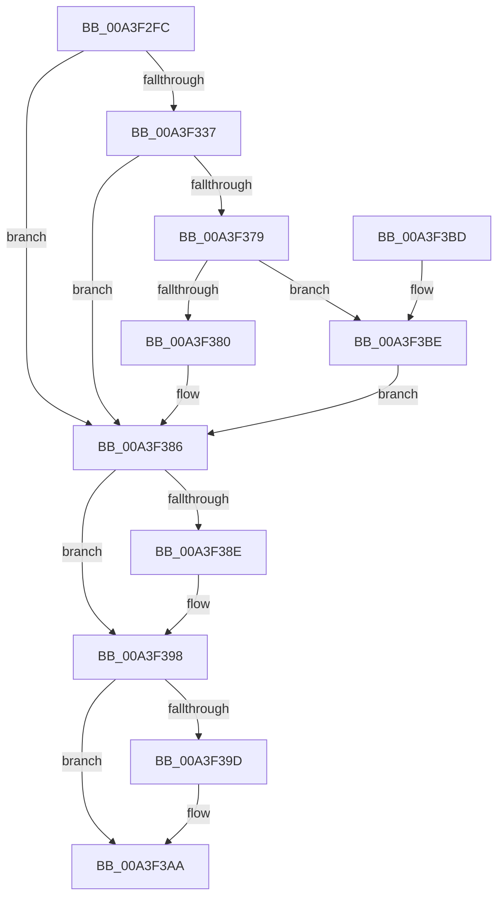

# BiGetObjectDescription

- RVA: `0x00A3F2FC`–`0x00A3F3C5` (길이 `201` bytes)
- VA: `0x0000000140A3F2FC`
- 실행 섹션: `PAGE`
- PDB 이름 있음: `예`; PDB Function 태그: `아니요`
- unwind 정보 RVA: `0x000AE7E8`
- 디코드: `53`개 명령, `201/201` bytes 표시
- 미해석 바이트: `0` (있으면 어셈블리에 `.byte`로 보존)

> 이 문서는 커널 이미지의 기계어와 PDB 기호를 분석해 생성했습니다. 4번과 5번은 함수 원형과 자료형을 바이너리 사용 방식에서 추정한 C 해석이며 원본 소스 복구 결과는 아닙니다.

## 1. Dependencies

- 직접 호출 지점: **4**; 고유 호출 대상: **4**
- 직접 호출자로 확인된 함수: **4**
- RIP 상대 이미지 참조: **2**

### Outgoing calls
- `0x00A3F32C` → [BiOpenKey](BiOpenKey_function_00A3F60C.md) (function, `0x00A3F60C`)
- `0x00A3F369` → [BiGetRegistryValue](BiGetRegistryValue_function_00A3F3CC.md) (function, `0x00A3F3CC`)
- `0x00A3F393` → [BiCloseKey](../91/BiCloseKey_function_00916A00.md) (function, `0x00916A00`)
- `0x00A3F3A5` → [ExFreePoolWithTag](../../poolcode/B8/ExFreePoolWithTag_function_00B82870.md) (function, `0x00B82870`)

### Direct callers
- [BcdEnumerateObjects](../82/BcdEnumerateObjects_function_00823594.md) at `0x0082368D`
- [BcdEnumerateObjects](../82/BcdEnumerateObjects_function_00823594.md) at `0x0082377C`
- [BcdQueryObject](../82/BcdQueryObject_function_0082385C.md) at `0x008238A8`
- [BiIsLinkedToFirmwareVariable](BiIsLinkedToFirmwareVariable_function_00A3E4D0.md) at `0x00A3E509`
- [BiBuildIdentifierList](BiBuildIdentifierList_function_00A3E584.md) at `0x00A3E6AE`

### Static image references
- `0x00A3F31B` → RVA `0x00AFF1D0` (` ?? ::NNGAKEGL::`string'`; read)
- `0x00A3F34E` → RVA `0x00AFC720` (` ?? ::NNGAKEGL::`string'`; read)

## 2. Other-region calls and transfers

- 다른 실행 섹션으로 향하는 call: **1**
  - `0x00A3F3A5` → [ExFreePoolWithTag](../../poolcode/B8/ExFreePoolWithTag_function_00B82870.md) (`PAGE` → `POOLCODE`)
- 별도 외부 분기/꼬리 이동을 확인하지 못했습니다.

## 3. Assembly (complete function range)

```asm
00A3F2FC  48 8B C4                        mov rax, rsp
00A3F2FF  48 89 58 08                     mov qword ptr [rax + 8], rbx
00A3F303  48 89 78 10                     mov qword ptr [rax + 0x10], rdi
00A3F307  41 56                           push r14
00A3F309  48 83 EC 40                     sub rsp, 0x40
00A3F30D  48 83 60 E8 00                  and qword ptr [rax - 0x18], 0
00A3F312  4C 8D 48 E8                     lea r9, [rax - 0x18]
00A3F316  4C 8B F2                        mov r14, rdx
00A3F319  33 DB                           xor ebx, ebx
00A3F31B  48 8D 15 AE FE 0B 00            lea rdx, [rip + 0xbfeae]
00A3F322  48 89 58 20                     mov qword ptr [rax + 0x20], rbx
00A3F326  41 B8 19 00 02 00               mov r8d, 0x20019
00A3F32C  E8 DB 02 00 00                  call 0x140a3f60c
00A3F331  8B F8                           mov edi, eax
00A3F333  85 C0                           test eax, eax
00A3F335  78 4F                           js 0x140a3f386
00A3F337  48 8B 4C 24 30                  mov rcx, qword ptr [rsp + 0x30]
00A3F33C  48 8D 44 24 60                  lea rax, [rsp + 0x60]
00A3F341  21 5C 24 60                     and dword ptr [rsp + 0x60], ebx
00A3F345  44 8D 4B 04                     lea r9d, [rbx + 4]
00A3F349  48 89 44 24 28                  mov qword ptr [rsp + 0x28], rax
00A3F34E  48 8D 15 CB D3 0B 00            lea rdx, [rip + 0xbd3cb]
00A3F355  48 8D 44 24 68                  lea rax, [rsp + 0x68]
00A3F35A  41 C7 06 01 00 00 00            mov dword ptr [r14], 1
00A3F361  45 33 C0                        xor r8d, r8d
00A3F364  48 89 44 24 20                  mov qword ptr [rsp + 0x20], rax
00A3F369  E8 5E 00 00 00                  call 0x140a3f3cc
00A3F36E  48 8B 5C 24 68                  mov rbx, qword ptr [rsp + 0x68]
00A3F373  8B F8                           mov edi, eax
00A3F375  85 C0                           test eax, eax
00A3F377  78 0D                           js 0x140a3f386
00A3F379  83 7C 24 60 04                  cmp dword ptr [rsp + 0x60], 4
00A3F37E  75 3E                           jne 0x140a3f3be
00A3F380  8B 03                           mov eax, dword ptr [rbx]
00A3F382  41 89 46 04                     mov dword ptr [r14 + 4], eax
00A3F386  48 83 7C 24 30 00               cmp qword ptr [rsp + 0x30], 0
00A3F38C  74 0A                           je 0x140a3f398
00A3F38E  48 8B 4C 24 30                  mov rcx, qword ptr [rsp + 0x30]
00A3F393  E8 68 76 ED FF                  call 0x140916a00
00A3F398  48 85 DB                        test rbx, rbx
00A3F39B  74 0D                           je 0x140a3f3aa
00A3F39D  BA 42 43 44 4B                  mov edx, 0x4b444342
00A3F3A2  48 8B CB                        mov rcx, rbx
00A3F3A5  E8 C6 34 14 00                  call 0x140b82870
00A3F3AA  48 8B 5C 24 50                  mov rbx, qword ptr [rsp + 0x50]
00A3F3AF  8B C7                           mov eax, edi
00A3F3B1  48 8B 7C 24 58                  mov rdi, qword ptr [rsp + 0x58]
00A3F3B6  48 83 C4 40                     add rsp, 0x40
00A3F3BA  41 5E                           pop r14
00A3F3BC  C3                              ret
00A3F3BD  CC                              int3
00A3F3BE  BF 24 00 00 C0                  mov edi, 0xc0000024
00A3F3C3  EB C1                           jmp 0x140a3f386
```

## 4. C-style interpretation (structured pseudocode)

```c
__int64 __fastcall BiGetObjectDescription(__int64 a1, __int64 a2)
{
    __int64 result;
    __int64 v_rbx;
    __int64 v_rsp;
    unsigned __int64 v_stack_m18;
    unsigned __int64 v_stack_m20;
    unsigned __int64 v_stack_m28;
    unsigned __int64 v_stack_p10;
    unsigned __int64 v_stack_p18;
    unsigned __int64 v_stack_p20;
    unsigned __int64 v_stack_p8;

    *(unsigned __int64 *)(v_rsp + 8) = v_rbx;
    *(unsigned __int64 *)(v_rsp + 16) = v_rdi;
    v_rsp = (v_rsp) - (64);
    v_rbx = 0;
    *(unsigned __int64 *)(v_rsp + 32) = 0;
    result = BiOpenKey(a1, v_rip + 786094, (unsigned int)(0x20019ULL), v_rsp - 24);
    if (sign_flag) goto loc_00A3F386;
    v_stack_m20 = v_stack_p18;
    *(unsigned int *)(a2) = 1;
    a3 = 0;
    v_stack_m28 = v_stack_p20;
    result = BiGetRegistryValue(v_stack_m18, v_rip + 775115, a3, v_rbx + 4);
    if (sign_flag) goto loc_00A3F386;
    if (v_stack_p18 != 4) goto loc_00A3F3BE;
    *(unsigned int *)(a2 + 4) = (unsigned int)((unsigned int)(*(unsigned int *)(v_stack_p20)));
loc_00A3F386:
    result = (unsigned int)(*(unsigned int *)(v_stack_p20));
    if (v_stack_m18 != 0) {
        a1 = v_stack_m18;
        result = BiCloseKey(a1, v_rip + 775115, a3, v_rbx + 4);
    }
    if (v_stack_p20 != 0) {
        a2 = 0x4B444342ULL;
        a1 = v_stack_p20;
        result = ExFreePoolWithTag(a1, a2, a3, v_rbx + 4);
    }
    v_rsp = (v_rsp) + (64);
    return (unsigned int)((unsigned int)((unsigned int)((unsigned int)(result))));
loc_00A3F3BE:
    goto loc_00A3F386;
}
```

## 5. (Beta) C Style

```c
int64_t BiGetObjectDescription(int64_t Arg1, void *Arg2)
{
    uint8_t *arg2 = (uint8_t *)Arg2;

    int64_t result;
    int64_t local_rbx;
    int64_t local_rsp;
    uint64_t v_stack_m18;
    uint64_t v_stack_m20;
    uint64_t v_stack_m28;
    uint64_t v_stack_p10;
    uint64_t v_stack_p18;
    uint64_t v_stack_p20;
    uint64_t v_stack_p8;

    *(uint64_t *)(local_rsp + 0x8) = local_rbx;
    *(uint64_t *)(local_rsp + 0x10) = local_rdi;
    local_rsp = (local_rsp) - (64);
    local_rbx = 0;
    *(uint64_t *)(local_rsp + 0x20) = 0;
    result = BiOpenKey(Arg1, v_rip + 786094, (uint32_t)(0x20019ULL), local_rsp - 24);
    if (sign_flag) goto loc_00A3F386;
    v_stack_m20 = v_stack_p18;
    *(uint32_t *)(arg2) = 1;
    a3 = 0;
    v_stack_m28 = v_stack_p20;
    result = BiGetRegistryValue(v_stack_m18, v_rip + 775115, a3, local_rbx + 4);
    if (sign_flag) goto loc_00A3F386;
    if (v_stack_p18 != 4) goto loc_00A3F3BE;
    *(uint32_t *)(arg2 + 0x4) = (uint32_t)((uint32_t)(*(uint32_t *)(v_stack_p20)));
loc_00A3F386:
    result = (uint32_t)(*(uint32_t *)(v_stack_p20));
    if (v_stack_m18 != 0) {
        Arg1 = v_stack_m18;
        result = BiCloseKey(Arg1, v_rip + 775115, a3, local_rbx + 4);
    }
    if (v_stack_p20 != 0) {
        Arg2 = 0x4B444342ULL;
        Arg1 = v_stack_p20;
        result = ExFreePoolWithTag(Arg1, Arg2, a3, local_rbx + 4);
    }
    local_rsp = (local_rsp) + (64);
    return (uint32_t)((uint32_t)((uint32_t)((uint32_t)(result))));
loc_00A3F3BE:
    goto loc_00A3F386;
}
```

### 관측된 메모리 오프셋

구조체 형식이 확인되지 않은 접근은 인자 기준의 오프셋으로만 기록했습니다.

| 기준 인자 | 오프셋 표현 | 폭 (bit) | 접근 |
|---|---:|---:|---|
| `Arg2` | `+ 0x0` | `32` | `W` |
| `Arg2` | `+ 0x4` | `32` | `W` |

## 6. Execution-region graph

[열기: 2D/3D 그래프와 함수 탐색 컨트롤 패널](../../../control-panel.html?section=page&rva=0x00A3F2FC&view=graph)

- 2D 그래프는 위에서 아래로 흐르고, 3D 그래프는 빈 공간을 드래그해 회전합니다. Shift+드래그는 이동, 휠은 확대·축소, 함수 노드 선택은 대상 보고서 이동입니다.

### Static fallback


