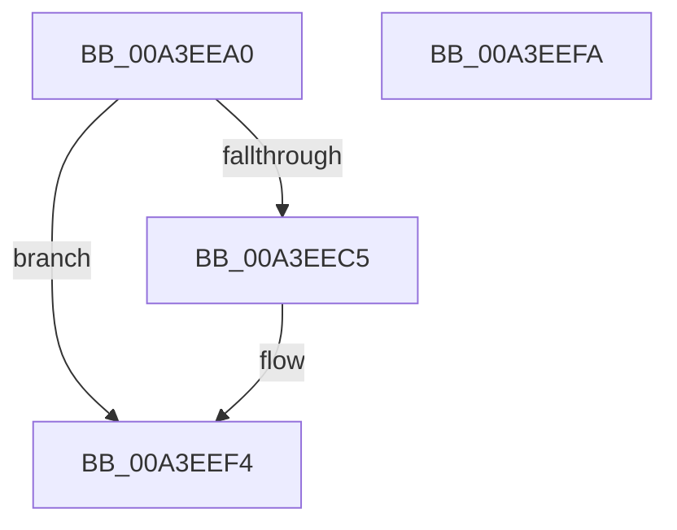

# BiGetObjectIdentifier

- RVA: `0x00A3EEA0`–`0x00A3EEFB` (길이 `91` bytes)
- VA: `0x0000000140A3EEA0`
- 실행 섹션: `PAGE`
- PDB 이름 있음: `예`; PDB Function 태그: `아니요`
- unwind 정보 RVA: `0x00064C80`
- 디코드: `25`개 명령, `91/91` bytes 표시
- 미해석 바이트: `0` (있으면 어셈블리에 `.byte`로 보존)

> 이 문서는 커널 이미지의 기계어와 PDB 기호를 분석해 생성했습니다. 4번과 5번은 함수 원형과 자료형을 바이너리 사용 방식에서 추정한 C 해석이며 원본 소스 복구 결과는 아닙니다.

## 1. Dependencies

- 직접 호출 지점: **4**; 고유 호출 대상: **4**
- 직접 호출자로 확인된 함수: **2**
- RIP 상대 이미지 참조: **0**

### Outgoing calls
- `0x00A3EEBC` → [BiGetKeyName](BiGetKeyName_function_00A3EF04.md) (function, `0x00A3EF04`)
- `0x00A3EECF` → [RtlInitUnicodeString](../../text/42/RtlInitUnicodeString_function_0042A780.md) (function, `0x0042A780`)
- `0x00A3EEDC` → [RtlGUIDFromString](../8F/RtlGUIDFromString_function_008F1EF0.md) (function, `0x008F1EF0`)
- `0x00A3EEED` → [ExFreePoolWithTag](../../poolcode/B8/ExFreePoolWithTag_function_00B82870.md) (function, `0x00B82870`)

### Direct callers
- [BcdQueryObject](../82/BcdQueryObject_function_0082385C.md) at `0x008238BE`
- [BcdGetElementDataWithFlags](BcdGetElementDataWithFlags_function_00A3EBE4.md) at `0x00A3EC8A`

### Static image references
- 디코드된 RIP-relative 메모리 참조가 없습니다.

## 2. Other-region calls and transfers

- 다른 실행 섹션으로 향하는 call: **2**
  - `0x00A3EECF` → [RtlInitUnicodeString](../../text/42/RtlInitUnicodeString_function_0042A780.md) (`PAGE` → `.text`)
  - `0x00A3EEED` → [ExFreePoolWithTag](../../poolcode/B8/ExFreePoolWithTag_function_00B82870.md) (`PAGE` → `POOLCODE`)
- 별도 외부 분기/꼬리 이동을 확인하지 못했습니다.

## 3. Assembly (complete function range)

```asm
00A3EEA0  40 53                           push rbx
00A3EEA2  48 83 EC 30                     sub rsp, 0x30
00A3EEA6  48 83 64 24 50 00               and qword ptr [rsp + 0x50], 0
00A3EEAC  48 8B DA                        mov rbx, rdx
00A3EEAF  0F 57 C0                        xorps xmm0, xmm0
00A3EEB2  48 8D 54 24 50                  lea rdx, [rsp + 0x50]
00A3EEB7  0F 11 44 24 20                  movups xmmword ptr [rsp + 0x20], xmm0
00A3EEBC  E8 43 00 00 00                  call 0x140a3ef04
00A3EEC1  85 C0                           test eax, eax
00A3EEC3  78 2F                           js 0x140a3eef4
00A3EEC5  48 8B 54 24 50                  mov rdx, qword ptr [rsp + 0x50]
00A3EECA  48 8D 4C 24 20                  lea rcx, [rsp + 0x20]
00A3EECF  E8 AC B8 9E FF                  call 0x14042a780
00A3EED4  48 8B D3                        mov rdx, rbx
00A3EED7  48 8D 4C 24 20                  lea rcx, [rsp + 0x20]
00A3EEDC  E8 0F 30 EB FF                  call 0x1408f1ef0
00A3EEE1  48 8B 4C 24 50                  mov rcx, qword ptr [rsp + 0x50]
00A3EEE6  BA 42 43 44 4B                  mov edx, 0x4b444342
00A3EEEB  8B D8                           mov ebx, eax
00A3EEED  E8 7E 39 14 00                  call 0x140b82870
00A3EEF2  8B C3                           mov eax, ebx
00A3EEF4  48 83 C4 30                     add rsp, 0x30
00A3EEF8  5B                              pop rbx
00A3EEF9  C3                              ret
00A3EEFA  CC                              int3
```

## 4. C-style interpretation (structured pseudocode)

```c
__int64 __fastcall BiGetObjectIdentifier(__int64 a1, __int64 a2)
{
    __int64 result;
    __int64 v_rbx;
    __int64 v_rsp;
    unsigned __int64 v_stack_m18;
    unsigned __int64 v_stack_p18;

    v_rsp = (v_rsp) - (48);
    v_stack_m18 = v_xmm0;
    result = BiGetKeyName(a1, v_stack_p18, a3, a4);
    v_rbx = a2;
    if (!(sign_flag)) {
        a2 = v_stack_p18;
        a1 = v_stack_m18;
        result = RtlInitUnicodeString(a1, a2, a3, a4);
        a2 = a2;
        a1 = v_stack_m18;
        result = RtlGUIDFromString(a1, a2, a3, a4);
        a1 = v_stack_p18;
        a2 = 0x4B444342ULL;
        v_rbx = (unsigned int)(result);
        result = ExFreePoolWithTag(a1, a2, a3, a4);
        result = (unsigned int)(v_rbx);
    }
    v_rsp = (v_rsp) + (48);
    return result;
}
```

## 5. (Beta) C Style

```c
int64_t BiGetObjectIdentifier(int64_t Arg1, int64_t Arg2)
{
    int64_t result;
    int64_t local_rbx;
    int64_t local_rsp;
    uint64_t v_stack_m18;
    uint64_t v_stack_p18;

    local_rsp = (local_rsp) - (48);
    v_stack_m18 = v_xmm0;
    result = BiGetKeyName(Arg1, v_stack_p18, a3, a4);
    local_rbx = Arg2;
    if (!(sign_flag)) {
        Arg2 = v_stack_p18;
        Arg1 = v_stack_m18;
        result = RtlInitUnicodeString(Arg1, Arg2, a3, a4);
        Arg2 = Arg2;
        Arg1 = v_stack_m18;
        result = RtlGUIDFromString(Arg1, Arg2, a3, a4);
        Arg1 = v_stack_p18;
        Arg2 = 0x4B444342ULL;
        local_rbx = (uint32_t)(result);
        result = ExFreePoolWithTag(Arg1, Arg2, a3, a4);
        result = (uint32_t)(local_rbx);
    }
    local_rsp = (local_rsp) + (48);
    return result;
}
```

## 6. Execution-region graph

[열기: 2D/3D 그래프와 함수 탐색 컨트롤 패널](../../../control-panel.html?section=page&rva=0x00A3EEA0&view=graph)

- 2D 그래프는 위에서 아래로 흐르고, 3D 그래프는 빈 공간을 드래그해 회전합니다. Shift+드래그는 이동, 휠은 확대·축소, 함수 노드 선택은 대상 보고서 이동입니다.

### Static fallback


