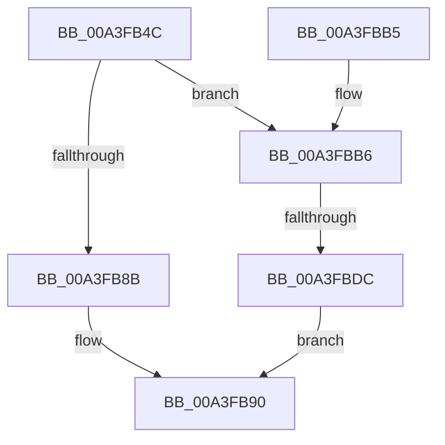

# BiGetObjectReferenceFromEfiEntry

- RVA: `0x00A3FB4C`–`0x00A3FBE3` (길이 `151` bytes)
- VA: `0x0000000140A3FB4C`
- 실행 섹션: `PAGE`
- PDB 이름 있음: `예`; PDB Function 태그: `예`
- unwind 정보 RVA: `0x000AE8B4`
- 디코드: `45`개 명령, `151/151` bytes 표시
- 미해석 바이트: `0` (있으면 어셈블리에 `.byte`로 보존)

> 이 문서는 커널 이미지의 기계어와 PDB 기호를 분석해 생성했습니다. 4번과 5번은 함수 원형과 자료형을 바이너리 사용 방식에서 추정한 C 해석이며 원본 소스 복구 결과는 아닙니다.

## 1. Dependencies

- 직접 호출 지점: **3**; 고유 호출 대상: **3**
- 직접 호출자로 확인된 함수: **2**
- RIP 상대 이미지 참조: **1**

### Outgoing calls
- `0x00A3FB7F` → [BiIsWindowsEfiEntry](BiIsWindowsEfiEntry_function_00A3FBEC.md) (function, `0x00A3FBEC`)
- `0x00A3FB99` → [_security_check_cookie](../../text/6A/_security_check_cookie_function_006AC640.md) (function, `0x006AC640`)
- `0x00A3FBCB` → [ExAllocatePool2](../../poolcode/B8/ExAllocatePool2_function_00B820F0.md) (function, `0x00B820F0`)

### Direct callers
- [BiUpdateObjectReferenceInEfiEntry](../82/BiUpdateObjectReferenceInEfiEntry_function_0082745C.md) at `0x0082749B`
- [BiBuildIdentifierList](BiBuildIdentifierList_function_00A3E584.md) at `0x00A3E80E`

### Static image references
- `0x00A3FB64` → RVA `0x00E0A740` (`.data`; read)

## 2. Other-region calls and transfers

- 다른 실행 섹션으로 향하는 call: **2**
  - `0x00A3FB99` → [_security_check_cookie](../../text/6A/_security_check_cookie_function_006AC640.md) (`PAGE` → `.text`)
  - `0x00A3FBCB` → [ExAllocatePool2](../../poolcode/B8/ExAllocatePool2_function_00B820F0.md) (`PAGE` → `POOLCODE`)
- call이 아닌 외부 분기/꼬리 이동: **1**
  - `0x00A3FBD6` → [sub_00B3A7EA](../B3/Unknown_function_00B3A7EA.md) (`tail-transfer`)

## 3. Assembly (complete function range)

```asm
00A3FB4C  48 89 5C 24 18                  mov qword ptr [rsp + 0x18], rbx
00A3FB51  55                              push rbp
00A3FB52  56                              push rsi
00A3FB53  57                              push rdi
00A3FB54  41 56                           push r14
00A3FB56  41 57                           push r15
00A3FB58  48 8D 6C 24 C9                  lea rbp, [rsp - 0x37]
00A3FB5D  48 81 EC 90 00 00 00            sub rsp, 0x90
00A3FB64  48 8B 05 D5 AB 3C 00            mov rax, qword ptr [rip + 0x3cabd5]
00A3FB6B  48 33 C4                        xor rax, rsp
00A3FB6E  48 89 45 27                     mov qword ptr [rbp + 0x27], rax
00A3FB72  0F 57 C0                        xorps xmm0, xmm0
00A3FB75  4C 8B F2                        mov r14, rdx
00A3FB78  0F 11 45 C7                     movups xmmword ptr [rbp - 0x39], xmm0
00A3FB7C  48 8B F1                        mov rsi, rcx
00A3FB7F  E8 68 00 00 00                  call 0x140a3fbec
00A3FB84  45 33 FF                        xor r15d, r15d
00A3FB87  84 C0                           test al, al
00A3FB89  75 2B                           jne 0x140a3fbb6
00A3FB8B  BB 0D 00 00 C0                  mov ebx, 0xc000000d
00A3FB90  8B C3                           mov eax, ebx
00A3FB92  48 8B 4D 27                     mov rcx, qword ptr [rbp + 0x27]
00A3FB96  48 33 CC                        xor rcx, rsp
00A3FB99  E8 A2 CA C6 FF                  call 0x1406ac640
00A3FB9E  48 8B 9C 24 D0 00 00 00         mov rbx, qword ptr [rsp + 0xd0]
00A3FBA6  48 81 C4 90 00 00 00            add rsp, 0x90
00A3FBAD  41 5F                           pop r15
00A3FBAF  41 5E                           pop r14
00A3FBB1  5F                              pop rdi
00A3FBB2  5E                              pop rsi
00A3FBB3  5D                              pop rbp
00A3FBB4  C3                              ret
00A3FBB5  CC                              int3
00A3FBB6  8B 46 28                        mov eax, dword ptr [rsi + 0x28]
00A3FBB9  41 B8 42 43 44 4B               mov r8d, 0x4b444342
00A3FBBF  83 E8 14                        sub eax, 0x14
00A3FBC2  B9 02 01 00 00                  mov ecx, 0x102
00A3FBC7  8B D0                           mov edx, eax
00A3FBC9  8B D8                           mov ebx, eax
00A3FBCB  E8 20 25 14 00                  call 0x140b820f0
00A3FBD0  48 8B F8                        mov rdi, rax
00A3FBD3  48 85 C0                        test rax, rax
00A3FBD6  0F 85 0E AC 0F 00               jne 0x140b3a7ea
00A3FBDC  BB 9A 00 00 C0                  mov ebx, 0xc000009a
00A3FBE1  EB AD                           jmp 0x140a3fb90
```

## 4. C-style interpretation (structured pseudocode)

```c
__int64 __fastcall BiGetObjectReferenceFromEfiEntry(__int64 a1, __int64 a2)
{
    __int64 result;
    __int64 v_r15;
    __int64 v_rsp;
    unsigned __int64 v_stack_m38;
    unsigned __int64 v_stack_m5F;
    unsigned __int64 v_stack_m98;
    unsigned __int64 v_stack_p18;

    v_stack_p18 = v_rbx;
    v_rsp = (v_rsp) - (144);
    result = (*(unsigned __int64 *)(v_rip + 3976149)) ^ (v_rsp);
    v_stack_m38 = result;
    v_stack_m98 = v_xmm0;
    result = BiIsWindowsEfiEntry(a1, a2, a3, a4);
    v_r15 = 0;
    if ((unsigned __int8)(result) != 0) goto loc_00A3FBB6;
loc_00A3FB90:
    a1 = (v_stack_m38) ^ (v_rsp);
    result = _security_check_cookie(a1, a2, a3, a4);
    v_rsp = (v_rsp) + (144);
    return result;
loc_00A3FBB6:
    result = (unsigned int)(((unsigned int)(*(unsigned int *)(a1 + 40))) - (20));
    result = ExAllocatePool2(258, (unsigned int)((unsigned int)(result)), (unsigned int)(0x4B444342ULL), a4);
    goto loc_00A3FB90;
}
```

## 5. (Beta) C Style

```c
int64_t BiGetObjectReferenceFromEfiEntry(void *Arg1, int64_t Arg2)
{
    uint8_t *arg1 = (uint8_t *)Arg1;

    int64_t result;
    int64_t local_r15;
    int64_t local_rsp;
    uint64_t v_stack_m38;
    uint64_t v_stack_m5F;
    uint64_t v_stack_m98;
    uint64_t v_stack_p18;

    v_stack_p18 = local_rbx;
    local_rsp = (local_rsp) - (144);
    result = (*(uint64_t *)(v_rip + 0x3CABD5)) ^ (local_rsp);
    v_stack_m38 = result;
    v_stack_m98 = v_xmm0;
    result = BiIsWindowsEfiEntry(Arg1, Arg2, a3, a4);
    local_r15 = 0;
    if ((uint8_t)(result) != 0) goto loc_00A3FBB6;
loc_00A3FB90:
    Arg1 = (v_stack_m38) ^ (local_rsp);
    result = _security_check_cookie(Arg1, Arg2, a3, a4);
    local_rsp = (local_rsp) + (144);
    return result;
loc_00A3FBB6:
    result = (uint32_t)(((uint32_t)(*(uint32_t *)(arg1 + 0x28))) - (20));
    result = ExAllocatePool2(258, (uint32_t)((uint32_t)(result)), (uint32_t)(0x4B444342ULL), a4);
    goto loc_00A3FB90;
}
```

### 관측된 메모리 오프셋

구조체 형식이 확인되지 않은 접근은 인자 기준의 오프셋으로만 기록했습니다.

| 기준 인자 | 오프셋 표현 | 폭 (bit) | 접근 |
|---|---:|---:|---|
| `Arg1` | `+ 0x28` | `32` | `R` |

## 6. Execution-region graph

[열기: 2D/3D 그래프와 함수 탐색 컨트롤 패널](../../../control-panel.html?section=page&rva=0x00A3FB4C&view=graph)

- 2D 그래프는 위에서 아래로 흐르고, 3D 그래프는 빈 공간을 드래그해 회전합니다. Shift+드래그는 이동, 휠은 확대·축소, 함수 노드 선택은 대상 보고서 이동입니다.

### Static fallback


