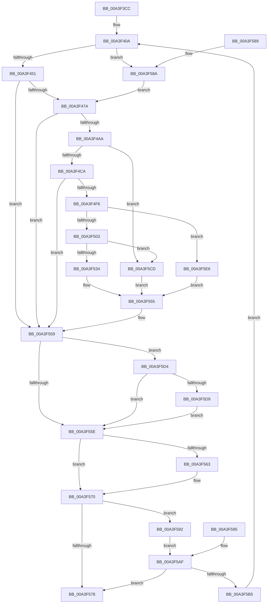

# BiGetRegistryValue

- RVA: `0x00A3F3CC`–`0x00A3F604` (길이 `568` bytes)
- VA: `0x0000000140A3F3CC`
- 실행 섹션: `PAGE`
- PDB 이름 있음: `예`; PDB Function 태그: `아니요`
- unwind 정보 RVA: `0x000AE7FC`
- 디코드: `143`개 명령, `568/568` bytes 표시
- 미해석 바이트: `0` (있으면 어셈블리에 `.byte`로 보존)

> 이 문서는 커널 이미지의 기계어와 PDB 기호를 분석해 생성했습니다. 4번과 5번은 함수 원형과 자료형을 바이너리 사용 방식에서 추정한 C 해석이며 원본 소스 복구 결과는 아닙니다.

## 1. Dependencies

- 직접 호출 지점: **11**; 고유 호출 대상: **9**
- 직접 호출자로 확인된 함수: **11**
- RIP 상대 이미지 참조: **1**

### Outgoing calls
- `0x00A3F430` → [RtlInitUnicodeString](../../text/42/RtlInitUnicodeString_function_0042A780.md) (function, `0x0042A780`)
- `0x00A3F438` → [BiSanitizeHandle](../../text/4B/BiSanitizeHandle_function_004B0E4C.md) (function, `0x004B0E4C`)
- `0x00A3F462` → [BiOpenKey](BiOpenKey_function_00A3F60C.md) (function, `0x00A3F60C`)
- `0x00A3F494` → [BiZwQueryValueKey](../../text/4A/BiZwQueryValueKey_function_004A8184.md) (function, `0x004A8184`)
- `0x00A3F4B9` → [ExAllocatePool2](../../poolcode/B8/ExAllocatePool2_function_00B820F0.md) (function, `0x00B820F0`)
- `0x00A3F4E7` → [BiZwQueryValueKey](../../text/4A/BiZwQueryValueKey_function_004A8184.md) (function, `0x004A8184`)
- `0x00A3F51B` → [ExAllocatePool2](../../poolcode/B8/ExAllocatePool2_function_00B820F0.md) (function, `0x00B820F0`)
- `0x00A3F540` → [memcpy](../../text/6C/memcpy_function_006C6840.md) (function, `0x006C6840`)
- `0x00A3F56B` → [ExFreePoolWithTag](../../poolcode/B8/ExFreePoolWithTag_function_00B82870.md) (function, `0x00B82870`)
- `0x00A3F5DC` → [BiZwClose](../../text/4A/BiZwClose_function_004A85DC.md) (function, `0x004A85DC`)
- `0x00A3F5F5` → [BiLogMessage](BiLogMessage_function_00A3D3A8.md) (function, `0x00A3D3A8`)

### Direct callers
- [BiWasFirmwareModified](../../text/4C/BiWasFirmwareModified_function_004CB8F4.md) at `0x004CB92C`
- [BiMarkTreatAsSystemStore](../82/BiMarkTreatAsSystemStore_function_008234C8.md) at `0x00823508`
- [BiIsPortableWorkspaceBoot](../82/BiIsPortableWorkspaceBoot_function_008261C0.md) at `0x0082622B`
- [BiUpdateBcdObject](../82/BiUpdateBcdObject_function_008270D0.md) at `0x00827168`
- [BiIsSystemStore](BiIsSystemStore_function_00A3DF84.md) at `0x00A3DFCE`
- [BiIsSystemStoreCandidate](BiIsSystemStoreCandidate_function_00A3E00C.md) at `0x00A3E044`
- [BcdGetElementDataWithFlags](BcdGetElementDataWithFlags_function_00A3EBE4.md) at `0x00A3ED49`
- [BiGetObjectDescription](BiGetObjectDescription_function_00A3F2FC.md) at `0x00A3F369`
- [BiIsWinPEBoot](../A4/BiIsWinPEBoot_function_00A40F54.md) at `0x00A40F8E`
- [BiUnloadHiveByHandle](../A4/BiUnloadHiveByHandle_function_00A4105C.md) at `0x00A410A0`
- [BiGetSavedBootEntry](../A4/BiGetSavedBootEntry_function_00A41248.md) at `0x00A41285`

### Static image references
- `0x00A3F5E9` → RVA `0x00B0C110` (` ?? ::NNGAKEGL::`string'`; read)

## 2. Other-region calls and transfers

- 다른 실행 섹션으로 향하는 call: **9**
  - `0x00A3F430` → [RtlInitUnicodeString](../../text/42/RtlInitUnicodeString_function_0042A780.md) (`PAGE` → `.text`)
  - `0x00A3F438` → [BiSanitizeHandle](../../text/4B/BiSanitizeHandle_function_004B0E4C.md) (`PAGE` → `.text`)
  - `0x00A3F494` → [BiZwQueryValueKey](../../text/4A/BiZwQueryValueKey_function_004A8184.md) (`PAGE` → `.text`)
  - `0x00A3F4B9` → [ExAllocatePool2](../../poolcode/B8/ExAllocatePool2_function_00B820F0.md) (`PAGE` → `POOLCODE`)
  - `0x00A3F4E7` → [BiZwQueryValueKey](../../text/4A/BiZwQueryValueKey_function_004A8184.md) (`PAGE` → `.text`)
  - `0x00A3F51B` → [ExAllocatePool2](../../poolcode/B8/ExAllocatePool2_function_00B820F0.md) (`PAGE` → `POOLCODE`)
  - `0x00A3F540` → [memcpy](../../text/6C/memcpy_function_006C6840.md) (`PAGE` → `.text`)
  - `0x00A3F56B` → [ExFreePoolWithTag](../../poolcode/B8/ExFreePoolWithTag_function_00B82870.md) (`PAGE` → `POOLCODE`)
  - `0x00A3F5DC` → [BiZwClose](../../text/4A/BiZwClose_function_004A85DC.md) (`PAGE` → `.text`)
- 별도 외부 분기/꼬리 이동을 확인하지 못했습니다.

## 3. Assembly (complete function range)

```asm
00A3F3CC  44 89 4C 24 20                  mov dword ptr [rsp + 0x20], r9d
00A3F3D1  4C 89 44 24 18                  mov qword ptr [rsp + 0x18], r8
00A3F3D6  48 89 54 24 10                  mov qword ptr [rsp + 0x10], rdx
00A3F3DB  53                              push rbx
00A3F3DC  56                              push rsi
00A3F3DD  41 54                           push r12
00A3F3DF  41 55                           push r13
00A3F3E1  41 56                           push r14
00A3F3E3  41 57                           push r15
00A3F3E5  48 83 EC 68                     sub rsp, 0x68
00A3F3E9  45 8B E9                        mov r13d, r9d
00A3F3EC  49 8B D8                        mov rbx, r8
00A3F3EF  48 8B C2                        mov rax, rdx
00A3F3F2  4C 8B F9                        mov r15, rcx
00A3F3F5  83 64 24 38 00                  and dword ptr [rsp + 0x38], 0
00A3F3FA  83 64 24 30 00                  and dword ptr [rsp + 0x30], 0
00A3F3FF  0F 57 C0                        xorps xmm0, xmm0
00A3F402  0F 11 44 24 48                  movups xmmword ptr [rsp + 0x48], xmm0
00A3F407  45 33 E4                        xor r12d, r12d
00A3F40A  45 33 F6                        xor r14d, r14d
00A3F40D  4C 21 74 24 40                  and qword ptr [rsp + 0x40], r14
00A3F412  48 8B 8C 24 C0 00 00 00         mov rcx, qword ptr [rsp + 0xc0]
00A3F41A  4C 21 31                        and qword ptr [rcx], r14
00A3F41D  48 8B 8C 24 C8 00 00 00         mov rcx, qword ptr [rsp + 0xc8]
00A3F425  44 21 31                        and dword ptr [rcx], r14d
00A3F428  48 8B D0                        mov rdx, rax
00A3F42B  48 8D 4C 24 48                  lea rcx, [rsp + 0x48]
00A3F430  E8 4B B3 9E FF                  call 0x14042a780
00A3F435  49 8B CF                        mov rcx, r15
00A3F438  E8 0F 1A A7 FF                  call 0x1404b0e4c
00A3F43D  4C 8B F8                        mov r15, rax
00A3F440  48 89 84 24 A0 00 00 00         mov qword ptr [rsp + 0xa0], rax
00A3F448  48 85 DB                        test rbx, rbx
00A3F44B  0F 84 39 01 00 00               je 0x140a3f58a
00A3F451  4C 8D 4C 24 40                  lea r9, [rsp + 0x40]
00A3F456  41 B8 19 00 02 00               mov r8d, 0x20019
00A3F45C  48 8B D3                        mov rdx, rbx
00A3F45F  48 8B C8                        mov rcx, rax
00A3F462  E8 A5 01 00 00                  call 0x140a3f60c
00A3F467  8B D8                           mov ebx, eax
00A3F469  89 44 24 34                     mov dword ptr [rsp + 0x34], eax
00A3F46D  48 8B 74 24 40                  mov rsi, qword ptr [rsp + 0x40]
00A3F472  85 C0                           test eax, eax
00A3F474  0F 88 DF 00 00 00               js 0x140a3f559
00A3F47A  48 8D 44 24 30                  lea rax, [rsp + 0x30]
00A3F47F  48 89 44 24 28                  mov qword ptr [rsp + 0x28], rax
00A3F484  44 21 74 24 20                  and dword ptr [rsp + 0x20], r14d
00A3F489  45 33 C9                        xor r9d, r9d
00A3F48C  48 8D 54 24 48                  lea rdx, [rsp + 0x48]
00A3F491  48 8B CE                        mov rcx, rsi
00A3F494  E8 EB 8C A6 FF                  call 0x1404a8184
00A3F499  8B D8                           mov ebx, eax
00A3F49B  89 44 24 34                     mov dword ptr [rsp + 0x34], eax
00A3F49F  3D 23 00 00 C0                  cmp eax, 0xc0000023
00A3F4A4  0F 85 AF 00 00 00               jne 0x140a3f559
00A3F4AA  8B 54 24 30                     mov edx, dword ptr [rsp + 0x30]
00A3F4AE  B9 02 01 00 00                  mov ecx, 0x102
00A3F4B3  41 B8 42 43 44 4B               mov r8d, 0x4b444342
00A3F4B9  E8 32 2C 14 00                  call 0x140b820f0
00A3F4BE  4C 8B F0                        mov r14, rax
00A3F4C1  48 85 C0                        test rax, rax
00A3F4C4  0F 84 03 01 00 00               je 0x140a3f5cd
00A3F4CA  48 8D 44 24 38                  lea rax, [rsp + 0x38]
00A3F4CF  48 89 44 24 28                  mov qword ptr [rsp + 0x28], rax
00A3F4D4  8B 44 24 30                     mov eax, dword ptr [rsp + 0x30]
00A3F4D8  89 44 24 20                     mov dword ptr [rsp + 0x20], eax
00A3F4DC  4D 8B CE                        mov r9, r14
00A3F4DF  48 8D 54 24 48                  lea rdx, [rsp + 0x48]
00A3F4E4  48 8B CE                        mov rcx, rsi
00A3F4E7  E8 98 8C A6 FF                  call 0x1404a8184
00A3F4EC  8B D8                           mov ebx, eax
00A3F4EE  89 44 24 34                     mov dword ptr [rsp + 0x34], eax
00A3F4F2  85 C0                           test eax, eax
00A3F4F4  78 63                           js 0x140a3f559
00A3F4F6  45 8B 4E 04                     mov r9d, dword ptr [r14 + 4]
00A3F4FA  45 3B CD                        cmp r9d, r13d
00A3F4FD  0F 85 E3 00 00 00               jne 0x140a3f5e6
00A3F503  8B 44 24 30                     mov eax, dword ptr [rsp + 0x30]
00A3F507  83 C0 F4                        add eax, -0xc
00A3F50A  89 44 24 30                     mov dword ptr [rsp + 0x30], eax
00A3F50E  8B D0                           mov edx, eax
00A3F510  B9 02 01 00 00                  mov ecx, 0x102
00A3F515  41 B8 42 43 44 4B               mov r8d, 0x4b444342
00A3F51B  E8 D0 2B 14 00                  call 0x140b820f0
00A3F520  48 8B 8C 24 C0 00 00 00         mov rcx, qword ptr [rsp + 0xc0]
00A3F528  48 89 01                        mov qword ptr [rcx], rax
00A3F52B  48 85 C0                        test rax, rax
00A3F52E  0F 84 99 00 00 00               je 0x140a3f5cd
00A3F534  44 8B 44 24 30                  mov r8d, dword ptr [rsp + 0x30]
00A3F539  49 8D 56 0C                     lea rdx, [r14 + 0xc]
00A3F53D  48 8B C8                        mov rcx, rax
00A3F540  E8 FB 72 C8 FF                  call 0x1406c6840
00A3F545  8B 44 24 30                     mov eax, dword ptr [rsp + 0x30]
00A3F549  48 8B 8C 24 C8 00 00 00         mov rcx, qword ptr [rsp + 0xc8]
00A3F551  89 01                           mov dword ptr [rcx], eax
00A3F553  33 DB                           xor ebx, ebx
00A3F555  89 5C 24 34                     mov dword ptr [rsp + 0x34], ebx
00A3F559  49 3B F7                        cmp rsi, r15
00A3F55C  75 76                           jne 0x140a3f5d4
00A3F55E  4D 85 F6                        test r14, r14
00A3F561  74 0D                           je 0x140a3f570
00A3F563  BA 42 43 44 4B                  mov edx, 0x4b444342
00A3F568  49 8B CE                        mov rcx, r14
00A3F56B  E8 00 33 14 00                  call 0x140b82870
00A3F570  81 FB 7D 01 00 C0               cmp ebx, 0xc000017d
00A3F576  74 1A                           je 0x140a3f592
00A3F578  8B C3                           mov eax, ebx
00A3F57A  48 83 C4 68                     add rsp, 0x68
00A3F57E  41 5F                           pop r15
00A3F580  41 5E                           pop r14
00A3F582  41 5D                           pop r13
00A3F584  41 5C                           pop r12
00A3F586  5E                              pop rsi
00A3F587  5B                              pop rbx
00A3F588  C3                              ret
00A3F589  CC                              int3
00A3F58A  49 8B F7                        mov rsi, r15
00A3F58D  E9 E8 FE FF FF                  jmp 0x140a3f47a
00A3F592  CC                              int3
00A3F593  EB 1A                           jmp 0x140a3f5af
00A3F595  41 BC 05 00 00 00               mov r12d, 5
00A3F59B  44 8B AC 24 B8 00 00 00         mov r13d, dword ptr [rsp + 0xb8]
00A3F5A3  4C 8B BC 24 A0 00 00 00         mov r15, qword ptr [rsp + 0xa0]
00A3F5AB  8B 5C 24 34                     mov ebx, dword ptr [rsp + 0x34]
00A3F5AF  41 83 FC 05                     cmp r12d, 5
00A3F5B3  73 C3                           jae 0x140a3f578
00A3F5B5  41 FF C4                        inc r12d
00A3F5B8  48 8B 9C 24 B0 00 00 00         mov rbx, qword ptr [rsp + 0xb0]
00A3F5C0  48 8B 84 24 A8 00 00 00         mov rax, qword ptr [rsp + 0xa8]
00A3F5C8  E9 3D FE FF FF                  jmp 0x140a3f40a
00A3F5CD  BB 9A 00 00 C0                  mov ebx, 0xc000009a
00A3F5D2  EB 81                           jmp 0x140a3f555
00A3F5D4  48 85 F6                        test rsi, rsi
00A3F5D7  74 85                           je 0x140a3f55e
00A3F5D9  48 8B CE                        mov rcx, rsi
00A3F5DC  E8 FB 8F A6 FF                  call 0x1404a85dc
00A3F5E1  E9 78 FF FF FF                  jmp 0x140a3f55e
00A3F5E6  45 8B C5                        mov r8d, r13d
00A3F5E9  48 8D 15 20 CB 0C 00            lea rdx, [rip + 0xccb20]
00A3F5F0  B9 04 00 00 00                  mov ecx, 4
00A3F5F5  E8 AE DD FF FF                  call 0x140a3d3a8
00A3F5FA  BB 24 00 00 C0                  mov ebx, 0xc0000024
00A3F5FF  E9 51 FF FF FF                  jmp 0x140a3f555
```

## 4. C-style interpretation (structured pseudocode)

```c
__int64 __fastcall BiGetRegistryValue(__int64 a1, __int64 a2, __int64 a3, int a4, __int64 a5, __int64 a6)
{
    __int64 result;
    __int64 v_r12;
    __int64 v_r14;
    __int64 v_rbx;
    __int64 v_rsp;
    unsigned __int64 v_stack_m50;
    unsigned __int64 v_stack_m58;
    unsigned int v_stack_m60;
    unsigned int v_stack_m64;
    unsigned int v_stack_m68;
    unsigned __int64 v_stack_m70;
    unsigned int v_stack_m78;
    unsigned __int64 v_stack_p10;
    unsigned __int64 v_stack_p18;
    unsigned int v_stack_p20;
    unsigned int v_stack_p34;
    unsigned __int64 v_stack_p8;
    unsigned __int64 v_stack_pA0;
    unsigned __int64 v_stack_pA8;
    unsigned __int64 v_stack_pB0;
    unsigned int v_stack_pB8;

    v_stack_p20 = a4;
    v_stack_p18 = a3;
    v_stack_p10 = a2;
    v_rsp = (v_rsp) - (104);
    v_stack_m50 = v_xmm0;
    v_r12 = 0;
loc_00A3F40A:
    v_r14 = 0;
    result = RtlInitUnicodeString(v_stack_m50, a2, a3, a4);
    result = BiSanitizeHandle(a1, a2, a3, a4);
    v_stack_p8 = result;
    if (a3 == 0) goto loc_00A3F58A;
    result = BiOpenKey(result, a3, (unsigned int)(0x20019ULL), v_stack_m58);
    v_stack_m64 = (unsigned int)(result);
    if (sign_flag) goto loc_00A3F559;
loc_00A3F47A:
    v_stack_m70 = v_stack_m68;
    a4 = 0;
    result = BiZwQueryValueKey(v_stack_m58, v_stack_m50, (unsigned int)(0x20019ULL), a4);
    v_stack_m64 = (unsigned int)(result);
    if (((unsigned int)(result)) != 0xC0000023ULL) goto loc_00A3F559;
    result = ExAllocatePool2(258, (unsigned int)(v_stack_m68), (unsigned int)(0x4B444342ULL), a4);
    if (result == 0) goto loc_00A3F5CD;
    v_stack_m70 = v_stack_m60;
    v_stack_m78 = (unsigned int)((unsigned int)(v_stack_m68));
    result = BiZwQueryValueKey(v_stack_m58, v_stack_m50, (unsigned int)(0x4B444342ULL), result);
    v_stack_m64 = (unsigned int)(result);
    if (sign_flag) goto loc_00A3F559;
    if (((unsigned int)((unsigned int)(*(unsigned int *)(result + 4)))) != ((unsigned int)((unsigned int)(a4)))) goto loc_00A3F5E6;
    result = (unsigned int)(((unsigned int)(v_stack_m68)) + (-12));
    v_stack_m68 = (unsigned int)(result);
    result = ExAllocatePool2(258, (unsigned int)((unsigned int)(result)), (unsigned int)(0x4B444342ULL), (unsigned int)(*(unsigned int *)(result + 4)));
    *(unsigned __int64 *)(a5) = result;
    if (result == 0) goto loc_00A3F5CD;
    result = memcpy(result, result + 12, (unsigned int)(v_stack_m68), (unsigned int)(*(unsigned int *)(result + 4)));
    *(unsigned int *)(a6) = (unsigned int)((unsigned int)(v_stack_m68));
    v_rbx = 0;
loc_00A3F555:
    v_stack_m64 = 0;
loc_00A3F559:
    if (v_stack_m58 != result) goto loc_00A3F5D4;
loc_00A3F55E:
    result = (unsigned int)(v_stack_m68);
    if (result != 0) {
        a2 = 0x4B444342ULL;
        a1 = result;
        result = ExFreePoolWithTag(a1, a2, (unsigned int)(v_stack_m68), (unsigned int)(*(unsigned int *)(result + 4)));
    }
    if (0 == 0xC000017DULL) goto loc_00A3F592;
loc_00A3F578:
    v_rsp = (v_rsp) + (104);
    return 0;
loc_00A3F58A:
    goto loc_00A3F47A;
loc_00A3F592:
    goto loc_00A3F5AF;
loc_00A3F5AF:
    if (0 >= 5) goto loc_00A3F578;
    v_r12 = (unsigned int)((v_r12) + 1);
    goto loc_00A3F40A;
loc_00A3F5CD:
    goto loc_00A3F555;
loc_00A3F5D4:
    if (result == 0) goto loc_00A3F55E;
    result = BiZwClose(result, a2, (unsigned int)(v_stack_m68), (unsigned int)(*(unsigned int *)(result + 4)));
    goto loc_00A3F55E;
loc_00A3F5E6:
    result = BiLogMessage(4, v_rip + 838432, (unsigned int)((unsigned int)((unsigned int)(a4))), (unsigned int)(*(unsigned int *)(result + 4)));
    goto loc_00A3F555;
}
```

## 5. (Beta) C Style

```c
int64_t BiGetRegistryValue(int64_t Arg1, int64_t Arg2, int64_t Arg3, int32_t Arg4, void *Arg5, void *Arg6)
{
    uint8_t *arg5 = (uint8_t *)Arg5;
    uint8_t *arg6 = (uint8_t *)Arg6;

    int64_t result;
    int64_t local_r12;
    int64_t local_r14;
    int64_t local_rbx;
    int64_t local_rsp;
    uint64_t v_stack_m50;
    uint64_t v_stack_m58;
    uint32_t v_stack_m60;
    uint32_t v_stack_m64;
    uint32_t v_stack_m68;
    uint64_t v_stack_m70;
    uint32_t v_stack_m78;
    uint64_t v_stack_p10;
    uint64_t v_stack_p18;
    uint32_t v_stack_p20;
    uint32_t v_stack_p34;
    uint64_t v_stack_p8;
    uint64_t v_stack_pA0;
    uint64_t v_stack_pA8;
    uint64_t v_stack_pB0;
    uint32_t v_stack_pB8;

    v_stack_p20 = Arg4;
    v_stack_p18 = Arg3;
    v_stack_p10 = Arg2;
    local_rsp = (local_rsp) - (104);
    v_stack_m50 = v_xmm0;
    local_r12 = 0;
loc_00A3F40A:
    local_r14 = 0;
    result = RtlInitUnicodeString(v_stack_m50, Arg2, Arg3, Arg4);
    result = BiSanitizeHandle(Arg1, Arg2, Arg3, Arg4);
    v_stack_p8 = result;
    if (Arg3 == 0) goto loc_00A3F58A;
    result = BiOpenKey(result, Arg3, (uint32_t)(0x20019ULL), v_stack_m58);
    v_stack_m64 = (uint32_t)(result);
    if (sign_flag) goto loc_00A3F559;
loc_00A3F47A:
    v_stack_m70 = v_stack_m68;
    Arg4 = 0;
    result = BiZwQueryValueKey(v_stack_m58, v_stack_m50, (uint32_t)(0x20019ULL), Arg4);
    v_stack_m64 = (uint32_t)(result);
    if (((uint32_t)(result)) != 0xC0000023ULL) goto loc_00A3F559;
    result = ExAllocatePool2(258, (uint32_t)(v_stack_m68), (uint32_t)(0x4B444342ULL), Arg4);
    if (result == 0) goto loc_00A3F5CD;
    v_stack_m70 = v_stack_m60;
    v_stack_m78 = (uint32_t)((uint32_t)(v_stack_m68));
    result = BiZwQueryValueKey(v_stack_m58, v_stack_m50, (uint32_t)(0x4B444342ULL), result);
    v_stack_m64 = (uint32_t)(result);
    if (sign_flag) goto loc_00A3F559;
    if (((uint32_t)((uint32_t)(*(uint32_t *)(result + 0x4)))) != ((uint32_t)((uint32_t)(Arg4)))) goto loc_00A3F5E6;
    result = (uint32_t)(((uint32_t)(v_stack_m68)) + (-12));
    v_stack_m68 = (uint32_t)(result);
    result = ExAllocatePool2(258, (uint32_t)((uint32_t)(result)), (uint32_t)(0x4B444342ULL), (uint32_t)(*(uint32_t *)(result + 0x4)));
    *(uint64_t *)(arg5) = result;
    if (result == 0) goto loc_00A3F5CD;
    result = memcpy(result, result + 12, (uint32_t)(v_stack_m68), (uint32_t)(*(uint32_t *)(result + 0x4)));
    *(uint32_t *)(arg6) = (uint32_t)((uint32_t)(v_stack_m68));
    local_rbx = 0;
loc_00A3F555:
    v_stack_m64 = 0;
loc_00A3F559:
    if (v_stack_m58 != result) goto loc_00A3F5D4;
loc_00A3F55E:
    result = (uint32_t)(v_stack_m68);
    if (result != 0) {
        Arg2 = 0x4B444342ULL;
        Arg1 = result;
        result = ExFreePoolWithTag(Arg1, Arg2, (uint32_t)(v_stack_m68), (uint32_t)(*(uint32_t *)(result + 0x4)));
    }
    if (0 == 0xC000017DULL) goto loc_00A3F592;
loc_00A3F578:
    local_rsp = (local_rsp) + (104);
    return 0;
loc_00A3F58A:
    goto loc_00A3F47A;
loc_00A3F592:
    goto loc_00A3F5AF;
loc_00A3F5AF:
    if (0 >= 5) goto loc_00A3F578;
    local_r12 = (uint32_t)((local_r12) + 1);
    goto loc_00A3F40A;
loc_00A3F5CD:
    goto loc_00A3F555;
loc_00A3F5D4:
    if (result == 0) goto loc_00A3F55E;
    result = BiZwClose(result, Arg2, (uint32_t)(v_stack_m68), (uint32_t)(*(uint32_t *)(result + 0x4)));
    goto loc_00A3F55E;
loc_00A3F5E6:
    result = BiLogMessage(4, v_rip + 838432, (uint32_t)((uint32_t)((uint32_t)(Arg4))), (uint32_t)(*(uint32_t *)(result + 0x4)));
    goto loc_00A3F555;
}
```

### 관측된 메모리 오프셋

구조체 형식이 확인되지 않은 접근은 인자 기준의 오프셋으로만 기록했습니다.

| 기준 인자 | 오프셋 표현 | 폭 (bit) | 접근 |
|---|---:|---:|---|
| `Arg5` | `+ 0x0` | `64` | `R/W` |
| `Arg5` | `+ 0x0` | `64` | `W` |
| `Arg6` | `+ 0x0` | `32` | `R/W` |
| `Arg6` | `+ 0x0` | `32` | `W` |

## 6. Execution-region graph

[열기: 2D/3D 그래프와 함수 탐색 컨트롤 패널](../../../control-panel.html?section=page&rva=0x00A3F3CC&view=graph)

- 2D 그래프는 위에서 아래로 흐르고, 3D 그래프는 빈 공간을 드래그해 회전합니다. Shift+드래그는 이동, 휠은 확대·축소, 함수 노드 선택은 대상 보고서 이동입니다.

### Static fallback


