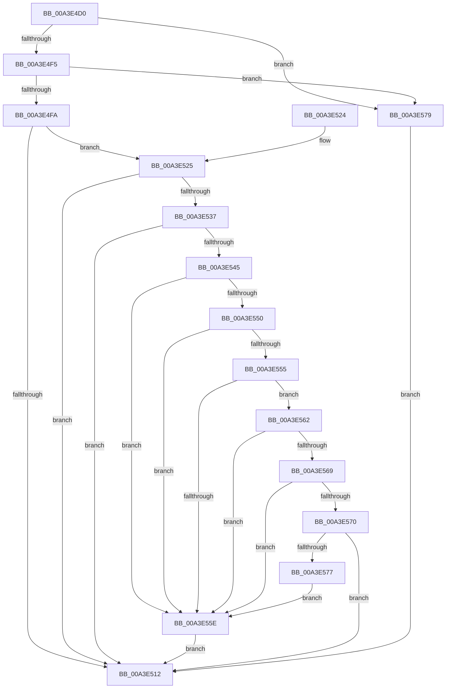

# BiIsLinkedToFirmwareVariable

- RVA: `0x00A3E4D0`–`0x00A3E57D` (길이 `173` bytes)
- VA: `0x0000000140A3E4D0`
- 실행 섹션: `PAGE`
- PDB 이름 있음: `예`; PDB Function 태그: `아니요`
- unwind 정보 RVA: `0x000A4544`
- 디코드: `54`개 명령, `173/173` bytes 표시
- 미해석 바이트: `0` (있으면 어셈블리에 `.byte`로 보존)

> 이 문서는 커널 이미지의 기계어와 PDB 기호를 분석해 생성했습니다. 4번과 5번은 함수 원형과 자료형을 바이너리 사용 방식에서 추정한 C 해석이며 원본 소스 복구 결과는 아닙니다.

## 1. Dependencies

- 직접 호출 지점: **2**; 고유 호출 대상: **2**
- 직접 호출자로 확인된 함수: **5**
- RIP 상대 이미지 참조: **0**

### Outgoing calls
- `0x00A3E4E7` → [BiGetFirmwareType](BiGetFirmwareType_function_00A3FA5C.md) (function, `0x00A3FA5C`)
- `0x00A3E509` → [BiGetObjectDescription](BiGetObjectDescription_function_00A3F2FC.md) (function, `0x00A3F2FC`)

### Direct callers
- [BcdDeleteObject](BcdDeleteObject_function_00A3C578.md) at `0x00A3C5A9`
- [BcdCreateObject](BcdCreateObject_function_00A3D890.md) at `0x00A3D90F`
- [BiBindEfiBootManager](BiBindEfiBootManager_function_00A3DCB0.md) at `0x00A3DECC`
- [BiDeleteElement](BiDeleteElement_function_00A3E0F8.md) at `0x00A3E220`
- [BcdSetElementDataWithFlags](BcdSetElementDataWithFlags_function_00A3F080.md) at `0x00A3F266`

### Static image references
- 디코드된 RIP-relative 메모리 참조가 없습니다.

## 2. Other-region calls and transfers

- 다른 실행 섹션으로 향하는 call: **0**
- 별도 외부 분기/꼬리 이동을 확인하지 못했습니다.

## 3. Assembly (complete function range)

```asm
00A3E4D0  48 89 5C 24 08                  mov qword ptr [rsp + 8], rbx
00A3E4D5  48 89 74 24 10                  mov qword ptr [rsp + 0x10], rsi
00A3E4DA  57                              push rdi
00A3E4DB  48 83 EC 20                     sub rsp, 0x20
00A3E4DF  48 8B F1                        mov rsi, rcx
00A3E4E2  48 8B FA                        mov rdi, rdx
00A3E4E5  33 C9                           xor ecx, ecx
00A3E4E7  E8 70 15 00 00                  call 0x140a3fa5c
00A3E4EC  83 E8 01                        sub eax, 1
00A3E4EF  0F 84 84 00 00 00               je 0x140a3e579
00A3E4F5  83 F8 01                        cmp eax, 1
00A3E4F8  75 7F                           jne 0x140a3e579
00A3E4FA  33 DB                           xor ebx, ebx
00A3E4FC  48 8D 54 24 40                  lea rdx, [rsp + 0x40]
00A3E501  48 8B CE                        mov rcx, rsi
00A3E504  48 89 5C 24 40                  mov qword ptr [rsp + 0x40], rbx
00A3E509  E8 EE 0D 00 00                  call 0x140a3f2fc
00A3E50E  85 C0                           test eax, eax
00A3E510  79 13                           jns 0x140a3e525
00A3E512  48 8B 74 24 38                  mov rsi, qword ptr [rsp + 0x38]
00A3E517  8A C3                           mov al, bl
00A3E519  48 8B 5C 24 30                  mov rbx, qword ptr [rsp + 0x30]
00A3E51E  48 83 C4 20                     add rsp, 0x20
00A3E522  5F                              pop rdi
00A3E523  C3                              ret
00A3E524  CC                              int3
00A3E525  8B 4C 24 44                     mov ecx, dword ptr [rsp + 0x44]
00A3E529  8B C1                           mov eax, ecx
00A3E52B  25 00 00 00 F0                  and eax, 0xf0000000
00A3E530  3D 00 00 00 10                  cmp eax, 0x10000000
00A3E535  75 DB                           jne 0x140a3e512
00A3E537  8B C1                           mov eax, ecx
00A3E539  25 00 00 F0 00                  and eax, 0xf00000
00A3E53E  3D 00 00 10 00                  cmp eax, 0x100000
00A3E543  75 CD                           jne 0x140a3e512
00A3E545  81 E1 FF FF 0F 00               and ecx, 0xfffff
00A3E54B  83 F9 02                        cmp ecx, 2
00A3E54E  75 0E                           jne 0x140a3e55e
00A3E550  48 85 FF                        test rdi, rdi
00A3E553  74 09                           je 0x140a3e55e
00A3E555  8B 07                           mov eax, dword ptr [rdi]
00A3E557  3D 02 00 00 12                  cmp eax, 0x12000002
00A3E55C  75 04                           jne 0x140a3e562
00A3E55E  B3 01                           mov bl, 1
00A3E560  EB B0                           jmp 0x140a3e512
00A3E562  3D 01 00 00 11                  cmp eax, 0x11000001
00A3E567  74 F5                           je 0x140a3e55e
00A3E569  3D 04 00 00 12                  cmp eax, 0x12000004
00A3E56E  74 EE                           je 0x140a3e55e
00A3E570  3D 82 00 00 16                  cmp eax, 0x16000082
00A3E575  75 9B                           jne 0x140a3e512
00A3E577  EB E5                           jmp 0x140a3e55e
00A3E579  33 DB                           xor ebx, ebx
00A3E57B  EB 95                           jmp 0x140a3e512
```

## 4. C-style interpretation (structured pseudocode)

```c
__int64 __fastcall BiIsLinkedToFirmwareVariable(__int64 a1, __int64 a2)
{
    __int64 result;
    __int64 v_rbx;
    __int64 v_rsp;
    unsigned __int64 v_stack_p10;
    unsigned __int64 v_stack_p18;
    unsigned int v_stack_p44;
    unsigned __int64 v_stack_p8;

    v_stack_p8 = v_rbx;
    v_stack_p10 = v_rsi;
    v_rsp = (v_rsp) - (32);
    a1 = 0;
    result = BiGetFirmwareType(a1, a2, a3, a4);
    result = (unsigned int)((result) - (1));
    if (condition_is_equal) goto loc_00A3E579;
    if (((unsigned int)(result)) != 1) goto loc_00A3E579;
    v_rbx = 0;
    v_stack_p18 = 0;
    result = BiGetObjectDescription(0, v_stack_p18, a3, a4);
    if (!sign_flag) goto loc_00A3E525;
loc_00A3E512:
    v_rsp = (v_rsp) + (32);
    return 0;
loc_00A3E525:
    result = (unsigned int)(((unsigned int)((unsigned int)((unsigned int)(v_stack_p44)))) & (0xF0000000ULL));
    if (((unsigned int)(result)) != 0x10000000ULL) goto loc_00A3E512;
    result = (unsigned int)(((unsigned int)((unsigned int)((unsigned int)(v_stack_p44)))) & (0xF00000ULL));
    if (((unsigned int)(result)) != 0x100000ULL) goto loc_00A3E512;
    a1 = (unsigned int)(((unsigned int)(v_stack_p44)) & (0xFFFFFULL));
    if (((unsigned int)(a1)) != 2) goto loc_00A3E55E;
    if (a2 == 0) goto loc_00A3E55E;
    if (((unsigned int)((unsigned int)(*(unsigned int *)(a2)))) != 0x12000002ULL) goto loc_00A3E562;
loc_00A3E55E:
    goto loc_00A3E512;
loc_00A3E562:
    if (((unsigned int)((unsigned int)(*(unsigned int *)(a2)))) == 0x11000001ULL) goto loc_00A3E55E;
    if (((unsigned int)((unsigned int)(*(unsigned int *)(a2)))) == 0x12000004ULL) goto loc_00A3E55E;
    if (((unsigned int)((unsigned int)(*(unsigned int *)(a2)))) != 0x16000082ULL) goto loc_00A3E512;
    goto loc_00A3E55E;
loc_00A3E579:
    v_rbx = 0;
    goto loc_00A3E512;
}
```

## 5. (Beta) C Style

```c
int64_t BiIsLinkedToFirmwareVariable(int64_t Arg1, int64_t Arg2)
{
    int64_t result;
    int64_t local_rbx;
    int64_t local_rsp;
    uint64_t v_stack_p10;
    uint64_t v_stack_p18;
    uint32_t v_stack_p44;
    uint64_t v_stack_p8;

    v_stack_p8 = local_rbx;
    v_stack_p10 = local_rsi;
    local_rsp = (local_rsp) - (32);
    Arg1 = 0;
    result = BiGetFirmwareType(Arg1, Arg2, a3, a4);
    result = (uint32_t)((result) - (1));
    if (condition_is_equal) goto loc_00A3E579;
    if (((uint32_t)(result)) != 1) goto loc_00A3E579;
    local_rbx = 0;
    v_stack_p18 = 0;
    result = BiGetObjectDescription(0, v_stack_p18, a3, a4);
    if (!sign_flag) goto loc_00A3E525;
loc_00A3E512:
    local_rsp = (local_rsp) + (32);
    return 0;
loc_00A3E525:
    result = (uint32_t)(((uint32_t)((uint32_t)((uint32_t)(v_stack_p44)))) & (0xF0000000ULL));
    if (((uint32_t)(result)) != 0x10000000ULL) goto loc_00A3E512;
    result = (uint32_t)(((uint32_t)((uint32_t)((uint32_t)(v_stack_p44)))) & (0xF00000ULL));
    if (((uint32_t)(result)) != 0x100000ULL) goto loc_00A3E512;
    Arg1 = (uint32_t)(((uint32_t)(v_stack_p44)) & (0xFFFFFULL));
    if (((uint32_t)(Arg1)) != 2) goto loc_00A3E55E;
    if (Arg2 == 0) goto loc_00A3E55E;
    if (((uint32_t)((uint32_t)(*(uint32_t *)(Arg2)))) != 0x12000002ULL) goto loc_00A3E562;
loc_00A3E55E:
    goto loc_00A3E512;
loc_00A3E562:
    if (((uint32_t)((uint32_t)(*(uint32_t *)(Arg2)))) == 0x11000001ULL) goto loc_00A3E55E;
    if (((uint32_t)((uint32_t)(*(uint32_t *)(Arg2)))) == 0x12000004ULL) goto loc_00A3E55E;
    if (((uint32_t)((uint32_t)(*(uint32_t *)(Arg2)))) != 0x16000082ULL) goto loc_00A3E512;
    goto loc_00A3E55E;
loc_00A3E579:
    local_rbx = 0;
    goto loc_00A3E512;
}
```

## 6. Execution-region graph

[열기: 2D/3D 그래프와 함수 탐색 컨트롤 패널](../../../control-panel.html?section=page&rva=0x00A3E4D0&view=graph)

- 2D 그래프는 위에서 아래로 흐르고, 3D 그래프는 빈 공간을 드래그해 회전합니다. Shift+드래그는 이동, 휠은 확대·축소, 함수 노드 선택은 대상 보고서 이동입니다.

### Static fallback


