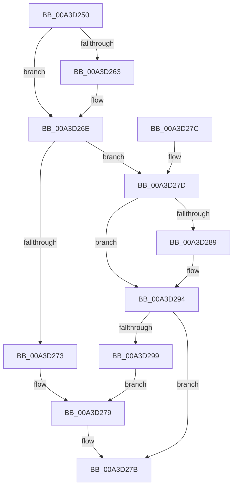

# BiIsObjectAliased

- RVA: `0x00A3D250`–`0x00A3D2A1` (길이 `81` bytes)
- VA: `0x0000000140A3D250`
- 실행 섹션: `PAGE`
- PDB 이름 있음: `예`; PDB Function 태그: `아니요`
- unwind 정보 RVA: `0x000DB714`
- 디코드: `23`개 명령, `81/81` bytes 표시
- 미해석 바이트: `0` (있으면 어셈블리에 `.byte`로 보존)

> 이 문서는 커널 이미지의 기계어와 PDB 기호를 분석해 생성했습니다. 4번과 5번은 함수 원형과 자료형을 바이너리 사용 방식에서 추정한 C 해석이며 원본 소스 복구 결과는 아닙니다.

## 1. Dependencies

- 직접 호출 지점: **0**; 고유 호출 대상: **0**
- 직접 호출자로 확인된 함수: **2**
- RIP 상대 이미지 참조: **4**

### Outgoing calls
- 직접 디코드된 call 명령이 없습니다.

### Direct callers
- [BcdOpenObject](../91/BcdOpenObject_function_00916704.md) at `0x00916810`
- [BiCreateObject](BiCreateObject_function_00A3D92C.md) at `0x00A3D9BC`

### Static image references
- `0x00A3D255` → RVA `0x0001A4A0` (`.rdata`; read)
- `0x00A3D267` → RVA `0x0001A4A8` (`.rdata`; read)
- `0x00A3D280` → RVA `0x0001A4B0` (`.rdata`; read)
- `0x00A3D28D` → RVA `0x0001A4B8` (`.rdata`; read)

## 2. Other-region calls and transfers

- 다른 실행 섹션으로 향하는 call: **0**
- 별도 외부 분기/꼬리 이동을 확인하지 못했습니다.

## 3. Assembly (complete function range)

```asm
00A3D250  4C 8B 01                        mov r8, qword ptr [rcx]
00A3D253  33 C0                           xor eax, eax
00A3D255  4C 2B 05 44 D2 5D FF            sub r8, qword ptr [rip - 0xa22dbc]
00A3D25C  4C 8B C9                        mov r9, rcx
00A3D25F  89 02                           mov dword ptr [rdx], eax
00A3D261  75 0B                           jne 0x140a3d26e
00A3D263  4C 8B 41 08                     mov r8, qword ptr [rcx + 8]
00A3D267  4C 2B 05 3A D2 5D FF            sub r8, qword ptr [rip - 0xa22dc6]
00A3D26E  4D 85 C0                        test r8, r8
00A3D271  75 0A                           jne 0x140a3d27d
00A3D273  C7 02 01 00 00 00               mov dword ptr [rdx], 1
00A3D279  B0 01                           mov al, 1
00A3D27B  C3                              ret
00A3D27C  CC                              int3
00A3D27D  48 8B 09                        mov rcx, qword ptr [rcx]
00A3D280  48 2B 0D 29 D2 5D FF            sub rcx, qword ptr [rip - 0xa22dd7]
00A3D287  75 0B                           jne 0x140a3d294
00A3D289  49 8B 49 08                     mov rcx, qword ptr [r9 + 8]
00A3D28D  48 2B 0D 24 D2 5D FF            sub rcx, qword ptr [rip - 0xa22ddc]
00A3D294  48 85 C9                        test rcx, rcx
00A3D297  75 E2                           jne 0x140a3d27b
00A3D299  C7 02 02 00 00 00               mov dword ptr [rdx], 2
00A3D29F  EB D8                           jmp 0x140a3d279
```

## 4. C-style interpretation (structured pseudocode)

```c
__int64 __fastcall BiIsObjectAliased(__int64 a1, __int64 a2)
{
    __int64 result;

    result = 0;
    a3 = (*(unsigned __int64 *)(a1)) - (*(unsigned __int64 *)(v_rip - 10628540));
    *(unsigned int *)(a2) = 0;
    if (!(condition_is_not_equal)) {
        a3 = *(unsigned __int64 *)(a1 + 8);
        a3 = (a3) - (*(unsigned __int64 *)(v_rip - 10628550));
    }
    if (a3 != 0) goto loc_00A3D27D;
    *(unsigned int *)(a2) = 1;
loc_00A3D279:
loc_00A3D27B:
    return 1;
loc_00A3D27D:
    a1 = (*(unsigned __int64 *)(a1)) - (*(unsigned __int64 *)(v_rip - 10628567));
    if (!(condition_is_not_equal)) {
        a1 = *(unsigned __int64 *)(a1 + 8);
        a1 = (a1) - (*(unsigned __int64 *)(v_rip - 10628572));
    }
    if (a1 != 0) goto loc_00A3D27B;
    *(unsigned int *)(a2) = 2;
    goto loc_00A3D279;
}
```

## 5. (Beta) C Style

```c
int64_t BiIsObjectAliased(void *Arg1, void *Arg2)
{
    uint8_t *arg1 = (uint8_t *)Arg1;
    uint8_t *arg2 = (uint8_t *)Arg2;

    int64_t result;

    result = 0;
    a3 = (*(uint64_t *)(arg1)) - (*(uint64_t *)(v_rip - 0xA22DBC));
    *(uint32_t *)(arg2) = 0;
    if (!(condition_is_not_equal)) {
        a3 = *(uint64_t *)(arg1 + 0x8);
        a3 = (a3) - (*(uint64_t *)(v_rip - 0xA22DC6));
    }
    if (a3 != 0) goto loc_00A3D27D;
    *(uint32_t *)(arg2) = 1;
loc_00A3D279:
loc_00A3D27B:
    return 1;
loc_00A3D27D:
    Arg1 = (*(uint64_t *)(arg1)) - (*(uint64_t *)(v_rip - 0xA22DD7));
    if (!(condition_is_not_equal)) {
        Arg1 = *(uint64_t *)(arg1 + 0x8);
        Arg1 = (Arg1) - (*(uint64_t *)(v_rip - 0xA22DDC));
    }
    if (Arg1 != NULL) goto loc_00A3D27B;
    *(uint32_t *)(arg2) = 2;
    goto loc_00A3D279;
}
```

### 관측된 메모리 오프셋

구조체 형식이 확인되지 않은 접근은 인자 기준의 오프셋으로만 기록했습니다.

| 기준 인자 | 오프셋 표현 | 폭 (bit) | 접근 |
|---|---:|---:|---|
| `Arg1` | `+ 0x0` | `64` | `R` |
| `Arg1` | `+ 0x8` | `64` | `R` |
| `Arg2` | `+ 0x0` | `32` | `W` |

## 6. Execution-region graph

[열기: 2D/3D 그래프와 함수 탐색 컨트롤 패널](../../../control-panel.html?section=page&rva=0x00A3D250&view=graph)

- 2D 그래프는 위에서 아래로 흐르고, 3D 그래프는 빈 공간을 드래그해 회전합니다. Shift+드래그는 이동, 휠은 확대·축소, 함수 노드 선택은 대상 보고서 이동입니다.

### Static fallback


