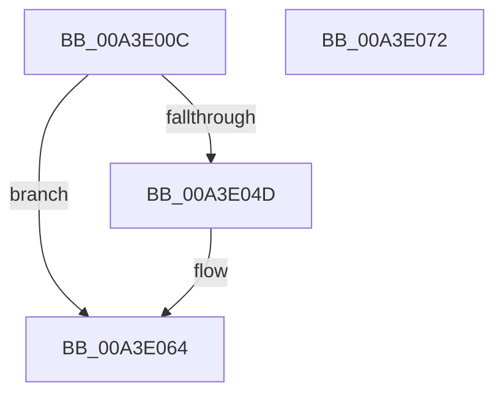

# BiIsSystemStoreCandidate

- RVA: `0x00A3E00C`–`0x00A3E073` (길이 `103` bytes)
- VA: `0x0000000140A3E00C`
- 실행 섹션: `PAGE`
- PDB 이름 있음: `예`; PDB Function 태그: `아니요`
- unwind 정보 RVA: `0x00084AC0`
- 디코드: `29`개 명령, `103/103` bytes 표시
- 미해석 바이트: `0` (있으면 어셈블리에 `.byte`로 보존)

> 이 문서는 커널 이미지의 기계어와 PDB 기호를 분석해 생성했습니다. 4번과 5번은 함수 원형과 자료형을 바이너리 사용 방식에서 추정한 C 해석이며 원본 소스 복구 결과는 아닙니다.

## 1. Dependencies

- 직접 호출 지점: **2**; 고유 호출 대상: **2**
- 직접 호출자로 확인된 함수: **1**
- RIP 상대 이미지 참조: **2**

### Outgoing calls
- `0x00A3E044` → [BiGetRegistryValue](BiGetRegistryValue_function_00A3F3CC.md) (function, `0x00A3F3CC`)
- `0x00A3E059` → [ExFreePoolWithTag](../../poolcode/B8/ExFreePoolWithTag_function_00B82870.md) (function, `0x00B82870`)

### Direct callers
- [BiIsSystemStore](BiIsSystemStore_function_00A3DF84.md) at `0x00A3DF9C`

### Static image references
- `0x00A3E022` → RVA `0x00AFF1D0` (` ?? ::NNGAKEGL::`string'`; read)
- `0x00A3E031` → RVA `0x00AFC8A0` (` ?? ::NNGAKEGL::`string'`; read)

## 2. Other-region calls and transfers

- 다른 실행 섹션으로 향하는 call: **1**
  - `0x00A3E059` → [ExFreePoolWithTag](../../poolcode/B8/ExFreePoolWithTag_function_00B82870.md) (`PAGE` → `POOLCODE`)
- 별도 외부 분기/꼬리 이동을 확인하지 못했습니다.

## 3. Assembly (complete function range)

```asm
00A3E00C  4C 8B DC                        mov r11, rsp
00A3E00F  49 89 5B 08                     mov qword ptr [r11 + 8], rbx
00A3E013  57                              push rdi
00A3E014  48 83 EC 30                     sub rsp, 0x30
00A3E018  33 FF                           xor edi, edi
00A3E01A  49 8D 43 10                     lea rax, [r11 + 0x10]
00A3E01E  49 89 43 F0                     mov qword ptr [r11 - 0x10], rax
00A3E022  4C 8D 05 A7 11 0C 00            lea r8, [rip + 0xc11a7]
00A3E029  49 8D 43 18                     lea rax, [r11 + 0x18]
00A3E02D  49 89 7B 18                     mov qword ptr [r11 + 0x18], rdi
00A3E031  48 8D 15 68 E8 0B 00            lea rdx, [rip + 0xbe868]
00A3E038  89 7C 24 48                     mov dword ptr [rsp + 0x48], edi
00A3E03C  44 8D 4F 04                     lea r9d, [rdi + 4]
00A3E040  49 89 43 E8                     mov qword ptr [r11 - 0x18], rax
00A3E044  E8 83 13 00 00                  call 0x140a3f3cc
00A3E049  85 C0                           test eax, eax
00A3E04B  78 17                           js 0x140a3e064
00A3E04D  48 8B 4C 24 50                  mov rcx, qword ptr [rsp + 0x50]
00A3E052  BA 42 43 44 4B                  mov edx, 0x4b444342
00A3E057  8B 19                           mov ebx, dword ptr [rcx]
00A3E059  E8 12 48 14 00                  call 0x140b82870
00A3E05E  85 DB                           test ebx, ebx
00A3E060  40 0F 95 C7                     setne dil
00A3E064  48 8B 5C 24 40                  mov rbx, qword ptr [rsp + 0x40]
00A3E069  40 8A C7                        mov al, dil
00A3E06C  48 83 C4 30                     add rsp, 0x30
00A3E070  5F                              pop rdi
00A3E071  C3                              ret
00A3E072  CC                              int3
```

## 4. C-style interpretation (structured pseudocode)

```c
__int64 __fastcall BiIsSystemStoreCandidate(void)
{
    __int64 result;
    __int64 v_rbx;
    __int64 v_rdi;
    __int64 v_rsp;
    unsigned int v_stack_p10;
    unsigned __int64 v_stack_p18;
    unsigned __int64 v_stack_p8;

    *(unsigned __int64 *)(v_rsp + 8) = v_rbx;
    v_rsp = (v_rsp) - (48);
    v_rdi = 0;
    *(unsigned __int64 *)(v_rsp - 16) = v_rsp + 16;
    *(unsigned __int64 *)(v_rsp + 24) = 0;
    v_stack_p10 = 0;
    *(unsigned __int64 *)(v_rsp - 24) = v_rsp + 24;
    result = BiGetRegistryValue(a1, v_rip + 780392, v_rip + 790951, v_rdi + 4);
    if (!(sign_flag)) {
        a1 = v_stack_p18;
        a2 = 0x4B444342ULL;
        v_rbx = *(unsigned int *)(a1);
        result = ExFreePoolWithTag(a1, a2, v_rip + 790951, v_rdi + 4);
        v_rdi = ((unsigned int)(v_rbx) != 0) ? 1 : 0;
    }
    v_rsp = (v_rsp) + (48);
    return (unsigned __int8)(v_rdi);
}
```

## 5. (Beta) C Style

```c
void BiIsSystemStoreCandidate(void)
{
    int64_t result;
    int64_t local_rbx;
    int64_t local_rdi;
    int64_t local_rsp;
    uint32_t v_stack_p10;
    uint64_t v_stack_p18;
    uint64_t v_stack_p8;

    *(uint64_t *)(local_rsp + 0x8) = local_rbx;
    local_rsp = (local_rsp) - (48);
    local_rdi = 0;
    *(uint64_t *)(local_rsp - 0x10) = local_rsp + 16;
    *(uint64_t *)(local_rsp + 0x18) = 0;
    v_stack_p10 = 0;
    *(uint64_t *)(local_rsp - 0x18) = local_rsp + 24;
    result = BiGetRegistryValue(a1, v_rip + 780392, v_rip + 790951, local_rdi + 4);
    if (!(sign_flag)) {
        a1 = v_stack_p18;
        a2 = 0x4B444342ULL;
        local_rbx = *(uint32_t *)(a1);
        result = ExFreePoolWithTag(a1, a2, v_rip + 790951, local_rdi + 4);
        local_rdi = ((uint32_t)(local_rbx) != 0) ? 1 : 0;
    }
    local_rsp = (local_rsp) + (48);
    return (uint8_t)(local_rdi);
}
```

## 6. Execution-region graph

[열기: 2D/3D 그래프와 함수 탐색 컨트롤 패널](../../../control-panel.html?section=page&rva=0x00A3E00C&view=graph)

- 2D 그래프는 위에서 아래로 흐르고, 3D 그래프는 빈 공간을 드래그해 회전합니다. Shift+드래그는 이동, 휠은 확대·축소, 함수 노드 선택은 대상 보고서 이동입니다.

### Static fallback


