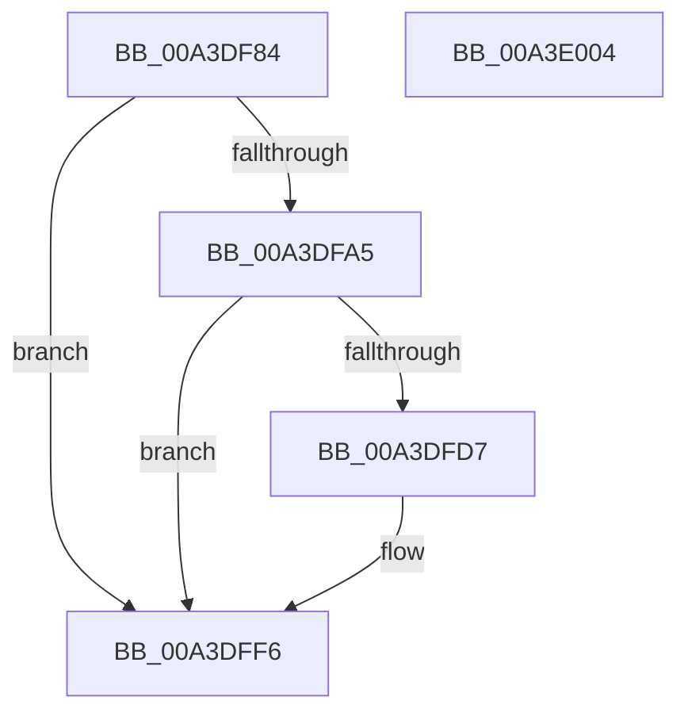

# BiIsSystemStore

- RVA: `0x00A3DF84`–`0x00A3E005` (길이 `129` bytes)
- VA: `0x0000000140A3DF84`
- 실행 섹션: `PAGE`
- PDB 이름 있음: `예`; PDB Function 태그: `아니요`
- unwind 정보 RVA: `0x0006E5F8`
- 디코드: `35`개 명령, `129/129` bytes 표시
- 미해석 바이트: `0` (있으면 어셈블리에 `.byte`로 보존)

> 이 문서는 커널 이미지의 기계어와 PDB 기호를 분석해 생성했습니다. 4번과 5번은 함수 원형과 자료형을 바이너리 사용 방식에서 추정한 C 해석이며 원본 소스 복구 결과는 아닙니다.

## 1. Dependencies

- 직접 호출 지점: **3**; 고유 호출 대상: **3**
- 직접 호출자로 확인된 함수: **4**
- RIP 상대 이미지 참조: **2**

### Outgoing calls
- `0x00A3DF9C` → [BiIsSystemStoreCandidate](BiIsSystemStoreCandidate_function_00A3E00C.md) (function, `0x00A3E00C`)
- `0x00A3DFCE` → [BiGetRegistryValue](BiGetRegistryValue_function_00A3F3CC.md) (function, `0x00A3F3CC`)
- `0x00A3DFE3` → [ExFreePoolWithTag](../../poolcode/B8/ExFreePoolWithTag_function_00B82870.md) (function, `0x00B82870`)

### Direct callers
- [BcdForciblyUnloadStore](../82/BcdForciblyUnloadStore_function_008232FC.md) at `0x0082333F`
- [BiLoadSystemStore](BiLoadSystemStore_function_00A3C198.md) at `0x00A3C2CA`
- [BcdCloseStore](BcdCloseStore_function_00A3C68C.md) at `0x00A3C6B7`
- [sub_00B3A892](../B3/Unknown_function_00B3A892.md) at `0x00B3A8E2`
- [sub_00B3A892](../B3/Unknown_function_00B3A892.md) at `0x00B3A972`
- [sub_00B3A892](../B3/Unknown_function_00B3A892.md) at `0x00B3A9F6`

### Static image references
- `0x00A3DFBB` → RVA `0x00AFF1D0` (` ?? ::NNGAKEGL::`string'`; read)
- `0x00A3DFC7` → RVA `0x00B0A380` (` ?? ::NNGAKEGL::`string'`; read)

## 2. Other-region calls and transfers

- 다른 실행 섹션으로 향하는 call: **1**
  - `0x00A3DFE3` → [ExFreePoolWithTag](../../poolcode/B8/ExFreePoolWithTag_function_00B82870.md) (`PAGE` → `POOLCODE`)
- 별도 외부 분기/꼬리 이동을 확인하지 못했습니다.

## 3. Assembly (complete function range)

```asm
00A3DF84  48 89 5C 24 08                  mov qword ptr [rsp + 8], rbx
00A3DF89  57                              push rdi
00A3DF8A  48 83 EC 30                     sub rsp, 0x30
00A3DF8E  33 FF                           xor edi, edi
00A3DF90  48 8B D9                        mov rbx, rcx
00A3DF93  48 89 7C 24 50                  mov qword ptr [rsp + 0x50], rdi
00A3DF98  89 7C 24 48                     mov dword ptr [rsp + 0x48], edi
00A3DF9C  E8 6B 00 00 00                  call 0x140a3e00c
00A3DFA1  84 C0                           test al, al
00A3DFA3  74 51                           je 0x140a3dff6
00A3DFA5  48 8D 44 24 48                  lea rax, [rsp + 0x48]
00A3DFAA  48 8B CB                        mov rcx, rbx
00A3DFAD  48 89 44 24 28                  mov qword ptr [rsp + 0x28], rax
00A3DFB2  44 8D 4F 04                     lea r9d, [rdi + 4]
00A3DFB6  48 8D 44 24 50                  lea rax, [rsp + 0x50]
00A3DFBB  4C 8D 05 0E 12 0C 00            lea r8, [rip + 0xc120e]
00A3DFC2  48 89 44 24 20                  mov qword ptr [rsp + 0x20], rax
00A3DFC7  48 8D 15 B2 C3 0C 00            lea rdx, [rip + 0xcc3b2]
00A3DFCE  E8 F9 13 00 00                  call 0x140a3f3cc
00A3DFD3  85 C0                           test eax, eax
00A3DFD5  78 1F                           js 0x140a3dff6
00A3DFD7  48 8B 4C 24 50                  mov rcx, qword ptr [rsp + 0x50]
00A3DFDC  BA 42 43 44 4B                  mov edx, 0x4b444342
00A3DFE1  8B 19                           mov ebx, dword ptr [rcx]
00A3DFE3  E8 88 48 14 00                  call 0x140b82870
00A3DFE8  85 DB                           test ebx, ebx
00A3DFEA  40 0F B6 FF                     movzx edi, dil
00A3DFEE  B9 01 00 00 00                  mov ecx, 1
00A3DFF3  0F 45 F9                        cmovne edi, ecx
00A3DFF6  48 8B 5C 24 40                  mov rbx, qword ptr [rsp + 0x40]
00A3DFFB  40 8A C7                        mov al, dil
00A3DFFE  48 83 C4 30                     add rsp, 0x30
00A3E002  5F                              pop rdi
00A3E003  C3                              ret
00A3E004  CC                              int3
```

## 4. C-style interpretation (structured pseudocode)

```c
__int64 __fastcall BiIsSystemStore(__int64 a1)
{
    __int64 result;
    __int64 v_rbx;
    __int64 v_rdi;
    __int64 v_rsp;
    unsigned __int64 v_stack_m10;
    unsigned __int64 v_stack_m18;
    unsigned int v_stack_p10;
    unsigned __int64 v_stack_p18;
    unsigned __int64 v_stack_p8;

    v_stack_p8 = v_rbx;
    v_rsp = (v_rsp) - (48);
    v_rdi = 0;
    v_stack_p18 = 0;
    v_stack_p10 = 0;
    result = BiIsSystemStoreCandidate(a1, a2, a3, a4);
    if ((unsigned __int8)(result) == 0) goto loc_00A3DFF6;
    v_stack_m10 = v_stack_p10;
    v_stack_m18 = v_stack_p18;
    result = BiGetRegistryValue(a1, v_rip + 836530, v_rip + 791054, v_rdi + 4);
    v_rbx = a1;
    if (!(sign_flag)) {
        a1 = v_stack_p18;
        a2 = 0x4B444342ULL;
        v_rbx = *(unsigned int *)(a1);
        result = ExFreePoolWithTag(a1, a2, v_rip + 791054, v_rdi + 4);
        v_rdi = 0;
        a1 = 1;
        if ((unsigned int)(v_rbx) != 0) { v_rdi = (unsigned int)(a1); }
    }
    v_rsp = (v_rsp) + (48);
    return (unsigned __int8)(v_rdi);
}
```

## 5. (Beta) C Style

```c
int64_t BiIsSystemStore(int64_t Arg1)
{
    int64_t result;
    int64_t local_rbx;
    int64_t local_rdi;
    int64_t local_rsp;
    uint64_t v_stack_m10;
    uint64_t v_stack_m18;
    uint32_t v_stack_p10;
    uint64_t v_stack_p18;
    uint64_t v_stack_p8;

    v_stack_p8 = local_rbx;
    local_rsp = (local_rsp) - (48);
    local_rdi = 0;
    v_stack_p18 = 0;
    v_stack_p10 = 0;
    result = BiIsSystemStoreCandidate(Arg1, a2, a3, a4);
    if ((uint8_t)(result) == 0) goto loc_00A3DFF6;
    v_stack_m10 = v_stack_p10;
    v_stack_m18 = v_stack_p18;
    result = BiGetRegistryValue(Arg1, v_rip + 836530, v_rip + 791054, local_rdi + 4);
    local_rbx = Arg1;
    if (!(sign_flag)) {
        Arg1 = v_stack_p18;
        a2 = 0x4B444342ULL;
        local_rbx = *(uint32_t *)(Arg1);
        result = ExFreePoolWithTag(Arg1, a2, v_rip + 791054, local_rdi + 4);
        local_rdi = 0;
        Arg1 = 1;
        if ((uint32_t)(local_rbx) != 0) { local_rdi = (uint32_t)(Arg1); }
    }
    local_rsp = (local_rsp) + (48);
    return (uint8_t)(local_rdi);
}
```

## 6. Execution-region graph

[열기: 2D/3D 그래프와 함수 탐색 컨트롤 패널](../../../control-panel.html?section=page&rva=0x00A3DF84&view=graph)

- 2D 그래프는 위에서 아래로 흐르고, 3D 그래프는 빈 공간을 드래그해 회전합니다. Shift+드래그는 이동, 휠은 확대·축소, 함수 노드 선택은 대상 보고서 이동입니다.

### Static fallback


