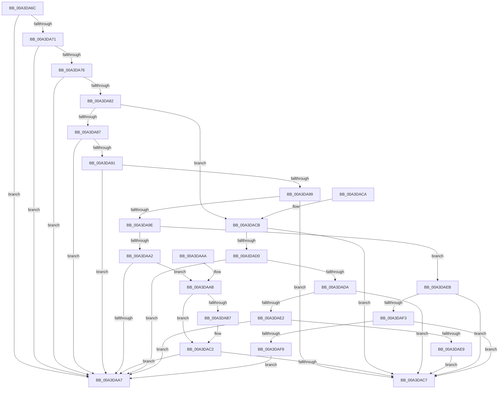

# BiIsValidObject

- RVA: `0x00A3DA6C`–`0x00A3DAFB` (길이 `143` bytes)
- VA: `0x0000000140A3DA6C`
- 실행 섹션: `PAGE`
- PDB 이름 있음: `예`; PDB Function 태그: `아니요`
- unwind 정보 RVA: `0x000DB714`
- 디코드: `51`개 명령, `143/143` bytes 표시
- 미해석 바이트: `0` (있으면 어셈블리에 `.byte`로 보존)

> 이 문서는 커널 이미지의 기계어와 PDB 기호를 분석해 생성했습니다. 4번과 5번은 함수 원형과 자료형을 바이너리 사용 방식에서 추정한 C 해석이며 원본 소스 복구 결과는 아닙니다.

## 1. Dependencies

- 직접 호출 지점: **0**; 고유 호출 대상: **0**
- 직접 호출자로 확인된 함수: **1**
- RIP 상대 이미지 참조: **2**

### Outgoing calls
- 직접 디코드된 call 명령이 없습니다.

### Direct callers
- [BiCreateObject](BiCreateObject_function_00A3D92C.md) at `0x00A3D9A3`

### Static image references
- `0x00A3DAAE` → RVA `0x0001A4C0` (`.rdata`; read)
- `0x00A3DABB` → RVA `0x0001A4C8` (`.rdata`; read)

## 2. Other-region calls and transfers

- 다른 실행 섹션으로 향하는 call: **0**
- 별도 외부 분기/꼬리 이동을 확인하지 못했습니다.

## 3. Assembly (complete function range)

```asm
00A3DA6C  48 85 C9                        test rcx, rcx
00A3DA6F  74 36                           je 0x140a3daa7
00A3DA71  83 39 00                        cmp dword ptr [rcx], 0
00A3DA74  74 31                           je 0x140a3daa7
00A3DA76  8B 41 04                        mov eax, dword ptr [rcx + 4]
00A3DA79  8B C8                           mov ecx, eax
00A3DA7B  C1 E9 1C                        shr ecx, 0x1c
00A3DA7E  85 C9                           test ecx, ecx
00A3DA80  74 25                           je 0x140a3daa7
00A3DA82  83 E9 01                        sub ecx, 1
00A3DA85  75 44                           jne 0x140a3dacb
00A3DA87  8B C8                           mov ecx, eax
00A3DA89  81 E1 FF FF 0F 00               and ecx, 0xfffff
00A3DA8F  74 16                           je 0x140a3daa7
00A3DA91  C1 E8 14                        shr eax, 0x14
00A3DA94  83 E0 0F                        and eax, 0xf
00A3DA97  74 0E                           je 0x140a3daa7
00A3DA99  83 F8 01                        cmp eax, 1
00A3DA9C  75 29                           jne 0x140a3dac7
00A3DA9E  2B C8                           sub ecx, eax
00A3DAA0  75 49                           jne 0x140a3daeb
00A3DAA2  48 85 D2                        test rdx, rdx
00A3DAA5  75 04                           jne 0x140a3daab
00A3DAA7  32 C0                           xor al, al
00A3DAA9  C3                              ret
00A3DAAA  CC                              int3
00A3DAAB  48 8B 02                        mov rax, qword ptr [rdx]
00A3DAAE  48 2B 05 0B CA 5D FF            sub rax, qword ptr [rip - 0xa235f5]
00A3DAB5  75 0B                           jne 0x140a3dac2
00A3DAB7  48 8B 42 08                     mov rax, qword ptr [rdx + 8]
00A3DABB  48 2B 05 06 CA 5D FF            sub rax, qword ptr [rip - 0xa235fa]
00A3DAC2  48 85 C0                        test rax, rax
00A3DAC5  75 E0                           jne 0x140a3daa7
00A3DAC7  B0 01                           mov al, 1
00A3DAC9  C3                              ret
00A3DACA  CC                              int3
00A3DACB  83 E9 01                        sub ecx, 1
00A3DACE  75 F7                           jne 0x140a3dac7
00A3DAD0  8B C8                           mov ecx, eax
00A3DAD2  81 E1 00 00 F0 00               and ecx, 0xf00000
00A3DAD8  74 CD                           je 0x140a3daa7
00A3DADA  81 F9 00 00 20 00               cmp ecx, 0x200000
00A3DAE0  75 E5                           jne 0x140a3dac7
00A3DAE2  A9 FF FF 0F 00                  test eax, 0xfffff
00A3DAE7  74 BE                           je 0x140a3daa7
00A3DAE9  EB DC                           jmp 0x140a3dac7
00A3DAEB  81 F9 FE FF 0F 00               cmp ecx, 0xffffe
00A3DAF1  75 D4                           jne 0x140a3dac7
00A3DAF3  41 F6 C0 01                     test r8b, 1
00A3DAF7  75 CE                           jne 0x140a3dac7
00A3DAF9  EB AC                           jmp 0x140a3daa7
```

## 4. C-style interpretation (structured pseudocode)

```c
__int64 __fastcall BiIsValidObject(__int64 a1, __int64 a2, unsigned __int8 a3)
{
    __int64 result;

    if (a1 == 0) goto loc_00A3DAA7;
    if ((*(unsigned int *)(a1)) == 0) goto loc_00A3DAA7;
    a1 = (unsigned int)(((unsigned int)((unsigned int)((unsigned int)(*(unsigned int *)(a1 + 4))))) >> (28));
    if ((unsigned int)(a1) == 0) goto loc_00A3DAA7;
    a1 = (unsigned int)((a1) - (1));
    if (condition_is_not_equal) goto loc_00A3DACB;
    a1 = (unsigned int)(((unsigned int)((unsigned int)((unsigned int)(*(unsigned int *)(a1 + 4))))) & (0xFFFFFULL));
    if (condition_is_equal) goto loc_00A3DAA7;
    result = (unsigned int)(((unsigned int)(*(unsigned int *)(a1 + 4))) >> (20));
    result = (unsigned int)((result) & (15));
    if (condition_is_equal) goto loc_00A3DAA7;
    if (((unsigned int)(result)) != 1) goto loc_00A3DAC7;
    a1 = (unsigned int)((a1) - ((unsigned int)(result)));
    if (condition_is_not_equal) goto loc_00A3DAEB;
    if (a2 != 0) goto loc_00A3DAAB;
loc_00A3DAA7:
    result = 0;
    return result;
loc_00A3DAAB:
    result = (*(unsigned __int64 *)(a2)) - (*(unsigned __int64 *)(v_rip - 10630645));
    if (!(condition_is_not_equal)) {
        result = *(unsigned __int64 *)(a2 + 8);
        result = (result) - (*(unsigned __int64 *)(v_rip - 10630650));
    }
    if (result != 0) goto loc_00A3DAA7;
loc_00A3DAC7:
    return 1;
loc_00A3DACB:
    a1 = (unsigned int)((a1) - (1));
    if (condition_is_not_equal) goto loc_00A3DAC7;
    a1 = (unsigned int)((1) & (0xF00000ULL));
    if (condition_is_equal) goto loc_00A3DAA7;
    if (((unsigned int)(a1)) != 0x200000ULL) goto loc_00A3DAC7;
    if (((1) & (0xFFFFFULL)) == 0) goto loc_00A3DAA7;
    goto loc_00A3DAC7;
loc_00A3DAEB:
    if (((unsigned int)(a1)) != 0xFFFFEULL) goto loc_00A3DAC7;
    if (((a3) & (1)) != 0) goto loc_00A3DAC7;
    goto loc_00A3DAA7;
}
```

## 5. (Beta) C Style

```c
int64_t BiIsValidObject(int64_t Arg1, int64_t Arg2, uint8_t Arg3)
{
    int64_t result;

    if (Arg1 == 0) goto loc_00A3DAA7;
    if ((*(uint32_t *)(Arg1)) == 0) goto loc_00A3DAA7;
    Arg1 = (uint32_t)(((uint32_t)((uint32_t)((uint32_t)(*(uint32_t *)(Arg1 + 0x4))))) >> (28));
    if ((uint32_t)(Arg1) == 0) goto loc_00A3DAA7;
    Arg1 = (uint32_t)((Arg1) - (1));
    if (condition_is_not_equal) goto loc_00A3DACB;
    Arg1 = (uint32_t)(((uint32_t)((uint32_t)((uint32_t)(*(uint32_t *)(Arg1 + 0x4))))) & (0xFFFFFULL));
    if (condition_is_equal) goto loc_00A3DAA7;
    result = (uint32_t)(((uint32_t)(*(uint32_t *)(Arg1 + 0x4))) >> (20));
    result = (uint32_t)((result) & (15));
    if (condition_is_equal) goto loc_00A3DAA7;
    if (((uint32_t)(result)) != 1) goto loc_00A3DAC7;
    Arg1 = (uint32_t)((Arg1) - ((uint32_t)(result)));
    if (condition_is_not_equal) goto loc_00A3DAEB;
    if (Arg2 != 0) goto loc_00A3DAAB;
loc_00A3DAA7:
    result = 0;
    return result;
loc_00A3DAAB:
    result = (*(uint64_t *)(Arg2)) - (*(uint64_t *)(v_rip - 0xA235F5));
    if (!(condition_is_not_equal)) {
        result = *(uint64_t *)(Arg2 + 0x8);
        result = (result) - (*(uint64_t *)(v_rip - 0xA235FA));
    }
    if (result != 0) goto loc_00A3DAA7;
loc_00A3DAC7:
    return 1;
loc_00A3DACB:
    Arg1 = (uint32_t)((Arg1) - (1));
    if (condition_is_not_equal) goto loc_00A3DAC7;
    Arg1 = (uint32_t)((1) & (0xF00000ULL));
    if (condition_is_equal) goto loc_00A3DAA7;
    if (((uint32_t)(Arg1)) != 0x200000ULL) goto loc_00A3DAC7;
    if (((1) & (0xFFFFFULL)) == 0) goto loc_00A3DAA7;
    goto loc_00A3DAC7;
loc_00A3DAEB:
    if (((uint32_t)(Arg1)) != 0xFFFFEULL) goto loc_00A3DAC7;
    if (((Arg3) & (1)) != 0) goto loc_00A3DAC7;
    goto loc_00A3DAA7;
}
```

## 6. Execution-region graph

[열기: 2D/3D 그래프와 함수 탐색 컨트롤 패널](../../../control-panel.html?section=page&rva=0x00A3DA6C&view=graph)

- 2D 그래프는 위에서 아래로 흐르고, 3D 그래프는 빈 공간을 드래그해 회전합니다. Shift+드래그는 이동, 휠은 확대·축소, 함수 노드 선택은 대상 보고서 이동입니다.

### Static fallback


