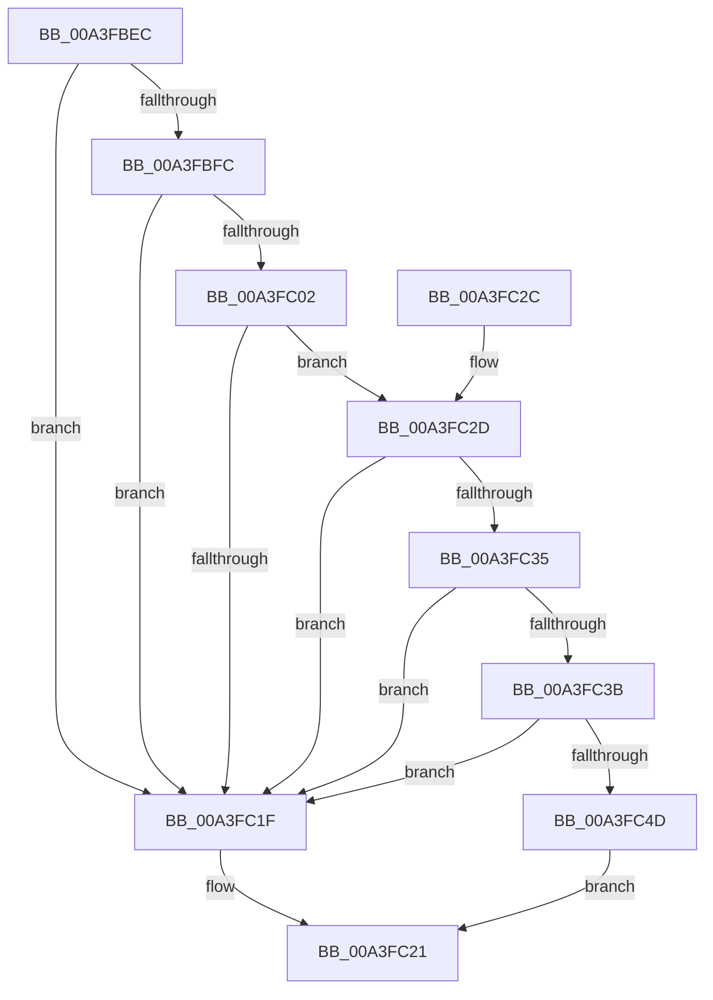

# BiIsWindowsEfiEntry

- RVA: `0x00A3FBEC`–`0x00A3FC51` (길이 `101` bytes)
- VA: `0x0000000140A3FBEC`
- 실행 섹션: `PAGE`
- PDB 이름 있음: `예`; PDB Function 태그: `아니요`
- unwind 정보 RVA: `0x0006E554`
- 디코드: `33`개 명령, `101/101` bytes 표시
- 미해석 바이트: `0` (있으면 어셈블리에 `.byte`로 보존)

> 이 문서는 커널 이미지의 기계어와 PDB 기호를 분석해 생성했습니다. 4번과 5번은 함수 원형과 자료형을 바이너리 사용 방식에서 추정한 C 해석이며 원본 소스 복구 결과는 아닙니다.

## 1. Dependencies

- 직접 호출 지점: **2**; 고유 호출 대상: **2**
- 직접 호출자로 확인된 함수: **1**
- RIP 상대 이미지 참조: **1**

### Outgoing calls
- `0x00A3FC16` → [strncmp](../../text/6C/strncmp_function_006C6720.md) (function, `0x006C6720`)
- `0x00A3FC44` → [wcsnlen](../../text/50/wcsnlen_function_00501D60.md) (function, `0x00501D60`)

### Direct callers
- [BiGetObjectReferenceFromEfiEntry](BiGetObjectReferenceFromEfiEntry_function_00A3FB4C.md) at `0x00A3FB7F`

### Static image references
- `0x00A3FC0F` → RVA `0x00B08730` (` ?? ::NNGAKEGL::`string'`; read)

## 2. Other-region calls and transfers

- 다른 실행 섹션으로 향하는 call: **2**
  - `0x00A3FC16` → [strncmp](../../text/6C/strncmp_function_006C6720.md) (`PAGE` → `.text`)
  - `0x00A3FC44` → [wcsnlen](../../text/50/wcsnlen_function_00501D60.md) (`PAGE` → `.text`)
- 별도 외부 분기/꼬리 이동을 확인하지 못했습니다.

## 3. Assembly (complete function range)

```asm
00A3FBEC  48 89 5C 24 08                  mov qword ptr [rsp + 8], rbx
00A3FBF1  57                              push rdi
00A3FBF2  48 83 EC 20                     sub rsp, 0x20
00A3FBF6  83 79 04 1C                     cmp dword ptr [rcx + 4], 0x1c
00A3FBFA  72 23                           jb 0x140a3fc1f
00A3FBFC  83 79 18 14                     cmp dword ptr [rcx + 0x18], 0x14
00A3FC00  72 1D                           jb 0x140a3fc1f
00A3FC02  48 8D 79 1C                     lea rdi, [rcx + 0x1c]
00A3FC06  41 B8 07 00 00 00               mov r8d, 7
00A3FC0C  48 8B CF                        mov rcx, rdi
00A3FC0F  48 8D 15 1A 8B 0C 00            lea rdx, [rip + 0xc8b1a]
00A3FC16  E8 05 6B C8 FF                  call 0x1406c6720
00A3FC1B  85 C0                           test eax, eax
00A3FC1D  74 0E                           je 0x140a3fc2d
00A3FC1F  32 C0                           xor al, al
00A3FC21  48 8B 5C 24 30                  mov rbx, qword ptr [rsp + 0x30]
00A3FC26  48 83 C4 20                     add rsp, 0x20
00A3FC2A  5F                              pop rdi
00A3FC2B  C3                              ret
00A3FC2C  CC                              int3
00A3FC2D  8B 5F 0C                        mov ebx, dword ptr [rdi + 0xc]
00A3FC30  83 FB 14                        cmp ebx, 0x14
00A3FC33  72 EA                           jb 0x140a3fc1f
00A3FC35  83 7F 08 00                     cmp dword ptr [rdi + 8], 0
00A3FC39  74 E4                           je 0x140a3fc1f
00A3FC3B  83 C3 EC                        add ebx, -0x14
00A3FC3E  48 8D 4F 14                     lea rcx, [rdi + 0x14]
00A3FC42  8B D3                           mov edx, ebx
00A3FC44  E8 17 21 AC FF                  call 0x140501d60
00A3FC49  3B C3                           cmp eax, ebx
00A3FC4B  74 D2                           je 0x140a3fc1f
00A3FC4D  B0 01                           mov al, 1
00A3FC4F  EB D0                           jmp 0x140a3fc21
```

## 4. C-style interpretation (structured pseudocode)

```c
__int64 __fastcall BiIsWindowsEfiEntry(__int64 a1)
{
    __int64 result;
    __int64 v_rbx;
    __int64 v_rsp;
    unsigned __int64 v_stack_p8;

    v_stack_p8 = v_rbx;
    v_rsp = (v_rsp) - (32);
    if ((*(unsigned int *)(a1 + 4)) < 28) goto loc_00A3FC1F;
    if ((*(unsigned int *)(a1 + 24)) < 20) goto loc_00A3FC1F;
    result = strncmp(a1 + 28, v_rip + 822042, 7, a4);
    if ((unsigned int)(result) == 0) goto loc_00A3FC2D;
loc_00A3FC1F:
    result = 0;
loc_00A3FC21:
    v_rsp = (v_rsp) + (32);
    return result;
loc_00A3FC2D:
    if (((unsigned int)((unsigned int)(*(unsigned int *)(a1 + 28 + 12)))) < 20) goto loc_00A3FC1F;
    if ((*(unsigned int *)(a1 + 28 + 8)) == 0) goto loc_00A3FC1F;
    v_rbx = (unsigned int)(((unsigned int)(*(unsigned int *)(a1 + 28 + 12))) + (-20));
    result = wcsnlen(a1 + 28 + 20, (unsigned int)((unsigned int)(v_rbx)), 7, a4);
    if (((unsigned int)(result)) == ((unsigned int)(v_rbx))) goto loc_00A3FC1F;
    goto loc_00A3FC21;
}
```

## 5. (Beta) C Style

```c
int64_t BiIsWindowsEfiEntry(void *Arg1)
{
    uint8_t *arg1 = (uint8_t *)Arg1;

    int64_t result;
    int64_t local_rbx;
    int64_t local_rsp;
    uint64_t v_stack_p8;

    v_stack_p8 = local_rbx;
    local_rsp = (local_rsp) - (32);
    if ((*(uint32_t *)(arg1 + 0x4)) < 28) goto loc_00A3FC1F;
    if ((*(uint32_t *)(arg1 + 0x18)) < 20) goto loc_00A3FC1F;
    result = strncmp(Arg1 + 28, v_rip + 822042, 7, a4);
    if ((uint32_t)(result) == 0) goto loc_00A3FC2D;
loc_00A3FC1F:
    result = 0;
loc_00A3FC21:
    local_rsp = (local_rsp) + (32);
    return result;
loc_00A3FC2D:
    if (((uint32_t)((uint32_t)(*(uint32_t *)(arg1 + 0x1C + 0xC)))) < 20) goto loc_00A3FC1F;
    if ((*(uint32_t *)(arg1 + 0x1C + 0x8)) == 0) goto loc_00A3FC1F;
    local_rbx = (uint32_t)(((uint32_t)(*(uint32_t *)(arg1 + 0x1C + 0xC))) + (-20));
    result = wcsnlen(Arg1 + 28 + 20, (uint32_t)((uint32_t)(local_rbx)), 7, a4);
    if (((uint32_t)(result)) == ((uint32_t)(local_rbx))) goto loc_00A3FC1F;
    goto loc_00A3FC21;
}
```

### 관측된 메모리 오프셋

구조체 형식이 확인되지 않은 접근은 인자 기준의 오프셋으로만 기록했습니다.

| 기준 인자 | 오프셋 표현 | 폭 (bit) | 접근 |
|---|---:|---:|---|
| `Arg1` | `+ 0x4` | `32` | `R` |
| `Arg1` | `+ 0x8` | `32` | `R` |
| `Arg1` | `+ 0xC` | `32` | `R` |
| `Arg1` | `+ 0x14` | `64` | `R` |
| `Arg1` | `+ 0x18` | `32` | `R` |
| `Arg1` | `+ 0x1C` | `64` | `R` |

## 6. Execution-region graph

[열기: 2D/3D 그래프와 함수 탐색 컨트롤 패널](../../../control-panel.html?section=page&rva=0x00A3FBEC&view=graph)

- 2D 그래프는 위에서 아래로 흐르고, 3D 그래프는 빈 공간을 드래그해 회전합니다. Shift+드래그는 이동, 휠은 확대·축소, 함수 노드 선택은 대상 보고서 이동입니다.

### Static fallback


