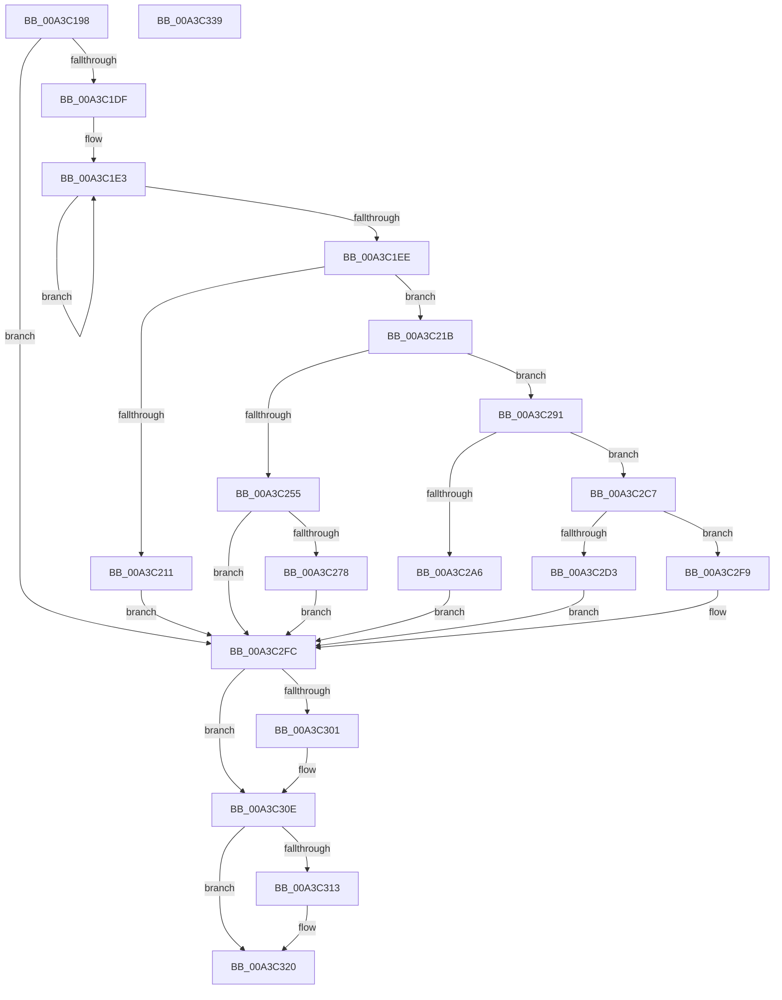

# BiLoadSystemStore

- RVA: `0x00A3C198`–`0x00A3C33A` (길이 `418` bytes)
- VA: `0x0000000140A3C198`
- 실행 섹션: `PAGE`
- PDB 이름 있음: `예`; PDB Function 태그: `아니요`
- unwind 정보 RVA: `0x000AE48C`
- 디코드: `116`개 명령, `418/418` bytes 표시
- 미해석 바이트: `0` (있으면 어셈블리에 `.byte`로 보존)

> 이 문서는 커널 이미지의 기계어와 PDB 기호를 분석해 생성했습니다. 4번과 5번은 함수 원형과 자료형을 바이너리 사용 방식에서 추정한 C 해석이며 원본 소스 복구 결과는 아닙니다.

## 1. Dependencies

- 직접 호출 지점: **15**; 고유 호출 대상: **11**
- 직접 호출자로 확인된 함수: **1**
- RIP 상대 이미지 참조: **3**

### Outgoing calls
- `0x00A3C1CB` → [BcdGetSystemStorePath](BcdGetSystemStorePath_function_00A3C340.md) (function, `0x00A3C340`)
- `0x00A3C204` → [ExAllocatePool2](../../poolcode/B8/ExAllocatePool2_function_00B820F0.md) (function, `0x00B820F0`)
- `0x00A3C23B` → [memcpy](../../text/6C/memcpy_function_006C6840.md) (function, `0x006C6840`)
- `0x00A3C24A` → [BiAddStoreFromFile](../A4/BiAddStoreFromFile_function_00A40C54.md) (function, `0x00A40C54`)
- `0x00A3C267` → [BiLogMessage](BiLogMessage_function_00A3D3A8.md) (function, `0x00A3D3A8`)
- `0x00A3C280` → [RtlInitUnicodeString](../../text/42/RtlInitUnicodeString_function_0042A780.md) (function, `0x0042A780`)
- `0x00A3C28A` → [BiLogFileOwnerProcess](../../text/69/BiLogFileOwnerProcess_function_0069E404.md) (function, `0x0069E404`)
- `0x00A3C29B` → [BiMarkTreatAsSystemStore](../82/BiMarkTreatAsSystemStore_function_008234C8.md) (function, `0x008234C8`)
- `0x00A3C2B8` → [BiLogMessage](BiLogMessage_function_00A3D3A8.md) (function, `0x00A3D3A8`)
- `0x00A3C2C0` → [BcdCloseStore](BcdCloseStore_function_00A3C68C.md) (function, `0x00A3C68C`)
- `0x00A3C2CA` → [BiIsSystemStore](BiIsSystemStore_function_00A3DF84.md) (function, `0x00A3DF84`)
- `0x00A3C2E5` → [BiLogMessage](BiLogMessage_function_00A3D3A8.md) (function, `0x00A3D3A8`)
- `0x00A3C2ED` → [BcdCloseStore](BcdCloseStore_function_00A3C68C.md) (function, `0x00A3C68C`)
- `0x00A3C309` → [ExFreePoolWithTag](../../poolcode/B8/ExFreePoolWithTag_function_00B82870.md) (function, `0x00B82870`)
- `0x00A3C31B` → [ExFreePoolWithTag](../../poolcode/B8/ExFreePoolWithTag_function_00B82870.md) (function, `0x00B82870`)

### Direct callers
- [sub_00B3A892](../B3/Unknown_function_00B3A892.md) at `0x00B3AA2D`

### Static image references
- `0x00A3C258` → RVA `0x00B0AC80` (` ?? ::NNGAKEGL::`string'`; read)
- `0x00A3C2A9` → RVA `0x00B0AD00` (` ?? ::NNGAKEGL::`string'`; read)
- `0x00A3C2D6` → RVA `0x00B0AD70` (` ?? ::NNGAKEGL::`string'`; read)

## 2. Other-region calls and transfers

- 다른 실행 섹션으로 향하는 call: **6**
  - `0x00A3C204` → [ExAllocatePool2](../../poolcode/B8/ExAllocatePool2_function_00B820F0.md) (`PAGE` → `POOLCODE`)
  - `0x00A3C23B` → [memcpy](../../text/6C/memcpy_function_006C6840.md) (`PAGE` → `.text`)
  - `0x00A3C280` → [RtlInitUnicodeString](../../text/42/RtlInitUnicodeString_function_0042A780.md) (`PAGE` → `.text`)
  - `0x00A3C28A` → [BiLogFileOwnerProcess](../../text/69/BiLogFileOwnerProcess_function_0069E404.md) (`PAGE` → `.text`)
  - `0x00A3C309` → [ExFreePoolWithTag](../../poolcode/B8/ExFreePoolWithTag_function_00B82870.md) (`PAGE` → `POOLCODE`)
  - `0x00A3C31B` → [ExFreePoolWithTag](../../poolcode/B8/ExFreePoolWithTag_function_00B82870.md) (`PAGE` → `POOLCODE`)
- 별도 외부 분기/꼬리 이동을 확인하지 못했습니다.

## 3. Assembly (complete function range)

```asm
00A3C198  48 8B C4                        mov rax, rsp
00A3C19B  48 89 58 08                     mov qword ptr [rax + 8], rbx
00A3C19F  48 89 68 20                     mov qword ptr [rax + 0x20], rbp
00A3C1A3  56                              push rsi
00A3C1A4  57                              push rdi
00A3C1A5  41 54                           push r12
00A3C1A7  41 56                           push r14
00A3C1A9  41 57                           push r15
00A3C1AB  48 83 EC 30                     sub rsp, 0x30
00A3C1AF  45 33 E4                        xor r12d, r12d
00A3C1B2  4C 8B F9                        mov r15, rcx
00A3C1B5  0F 57 C0                        xorps xmm0, xmm0
00A3C1B8  4C 89 60 18                     mov qword ptr [rax + 0x18], r12
00A3C1BC  48 8D 48 10                     lea rcx, [rax + 0x10]
00A3C1C0  4C 89 60 10                     mov qword ptr [rax + 0x10], r12
00A3C1C4  0F 11 40 C8                     movups xmmword ptr [rax - 0x38], xmm0
00A3C1C8  41 8B FC                        mov edi, r12d
00A3C1CB  E8 70 01 00 00                  call 0x140a3c340
00A3C1D0  48 8B 6C 24 68                  mov rbp, qword ptr [rsp + 0x68]
00A3C1D5  8B D8                           mov ebx, eax
00A3C1D7  85 C0                           test eax, eax
00A3C1D9  0F 88 1D 01 00 00               js 0x140a3c2fc
00A3C1DF  48 83 CB FF                     or rbx, 0xffffffffffffffff
00A3C1E3  48 FF C3                        inc rbx
00A3C1E6  66 44 39 64 5D 00               cmp word ptr [rbp + rbx*2], r12w
00A3C1EC  75 F5                           jne 0x140a3c1e3
00A3C1EE  FF C3                           inc ebx
00A3C1F0  B9 02 01 00 00                  mov ecx, 0x102
00A3C1F5  41 B8 42 43 44 4B               mov r8d, 0x4b444342
00A3C1FB  8D 34 5D 0C 00 00 00            lea esi, [rbx*2 + 0xc]
00A3C202  8B D6                           mov edx, esi
00A3C204  E8 E7 5E 14 00                  call 0x140b820f0
00A3C209  48 8B F8                        mov rdi, rax
00A3C20C  48 85 C0                        test rax, rax
00A3C20F  75 0A                           jne 0x140a3c21b
00A3C211  BB 9A 00 00 C0                  mov ebx, 0xc000009a
00A3C216  E9 E1 00 00 00                  jmp 0x140a3c2fc
00A3C21B  4C 8D 70 0C                     lea r14, [rax + 0xc]
00A3C21F  44 8B C3                        mov r8d, ebx
00A3C222  4D 03 C0                        add r8, r8
00A3C225  C7 00 01 00 00 00               mov dword ptr [rax], 1
00A3C22B  49 8B CE                        mov rcx, r14
00A3C22E  89 70 04                        mov dword ptr [rax + 4], esi
00A3C231  48 8B D5                        mov rdx, rbp
00A3C234  C7 40 08 03 00 00 00            mov dword ptr [rax + 8], 3
00A3C23B  E8 00 A6 C8 FF                  call 0x1406c6840
00A3C240  4C 8D 44 24 70                  lea r8, [rsp + 0x70]
00A3C245  33 D2                           xor edx, edx
00A3C247  48 8B CF                        mov rcx, rdi
00A3C24A  E8 05 4A 00 00                  call 0x140a40c54
00A3C24F  8B D8                           mov ebx, eax
00A3C251  85 C0                           test eax, eax
00A3C253  79 3C                           jns 0x140a3c291
00A3C255  44 8B C8                        mov r9d, eax
00A3C258  48 8D 15 21 EA 0C 00            lea rdx, [rip + 0xcea21]
00A3C25F  4D 8B C6                        mov r8, r14
00A3C262  B9 04 00 00 00                  mov ecx, 4
00A3C267  E8 3C 11 00 00                  call 0x140a3d3a8
00A3C26C  81 FB 43 00 00 C0               cmp ebx, 0xc0000043
00A3C272  0F 85 84 00 00 00               jne 0x140a3c2fc
00A3C278  48 8B D5                        mov rdx, rbp
00A3C27B  48 8D 4C 24 20                  lea rcx, [rsp + 0x20]
00A3C280  E8 FB E4 9E FF                  call 0x14042a780
00A3C285  48 8D 4C 24 20                  lea rcx, [rsp + 0x20]
00A3C28A  E8 75 21 C6 FF                  call 0x14069e404
00A3C28F  EB 6B                           jmp 0x140a3c2fc
00A3C291  48 8B 74 24 70                  mov rsi, qword ptr [rsp + 0x70]
00A3C296  B2 01                           mov dl, 1
00A3C298  48 8B CE                        mov rcx, rsi
00A3C29B  E8 28 72 DE FF                  call 0x1408234c8
00A3C2A0  8B D8                           mov ebx, eax
00A3C2A2  85 C0                           test eax, eax
00A3C2A4  79 21                           jns 0x140a3c2c7
00A3C2A6  44 8B C8                        mov r9d, eax
00A3C2A9  48 8D 15 50 EA 0C 00            lea rdx, [rip + 0xcea50]
00A3C2B0  4D 8B C6                        mov r8, r14
00A3C2B3  B9 04 00 00 00                  mov ecx, 4
00A3C2B8  E8 EB 10 00 00                  call 0x140a3d3a8
00A3C2BD  48 8B CE                        mov rcx, rsi
00A3C2C0  E8 C7 03 00 00                  call 0x140a3c68c
00A3C2C5  EB 35                           jmp 0x140a3c2fc
00A3C2C7  48 8B CE                        mov rcx, rsi
00A3C2CA  E8 B5 1C 00 00                  call 0x140a3df84
00A3C2CF  84 C0                           test al, al
00A3C2D1  75 26                           jne 0x140a3c2f9
00A3C2D3  44 8B CB                        mov r9d, ebx
00A3C2D6  48 8D 15 93 EA 0C 00            lea rdx, [rip + 0xcea93]
00A3C2DD  4D 8B C6                        mov r8, r14
00A3C2E0  B9 04 00 00 00                  mov ecx, 4
00A3C2E5  E8 BE 10 00 00                  call 0x140a3d3a8
00A3C2EA  48 8B CE                        mov rcx, rsi
00A3C2ED  E8 9A 03 00 00                  call 0x140a3c68c
00A3C2F2  BB 98 00 00 C0                  mov ebx, 0xc0000098
00A3C2F7  EB 03                           jmp 0x140a3c2fc
00A3C2F9  49 89 37                        mov qword ptr [r15], rsi
00A3C2FC  48 85 ED                        test rbp, rbp
00A3C2FF  74 0D                           je 0x140a3c30e
00A3C301  BA 42 43 44 4B                  mov edx, 0x4b444342
00A3C306  48 8B CD                        mov rcx, rbp
00A3C309  E8 62 65 14 00                  call 0x140b82870
00A3C30E  48 85 FF                        test rdi, rdi
00A3C311  74 0D                           je 0x140a3c320
00A3C313  BA 42 43 44 4B                  mov edx, 0x4b444342
00A3C318  48 8B CF                        mov rcx, rdi
00A3C31B  E8 50 65 14 00                  call 0x140b82870
00A3C320  48 8B 6C 24 78                  mov rbp, qword ptr [rsp + 0x78]
00A3C325  8B C3                           mov eax, ebx
00A3C327  48 8B 5C 24 60                  mov rbx, qword ptr [rsp + 0x60]
00A3C32C  48 83 C4 30                     add rsp, 0x30
00A3C330  41 5F                           pop r15
00A3C332  41 5E                           pop r14
00A3C334  41 5C                           pop r12
00A3C336  5F                              pop rdi
00A3C337  5E                              pop rsi
00A3C338  C3                              ret
00A3C339  CC                              int3
```

## 4. C-style interpretation (structured pseudocode)

```c
__int64 __fastcall BiLoadSystemStore(__int64 a1)
{
    __int64 result;
    __int64 v_r12;
    __int64 v_rbx;
    __int64 v_rsp;
    unsigned __int64 v_stack_m38;
    unsigned __int64 v_stack_p10;
    unsigned __int64 v_stack_p18;
    unsigned __int64 v_stack_p20;
    unsigned __int64 v_stack_p8;

    *(unsigned __int64 *)(v_rsp + 8) = v_rbx;
    *(unsigned __int64 *)(v_rsp + 32) = v_rbp;
    v_rsp = (v_rsp) - (48);
    v_r12 = 0;
    *(unsigned __int64 *)(v_rsp + 24) = 0;
    *(unsigned __int64 *)(v_rsp + 16) = 0;
    *(unsigned __int64 *)(v_rsp - 56) = v_xmm0;
    result = BcdGetSystemStorePath(v_rsp + 16, a2, a3, a4);
    if (sign_flag) goto loc_00A3C2FC;
    v_rbx = ((unsigned int)((unsigned int)(result))) | (-1);
loc_00A3C1E3:
    v_rbx = (v_rbx) + 1;
    if ((*(unsigned __int16 *)(v_stack_p10 + v_rbx * 2)) != 0) goto loc_00A3C1E3;
    v_rbx = (unsigned int)((v_rbx) + 1);
    result = ExAllocatePool2(258, (unsigned int)((unsigned int)(v_rbx * 2 + 12)), (unsigned int)(0x4B444342ULL), a4);
    if (result != 0) goto loc_00A3C21B;
    goto loc_00A3C2FC;
loc_00A3C21B:
    a3 = ((unsigned int)((unsigned int)((unsigned int)(0xC000009AULL)))) + ((unsigned int)((unsigned int)((unsigned int)(0xC000009AULL))));
    *(unsigned int *)(result) = 1;
    *(unsigned int *)(result + 4) = (unsigned int)(v_rbx * 2 + 12);
    *(unsigned int *)(result + 8) = 3;
    result = memcpy(result + 12, v_stack_p10, a3, a4);
    a2 = 0;
    result = BiAddStoreFromFile(result, a2, v_stack_p18, a4);
    if (!sign_flag) goto loc_00A3C291;
    result = BiLogMessage(4, v_rip + 846369, result + 12, (unsigned int)((unsigned int)(result)));
    if (((unsigned int)((unsigned int)((unsigned int)(result)))) != 0xC0000043ULL) goto loc_00A3C2FC;
    result = RtlInitUnicodeString(v_stack_m38, v_stack_p10, result + 12, (unsigned int)((unsigned int)(result)));
    result = BiLogFileOwnerProcess(v_stack_m38, v_stack_p10, result + 12, (unsigned int)((unsigned int)(result)));
    goto loc_00A3C2FC;
loc_00A3C291:
    result = BiMarkTreatAsSystemStore(v_stack_p18, 1, result + 12, (unsigned int)((unsigned int)(result)));
    if (!sign_flag) goto loc_00A3C2C7;
    result = BiLogMessage(4, v_rip + 846416, result + 12, (unsigned int)((unsigned int)(result)));
    result = BcdCloseStore(v_stack_p18, v_rip + 846416, result + 12, (unsigned int)((unsigned int)(result)));
    goto loc_00A3C2FC;
loc_00A3C2C7:
    result = BiIsSystemStore(v_stack_p18, v_rip + 846416, result + 12, (unsigned int)((unsigned int)(result)));
    if ((unsigned __int8)(result) != 0) goto loc_00A3C2F9;
    result = BiLogMessage(4, v_rip + 846483, result + 12, (unsigned int)((unsigned int)((unsigned int)((unsigned int)(result)))));
    result = BcdCloseStore(v_stack_p18, v_rip + 846483, result + 12, (unsigned int)((unsigned int)((unsigned int)((unsigned int)(result)))));
    goto loc_00A3C2FC;
loc_00A3C2F9:
    *(unsigned __int64 *)(a1) = v_stack_p18;
loc_00A3C2FC:
    if (v_stack_p10 != 0) {
        a2 = 0x4B444342ULL;
        a1 = v_stack_p10;
        result = ExFreePoolWithTag(a1, a2, result + 12, (unsigned int)((unsigned int)((unsigned int)((unsigned int)(result)))));
    }
    if (result != 0) {
        a2 = 0x4B444342ULL;
        a1 = result;
        result = ExFreePoolWithTag(a1, a2, result + 12, (unsigned int)((unsigned int)((unsigned int)((unsigned int)(result)))));
    }
    v_rsp = (v_rsp) + (48);
    return (unsigned int)((unsigned int)((unsigned int)(0xC0000098ULL)));
}
```

## 5. (Beta) C Style

```c
int64_t BiLoadSystemStore(void *Arg1)
{
    uint8_t *arg1 = (uint8_t *)Arg1;

    int64_t result;
    int64_t local_r12;
    int64_t local_rbx;
    int64_t local_rsp;
    uint64_t v_stack_m38;
    uint64_t v_stack_p10;
    uint64_t v_stack_p18;
    uint64_t v_stack_p20;
    uint64_t v_stack_p8;

    *(uint64_t *)(local_rsp + 0x8) = local_rbx;
    *(uint64_t *)(local_rsp + 0x20) = local_rbp;
    local_rsp = (local_rsp) - (48);
    local_r12 = 0;
    *(uint64_t *)(local_rsp + 0x18) = 0;
    *(uint64_t *)(local_rsp + 0x10) = 0;
    *(uint64_t *)(local_rsp - 0x38) = v_xmm0;
    result = BcdGetSystemStorePath(local_rsp + 16, a2, a3, a4);
    if (sign_flag) goto loc_00A3C2FC;
    local_rbx = ((uint32_t)((uint32_t)(result))) | (-1);
loc_00A3C1E3:
    local_rbx = (local_rbx) + 1;
    if ((*(uint16_t *)(v_stack_p10 + local_rbx * 2)) != 0) goto loc_00A3C1E3;
    local_rbx = (uint32_t)((local_rbx) + 1);
    result = ExAllocatePool2(258, (uint32_t)((uint32_t)(local_rbx * 2 + 12)), (uint32_t)(0x4B444342ULL), a4);
    if (result != 0) goto loc_00A3C21B;
    goto loc_00A3C2FC;
loc_00A3C21B:
    a3 = ((uint32_t)((uint32_t)((uint32_t)(0xC000009AULL)))) + ((uint32_t)((uint32_t)((uint32_t)(0xC000009AULL))));
    *(uint32_t *)(result) = 1;
    *(uint32_t *)(result + 0x4) = (uint32_t)(local_rbx * 2 + 12);
    *(uint32_t *)(result + 0x8) = 3;
    result = memcpy(result + 12, v_stack_p10, a3, a4);
    a2 = 0;
    result = BiAddStoreFromFile(result, a2, v_stack_p18, a4);
    if (!sign_flag) goto loc_00A3C291;
    result = BiLogMessage(4, v_rip + 846369, result + 12, (uint32_t)((uint32_t)(result)));
    if (((uint32_t)((uint32_t)((uint32_t)(result)))) != 0xC0000043ULL) goto loc_00A3C2FC;
    result = RtlInitUnicodeString(v_stack_m38, v_stack_p10, result + 12, (uint32_t)((uint32_t)(result)));
    result = BiLogFileOwnerProcess(v_stack_m38, v_stack_p10, result + 12, (uint32_t)((uint32_t)(result)));
    goto loc_00A3C2FC;
loc_00A3C291:
    result = BiMarkTreatAsSystemStore(v_stack_p18, 1, result + 12, (uint32_t)((uint32_t)(result)));
    if (!sign_flag) goto loc_00A3C2C7;
    result = BiLogMessage(4, v_rip + 846416, result + 12, (uint32_t)((uint32_t)(result)));
    result = BcdCloseStore(v_stack_p18, v_rip + 846416, result + 12, (uint32_t)((uint32_t)(result)));
    goto loc_00A3C2FC;
loc_00A3C2C7:
    result = BiIsSystemStore(v_stack_p18, v_rip + 846416, result + 12, (uint32_t)((uint32_t)(result)));
    if ((uint8_t)(result) != 0) goto loc_00A3C2F9;
    result = BiLogMessage(4, v_rip + 846483, result + 12, (uint32_t)((uint32_t)((uint32_t)((uint32_t)(result)))));
    result = BcdCloseStore(v_stack_p18, v_rip + 846483, result + 12, (uint32_t)((uint32_t)((uint32_t)((uint32_t)(result)))));
    goto loc_00A3C2FC;
loc_00A3C2F9:
    *(uint64_t *)(arg1) = v_stack_p18;
loc_00A3C2FC:
    if (v_stack_p10 != 0) {
        a2 = 0x4B444342ULL;
        Arg1 = v_stack_p10;
        result = ExFreePoolWithTag(Arg1, a2, result + 12, (uint32_t)((uint32_t)((uint32_t)((uint32_t)(result)))));
    }
    if (result != 0) {
        a2 = 0x4B444342ULL;
        Arg1 = result;
        result = ExFreePoolWithTag(Arg1, a2, result + 12, (uint32_t)((uint32_t)((uint32_t)((uint32_t)(result)))));
    }
    local_rsp = (local_rsp) + (48);
    return (uint32_t)((uint32_t)((uint32_t)(0xC0000098ULL)));
}
```

### 관측된 메모리 오프셋

구조체 형식이 확인되지 않은 접근은 인자 기준의 오프셋으로만 기록했습니다.

| 기준 인자 | 오프셋 표현 | 폭 (bit) | 접근 |
|---|---:|---:|---|
| `Arg1` | `+ 0x0` | `64` | `W` |

## 6. Execution-region graph

[열기: 2D/3D 그래프와 함수 탐색 컨트롤 패널](../../../control-panel.html?section=page&rva=0x00A3C198&view=graph)

- 2D 그래프는 위에서 아래로 흐르고, 3D 그래프는 빈 공간을 드래그해 회전합니다. Shift+드래그는 이동, 휠은 확대·축소, 함수 노드 선택은 대상 보고서 이동입니다.

### Static fallback


