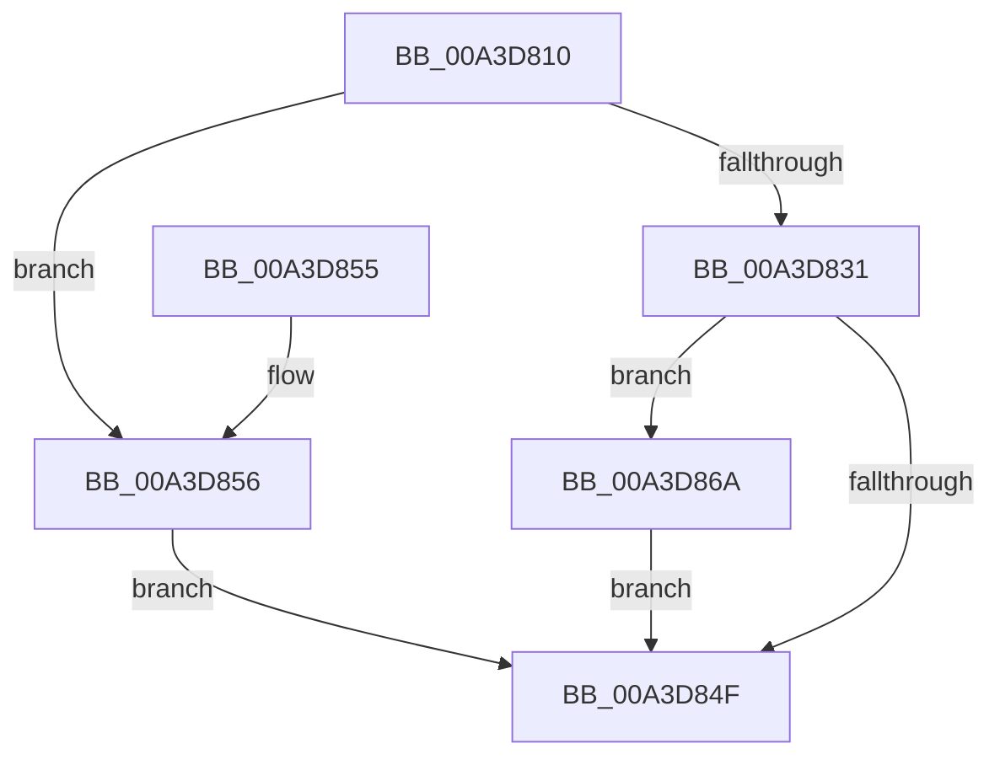

# BiOpenEffectiveToken

- RVA: `0x00A3D810`–`0x00A3D887` (길이 `119` bytes)
- VA: `0x0000000140A3D810`
- 실행 섹션: `PAGE`
- PDB 이름 있음: `예`; PDB Function 태그: `아니요`
- unwind 정보 RVA: `0x000A69A8`
- 디코드: `31`개 명령, `119/119` bytes 표시
- 미해석 바이트: `0` (있으면 어셈블리에 `.byte`로 보존)

> 이 문서는 커널 이미지의 기계어와 PDB 기호를 분석해 생성했습니다. 4번과 5번은 함수 원형과 자료형을 바이너리 사용 방식에서 추정한 C 해석이며 원본 소스 복구 결과는 아닙니다.

## 1. Dependencies

- 직접 호출 지점: **3**; 고유 호출 대상: **2**
- 직접 호출자로 확인된 함수: **1**
- RIP 상대 이미지 참조: **0**

### Outgoing calls
- `0x00A3D846` → [ZwOpenThreadTokenEx](../../text/6A/ZwOpenThreadTokenEx_function_006AD6B0.md) (function, `0x006AD6B0`)
- `0x00A3D863` → [ZwOpenProcessTokenEx](../../text/6A/ZwOpenProcessTokenEx_function_006AD6D0.md) (function, `0x006AD6D0`)
- `0x00A3D880` → [ZwOpenThreadTokenEx](../../text/6A/ZwOpenThreadTokenEx_function_006AD6B0.md) (function, `0x006AD6B0`)

### Direct callers
- [BiAdjustPrivilege](BiAdjustPrivilege_function_00A3D708.md) at `0x00A3D74C`

### Static image references
- 디코드된 RIP-relative 메모리 참조가 없습니다.

## 2. Other-region calls and transfers

- 다른 실행 섹션으로 향하는 call: **3**
  - `0x00A3D846` → [ZwOpenThreadTokenEx](../../text/6A/ZwOpenThreadTokenEx_function_006AD6B0.md) (`PAGE` → `.text`)
  - `0x00A3D863` → [ZwOpenProcessTokenEx](../../text/6A/ZwOpenProcessTokenEx_function_006AD6D0.md) (`PAGE` → `.text`)
  - `0x00A3D880` → [ZwOpenThreadTokenEx](../../text/6A/ZwOpenThreadTokenEx_function_006AD6B0.md) (`PAGE` → `.text`)
- 별도 외부 분기/꼬리 이동을 확인하지 못했습니다.

## 3. Assembly (complete function range)

```asm
00A3D810  40 53                           push rbx
00A3D812  48 83 EC 30                     sub rsp, 0x30
00A3D816  65 48 8B 04 25 88 01 00 00      mov rax, qword ptr gs:[0x188]
00A3D81F  48 8B D9                        mov rbx, rcx
00A3D822  BA 28 00 00 00                  mov edx, 0x28
00A3D827  8B 80 A0 05 00 00               mov eax, dword ptr [rax + 0x5a0]
00A3D82D  A8 08                           test al, 8
00A3D82F  74 25                           je 0x140a3d856
00A3D831  48 89 4C 24 20                  mov qword ptr [rsp + 0x20], rcx
00A3D836  41 B9 00 02 00 00               mov r9d, 0x200
00A3D83C  48 C7 C1 FE FF FF FF            mov rcx, 0xfffffffffffffffe
00A3D843  41 B0 01                        mov r8b, 1
00A3D846  E8 65 FE C6 FF                  call 0x1406ad6b0
00A3D84B  85 C0                           test eax, eax
00A3D84D  78 1B                           js 0x140a3d86a
00A3D84F  48 83 C4 30                     add rsp, 0x30
00A3D853  5B                              pop rbx
00A3D854  C3                              ret
00A3D855  CC                              int3
00A3D856  4C 8B CB                        mov r9, rbx
00A3D859  41 B8 00 02 00 00               mov r8d, 0x200
00A3D85F  48 83 C9 FF                     or rcx, 0xffffffffffffffff
00A3D863  E8 68 FE C6 FF                  call 0x1406ad6d0
00A3D868  EB E5                           jmp 0x140a3d84f
00A3D86A  45 33 C0                        xor r8d, r8d
00A3D86D  48 89 5C 24 20                  mov qword ptr [rsp + 0x20], rbx
00A3D872  41 B9 00 02 00 00               mov r9d, 0x200
00A3D878  41 8D 50 28                     lea edx, [r8 + 0x28]
00A3D87C  49 8D 48 FE                     lea rcx, [r8 - 2]
00A3D880  E8 2B FE C6 FF                  call 0x1406ad6b0
00A3D885  EB C8                           jmp 0x140a3d84f
```

## 4. C-style interpretation (structured pseudocode)

```c
__int64 __fastcall BiOpenEffectiveToken(__int64 a1)
{
    __int64 result;
    __int64 v_rsp;
    unsigned __int64 v_stack_m18;
    unsigned __int64 v_stack_p20;

    v_rsp = (v_rsp) - (48);
    if ((((unsigned __int8)((unsigned int)(*(unsigned int *)(*(unsigned __int64 *)(gs_base + (0 + 392)) + 1440)))) & (8)) == 0) goto loc_00A3D856;
    v_stack_m18 = a1;
    result = ZwOpenThreadTokenEx(-2, 40, 1, 512);
    if (sign_flag) goto loc_00A3D86A;
loc_00A3D84F:
    v_rsp = (v_rsp) + (48);
    return result;
loc_00A3D856:
    a1 = (-2) | (-1);
    result = ZwOpenProcessTokenEx(a1, 40, 512, a1);
    goto loc_00A3D84F;
loc_00A3D86A:
    a3 = 0;
    v_stack_p20 = a1;
    result = ZwOpenThreadTokenEx(a3 - 2, a3 + 40, a3, 512);
    goto loc_00A3D84F;
}
```

## 5. (Beta) C Style

```c
int64_t BiOpenEffectiveToken(int64_t Arg1)
{
    int64_t result;
    int64_t local_rsp;
    uint64_t v_stack_m18;
    uint64_t v_stack_p20;

    local_rsp = (local_rsp) - (48);
    if ((((uint8_t)((uint32_t)(*(uint32_t *)(*(uint64_t *)(gs_base + (0 + 0x188)) + 0x5A0)))) & (8)) == 0) goto loc_00A3D856;
    v_stack_m18 = Arg1;
    result = ZwOpenThreadTokenEx(-2, 40, 1, 512);
    if (sign_flag) goto loc_00A3D86A;
loc_00A3D84F:
    local_rsp = (local_rsp) + (48);
    return result;
loc_00A3D856:
    Arg1 = (-2) | (-1);
    result = ZwOpenProcessTokenEx(Arg1, 40, 512, Arg1);
    goto loc_00A3D84F;
loc_00A3D86A:
    a3 = 0;
    v_stack_p20 = Arg1;
    result = ZwOpenThreadTokenEx(a3 - 2, a3 + 40, a3, 512);
    goto loc_00A3D84F;
}
```

## 6. Execution-region graph

[열기: 2D/3D 그래프와 함수 탐색 컨트롤 패널](../../../control-panel.html?section=page&rva=0x00A3D810&view=graph)

- 2D 그래프는 위에서 아래로 흐르고, 3D 그래프는 빈 공간을 드래그해 회전합니다. Shift+드래그는 이동, 휠은 확대·축소, 함수 노드 선택은 대상 보고서 이동입니다.

### Static fallback


