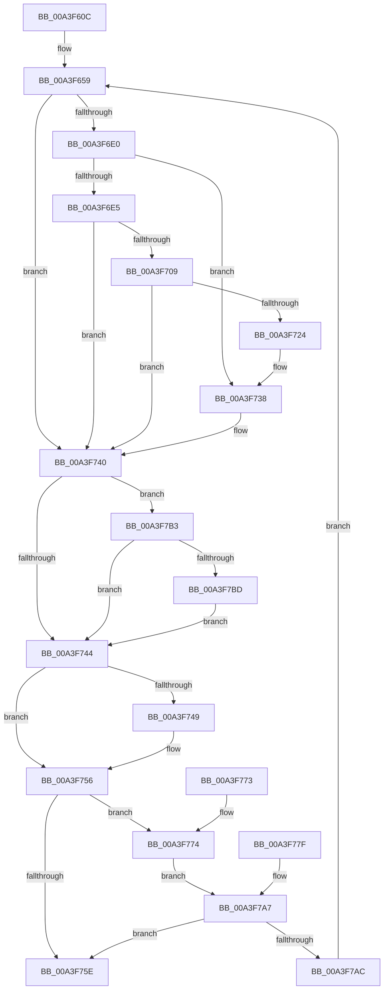

# BiOpenKey

- RVA: `0x00A3F60C`–`0x00A3F7C4` (길이 `440` bytes)
- VA: `0x0000000140A3F60C`
- 실행 섹션: `PAGE`
- PDB 이름 있음: `예`; PDB Function 태그: `아니요`
- unwind 정보 RVA: `0x000AE82C`
- 디코드: `116`개 명령, `440/440` bytes 표시
- 미해석 바이트: `0` (있으면 어셈블리에 `.byte`로 보존)

> 이 문서는 커널 이미지의 기계어와 PDB 기호를 분석해 생성했습니다. 4번과 5번은 함수 원형과 자료형을 바이너리 사용 방식에서 추정한 C 해석이며 원본 소스 복구 결과는 아닙니다.

## 1. Dependencies

- 직접 호출 지점: **9**; 고유 호출 대상: **7**
- 직접 호출자로 확인된 함수: **17**
- RIP 상대 이미지 참조: **0**

### Outgoing calls
- `0x00A3F66A` → [RtlInitUnicodeString](../../text/42/RtlInitUnicodeString_function_0042A780.md) (function, `0x0042A780`)
- `0x00A3F672` → [BiSanitizeHandle](../../text/4B/BiSanitizeHandle_function_004B0E4C.md) (function, `0x004B0E4C`)
- `0x00A3F6D1` → [BiZwOpenKey](../../text/4A/BiZwOpenKey_function_004AF654.md) (function, `0x004AF654`)
- `0x00A3F6EA` → [BiCreateKeySecurityDescriptor](../91/BiCreateKeySecurityDescriptor_function_00916D6C.md) (function, `0x00916D6C`)
- `0x00A3F6FA` → [BiZwSetSecurityObject](../../text/4A/BiZwSetSecurityObject_function_004A9A84.md) (function, `0x004A9A84`)
- `0x00A3F715` → [BiZwOpenKey](../../text/4A/BiZwOpenKey_function_004AF654.md) (function, `0x004AF654`)
- `0x00A3F729` → [BiZwClose](../../text/4A/BiZwClose_function_004A85DC.md) (function, `0x004A85DC`)
- `0x00A3F751` → [ExFreePoolWithTag](../../poolcode/B8/ExFreePoolWithTag_function_00B82870.md) (function, `0x00B82870`)
- `0x00A3F7BD` → [BiZwClose](../../text/4A/BiZwClose_function_004A85DC.md) (function, `0x004A85DC`)

### Direct callers
- [BiOpenStoreKeyFromObject](../../text/4B/BiOpenStoreKeyFromObject_function_004B1D14.md) at `0x004B1DA4`
- [BcdEnumerateObjects](../82/BcdEnumerateObjects_function_00823594.md) at `0x0082362A`
- [BcdEnumerateObjects](../82/BcdEnumerateObjects_function_00823594.md) at `0x0082367C`
- [BcdEnumerateObjects](../82/BcdEnumerateObjects_function_00823594.md) at `0x0082376B`
- [BiDeleteRegistryValue](../82/BiDeleteRegistryValue_function_00826078.md) at `0x008260C5`
- [BiIsPortableWorkspaceBoot](../82/BiIsPortableWorkspaceBoot_function_008261C0.md) at `0x008261EC`
- [BcdOpenObject](../91/BcdOpenObject_function_00916704.md) at `0x009167A6`
- [BcdOpenObject](../91/BcdOpenObject_function_00916704.md) at `0x00916829`
- [BiDeleteElement](BiDeleteElement_function_00A3E0F8.md) at `0x00A3E16F`
- [BiDeleteElement](BiDeleteElement_function_00A3E0F8.md) at `0x00A3E1AB`
- [BiSetRegistryValue](BiSetRegistryValue_function_00A3E3B0.md) at `0x00A3E41D`
- [BiBuildIdentifierList](BiBuildIdentifierList_function_00A3E584.md) at `0x00A3E632`
- [BcdGetElementDataWithFlags](BcdGetElementDataWithFlags_function_00A3EBE4.md) at `0x00A3ECC5`
- [BcdGetElementDataWithFlags](BcdGetElementDataWithFlags_function_00A3EBE4.md) at `0x00A3ED06`
- [BcdSetElementDataWithFlags](BcdSetElementDataWithFlags_function_00A3F080.md) at `0x00A3F11C`
- [BiGetObjectDescription](BiGetObjectDescription_function_00A3F2FC.md) at `0x00A3F32C`
- [BiGetRegistryValue](BiGetRegistryValue_function_00A3F3CC.md) at `0x00A3F462`
- [BiDeleteKey](BiDeleteKey_function_00A3FC58.md) at `0x00A3FCD8`
- [BiAddStoreFromFile](../A4/BiAddStoreFromFile_function_00A40C54.md) at `0x00A40D11`
- [sub_00B3A518](../B3/Unknown_function_00B3A518.md) at `0x00B3A53F`
- [sub_00B3A892](../B3/Unknown_function_00B3A892.md) at `0x00B3A8D2`
- [sub_00B3A892](../B3/Unknown_function_00B3A892.md) at `0x00B3A962`
- [sub_00B3A892](../B3/Unknown_function_00B3A892.md) at `0x00B3A9E0`
- [BcdSetBootBcdAsSystemStore](../../init/C6/BcdSetBootBcdAsSystemStore_function_00C6D214.md) at `0x00C6D25C`

### Static image references
- 디코드된 RIP-relative 메모리 참조가 없습니다.

## 2. Other-region calls and transfers

- 다른 실행 섹션으로 향하는 call: **8**
  - `0x00A3F66A` → [RtlInitUnicodeString](../../text/42/RtlInitUnicodeString_function_0042A780.md) (`PAGE` → `.text`)
  - `0x00A3F672` → [BiSanitizeHandle](../../text/4B/BiSanitizeHandle_function_004B0E4C.md) (`PAGE` → `.text`)
  - `0x00A3F6D1` → [BiZwOpenKey](../../text/4A/BiZwOpenKey_function_004AF654.md) (`PAGE` → `.text`)
  - `0x00A3F6FA` → [BiZwSetSecurityObject](../../text/4A/BiZwSetSecurityObject_function_004A9A84.md) (`PAGE` → `.text`)
  - `0x00A3F715` → [BiZwOpenKey](../../text/4A/BiZwOpenKey_function_004AF654.md) (`PAGE` → `.text`)
  - `0x00A3F729` → [BiZwClose](../../text/4A/BiZwClose_function_004A85DC.md) (`PAGE` → `.text`)
  - `0x00A3F751` → [ExFreePoolWithTag](../../poolcode/B8/ExFreePoolWithTag_function_00B82870.md) (`PAGE` → `POOLCODE`)
  - `0x00A3F7BD` → [BiZwClose](../../text/4A/BiZwClose_function_004A85DC.md) (`PAGE` → `.text`)
- 별도 외부 분기/꼬리 이동을 확인하지 못했습니다.

## 3. Assembly (complete function range)

```asm
00A3F60C  4C 89 4C 24 20                  mov qword ptr [rsp + 0x20], r9
00A3F611  48 89 54 24 10                  mov qword ptr [rsp + 0x10], rdx
00A3F616  53                              push rbx
00A3F617  56                              push rsi
00A3F618  57                              push rdi
00A3F619  41 54                           push r12
00A3F61B  41 55                           push r13
00A3F61D  41 56                           push r14
00A3F61F  41 57                           push r15
00A3F621  48 81 EC 80 00 00 00            sub rsp, 0x80
00A3F628  4D 8B F9                        mov r15, r9
00A3F62B  41 8B F8                        mov edi, r8d
00A3F62E  4C 8B E2                        mov r12, rdx
00A3F631  4C 8B E9                        mov r13, rcx
00A3F634  48 83 64 24 30 00               and qword ptr [rsp + 0x30], 0
00A3F63A  0F 57 C0                        xorps xmm0, xmm0
00A3F63D  0F 11 44 24 38                  movups xmmword ptr [rsp + 0x38], xmm0
00A3F642  33 C0                           xor eax, eax
00A3F644  0F 11 44 24 48                  movups xmmword ptr [rsp + 0x48], xmm0
00A3F649  0F 11 44 24 58                  movups xmmword ptr [rsp + 0x58], xmm0
00A3F64E  48 89 44 24 68                  mov qword ptr [rsp + 0x68], rax
00A3F653  89 44 24 70                     mov dword ptr [rsp + 0x70], eax
00A3F657  33 F6                           xor esi, esi
00A3F659  48 83 64 24 28 00               and qword ptr [rsp + 0x28], 0
00A3F65F  45 33 F6                        xor r14d, r14d
00A3F662  49 8B D4                        mov rdx, r12
00A3F665  48 8D 4C 24 38                  lea rcx, [rsp + 0x38]
00A3F66A  E8 11 B1 9E FF                  call 0x14042a780
00A3F66F  49 8B CD                        mov rcx, r13
00A3F672  E8 D5 17 A7 FF                  call 0x1404b0e4c
00A3F677  48 89 84 24 C0 00 00 00         mov qword ptr [rsp + 0xc0], rax
00A3F67F  0F BA EF 12                     bts edi, 0x12
00A3F683  89 BC 24 D0 00 00 00            mov dword ptr [rsp + 0xd0], edi
00A3F68A  44 8B EF                        mov r13d, edi
00A3F68D  41 81 E5 19 00 06 00            and r13d, 0x60019
00A3F694  C7 44 24 48 30 00 00 00         mov dword ptr [rsp + 0x48], 0x30
00A3F69C  48 89 44 24 50                  mov qword ptr [rsp + 0x50], rax
00A3F6A1  C7 44 24 60 40 02 00 00         mov dword ptr [rsp + 0x60], 0x240
00A3F6A9  48 8D 44 24 38                  lea rax, [rsp + 0x38]
00A3F6AE  48 89 44 24 58                  mov qword ptr [rsp + 0x58], rax
00A3F6B3  0F 57 C0                        xorps xmm0, xmm0
00A3F6B6  F3 0F 7F 44 24 68               movdqu xmmword ptr [rsp + 0x68], xmm0
00A3F6BC  BA 00 00 04 00                  mov edx, 0x40000
00A3F6C1  44 3B EF                        cmp r13d, edi
00A3F6C4  0F 44 D7                        cmove edx, edi
00A3F6C7  4C 8D 44 24 48                  lea r8, [rsp + 0x48]
00A3F6CC  48 8D 4C 24 28                  lea rcx, [rsp + 0x28]
00A3F6D1  E8 7E FF A6 FF                  call 0x1404af654
00A3F6D6  8B D8                           mov ebx, eax
00A3F6D8  89 44 24 20                     mov dword ptr [rsp + 0x20], eax
00A3F6DC  85 C0                           test eax, eax
00A3F6DE  78 60                           js 0x140a3f740
00A3F6E0  44 3B EF                        cmp r13d, edi
00A3F6E3  74 53                           je 0x140a3f738
00A3F6E5  B9 3F 00 0F 00                  mov ecx, 0xf003f
00A3F6EA  E8 7D 76 ED FF                  call 0x140916d6c
00A3F6EF  4C 8B F0                        mov r14, rax
00A3F6F2  4C 8B C0                        mov r8, rax
00A3F6F5  48 8B 4C 24 28                  mov rcx, qword ptr [rsp + 0x28]
00A3F6FA  E8 85 A3 A6 FF                  call 0x1404a9a84
00A3F6FF  8B D8                           mov ebx, eax
00A3F701  89 44 24 20                     mov dword ptr [rsp + 0x20], eax
00A3F705  85 C0                           test eax, eax
00A3F707  78 37                           js 0x140a3f740
00A3F709  4C 8D 44 24 48                  lea r8, [rsp + 0x48]
00A3F70E  8B D7                           mov edx, edi
00A3F710  48 8D 4C 24 30                  lea rcx, [rsp + 0x30]
00A3F715  E8 3A FF A6 FF                  call 0x1404af654
00A3F71A  8B D8                           mov ebx, eax
00A3F71C  89 44 24 20                     mov dword ptr [rsp + 0x20], eax
00A3F720  85 C0                           test eax, eax
00A3F722  78 1C                           js 0x140a3f740
00A3F724  48 8B 4C 24 28                  mov rcx, qword ptr [rsp + 0x28]
00A3F729  E8 AE 8E A6 FF                  call 0x1404a85dc
00A3F72E  48 8B 44 24 30                  mov rax, qword ptr [rsp + 0x30]
00A3F733  48 89 44 24 28                  mov qword ptr [rsp + 0x28], rax
00A3F738  48 8B 44 24 28                  mov rax, qword ptr [rsp + 0x28]
00A3F73D  49 89 07                        mov qword ptr [r15], rax
00A3F740  85 DB                           test ebx, ebx
00A3F742  78 6F                           js 0x140a3f7b3
00A3F744  4D 85 F6                        test r14, r14
00A3F747  74 0D                           je 0x140a3f756
00A3F749  BA 42 43 44 4B                  mov edx, 0x4b444342
00A3F74E  49 8B CE                        mov rcx, r14
00A3F751  E8 1A 31 14 00                  call 0x140b82870
00A3F756  81 FB 7D 01 00 C0               cmp ebx, 0xc000017d
00A3F75C  74 16                           je 0x140a3f774
00A3F75E  8B C3                           mov eax, ebx
00A3F760  48 81 C4 80 00 00 00            add rsp, 0x80
00A3F767  41 5F                           pop r15
00A3F769  41 5E                           pop r14
00A3F76B  41 5D                           pop r13
00A3F76D  41 5C                           pop r12
00A3F76F  5F                              pop rdi
00A3F770  5E                              pop rsi
00A3F771  5B                              pop rbx
00A3F772  C3                              ret
00A3F773  CC                              int3
00A3F774  CC                              int3
00A3F775  4C 8B AC 24 C0 00 00 00         mov r13, qword ptr [rsp + 0xc0]
00A3F77D  EB 28                           jmp 0x140a3f7a7
00A3F77F  BE 05 00 00 00                  mov esi, 5
00A3F784  4C 8B BC 24 D8 00 00 00         mov r15, qword ptr [rsp + 0xd8]
00A3F78C  8B BC 24 D0 00 00 00            mov edi, dword ptr [rsp + 0xd0]
00A3F793  4C 8B A4 24 C8 00 00 00         mov r12, qword ptr [rsp + 0xc8]
00A3F79B  4C 8B AC 24 C0 00 00 00         mov r13, qword ptr [rsp + 0xc0]
00A3F7A3  8B 5C 24 20                     mov ebx, dword ptr [rsp + 0x20]
00A3F7A7  83 FE 05                        cmp esi, 5
00A3F7AA  73 B2                           jae 0x140a3f75e
00A3F7AC  FF C6                           inc esi
00A3F7AE  E9 A6 FE FF FF                  jmp 0x140a3f659
00A3F7B3  48 8B 4C 24 28                  mov rcx, qword ptr [rsp + 0x28]
00A3F7B8  48 85 C9                        test rcx, rcx
00A3F7BB  74 87                           je 0x140a3f744
00A3F7BD  E8 1A 8E A6 FF                  call 0x1404a85dc
00A3F7C2  EB 80                           jmp 0x140a3f744
```

## 4. C-style interpretation (structured pseudocode)

```c
__int64 __fastcall BiOpenKey(__int64 a1, __int64 a2, int a3, __int64 a4)
{
    __int64 result;
    __int64 v_r13;
    __int64 v_r14;
    __int64 v_rsi;
    __int64 v_rsp;
    unsigned int v_stack_m48;
    unsigned __int64 v_stack_m50;
    unsigned int v_stack_m58;
    unsigned __int64 v_stack_m60;
    unsigned __int64 v_stack_m68;
    unsigned __int64 v_stack_m70;
    unsigned __int64 v_stack_m80;
    unsigned __int64 v_stack_m88;
    unsigned __int64 v_stack_m90;
    unsigned int v_stack_m98;
    unsigned __int64 v_stack_p10;
    unsigned int v_stack_p18;
    unsigned __int64 v_stack_p20;
    unsigned __int64 v_stack_p28;
    unsigned __int64 v_stack_p8;
    unsigned __int64 v_stack_pC0;
    unsigned __int64 v_stack_pC8;
    unsigned int v_stack_pD0;
    unsigned __int64 v_stack_pD8;

    v_stack_p20 = a4;
    v_stack_p10 = a2;
    v_rsp = (v_rsp) - (128);
    v_stack_m80 = v_xmm0;
    result = 0;
    v_stack_m70 = v_xmm0;
    v_stack_m60 = v_xmm0;
    v_stack_m50 = 0;
    v_stack_m48 = 0;
    v_rsi = 0;
loc_00A3F659:
    v_r14 = 0;
    result = RtlInitUnicodeString(v_stack_m80, a2, a3, a4);
    result = BiSanitizeHandle(a1, a2, a3, a4);
    v_stack_p8 = result;
    v_stack_p18 = (unsigned int)((unsigned int)(a3));
    v_r13 = (unsigned int)(((unsigned int)((unsigned int)((unsigned int)(a3)))) & (0x60019ULL));
    v_stack_m70 = 48;
    v_stack_m68 = result;
    v_stack_m58 = 576;
    v_stack_m60 = v_stack_m80;
    v_stack_m50 = v_xmm0;
    a2 = (unsigned int)(0x40000ULL);
    if (((unsigned int)(v_r13)) == ((unsigned int)((unsigned int)(a3)))) { a2 = (unsigned int)((unsigned int)(a3)); }
    result = BiZwOpenKey(v_stack_m90, a2, v_stack_m70, a4);
    v_stack_m98 = (unsigned int)(result);
    if (sign_flag) goto loc_00A3F740;
    if (((unsigned int)(v_r13)) == ((unsigned int)((unsigned int)(a3)))) goto loc_00A3F738;
    result = BiCreateKeySecurityDescriptor((unsigned int)(0xF003FULL), a2, v_stack_m70, a4);
    result = BiZwSetSecurityObject(v_stack_m90, a2, result, a4);
    v_stack_m98 = (unsigned int)(result);
    if (sign_flag) goto loc_00A3F740;
    result = BiZwOpenKey(v_stack_m88, (unsigned int)((unsigned int)((unsigned int)(a3))), v_stack_m70, a4);
    v_stack_m98 = (unsigned int)(result);
    if (sign_flag) goto loc_00A3F740;
    result = BiZwClose(v_stack_m90, (unsigned int)((unsigned int)((unsigned int)(a3))), v_stack_m70, a4);
    v_stack_m90 = v_stack_m88;
loc_00A3F738:
    *(unsigned __int64 *)(a4) = v_stack_m90;
loc_00A3F740:
    if (sign_flag) goto loc_00A3F7B3;
loc_00A3F744:
    result = v_stack_m90;
    if (result != 0) {
        a2 = 0x4B444342ULL;
        a1 = result;
        result = ExFreePoolWithTag(a1, a2, v_stack_m70, a4);
    }
    if (((unsigned int)((unsigned int)((unsigned int)(result)))) == 0xC000017DULL) goto loc_00A3F774;
loc_00A3F75E:
    v_rsp = (v_rsp) + (128);
    return (unsigned int)((unsigned int)((unsigned int)((unsigned int)(result))));
loc_00A3F774:
    goto loc_00A3F7A7;
loc_00A3F7A7:
    if (0 >= 5) goto loc_00A3F75E;
    v_rsi = (unsigned int)((v_rsi) + 1);
    goto loc_00A3F659;
loc_00A3F7B3:
    if (v_stack_p28 == 0) goto loc_00A3F744;
    result = BiZwClose(v_stack_p28, a2, v_stack_m70, a4);
    goto loc_00A3F744;
}
```

## 5. (Beta) C Style

```c
int64_t BiOpenKey(int64_t Arg1, int64_t Arg2, int32_t Arg3, void *Arg4)
{
    uint8_t *arg4 = (uint8_t *)Arg4;

    int64_t result;
    int64_t local_r13;
    int64_t local_r14;
    int64_t local_rsi;
    int64_t local_rsp;
    uint32_t v_stack_m48;
    uint64_t v_stack_m50;
    uint32_t v_stack_m58;
    uint64_t v_stack_m60;
    uint64_t v_stack_m68;
    uint64_t v_stack_m70;
    uint64_t v_stack_m80;
    uint64_t v_stack_m88;
    uint64_t v_stack_m90;
    uint32_t v_stack_m98;
    uint64_t v_stack_p10;
    uint32_t v_stack_p18;
    uint64_t v_stack_p20;
    uint64_t v_stack_p28;
    uint64_t v_stack_p8;
    uint64_t v_stack_pC0;
    uint64_t v_stack_pC8;
    uint32_t v_stack_pD0;
    uint64_t v_stack_pD8;

    v_stack_p20 = Arg4;
    v_stack_p10 = Arg2;
    local_rsp = (local_rsp) - (128);
    v_stack_m80 = v_xmm0;
    result = 0;
    v_stack_m70 = v_xmm0;
    v_stack_m60 = v_xmm0;
    v_stack_m50 = 0;
    v_stack_m48 = 0;
    local_rsi = 0;
loc_00A3F659:
    local_r14 = 0;
    result = RtlInitUnicodeString(v_stack_m80, Arg2, Arg3, Arg4);
    result = BiSanitizeHandle(Arg1, Arg2, Arg3, Arg4);
    v_stack_p8 = result;
    v_stack_p18 = (uint32_t)((uint32_t)(Arg3));
    local_r13 = (uint32_t)(((uint32_t)((uint32_t)((uint32_t)(Arg3)))) & (0x60019ULL));
    v_stack_m70 = 48;
    v_stack_m68 = result;
    v_stack_m58 = 576;
    v_stack_m60 = v_stack_m80;
    v_stack_m50 = v_xmm0;
    Arg2 = (uint32_t)(0x40000ULL);
    if (((uint32_t)(local_r13)) == ((uint32_t)((uint32_t)(Arg3)))) { Arg2 = (uint32_t)((uint32_t)(Arg3)); }
    result = BiZwOpenKey(v_stack_m90, Arg2, v_stack_m70, Arg4);
    v_stack_m98 = (uint32_t)(result);
    if (sign_flag) goto loc_00A3F740;
    if (((uint32_t)(local_r13)) == ((uint32_t)((uint32_t)(Arg3)))) goto loc_00A3F738;
    result = BiCreateKeySecurityDescriptor((uint32_t)(0xF003FULL), Arg2, v_stack_m70, Arg4);
    result = BiZwSetSecurityObject(v_stack_m90, Arg2, result, Arg4);
    v_stack_m98 = (uint32_t)(result);
    if (sign_flag) goto loc_00A3F740;
    result = BiZwOpenKey(v_stack_m88, (uint32_t)((uint32_t)((uint32_t)(Arg3))), v_stack_m70, Arg4);
    v_stack_m98 = (uint32_t)(result);
    if (sign_flag) goto loc_00A3F740;
    result = BiZwClose(v_stack_m90, (uint32_t)((uint32_t)((uint32_t)(Arg3))), v_stack_m70, Arg4);
    v_stack_m90 = v_stack_m88;
loc_00A3F738:
    *(uint64_t *)(arg4) = v_stack_m90;
loc_00A3F740:
    if (sign_flag) goto loc_00A3F7B3;
loc_00A3F744:
    result = v_stack_m90;
    if (result != 0) {
        Arg2 = 0x4B444342ULL;
        Arg1 = result;
        result = ExFreePoolWithTag(Arg1, Arg2, v_stack_m70, Arg4);
    }
    if (((uint32_t)((uint32_t)((uint32_t)(result)))) == 0xC000017DULL) goto loc_00A3F774;
loc_00A3F75E:
    local_rsp = (local_rsp) + (128);
    return (uint32_t)((uint32_t)((uint32_t)((uint32_t)(result))));
loc_00A3F774:
    goto loc_00A3F7A7;
loc_00A3F7A7:
    if (0 >= 5) goto loc_00A3F75E;
    local_rsi = (uint32_t)((local_rsi) + 1);
    goto loc_00A3F659;
loc_00A3F7B3:
    if (v_stack_p28 == 0) goto loc_00A3F744;
    result = BiZwClose(v_stack_p28, Arg2, v_stack_m70, Arg4);
    goto loc_00A3F744;
}
```

### 관측된 메모리 오프셋

구조체 형식이 확인되지 않은 접근은 인자 기준의 오프셋으로만 기록했습니다.

| 기준 인자 | 오프셋 표현 | 폭 (bit) | 접근 |
|---|---:|---:|---|
| `Arg4` | `+ 0x0` | `64` | `W` |

## 6. Execution-region graph

[열기: 2D/3D 그래프와 함수 탐색 컨트롤 패널](../../../control-panel.html?section=page&rva=0x00A3F60C&view=graph)

- 2D 그래프는 위에서 아래로 흐르고, 3D 그래프는 빈 공간을 드래그해 회전합니다. Shift+드래그는 이동, 휠은 확대·축소, 함수 노드 선택은 대상 보고서 이동입니다.

### Static fallback


