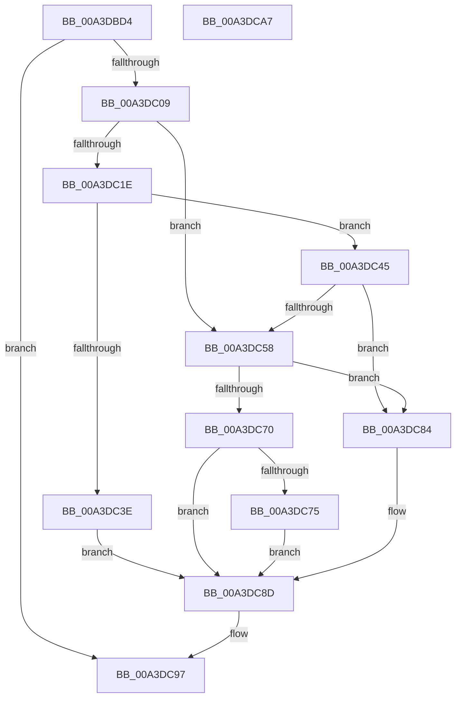

# BiQueryBootEntryOrder

- RVA: `0x00A3DBD4`–`0x00A3DCA8` (길이 `212` bytes)
- VA: `0x0000000140A3DBD4`
- 실행 섹션: `PAGE`
- PDB 이름 있음: `예`; PDB Function 태그: `아니요`
- unwind 정보 RVA: `0x000AE684`
- 디코드: `64`개 명령, `212/212` bytes 표시
- 미해석 바이트: `0` (있으면 어셈블리에 `.byte`로 보존)

> 이 문서는 커널 이미지의 기계어와 PDB 기호를 분석해 생성했습니다. 4번과 5번은 함수 원형과 자료형을 바이너리 사용 방식에서 추정한 C 해석이며 원본 소스 복구 결과는 아닙니다.

## 1. Dependencies

- 직접 호출 지점: **7**; 고유 호출 대상: **6**
- 직접 호출자로 확인된 함수: **4**
- RIP 상대 이미지 참조: **1**

### Outgoing calls
- `0x00A3DBFA` → [BiAcquirePrivilege](BiAcquirePrivilege_function_00A3D658.md) (function, `0x00A3D658`)
- `0x00A3DC10` → [ZwQueryBootEntryOrder](../../text/6A/ZwQueryBootEntryOrder_function_006AFA30.md) (function, `0x006AFA30`)
- `0x00A3DC31` → [ExAllocatePool2](../../poolcode/B8/ExAllocatePool2_function_00B820F0.md) (function, `0x00B820F0`)
- `0x00A3DC4D` → [ZwQueryBootEntryOrder](../../text/6A/ZwQueryBootEntryOrder_function_006AFA30.md) (function, `0x006AFA30`)
- `0x00A3DC67` → [BiLogMessage](BiLogMessage_function_00A3D3A8.md) (function, `0x00A3D3A8`)
- `0x00A3DC7D` → [ExFreePoolWithTag](../../poolcode/B8/ExFreePoolWithTag_function_00B82870.md) (function, `0x00B82870`)
- `0x00A3DC92` → [BiReleasePrivilege](BiReleasePrivilege_function_00A3D600.md) (function, `0x00A3D600`)

### Direct callers
- [BiAddBootEntryToNvramDisplayOrder](../82/BiAddBootEntryToNvramDisplayOrder_function_00826428.md) at `0x00826451`
- [BiRemoveBootEntryFromNvramDisplayOrder](../82/BiRemoveBootEntryFromNvramDisplayOrder_function_00826EEC.md) at `0x00826F10`
- [BiBindEfiBootManager](BiBindEfiBootManager_function_00A3DCB0.md) at `0x00A3DD91`
- [BiExportEfiBootManager](../AC/BiExportEfiBootManager_function_00ACB13C.md) at `0x00ACB257`

### Static image references
- `0x00A3DC58` → RVA `0x00B0CDB0` (` ?? ::NNGAKEGL::`string'`; read)

## 2. Other-region calls and transfers

- 다른 실행 섹션으로 향하는 call: **4**
  - `0x00A3DC10` → [ZwQueryBootEntryOrder](../../text/6A/ZwQueryBootEntryOrder_function_006AFA30.md) (`PAGE` → `.text`)
  - `0x00A3DC31` → [ExAllocatePool2](../../poolcode/B8/ExAllocatePool2_function_00B820F0.md) (`PAGE` → `POOLCODE`)
  - `0x00A3DC4D` → [ZwQueryBootEntryOrder](../../text/6A/ZwQueryBootEntryOrder_function_006AFA30.md) (`PAGE` → `.text`)
  - `0x00A3DC7D` → [ExFreePoolWithTag](../../poolcode/B8/ExFreePoolWithTag_function_00B82870.md) (`PAGE` → `POOLCODE`)
- 별도 외부 분기/꼬리 이동을 확인하지 못했습니다.

## 3. Assembly (complete function range)

```asm
00A3DBD4  48 8B C4                        mov rax, rsp
00A3DBD7  48 89 58 08                     mov qword ptr [rax + 8], rbx
00A3DBDB  56                              push rsi
00A3DBDC  57                              push rdi
00A3DBDD  41 56                           push r14
00A3DBDF  48 83 EC 20                     sub rsp, 0x20
00A3DBE3  48 83 60 20 00                  and qword ptr [rax + 0x20], 0
00A3DBE8  33 FF                           xor edi, edi
00A3DBEA  21 78 18                        and dword ptr [rax + 0x18], edi
00A3DBED  48 8B F2                        mov rsi, rdx
00A3DBF0  4C 8B F1                        mov r14, rcx
00A3DBF3  48 8D 50 20                     lea rdx, [rax + 0x20]
00A3DBF7  8D 4F 16                        lea ecx, [rdi + 0x16]
00A3DBFA  E8 59 FA FF FF                  call 0x140a3d658
00A3DBFF  8B D8                           mov ebx, eax
00A3DC01  85 C0                           test eax, eax
00A3DC03  0F 88 8E 00 00 00               js 0x140a3dc97
00A3DC09  48 8D 54 24 50                  lea rdx, [rsp + 0x50]
00A3DC0E  33 C9                           xor ecx, ecx
00A3DC10  E8 1B 1E C7 FF                  call 0x1406afa30
00A3DC15  8B D8                           mov ebx, eax
00A3DC17  3D 23 00 00 C0                  cmp eax, 0xc0000023
00A3DC1C  75 3A                           jne 0x140a3dc58
00A3DC1E  8B 54 24 50                     mov edx, dword ptr [rsp + 0x50]
00A3DC22  B9 02 01 00 00                  mov ecx, 0x102
00A3DC27  48 C1 E2 02                     shl rdx, 2
00A3DC2B  41 B8 42 43 44 4B               mov r8d, 0x4b444342
00A3DC31  E8 BA 44 14 00                  call 0x140b820f0
00A3DC36  48 8B F8                        mov rdi, rax
00A3DC39  48 85 C0                        test rax, rax
00A3DC3C  75 07                           jne 0x140a3dc45
00A3DC3E  BB 9A 00 00 C0                  mov ebx, 0xc000009a
00A3DC43  EB 48                           jmp 0x140a3dc8d
00A3DC45  48 8D 54 24 50                  lea rdx, [rsp + 0x50]
00A3DC4A  48 8B C8                        mov rcx, rax
00A3DC4D  E8 DE 1D C7 FF                  call 0x1406afa30
00A3DC52  8B D8                           mov ebx, eax
00A3DC54  85 C0                           test eax, eax
00A3DC56  79 2C                           jns 0x140a3dc84
00A3DC58  48 8D 15 51 F1 0C 00            lea rdx, [rip + 0xcf151]
00A3DC5F  B9 04 00 00 00                  mov ecx, 4
00A3DC64  44 8B C3                        mov r8d, ebx
00A3DC67  E8 3C F7 FF FF                  call 0x140a3d3a8
00A3DC6C  85 DB                           test ebx, ebx
00A3DC6E  79 14                           jns 0x140a3dc84
00A3DC70  48 85 FF                        test rdi, rdi
00A3DC73  74 18                           je 0x140a3dc8d
00A3DC75  BA 42 43 44 4B                  mov edx, 0x4b444342
00A3DC7A  48 8B CF                        mov rcx, rdi
00A3DC7D  E8 EE 4B 14 00                  call 0x140b82870
00A3DC82  EB 09                           jmp 0x140a3dc8d
00A3DC84  8B 44 24 50                     mov eax, dword ptr [rsp + 0x50]
00A3DC88  89 06                           mov dword ptr [rsi], eax
00A3DC8A  49 89 3E                        mov qword ptr [r14], rdi
00A3DC8D  48 8D 4C 24 58                  lea rcx, [rsp + 0x58]
00A3DC92  E8 69 F9 FF FF                  call 0x140a3d600
00A3DC97  8B C3                           mov eax, ebx
00A3DC99  48 8B 5C 24 40                  mov rbx, qword ptr [rsp + 0x40]
00A3DC9E  48 83 C4 20                     add rsp, 0x20
00A3DCA2  41 5E                           pop r14
00A3DCA4  5F                              pop rdi
00A3DCA5  5E                              pop rsi
00A3DCA6  C3                              ret
00A3DCA7  CC                              int3
```

## 4. C-style interpretation (structured pseudocode)

```c
__int64 __fastcall BiQueryBootEntryOrder(__int64 a1, __int64 a2)
{
    __int64 result;
    __int64 v_rdi;
    __int64 v_rsp;
    unsigned __int64 v_stack_p18;
    unsigned __int64 v_stack_p20;
    unsigned __int64 v_stack_p8;

    *(unsigned __int64 *)(v_rsp + 8) = v_rbx;
    v_rsp = (v_rsp) - (32);
    v_rdi = 0;
    result = BiAcquirePrivilege(v_rdi + 22, v_rsp + 32, a3, a4);
    if (sign_flag) goto loc_00A3DC97;
    a1 = 0;
    result = ZwQueryBootEntryOrder(a1, v_stack_p18, a3, a4);
    if (((unsigned int)(result)) != 0xC0000023ULL) goto loc_00A3DC58;
    a2 = ((unsigned int)(v_stack_p18)) << (2);
    result = ExAllocatePool2(258, a2, (unsigned int)(0x4B444342ULL), a4);
    if (result != 0) goto loc_00A3DC45;
    goto loc_00A3DC8D;
loc_00A3DC45:
    result = ZwQueryBootEntryOrder(result, v_stack_p18, (unsigned int)(0x4B444342ULL), a4);
    if (!sign_flag) goto loc_00A3DC84;
loc_00A3DC58:
    result = BiLogMessage(4, v_rip + 848209, (unsigned int)((unsigned int)((unsigned int)((unsigned int)(result)))), a4);
    if (!sign_flag) goto loc_00A3DC84;
    if (result == 0) goto loc_00A3DC8D;
    result = ExFreePoolWithTag(result, (unsigned int)(0x4B444342ULL), (unsigned int)((unsigned int)((unsigned int)((unsigned int)(result)))), a4);
    goto loc_00A3DC8D;
loc_00A3DC84:
    *(unsigned int *)(a2) = (unsigned int)((unsigned int)(v_stack_p18));
    *(unsigned __int64 *)(a1) = result;
loc_00A3DC8D:
    result = BiReleasePrivilege(v_stack_p20, (unsigned int)(0x4B444342ULL), (unsigned int)((unsigned int)((unsigned int)((unsigned int)(result)))), a4);
loc_00A3DC97:
    v_rsp = (v_rsp) + (32);
    return (unsigned int)((unsigned int)((unsigned int)((unsigned int)(result))));
}
```

## 5. (Beta) C Style

```c
int64_t BiQueryBootEntryOrder(void *Arg1, void *Arg2)
{
    uint8_t *arg1 = (uint8_t *)Arg1;
    uint8_t *arg2 = (uint8_t *)Arg2;

    int64_t result;
    int64_t local_rdi;
    int64_t local_rsp;
    uint64_t v_stack_p18;
    uint64_t v_stack_p20;
    uint64_t v_stack_p8;

    *(uint64_t *)(local_rsp + 0x8) = local_rbx;
    local_rsp = (local_rsp) - (32);
    local_rdi = 0;
    result = BiAcquirePrivilege(local_rdi + 22, local_rsp + 32, a3, a4);
    if (sign_flag) goto loc_00A3DC97;
    Arg1 = 0;
    result = ZwQueryBootEntryOrder(Arg1, v_stack_p18, a3, a4);
    if (((uint32_t)(result)) != 0xC0000023ULL) goto loc_00A3DC58;
    Arg2 = ((uint32_t)(v_stack_p18)) << (2);
    result = ExAllocatePool2(258, Arg2, (uint32_t)(0x4B444342ULL), a4);
    if (result != 0) goto loc_00A3DC45;
    goto loc_00A3DC8D;
loc_00A3DC45:
    result = ZwQueryBootEntryOrder(result, v_stack_p18, (uint32_t)(0x4B444342ULL), a4);
    if (!sign_flag) goto loc_00A3DC84;
loc_00A3DC58:
    result = BiLogMessage(4, v_rip + 848209, (uint32_t)((uint32_t)((uint32_t)((uint32_t)(result)))), a4);
    if (!sign_flag) goto loc_00A3DC84;
    if (result == 0) goto loc_00A3DC8D;
    result = ExFreePoolWithTag(result, (uint32_t)(0x4B444342ULL), (uint32_t)((uint32_t)((uint32_t)((uint32_t)(result)))), a4);
    goto loc_00A3DC8D;
loc_00A3DC84:
    *(uint32_t *)(arg2) = (uint32_t)((uint32_t)(v_stack_p18));
    *(uint64_t *)(arg1) = result;
loc_00A3DC8D:
    result = BiReleasePrivilege(v_stack_p20, (uint32_t)(0x4B444342ULL), (uint32_t)((uint32_t)((uint32_t)((uint32_t)(result)))), a4);
loc_00A3DC97:
    local_rsp = (local_rsp) + (32);
    return (uint32_t)((uint32_t)((uint32_t)((uint32_t)(result))));
}
```

### 관측된 메모리 오프셋

구조체 형식이 확인되지 않은 접근은 인자 기준의 오프셋으로만 기록했습니다.

| 기준 인자 | 오프셋 표현 | 폭 (bit) | 접근 |
|---|---:|---:|---|
| `Arg1` | `+ 0x0` | `64` | `W` |
| `Arg2` | `+ 0x0` | `32` | `W` |

## 6. Execution-region graph

[열기: 2D/3D 그래프와 함수 탐색 컨트롤 패널](../../../control-panel.html?section=page&rva=0x00A3DBD4&view=graph)

- 2D 그래프는 위에서 아래로 흐르고, 3D 그래프는 빈 공간을 드래그해 회전합니다. Shift+드래그는 이동, 휠은 확대·축소, 함수 노드 선택은 대상 보고서 이동입니다.

### Static fallback


