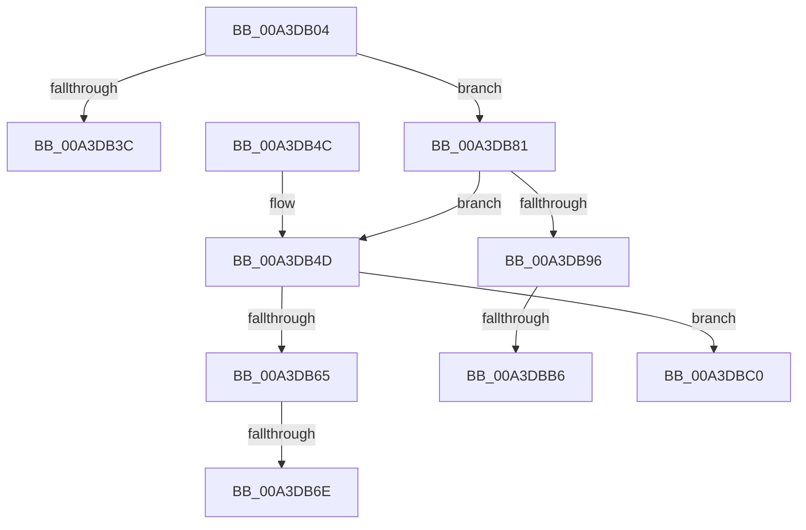

# BiQueryBootOptions

- RVA: `0x00A3DB04`–`0x00A3DBCE` (길이 `202` bytes)
- VA: `0x0000000140A3DB04`
- 실행 섹션: `PAGE`
- PDB 이름 있음: `예`; PDB Function 태그: `예`
- unwind 정보 RVA: `0x000AE660`
- 디코드: `59`개 명령, `202/202` bytes 표시
- 미해석 바이트: `0` (있으면 어셈블리에 `.byte`로 보존)

> 이 문서는 커널 이미지의 기계어와 PDB 기호를 분석해 생성했습니다. 4번과 5번은 함수 원형과 자료형을 바이너리 사용 방식에서 추정한 C 해석이며 원본 소스 복구 결과는 아닙니다.

## 1. Dependencies

- 직접 호출 지점: **5**; 고유 호출 대상: **5**
- 직접 호출자로 확인된 함수: **2**
- RIP 상대 이미지 참조: **1**

### Outgoing calls
- `0x00A3DB31` → [BiAcquirePrivilege](BiAcquirePrivilege_function_00A3D658.md) (function, `0x00A3D658`)
- `0x00A3DB5C` → [BiLogMessage](BiLogMessage_function_00A3D3A8.md) (function, `0x00A3D3A8`)
- `0x00A3DB76` → [ExFreePoolWithTag](../../poolcode/B8/ExFreePoolWithTag_function_00B82870.md) (function, `0x00B82870`)
- `0x00A3DB88` → [ZwQueryBootOptions](../../text/6A/ZwQueryBootOptions_function_006AFA50.md) (function, `0x006AFA50`)
- `0x00A3DBA5` → [ExAllocatePool2](../../poolcode/B8/ExAllocatePool2_function_00B820F0.md) (function, `0x00B820F0`)

### Direct callers
- [BiBindEfiBootManager](BiBindEfiBootManager_function_00A3DCB0.md) at `0x00A3DE0B`
- [BiExportEfiBootManager](../AC/BiExportEfiBootManager_function_00ACB13C.md) at `0x00ACB39E`

### Static image references
- `0x00A3DB4D` → RVA `0x00B0CE10` (` ?? ::NNGAKEGL::`string'`; read)

## 2. Other-region calls and transfers

- 다른 실행 섹션으로 향하는 call: **3**
  - `0x00A3DB76` → [ExFreePoolWithTag](../../poolcode/B8/ExFreePoolWithTag_function_00B82870.md) (`PAGE` → `POOLCODE`)
  - `0x00A3DB88` → [ZwQueryBootOptions](../../text/6A/ZwQueryBootOptions_function_006AFA50.md) (`PAGE` → `.text`)
  - `0x00A3DBA5` → [ExAllocatePool2](../../poolcode/B8/ExAllocatePool2_function_00B820F0.md) (`PAGE` → `POOLCODE`)
- call이 아닌 외부 분기/꼬리 이동: **5**
  - `0x00A3DB68` → [sub_00B3A5EA + 0x1C](../B3/Unknown_function_00B3A5EA.md) (`tail-transfer`)
  - `0x00A3DB7C` → [sub_00B3A5EA + 0x1C](../B3/Unknown_function_00B3A5EA.md) (`tail-transfer`)
  - `0x00A3DBB0` → [sub_00B3A5EA](../B3/Unknown_function_00B3A5EA.md) (`tail-transfer`)
  - `0x00A3DBBB` → [sub_00B3A5EA + 0x1C](../B3/Unknown_function_00B3A5EA.md) (`tail-transfer`)
  - `0x00A3DBC9` → [sub_00B3A5EA + 0x1C](../B3/Unknown_function_00B3A5EA.md) (`tail-transfer`)

## 3. Assembly (complete function range)

```asm
00A3DB04  48 8B C4                        mov rax, rsp
00A3DB07  48 89 58 18                     mov qword ptr [rax + 0x18], rbx
00A3DB0B  56                              push rsi
00A3DB0C  57                              push rdi
00A3DB0D  41 56                           push r14
00A3DB0F  48 83 EC 20                     sub rsp, 0x20
00A3DB13  48 83 21 00                     and qword ptr [rcx], 0
00A3DB17  33 FF                           xor edi, edi
00A3DB19  83 22 00                        and dword ptr [rdx], 0
00A3DB1C  48 8B F2                        mov rsi, rdx
00A3DB1F  48 83 60 10 00                  and qword ptr [rax + 0x10], 0
00A3DB24  48 8D 50 10                     lea rdx, [rax + 0x10]
00A3DB28  21 78 08                        and dword ptr [rax + 8], edi
00A3DB2B  4C 8B F1                        mov r14, rcx
00A3DB2E  8D 4F 16                        lea ecx, [rdi + 0x16]
00A3DB31  E8 22 FB FF FF                  call 0x140a3d658
00A3DB36  8B D8                           mov ebx, eax
00A3DB38  85 C0                           test eax, eax
00A3DB3A  79 45                           jns 0x140a3db81
00A3DB3C  8B C3                           mov eax, ebx
00A3DB3E  48 8B 5C 24 50                  mov rbx, qword ptr [rsp + 0x50]
00A3DB43  48 83 C4 20                     add rsp, 0x20
00A3DB47  41 5E                           pop r14
00A3DB49  5F                              pop rdi
00A3DB4A  5E                              pop rsi
00A3DB4B  C3                              ret
00A3DB4C  CC                              int3
00A3DB4D  48 8D 15 BC F2 0C 00            lea rdx, [rip + 0xcf2bc]
00A3DB54  B9 04 00 00 00                  mov ecx, 4
00A3DB59  44 8B C3                        mov r8d, ebx
00A3DB5C  E8 47 F8 FF FF                  call 0x140a3d3a8
00A3DB61  85 DB                           test ebx, ebx
00A3DB63  79 5B                           jns 0x140a3dbc0
00A3DB65  48 85 FF                        test rdi, rdi
00A3DB68  0F 84 98 CA 0F 00               je 0x140b3a606
00A3DB6E  BA 42 43 44 4B                  mov edx, 0x4b444342
00A3DB73  48 8B CF                        mov rcx, rdi
00A3DB76  E8 F5 4C 14 00                  call 0x140b82870
00A3DB7B  90                              nop
00A3DB7C  E9 85 CA 0F 00                  jmp 0x140b3a606
00A3DB81  48 8D 54 24 40                  lea rdx, [rsp + 0x40]
00A3DB86  33 C9                           xor ecx, ecx
00A3DB88  E8 C3 1E C7 FF                  call 0x1406afa50
00A3DB8D  8B D8                           mov ebx, eax
00A3DB8F  3D 23 00 00 C0                  cmp eax, 0xc0000023
00A3DB94  75 B7                           jne 0x140a3db4d
00A3DB96  8B 54 24 40                     mov edx, dword ptr [rsp + 0x40]
00A3DB9A  B9 02 01 00 00                  mov ecx, 0x102
00A3DB9F  41 B8 42 43 44 4B               mov r8d, 0x4b444342
00A3DBA5  E8 46 45 14 00                  call 0x140b820f0
00A3DBAA  48 8B F8                        mov rdi, rax
00A3DBAD  48 85 C0                        test rax, rax
00A3DBB0  0F 85 34 CA 0F 00               jne 0x140b3a5ea
00A3DBB6  BB 9A 00 00 C0                  mov ebx, 0xc000009a
00A3DBBB  E9 46 CA 0F 00                  jmp 0x140b3a606
00A3DBC0  8B 44 24 40                     mov eax, dword ptr [rsp + 0x40]
00A3DBC4  89 06                           mov dword ptr [rsi], eax
00A3DBC6  49 89 3E                        mov qword ptr [r14], rdi
00A3DBC9  E9 38 CA 0F 00                  jmp 0x140b3a606
```

## 4. C-style interpretation (structured pseudocode)

```c
__int64 __fastcall BiQueryBootOptions(__int64 a1, __int64 a2)
{
    __int64 result;
    __int64 v_rdi;
    __int64 v_rsp;
    unsigned __int64 v_stack_p18;
    unsigned __int64 v_stack_p40;

    *(unsigned __int64 *)(v_rsp + 24) = v_rbx;
    v_rsp = (v_rsp) - (32);
    v_rdi = 0;
    result = BiAcquirePrivilege(v_rdi + 22, v_rsp + 16, a3, a4);
    if (!sign_flag) goto loc_00A3DB81;
    v_rsp = (v_rsp) + (32);
    return (unsigned int)((unsigned int)((unsigned int)((unsigned int)(result))));
loc_00A3DB4D:
    result = BiLogMessage(4, v_rip + 848572, (unsigned int)((unsigned int)(v_stack_p18)), a4);
    if (!sign_flag) goto loc_00A3DBC0;
    result = ExFreePoolWithTag(0, (unsigned int)(0x4B444342ULL), (unsigned int)((unsigned int)(v_stack_p18)), a4);
loc_00A3DB81:
    a1 = 0;
    result = ZwQueryBootOptions(a1, v_stack_p40, (unsigned int)((unsigned int)(v_stack_p18)), a4);
    if (((unsigned int)(result)) != 0xC0000023ULL) goto loc_00A3DB4D;
    result = ExAllocatePool2(258, (unsigned int)(v_stack_p40), (unsigned int)(0x4B444342ULL), a4);
loc_00A3DBC0:
    *(unsigned int *)(a2) = (unsigned int)((unsigned int)(v_stack_p40));
    *(unsigned __int64 *)(a1) = result;
}
```

## 5. (Beta) C Style

```c
int64_t BiQueryBootOptions(void *Arg1, void *Arg2)
{
    uint8_t *arg1 = (uint8_t *)Arg1;
    uint8_t *arg2 = (uint8_t *)Arg2;

    int64_t result;
    int64_t local_rdi;
    int64_t local_rsp;
    uint64_t v_stack_p18;
    uint64_t v_stack_p40;

    *(uint64_t *)(local_rsp + 0x18) = local_rbx;
    local_rsp = (local_rsp) - (32);
    local_rdi = 0;
    result = BiAcquirePrivilege(local_rdi + 22, local_rsp + 16, a3, a4);
    if (!sign_flag) goto loc_00A3DB81;
    local_rsp = (local_rsp) + (32);
    return (uint32_t)((uint32_t)((uint32_t)((uint32_t)(result))));
loc_00A3DB4D:
    result = BiLogMessage(4, v_rip + 848572, (uint32_t)((uint32_t)(v_stack_p18)), a4);
    if (!sign_flag) goto loc_00A3DBC0;
    result = ExFreePoolWithTag(0, (uint32_t)(0x4B444342ULL), (uint32_t)((uint32_t)(v_stack_p18)), a4);
loc_00A3DB81:
    Arg1 = 0;
    result = ZwQueryBootOptions(Arg1, v_stack_p40, (uint32_t)((uint32_t)(v_stack_p18)), a4);
    if (((uint32_t)(result)) != 0xC0000023ULL) goto loc_00A3DB4D;
    result = ExAllocatePool2(258, (uint32_t)(v_stack_p40), (uint32_t)(0x4B444342ULL), a4);
loc_00A3DBC0:
    *(uint32_t *)(arg2) = (uint32_t)((uint32_t)(v_stack_p40));
    *(uint64_t *)(arg1) = result;
}
```

### 관측된 메모리 오프셋

구조체 형식이 확인되지 않은 접근은 인자 기준의 오프셋으로만 기록했습니다.

| 기준 인자 | 오프셋 표현 | 폭 (bit) | 접근 |
|---|---:|---:|---|
| `Arg1` | `+ 0x0` | `64` | `R/W` |
| `Arg1` | `+ 0x0` | `64` | `W` |
| `Arg2` | `+ 0x0` | `32` | `R/W` |
| `Arg2` | `+ 0x0` | `32` | `W` |

## 6. Execution-region graph

[열기: 2D/3D 그래프와 함수 탐색 컨트롤 패널](../../../control-panel.html?section=page&rva=0x00A3DB04&view=graph)

- 2D 그래프는 위에서 아래로 흐르고, 3D 그래프는 빈 공간을 드래그해 회전합니다. Shift+드래그는 이동, 휠은 확대·축소, 함수 노드 선택은 대상 보고서 이동입니다.

### Static fallback


