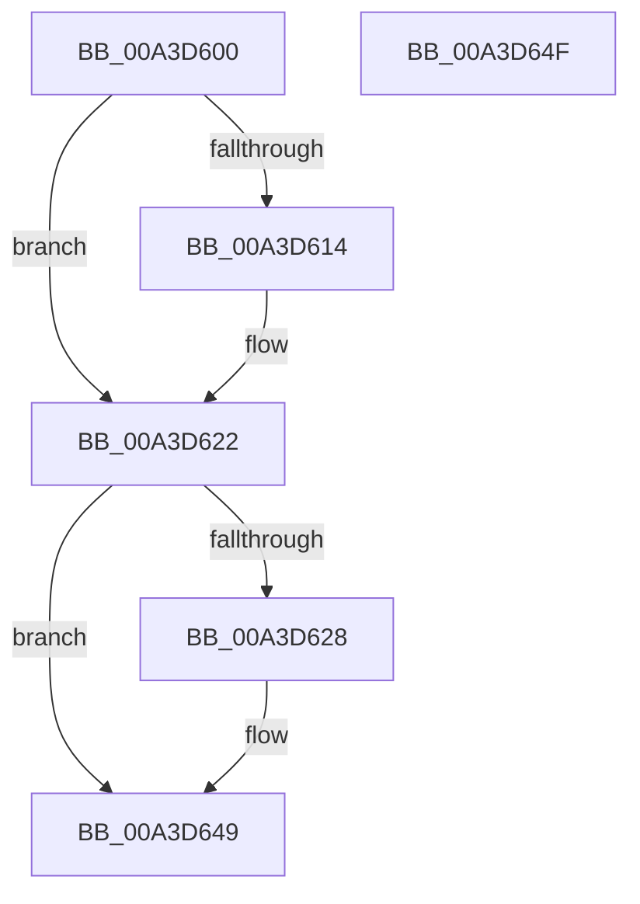

# BiReleasePrivilege

- RVA: `0x00A3D600`–`0x00A3D650` (길이 `80` bytes)
- VA: `0x0000000140A3D600`
- 실행 섹션: `PAGE`
- PDB 이름 있음: `예`; PDB Function 태그: `아니요`
- unwind 정보 RVA: `0x0005CF00`
- 디코드: `22`개 명령, `80/80` bytes 표시
- 미해석 바이트: `0` (있으면 어셈블리에 `.byte`로 보존)

> 이 문서는 커널 이미지의 기계어와 PDB 기호를 분석해 생성했습니다. 4번과 5번은 함수 원형과 자료형을 바이너리 사용 방식에서 추정한 C 해석이며 원본 소스 복구 결과는 아닙니다.

## 1. Dependencies

- 직접 호출 지점: **2**; 고유 호출 대상: **2**
- 직접 호출자로 확인된 함수: **13**
- RIP 상대 이미지 참조: **0**

### Outgoing calls
- `0x00A3D61D` → [BiAdjustPrivilege](BiAdjustPrivilege_function_00A3D708.md) (function, `0x00A3D708`)
- `0x00A3D644` → [ZwSetInformationThread](../../text/6A/ZwSetInformationThread_function_006AD270.md) (function, `0x006AD270`)

### Direct callers
- [BiAddBootEntry](../82/BiAddBootEntry_function_00826260.md) at `0x008262B9`
- [BiDeleteBootEntry](../82/BiDeleteBootEntry_function_00826AB0.md) at `0x00826B14`
- [BiModifyBootEntry](../82/BiModifyBootEntry_function_00826E80.md) at `0x00826ED3`
- [BiSetBootOptions](../82/BiSetBootOptions_function_00826FD0.md) at `0x00827027`
- [SiGetEspFromFirmware](../82/SiGetEspFromFirmware_function_008280C0.md) at `0x00828381`
- [BiSetBootEntryOrder](BiSetBootEntryOrder_function_00A3CC48.md) at `0x00A3CC8B`
- [BiDeleteEfiVariable](BiDeleteEfiVariable_function_00A3D2A8.md) at `0x00A3D35F`
- [BiTranslateFilePath](BiTranslateFilePath_function_00A3D534.md) at `0x00A3D5A6`
- [BiQueryBootEntryOrder](BiQueryBootEntryOrder_function_00A3DBD4.md) at `0x00A3DC92`
- [BiEnumerateBootEntries](../A4/BiEnumerateBootEntries_function_00A4074C.md) at `0x00A40828`
- [BiLoadHive](../A4/BiLoadHive_function_00A412F4.md) at `0x00A414DD`
- [BiLoadHive](../A4/BiLoadHive_function_00A412F4.md) at `0x00A41558`
- [sub_00B3A5EA](../B3/Unknown_function_00B3A5EA.md) at `0x00B3A60B`
- [sub_00B3AB32](../B3/Unknown_function_00B3AB32.md) at `0x00B3ABB6`

### Static image references
- 디코드된 RIP-relative 메모리 참조가 없습니다.

## 2. Other-region calls and transfers

- 다른 실행 섹션으로 향하는 call: **1**
  - `0x00A3D644` → [ZwSetInformationThread](../../text/6A/ZwSetInformationThread_function_006AD270.md) (`PAGE` → `.text`)
- 별도 외부 분기/꼬리 이동을 확인하지 못했습니다.

## 3. Assembly (complete function range)

```asm
00A3D600  40 53                           push rbx
00A3D602  48 83 EC 20                     sub rsp, 0x20
00A3D606  80 79 04 00                     cmp byte ptr [rcx + 4], 0
00A3D60A  48 8B D9                        mov rbx, rcx
00A3D60D  C6 44 24 30 00                  mov byte ptr [rsp + 0x30], 0
00A3D612  75 0E                           jne 0x140a3d622
00A3D614  8B 09                           mov ecx, dword ptr [rcx]
00A3D616  4C 8D 44 24 30                  lea r8, [rsp + 0x30]
00A3D61B  33 D2                           xor edx, edx
00A3D61D  E8 E6 00 00 00                  call 0x140a3d708
00A3D622  80 7B 05 00                     cmp byte ptr [rbx + 5], 0
00A3D626  75 21                           jne 0x140a3d649
00A3D628  48 83 64 24 30 00               and qword ptr [rsp + 0x30], 0
00A3D62E  4C 8D 44 24 30                  lea r8, [rsp + 0x30]
00A3D633  41 B9 08 00 00 00               mov r9d, 8
00A3D639  48 C7 C1 FE FF FF FF            mov rcx, 0xfffffffffffffffe
00A3D640  41 8D 51 FD                     lea edx, [r9 - 3]
00A3D644  E8 27 FC C6 FF                  call 0x1406ad270
00A3D649  48 83 C4 20                     add rsp, 0x20
00A3D64D  5B                              pop rbx
00A3D64E  C3                              ret
00A3D64F  CC                              int3
```

## 4. C-style interpretation (structured pseudocode)

```c
__int64 __fastcall BiReleasePrivilege(__int64 a1, int a2)
{
    __int64 result;
    __int64 v_rsp;
    unsigned __int8 v_stack_p8;

    v_rsp = (v_rsp) - (32);
    v_stack_p8 = 0;
    if ((*(unsigned __int8 *)(a1 + 4)) == 0) {
        a1 = *(unsigned int *)(a1);
        a3 = v_stack_p8;
        a2 = 0;
        result = BiAdjustPrivilege(a1, a2, a3, a4);
    }
    if ((*(unsigned __int8 *)(a1 + 5)) == 0) {
        a3 = v_stack_p8;
        a4 = 8;
        a1 = -2;
        a2 = a4 - 3;
        result = ZwSetInformationThread(a1, a2, a3, a4);
    }
    v_rsp = (v_rsp) + (32);
    return result;
}
```

## 5. (Beta) C Style

```c
int64_t BiReleasePrivilege(void *Arg1, int32_t Arg2)
{
    uint8_t *arg1 = (uint8_t *)Arg1;

    int64_t result;
    int64_t local_rsp;
    uint8_t v_stack_p8;

    local_rsp = (local_rsp) - (32);
    v_stack_p8 = 0;
    if ((*(uint8_t *)(arg1 + 0x4)) == 0) {
        Arg1 = *(uint32_t *)(arg1);
        a3 = v_stack_p8;
        Arg2 = 0;
        result = BiAdjustPrivilege(Arg1, Arg2, a3, a4);
    }
    if ((*(uint8_t *)(arg1 + 0x5)) == 0) {
        a3 = v_stack_p8;
        a4 = 8;
        Arg1 = -2;
        Arg2 = a4 - 3;
        result = ZwSetInformationThread(Arg1, Arg2, a3, a4);
    }
    local_rsp = (local_rsp) + (32);
    return result;
}
```

### 관측된 메모리 오프셋

구조체 형식이 확인되지 않은 접근은 인자 기준의 오프셋으로만 기록했습니다.

| 기준 인자 | 오프셋 표현 | 폭 (bit) | 접근 |
|---|---:|---:|---|
| `Arg1` | `+ 0x0` | `32` | `R` |
| `Arg1` | `+ 0x4` | `8` | `R` |
| `Arg1` | `+ 0x5` | `8` | `R` |

## 6. Execution-region graph

[열기: 2D/3D 그래프와 함수 탐색 컨트롤 패널](../../../control-panel.html?section=page&rva=0x00A3D600&view=graph)

- 2D 그래프는 위에서 아래로 흐르고, 3D 그래프는 빈 공간을 드래그해 회전합니다. Shift+드래그는 이동, 휠은 확대·축소, 함수 노드 선택은 대상 보고서 이동입니다.

### Static fallback


