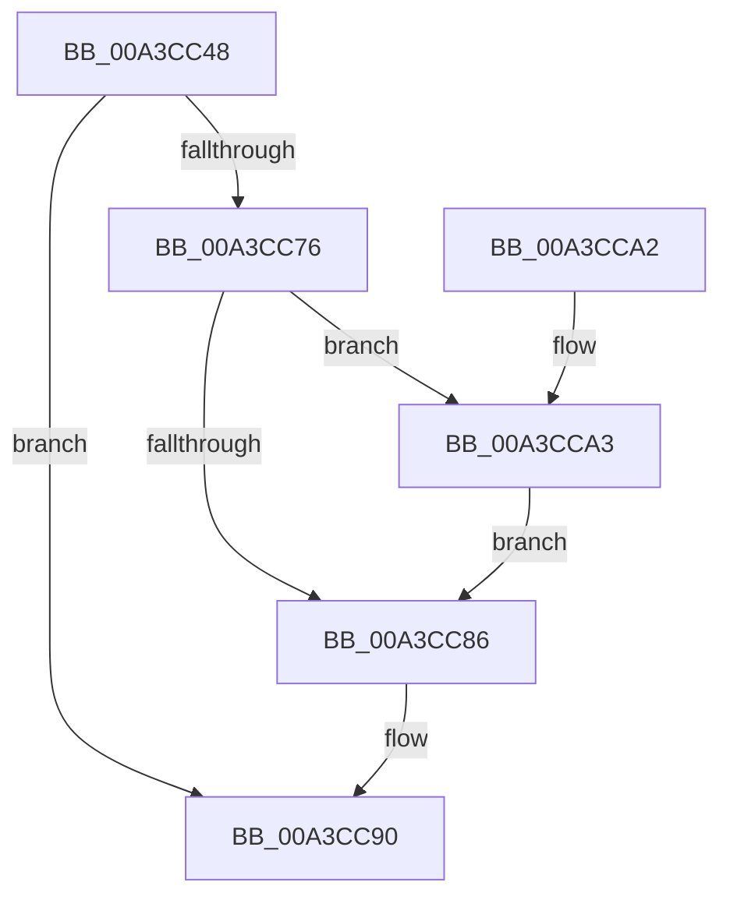

# BiSetBootEntryOrder

- RVA: `0x00A3CC48`–`0x00A3CCB9` (길이 `113` bytes)
- VA: `0x0000000140A3CC48`
- 실행 섹션: `PAGE`
- PDB 이름 있음: `예`; PDB Function 태그: `아니요`
- unwind 정보 RVA: `0x000AE4F4`
- 디코드: `34`개 명령, `113/113` bytes 표시
- 미해석 바이트: `0` (있으면 어셈블리에 `.byte`로 보존)

> 이 문서는 커널 이미지의 기계어와 PDB 기호를 분석해 생성했습니다. 4번과 5번은 함수 원형과 자료형을 바이너리 사용 방식에서 추정한 C 해석이며 원본 소스 복구 결과는 아닙니다.

## 1. Dependencies

- 직접 호출 지점: **4**; 고유 호출 대상: **4**
- 직접 호출자로 확인된 함수: **3**
- RIP 상대 이미지 참조: **1**

### Outgoing calls
- `0x00A3CC6B` → [BiAcquirePrivilege](BiAcquirePrivilege_function_00A3D658.md) (function, `0x00A3D658`)
- `0x00A3CC7B` → [ZwSetBootEntryOrder](../../text/6B/ZwSetBootEntryOrder_function_006B03B0.md) (function, `0x006B03B0`)
- `0x00A3CC8B` → [BiReleasePrivilege](BiReleasePrivilege_function_00A3D600.md) (function, `0x00A3D600`)
- `0x00A3CCB2` → [BiLogMessage](BiLogMessage_function_00A3D3A8.md) (function, `0x00A3D3A8`)

### Direct callers
- [BiAddBootEntryToNvramDisplayOrder](../82/BiAddBootEntryToNvramDisplayOrder_function_00826428.md) at `0x008264C7`
- [BiRemoveBootEntryFromNvramDisplayOrder](../82/BiRemoveBootEntryFromNvramDisplayOrder_function_00826EEC.md) at `0x00826F47`
- [BiExportEfiBootManager](../AC/BiExportEfiBootManager_function_00ACB13C.md) at `0x00ACB2B1`

### Static image references
- `0x00A3CCA6` → RVA `0x00B0CD00` (` ?? ::NNGAKEGL::`string'`; read)

## 2. Other-region calls and transfers

- 다른 실행 섹션으로 향하는 call: **1**
  - `0x00A3CC7B` → [ZwSetBootEntryOrder](../../text/6B/ZwSetBootEntryOrder_function_006B03B0.md) (`PAGE` → `.text`)
- 별도 외부 분기/꼬리 이동을 확인하지 못했습니다.

## 3. Assembly (complete function range)

```asm
00A3CC48  48 8B C4                        mov rax, rsp
00A3CC4B  48 89 58 08                     mov qword ptr [rax + 8], rbx
00A3CC4F  48 89 70 10                     mov qword ptr [rax + 0x10], rsi
00A3CC53  57                              push rdi
00A3CC54  48 83 EC 20                     sub rsp, 0x20
00A3CC58  48 83 60 18 00                  and qword ptr [rax + 0x18], 0
00A3CC5D  8B FA                           mov edi, edx
00A3CC5F  48 8B F1                        mov rsi, rcx
00A3CC62  48 8D 50 18                     lea rdx, [rax + 0x18]
00A3CC66  B9 16 00 00 00                  mov ecx, 0x16
00A3CC6B  E8 E8 09 00 00                  call 0x140a3d658
00A3CC70  8B D8                           mov ebx, eax
00A3CC72  85 C0                           test eax, eax
00A3CC74  78 1A                           js 0x140a3cc90
00A3CC76  8B D7                           mov edx, edi
00A3CC78  48 8B CE                        mov rcx, rsi
00A3CC7B  E8 30 37 C7 FF                  call 0x1406b03b0
00A3CC80  8B D8                           mov ebx, eax
00A3CC82  85 C0                           test eax, eax
00A3CC84  78 1D                           js 0x140a3cca3
00A3CC86  48 8D 4C 24 40                  lea rcx, [rsp + 0x40]
00A3CC8B  E8 70 09 00 00                  call 0x140a3d600
00A3CC90  48 8B 74 24 38                  mov rsi, qword ptr [rsp + 0x38]
00A3CC95  8B C3                           mov eax, ebx
00A3CC97  48 8B 5C 24 30                  mov rbx, qword ptr [rsp + 0x30]
00A3CC9C  48 83 C4 20                     add rsp, 0x20
00A3CCA0  5F                              pop rdi
00A3CCA1  C3                              ret
00A3CCA2  CC                              int3
00A3CCA3  44 8B C0                        mov r8d, eax
00A3CCA6  48 8D 15 53 00 0D 00            lea rdx, [rip + 0xd0053]
00A3CCAD  B9 04 00 00 00                  mov ecx, 4
00A3CCB2  E8 F1 06 00 00                  call 0x140a3d3a8
00A3CCB7  EB CD                           jmp 0x140a3cc86
```

## 4. C-style interpretation (structured pseudocode)

```c
__int64 __fastcall BiSetBootEntryOrder(__int64 a1, int a2)
{
    __int64 result;
    __int64 v_rsp;
    unsigned __int64 v_stack_p10;
    unsigned __int64 v_stack_p18;
    unsigned __int64 v_stack_p8;

    *(unsigned __int64 *)(v_rsp + 8) = v_rbx;
    *(unsigned __int64 *)(v_rsp + 16) = v_rsi;
    v_rsp = (v_rsp) - (32);
    result = BiAcquirePrivilege(22, v_rsp + 24, a3, a4);
    if (sign_flag) goto loc_00A3CC90;
    result = ZwSetBootEntryOrder(a1, (unsigned int)((unsigned int)((unsigned int)(a2))), a3, a4);
    if (sign_flag) goto loc_00A3CCA3;
loc_00A3CC86:
    result = BiReleasePrivilege(v_stack_p18, (unsigned int)((unsigned int)((unsigned int)(a2))), a3, a4);
loc_00A3CC90:
    v_rsp = (v_rsp) + (32);
    return (unsigned int)((unsigned int)((unsigned int)((unsigned int)(result))));
loc_00A3CCA3:
    result = BiLogMessage(4, v_rip + 852051, (unsigned int)((unsigned int)((unsigned int)((unsigned int)((unsigned int)((unsigned int)(result)))))), a4);
    goto loc_00A3CC86;
}
```

## 5. (Beta) C Style

```c
int64_t BiSetBootEntryOrder(int64_t Arg1, int32_t Arg2)
{
    int64_t result;
    int64_t local_rsp;
    uint64_t v_stack_p10;
    uint64_t v_stack_p18;
    uint64_t v_stack_p8;

    *(uint64_t *)(local_rsp + 0x8) = local_rbx;
    *(uint64_t *)(local_rsp + 0x10) = local_rsi;
    local_rsp = (local_rsp) - (32);
    result = BiAcquirePrivilege(22, local_rsp + 24, a3, a4);
    if (sign_flag) goto loc_00A3CC90;
    result = ZwSetBootEntryOrder(Arg1, (uint32_t)((uint32_t)((uint32_t)(Arg2))), a3, a4);
    if (sign_flag) goto loc_00A3CCA3;
loc_00A3CC86:
    result = BiReleasePrivilege(v_stack_p18, (uint32_t)((uint32_t)((uint32_t)(Arg2))), a3, a4);
loc_00A3CC90:
    local_rsp = (local_rsp) + (32);
    return (uint32_t)((uint32_t)((uint32_t)((uint32_t)(result))));
loc_00A3CCA3:
    result = BiLogMessage(4, v_rip + 852051, (uint32_t)((uint32_t)((uint32_t)((uint32_t)((uint32_t)((uint32_t)(result)))))), a4);
    goto loc_00A3CC86;
}
```

## 6. Execution-region graph

[열기: 2D/3D 그래프와 함수 탐색 컨트롤 패널](../../../control-panel.html?section=page&rva=0x00A3CC48&view=graph)

- 2D 그래프는 위에서 아래로 흐르고, 3D 그래프는 빈 공간을 드래그해 회전합니다. Shift+드래그는 이동, 휠은 확대·축소, 함수 노드 선택은 대상 보고서 이동입니다.

### Static fallback


